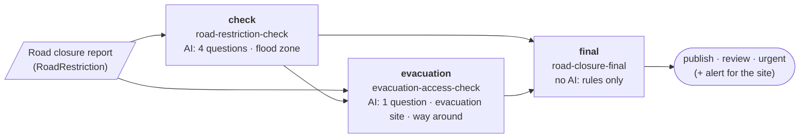

# Decision chains (design)

Status: **agreed design**, for #101 (agreed points of 2026-10-20 at the
end). Nothing here is built yet.

A decision can build on earlier decisions: the report is evaluated, more
checks run, and a final decision uses all of it. This document says how a
profile names the decisions it builds on, what its rules can read from them,
who runs the chain, what happens when a person reviews a step, and how
people see it.

## The idea in one picture

The FIWARE demo today (#66) has two checks whose results stay side by side.
With chains, a third, final decision combines them:



Each box is one decision with its own profile, its own decision log row and
its own Decision entity. An arrow means "uses the result of".

## Words from DMN, rules of our own

DMN (Decision Model and Notation, OMG) describes this structure as a
*decision requirements graph*: **decisions**, the **input data** they read,
and **information requirements** between them (decision B requires decision
A). We use these concepts and their names, so the graph can be shown in DMN
tools and read by people who know DMN.

We do **not** run DMN decision logic. The spike on DMN decision tables (#13,
[spikes/dmn-policy-tables.md](spikes/dmn-policy-tables.md)) found that FEEL
tables work in a Worker but add about 25 % to the Worker, need their own
validation, and read worse than our one-line rules for small profiles. Each
decision keeps its questions, facts and threshold rules as today.

| DMN (1.3 and later) | Pointsman |
|---|---|
| `decision` (with `question`, `allowedAnswers`) | a profile, decided once per entity: one decision log row, one Decision entity. `question` = the profile's description, `allowedAnswers` = its actions |
| `inputData` | the state's fields the profile reads, and each fact (named after the fact) |
| `informationRequirement` → `requiredDecision` | `requires` in the profile (below) |
| `businessKnowledgeModel` + `knowledgeRequirement` | the profile's AI questions and model (DMN uses these for analytic models; we export it without logic) |
| `knowledgeSource` + `authorityRequirement` | the data sources behind the facts (GSI, OpenStreetMap) and the profile document, with `locationURI` |
| `decisionService` with `inputDecision`s | a profile with `requires`: the required decisions' results are given to it, not evaluated by it (see "Who runs the chain") |
| Decision logic (FEEL, decision tables) | **not used**: questions, facts and `policy.rules` as today |

## In the profile

### `requires`

A profile names the decisions it builds on. Each has a local name (used in
rules) and the profile it must come from:

```yaml
id: road-closure-final
version: 1
requires:
  - { name: check, profile: road-restriction-check }
  - { name: evacuation, profile: evacuation-access-check, optional: true }
facts:
  - { name: flood, type: inside, layer: gsi-flood-max, at: $.location.value }
policy:
  rules:
    - when: "decisions.evacuation.action == 'alert'"
      action: urgent
    - when: "decisions.check.outcome == 'urgent'"
      action: urgent
    - when: "decisions.check.outcome == 'publish' and facts.flood.rank < 5"
      action: publish
    - when: "decisions.check.outcome == 'reject'"
      action: reject
  default: review
  people_check: [review, urgent]
```

- `optional: true`: the decision may not exist. In the demo the evacuation
  check runs only for urgent and review reports; a published report has none.
- A profile with `requires` may have **no questions**: the decision is then
  rules only, with no model call. It is logged with the model `none`, and no
  model adapter is needed. Without `requires`, a profile still needs at
  least one question.
- A required profile may itself require others. Cycles are refused when
  profiles are validated.
- `decisions` is reserved, like `facts`: no question may be named
  `decisions` or start with `decisions.`.

### `people_check`: the actions a person checks

`policy.people_check` lists the actions a person looks at before they count
(default: `[review]`, as today). Pointsman opens a review for each decision
whose action is in the list, and records the person's answer
(`final_action`) when the review is resolved. Today only `review` opens a
review; a correction of an `urgent` report reaches Pointsman only as
feedback, so a later decision could not see it. With `people_check`, the
bridge resolves those reviews the way it resolves `review` today (its
`reviewActions` follow the profile).

### What rules can read

`decisions.<name>.<field>`, checked when the profile is validated against
the required profile:

| Field | Type | Meaning |
|---|---|---|
| `missing` | boolean | no such decision was given (only for `optional`); always known |
| `action` | text, one of the required profile's actions | the automatic action |
| `outcome` | text | what counts now: the person's answer when a review of it was resolved, otherwise the automatic action |
| `reviewed` | boolean | a person has resolved a review of it |
| `answers.<question>.<field>` | as for questions | the required decision's answers (`value`, `p`, `yes`, …) |
| `facts.<fact>.<field>` | as for facts | the required decision's facts |

A profile's own questions are read as `<question>.<field>`; another
decision's as `decisions.<name>.answers.<question>.<field>`.

Unknown values work as for facts today: a comparison with a missing decision
or a value that is not there is *unknown*, `missing == true` is always known,
and a rule matches only when its condition is true. A field of another type
than the profile was validated against (an older version of the required
profile) is also *unknown*, never an error.

The rule's index is not readable: index 0 can be a different rule in
another version. Rules use the action or outcome instead.

This is what #101 asks for: **the map checks count in the final decision**,
from the decision that looked them up (`decisions.evacuation.facts.walk.extra_m`)
or looked up again by the final profile itself (`facts.flood.rank`).

### Checked both ways

- A profile with `requires` is checked against the required profiles when it
  is validated: they must be in the same set of profiles (the folder that
  is validated or published), every field its rules read must exist with
  the right type, and every action it compares with must be one the
  required profile can give.
- Publishing a new version of a required profile checks every profile that
  requires it, so a question, fact or action it removes or changes fails the
  publish in CI and names the profile to update.
- A decision of an older version that lacks a field gives *unknown* at run
  time.

## In the request: decisions by id, read from the log

The client names the earlier decisions by id; Pointsman reads them from its
own decision log:

```json
POST /v1/decide/road-closure-final
{
  "state": { "...": "the entity" },
  "ref": "urn:ngsi-ld:RoadRestriction:demo-…",
  "decisions": { "check": "1f0c…", "evacuation": "8a2d…" }
}
```

- **Read, not trusted.** The client sends only ids. The action, outcome,
  answers and facts come from the decision log, so a client cannot make a
  final decision "urgent" by claiming the first one was.
- **The names fit the profile.** Every non-optional name of `requires` must
  be given, no other name, and no id twice.
- **`ref` is required** when `decisions` is sent.
- **Each id must be usable:** a logged decision of the named profile, in the
  token's scope, with the same `ref`, from the same client. Client names
  are unique (`tokens.mjs` refuses a second token with a name in use).
  Every reason gives **the same answer** (`400`, "decisions.check is not a
  usable decision"), so a caller cannot find out which decisions exist
  (`P-TOKEN-SCOPE`).
- **The decisions fit each other.** If a required decision itself required
  one that is also given (the evacuation check required `check`), the ids
  must match: an old evacuation result cannot be combined with a new check.
- **Test tokens may not send `decisions`** (`400`). Their decisions are not
  logged, so they cannot have any, and they must not read logged decisions
  (`P-TEST-TOKEN-ISOLATED`).
- MCP's `decide` tool gets the same `decisions` input; tokens and people go
  through the same checks.

### What is logged

The new decision row stores what its rules read from each required
decision, at the moment it was decided:

```json
"requires": {
  "check": { "decision": "1f0c…", "profile_version": 2, "action": "review", "outcome": "urgent", "reviewed": true },
  "evacuation": { "decision": "8a2d…", "profile_version": 2, "action": "alert", "outcome": "alert", "reviewed": false }
}
```

This is the trace of the chain for this decision: direct requirements only,
taken when it was decided (a later review of a required decision does not
change it; the final step runs again instead, below). The names follow
Apache KIE and Camunda traces where they fit (see "Standards considered").

`GET /v1/decisions/{id}` returns `requires` filtered by the reader's scope:
a required decision of a profile the reader may not see is shown as
`{ "decision": null }`, as if unknown. The Decision entity gets one
`wasInformedBy` per required decision.

### Who runs the chain

**The caller orchestrates, the engine checks.** In DMN terms, each profile
with `requires` is a *decision service* whose required decisions are *input
decisions*: given to it, not evaluated by it. DMN engines (Apache KIE,
Camunda) usually evaluate a whole graph in one call; we split it on purpose:
a step can wait for a person, and each step has its own time limits and log
row. For FIWARE the caller is the bridge, driven by subscriptions, as for
the evacuation check today.

## Reviews in the chain, and running again

Agreed point 1: the final step decides **at once** on the automatic results
(an urgent alert is not delayed), and **again** when a person resolves a
required decision.

- **What starts it again.** The bridge's loop guard (the hash of the
  inputs) includes, for a required attribute, its decision id and
  `finalAction`, so a resolved review is a new input and the final route
  runs again. The rules read `outcome`, which now holds the person's answer.
- **The new final decision replaces the older ones** for the same profile,
  `ref` and client:
  - "Latest" is the newest `created_at` in the decision log. The bridge
    writes the result attribute only when its decision is newer than the
    one already there, so two runs finishing out of order cannot leave the
    older one.
  - An older final decision whose review is still open gets the review
    status `superseded`: it leaves the review queue, and the bridge closes
    its Task.
  - The new Decision entity links the one it replaces (`wasRevisionOf`).
  - An alert that was already sent stays sent (agreed point 2): the
    evacuation site's staff were told; the new decision is shown as
    replacing the earlier one, without an all-clear message.
- **No loop.** A run again happens only when a required decision changes
  (a new id, or a review resolved). The final step's own result is not an
  input of any route that it requires.

## In the bridge

A route lists what it requires, by the attribute where that decision's
result is:

```json
{ "type": "RoadRestriction", "profile": "road-closure-final", "name": "final",
  "inputs": ["description", "check", "evacuation"], "attribute": "final",
  "requires": { "check": "check", "evacuation": "evacuation" }, "decisionEntity": true }
```

- The bridge reads each required attribute's `decisionId` and sends it in
  `decisions`. A name the profile does not require is refused by Pointsman.
  This replaces `informedBy`, which keeps working as a route with a single
  requirement until the routes are moved over.
- **When to run:** when all non-optional required decisions are there, and
  each optional one is either there or will not come. "Will not come" is
  the subscription's `q` (in the demo: `check` is `publish`, or
  `evacuation` is set); the bridge does not guess it.
- Routes that require each other in a circle (through their attributes) are
  refused when the routes are read.
- The Decision entity gets one `wasInformedBy` per required decision (an
  NGSI-LD Relationship with several instances, one `datasetId` each) and the
  list of names (`requiredDecisions`), in the datamodels.jp Decision model
  (geolonia/datamodels#302).
- Work orders (#85) resolve only the type's main route; a review of the
  final route is resolved in the broker or the review queue.

## In the demo

Agreed point 6: the page shows three stages, **first result → additional
checks → final result**; the first two marked as intermediate, the final
one as the headline, each with what it was based on. Apps (the residents'
map) read the report's `final` attribute. The developer view's diagram gets
the third decision.

## The graph for DMN tools

`GET /v1/profiles/{id}/graph` returns the graph a profile belongs to, as
JSON whose nodes and edges use the DMN names, so the DMN XML is a direct
serialization of it:

```json
{ "nodes": [
    { "id": "decision_road-closure-final", "type": "decision", "name": "final", "profile": "road-closure-final", "version": 1, "allowedAnswers": ["publish", "review", "urgent", "reject"] },
    { "id": "input_location", "type": "inputData", "name": "location" },
    { "id": "bkm_road-restriction-check", "type": "businessKnowledgeModel", "name": "AI questions" },
    { "id": "ks_gsi", "type": "knowledgeSource", "name": "GSI (flood zones, evacuation sites)", "locationURI": "https://disaportal.gsi.go.jp/" } ],
  "edges": [
    { "type": "informationRequirement", "from": "decision_road-restriction-check", "to": "decision_road-closure-final", "optional": false },
    { "type": "knowledgeRequirement", "from": "bkm_road-restriction-check", "to": "decision_road-restriction-check" },
    { "type": "authorityRequirement", "from": "ks_gsi", "to": "decision_road-restriction-check" } ] }
```

and as **DMN 1.3 XML** (`https://www.omg.org/spec/DMN/20191111/MODEL/`):
only the decision requirements diagram (no decision logic), **with DMNDI**
shapes and edges (a simple layered layout, which the demo reuses), ids as
NCNames (`decision_…`, `input_…`), and the profile version and `optional` in
`extensionElements`. DMN 1.3, because it is the version that bpmn.io
dmn-js, Camunda Modeler, Apache KIE and Trisotech all open; without DMNDI,
dmn-js does not lay the graph out. The export is checked by opening it in
those tools. Optional, after the rest.

NGSI-LD 1.8 *linked entity retrieval* (`join=inline&joinLevel=2`) can fetch
the chain of Decision entities in one request; broker support (GeonicDB,
Orion-LD, Scorpio) is checked in the compliance testbed before the demo
relies on it.

## The rule language

Conditions stay our own small language (`src/policy.ts`), now with
`decisions.*`. It is **not** a subset of S-FEEL or CEL (FEEL compares with
`=`, CEL combines with `&&`, and our names contain `-`). Most conditions
translate directly; **missing values** need care: in our rules a
comparison with a missing value is *unknown*, while in FEEL `null = "x"` is
false (so `a != "x"` is true) and in CEL a missing field is an error. A
translation therefore guards each reference. The docs get a semantics note
and this mapping:

| Ours | FEEL | CEL |
|---|---|---|
| `a == 'x'` | `a != null and a = "x"` | `has(a) && a == "x"` |
| `a != 'x'` | `a != null and a != "x"` | `has(a) && a != "x"` |
| `x and y`, `x or y` | `x and y`, `x or y` | `x && y`, `x \|\| y` |
| `not x` | `not(x)` | `!x` |
| `decisions.check.outcome` | `decisions.check.outcome` (context path) | `decisions.check.outcome` |

## Threat model

The design adds an input that reads other decisions. The threat model gets:

- `P-TOKEN-SCOPE`: a decide request can read a logged decision only within
  the token's scope, with the same `ref` and client, and every refusal looks
  the same; `GET` filters `requires` by the reader's scope.
- `P-TEST-TOKEN-ISOLATED`: test tokens cannot send `decisions`.
- A new property: a decision's `requires` records what its rules read from
  other decisions, at decide time.
- The review status `superseded`, and that an alert already sent is not
  taken back.

## Steps

1. **Engine:**
   - `requires`, `policy.people_check`, zero questions with `requires`
     (model `none`), the reserved name `decisions`, in the profile format,
     schema and validation (checked both ways, cycles);
   - `decisions.*` in conditions;
   - `decisions` in the decide request and the MCP tool, with the checks
     above; the snapshot `requires` in the log (D1 migration 0006) and in
     `GET`, filtered by scope;
   - reviews for every `people_check` action; the review status
     `superseded`;
   - unique client names in `tokens.mjs`;
   - docs, OpenAPI, threat model, tests, an example profile.
2. **datamodels.jp:** the Decision model with several `wasInformedBy`,
   `requiredDecisions` and `wasRevisionOf` (geolonia/datamodels#302).
3. **Bridge:** `requires` on routes, the loop guard with `finalAction`,
   writes only when newer, closing the Task of a superseded decision,
   route cycles.
4. **pointsman-config:** the `road-closure-final` profile and its route.
5. **Demo:** three stages, the third decision in the developer view.
6. **Later:** the graph endpoint and the DMN 1.3 export (with DMNDI); a
   table view of rules (the spike's suggestion); `join` support check.

## Standards considered

Checked on 2026-10-20. Used where they fit, recorded where not:

| Candidate | Status | Used? | Why |
|---|---|---|---|
| OMG DMN, decision requirements graph | 1.6 is the current formal version; tools read 1.3 | **Yes**: names and the export | The graph structure is exactly ours; see the mapping above |
| DMN decision logic (FEEL, S-FEEL, tables) | Same | No | Spike #13: +25 % Worker size, separate validation; our rules read better at this size |
| DMN TCK | Active (Apache-2.0) | No | Tests decision logic, which we do not export |
| Apache KIE (Drools/Kogito) DMN, Camunda DMN | Mature engines | Names only | They run the whole graph in one call; we take their trace field names |
| W3C PROV-O | Recommendation | **Yes** (already) | `wasInformedBy` per requirement, `wasRevisionOf` for a replaced decision |
| NGSI-LD Relationships, linked entity retrieval (1.8) | ETSI GS CIM 009 | **Yes** | Links between Decision entities; one request for the chain (after a broker check) |
| Smart Data Models `Alert` | Maintained | **Yes** (already) | The alert of the evacuation check |
| Google CEL | Active (Kubernetes) | No | Well specified, but about 82 KB in the Worker and its own type environment |
| JsonLogic | Little activity | No | Untyped JSON trees, hard to read in YAML |
| OPA / Rego | Mature (CNCF) | No | A policy language for sets and data; far too large for threshold rules |
| CNCF Serverless Workflow, BPMN | Active / mature | No | Workflow languages for an orchestrator; our chain is driven by subscriptions |
| OpenLineage | Active | No | Data lineage for jobs; nothing in FIWARE reads it |
| CloudEvents | CNCF graduated | Not now | For decision events to callers outside FIWARE, later |
| FIWARE Perseo (CEP) | Maintained, NGSI-v2, AGPL | No | Event correlation rules, not decisions with a model; a separate server |
| A Smart Data Models "Decision" or "Rule" | Does not exist | — | Our Decision model stays our own ([decision-model-standards.md](decision-model-standards.md)) |

## Agreed points (2026-10-20)

1. **Reviews in the chain:** the final step decides at once on the automatic
   results and again when a person resolves a required decision; the
   newest final decision counts (see "Reviews in the chain, and running
   again").
2. **Replaced results:** an older final decision's open review and Task are
   closed; an alert already sent stays sent.
3. **Same report:** required decisions must have the same `ref` and come
   from the same client; test tokens cannot send `decisions`.
4. **Versions:** checked both ways when profiles are validated and
   published.
5. **People's answers for any action:** a profile lists the actions a
   person checks (`people_check`); chained rules read the person's answer
   as `outcome`.
6. **Demo:** three stages, the final result as the headline.
