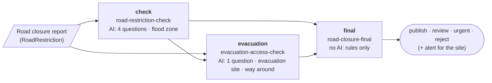

# Decision chains (design)

Status: **agreed design**, for #101 (agreed points of 2026-10-20 at the
end). Built: the engine (#107), the bridge (#108) and the graph for DMN
tools (below); the demo shows it.

A decision can build on earlier decisions: the report is evaluated, more
checks run, and a final decision uses all of it. This document says how a
profile names the decisions it builds on, what its rules can read from them,
who runs the chain, what happens when a person reviews a step, and how
people see it.

## The idea in one picture

The FIWARE demo today (#66) has two checks whose results stay side by side.
With chains, a third, final decision combines them:



Each box is one decision with its own profile, its own decision log row and
its own Decision entity. An arrow means "uses the result of".

## Words from DMN, rules of our own

DMN (Decision Model and Notation, OMG) describes this structure as a
*decision requirements graph*: **decisions**, the **input data** they read,
and **information requirements** between them (decision B requires decision
A). We use these concepts and their names, so the graph can be shown in DMN
tools and read by people who know DMN.

We do **not** run DMN decision logic. The spike on DMN decision tables (#13,
[spikes/dmn-policy-tables.md](spikes/dmn-policy-tables.md)) found that FEEL
tables work in a Worker but add about 25 % to the Worker, need their own
validation, and read worse than our one-line rules for small profiles. Each
decision keeps its questions, facts and threshold rules as today.

| DMN (1.3 and later) | Pointsman |
|---|---|
| `decision` (with `question`, `allowedAnswers`) | a profile. Each time it is decided for an entity there is one decision log row and one Decision entity; a run again gives a new one, which `replaces` the earlier one. `question` = the profile's description, `allowedAnswers` = its actions and the answers a person may give (`people_answers`, below) |
| `inputData` | the state's fields the profile reads, and each fact (named after the fact) |
| `informationRequirement` → `requiredDecision` | `requires` in the profile (below) |
| `businessKnowledgeModel` + `knowledgeRequirement` | the profile's AI questions and model (DMN uses these for analytic models; we export it without logic) |
| `knowledgeSource` + `authorityRequirement` | the data sources behind the facts (GSI, OpenStreetMap) and the profile document, with `locationURI` |
| `decisionService` with `inputDecision`s | a profile with `requires`: the required decisions' results are given to it, not evaluated by it (see "Who runs the chain") |
| Decision logic (FEEL, decision tables) | **not used**: questions, facts and `policy.rules` as today |

## In the profile

### `requires`

A profile names the decisions it builds on. Each has a local name (used in
rules) and the profile it must come from:

```yaml
id: road-closure-final
version: 1
requires:
  - { name: check, profile: road-restriction-check }
  - { name: evacuation, profile: evacuation-access-check, optional: true }
model: none
questions: []
policy:
  rules:
    - when: "decisions.check.outcome == 'reject'"
      action: reject
    - when: "decisions.evacuation.outcome == 'alert'"
      action: urgent
    - when: "decisions.check.outcome == 'urgent'"
      action: urgent
    - when: "decisions.check.outcome == 'publish'"
      action: publish
  default: review
  people_check: []
```

As built (examples/profiles/road-closure-final.yaml): a person's `reject`
comes first, also over an alert; an alert counts when a person gave it on
the evacuation check's review too (`outcome`, not `action`). The flood zone
is checked in the first step, which sends a report in a deep flood zone to a
person before it can be published: so `default: review` always means "the
first step's review is still open", and answering it runs the final step
again. A first version read the flood zone here, which left reports at
`review` with nobody to answer them.

The final profile has no `people_check` of its own: people check the first
step (its profile lists `people_check: [review, urgent]` and
`people_answers: [publish, reject]`), and the final step only applies rules.
So one report never waits for two people.

- `optional: true`: the decision may not exist. In the demo the evacuation
  check runs only for urgent and review reports; a published report has none.
- A profile with `requires` may have **no questions**: the decision is then
  rules only, with no model call. It is logged with the model `none`, and no
  model adapter is needed. Without `requires`, a profile still needs at
  least one question.
- A required profile may itself require others. Cycles are refused when
  profiles are validated.
- `decisions` is reserved, like `facts`: no question may be named
  `decisions` or start with `decisions.`.

### `people_check` and `people_answers`: what a person checks and may answer

- `policy.people_check` lists the actions a person looks at before they
  count (default: `[review]`, as today). Pointsman opens a review for each
  decision whose action is in the list, and records the person's answer
  (`final_action`) when the review is resolved. Today only `review` opens a
  review; a correction of an `urgent` report reaches Pointsman only as
  feedback, so a later decision could not see it.
- `policy.people_answers` lists the answers a person may give (default:
  the profile's actions without `review`, plus `reject`). Resolving a
  review with another answer is refused (`400`); today any lower-case word
  is accepted. So the values of `outcome` are known when profiles are
  validated.
- The decide response says when a review was opened (`review: { "status":
  "pending" }`). The bridge creates the Task and resolves the review from
  that, instead of its own `reviewActions` setting. `reviewActions` keeps
  working for profiles without `people_check` while routes are moved over.
  Migration note: a route with `reviewActions: ["review", "urgent"]` needs
  its profile to list `people_check: [review, urgent]`; the bridge then
  resolves `urgent` as a review, not as feedback.

### What rules can read

`decisions.<name>.<field>`, checked when the profile is validated against
the required profile:

| Field | Type | Meaning |
|---|---|---|
| `missing` | boolean | no such decision was given (only for `optional`); always known |
| `action` | text, one of the required profile's actions | the automatic action |
| `outcome` | text, one of the required profile's actions or `people_answers` | what counts now: the person's answer when a review of it was resolved, otherwise the automatic action |
| `reviewed` | boolean | a person has resolved a review of it |
| `answers.<question>.<field>` | as for questions | the required decision's answers (`value`, `p`, `yes`, …): a person's corrected answers when the review was resolved with corrections, otherwise the model's |
| `facts.<fact>.<field>` | as for facts | the required decision's facts |

A profile's own questions are read as `<question>.<field>`; another
decision's as `decisions.<name>.answers.<question>.<field>`.

Unknown values work as for facts today: a comparison with a missing decision
or a value that is not there is *unknown*, `missing == true` is always known,
and a rule matches only when its condition is true. A field of another type
than the profile was validated against (an older version of the required
profile) is also *unknown*, never an error.

The rule's index is not readable: index 0 can be a different rule in
another version. Rules use the action or outcome instead.

This is what #101 asks for: **the map checks count in the final decision**,
from the decision that looked them up (`decisions.evacuation.facts.walk.extra_m`),
or, as in the demo, through the earlier decisions' results (the evacuation
check's alert; the first check sends deep flood zones to a person). A final
profile could also look up facts of its own (`facts.flood.rank`); then every
action it leaves a report at needs a way out (see the example above).

### Checked both ways

- A profile with `requires` is checked against the required profiles when it
  is validated: they must be in the same set of profiles (the folder that
  is validated or published), every field its rules read must exist with
  the right type, and every action or answer it compares with must be one
  the required profile can give (its actions and `people_answers`).
- Publishing a new version of a required profile checks every profile that
  requires it, so a question, fact or action it removes or changes fails the
  publish in CI and names the profile to update.
- A decision of an older version that lacks a field gives *unknown* at run
  time.

## In the request: decisions by id, read from the log

The client names the earlier decisions by id; Pointsman reads them from its
own decision log:

```json
POST /v1/decide/road-closure-final
{
  "state": { "...": "the entity" },
  "ref": "urn:ngsi-ld:RoadRestriction:demo-…",
  "decisions": { "check": "1f0c…", "evacuation": "8a2d…" }
}
```

- **Read, not trusted.** The client sends only ids. The action, outcome,
  answers and facts come from the decision log, so a client cannot make a
  final decision "urgent" by claiming the first one was.
- **The names fit the profile.** Every non-optional name of `requires` must
  be given, no other name, and no id twice.
- **`ref` is required** when `decisions` is sent.
- **Each id must be usable:** a logged decision of the named profile, in the
  token's scope, with the same `ref`, from the same client. Client names
  are unique (`tokens.mjs` refuses a second token with a name in use).
  Every reason gives **the same answer** (`400`, "decisions.check is not a
  usable decision"), so a caller cannot find out which decisions exist
  (`P-TOKEN-SCOPE`).
- **The decisions fit each other.** If a required decision itself required
  one that is also given (the evacuation check requires `check`), the ids
  must match: an old evacuation result cannot be combined with a new check.
  For an `optional` requirement such a decision is **left out**, as if it
  had not run (agreed point 8): it was made for an earlier state of the
  report, and the step is decided from the current decisions; it runs again
  when the later decision is made for the new check. A non-optional one is
  refused (`400`, the same answer as above).
- **Not replaced decisions only.** A required decision that was itself
  replaced (`superseded`, below) is refused with the same answer.
- **Test tokens may not send `decisions`** (`400`). Their decisions are not
  logged, so they cannot have any, and they must not read logged decisions
  (`P-TEST-TOKEN-ISOLATED`). So a chained profile cannot be tried with a
  test token; the weekly examples check covers single profiles.
- MCP's `decide` tool gets the same `decisions` input; tokens and people go
  through the same checks. MCP's `get_decision` also hides required
  decisions of profiles that are not `mcp.visible` to the caller.

### What is logged

The new decision row stores what its rules read from each required
decision, at the moment it was decided:

```json
"requires": {
  "check": { "decision": "1f0c…", "profile_version": 2, "action": "review", "outcome": "urgent", "reviewed": true,
             "read": { "outcome": "urgent", "answers.danger.yes": 0.81 } },
  "evacuation": { "decision": "8a2d…", "profile_version": 2, "action": "alert", "outcome": "alert", "reviewed": false,
                  "read": { "action": "alert" } }
}
```

`read` holds every value the profile's rules read from that decision (all
rules, not only the matching one), so the log explains the result even
after later corrections.

This is the trace of the chain for this decision: direct requirements only,
taken when it was decided (a later review of a required decision does not
change it; the final step runs again instead, below). The names follow
Apache KIE and Camunda traces where they fit (see "Standards considered").

`GET /v1/decisions/{id}` returns `requires` filtered by the reader's scope:
a required decision of a profile the reader may not see is shown as
`{ "decision": null }` with no other fields, as if unknown; MCP's
`get_decision` does the same (and also hides profiles that are not
`mcp.visible`). These are Pointsman's own answers, so Pointsman filters
them. The Decision entity in the broker is written by the caller, which
already knows the ids it sent; who may read it is the broker's access
control, as for every entity there. It gets one `wasInformedBy` per
required decision.

### Who runs the chain

**The caller orchestrates, the engine checks.** In DMN terms, each profile
with `requires` is a *decision service* whose required decisions are *input
decisions*: given to it, not evaluated by it. DMN engines (Apache KIE,
Camunda) usually evaluate a whole graph in one call; we split it on purpose:
a step can wait for a person, and each step has its own time limits and log
row. For FIWARE the caller is the bridge, driven by subscriptions, as for
the evacuation check today.

## Reviews in the chain, and running again

Agreed point 1: the final step decides **at once** on the automatic results
(an urgent alert is not delayed), and **again** when a person resolves a
required decision.

- **What starts it again.** For a requirement with `rerunOnReview: true` in
  the route (default `false`), the bridge's loop guard (the hash of the
  inputs) includes the required attribute's decision id, `finalAction` and
  `reviewedAt`, so a resolved review is a new input and the route runs
  again, also when the person only corrected answers. The rules
  read `outcome`, which now holds the person's answer. In the demo the
  final route sets it for `check` and `evacuation` (a person may answer
  either); the evacuation route does not set it for `check`, so a resolved
  check does not run the evacuation check (and its alert) twice.
- **A person's answer stays** (agreed point 7). A final decision that a
  person has resolved is never replaced: a decide request that would
  replace it is refused (`409`, code `resolved_by_person`). The bridge
  treats only that code as done (it logs it and acknowledges the message).
  `idempotency_conflict` is not retried: sending the same request again
  cannot succeed, so the message goes to the dead-letter queue at once.
  There an operator either fixes the request and sends it with a new key,
  or restores the original request (whose digest matches) and replays it.
  Every other error is retried as usual and ends in the dead-letter queue
  when the retries run out.
- **The new final decision replaces the older ones** for the same profile,
  `ref` and client, for profiles with `requires` only (other profiles keep
  today's behaviour):
  - "Latest" is the newest `created_at` in the decision log. Routes with
    `requires` run from the bridge's queue one message at a time
    (`max_concurrency` 1), so two runs for the same report never overlap
    and the newer one is always written last; the inline path without a
    queue is refused for them. In addition the bridge writes the result
    attribute only when its decision is newer than the `observedAt` of the
    one already there (NGSI-LD has no conditional update, so this check
    alone would not be enough).
  - An older final decision whose review is still open gets the review
    status `superseded`: it leaves the review queue (no callback is sent
    for it), the bridge closes its Task, and the stats count it as
    replaced, not as reviewed.
  - The new Decision entity links the one it replaces (`replaces`,
    Dublin Core `dcterms:replaces`; PROV-O's `wasRevisionOf` links
    entities, and a Decision is a PROV activity).
  - An alert that was already sent stays sent (agreed point 2): the
    evacuation site's staff were told; the new decision is shown as
    replacing the earlier one, without an all-clear message.
- **Order and failures.** For each run the bridge (1) asks Pointsman,
  which logs the decision, (2) creates the Decision entity, (3) creates or
  closes Tasks, and (4) writes the result attribute last. A failure in a
  later step leaves the message on the queue, which tries again. The
  bridge sends an idempotency key with the decide request (the route, the
  entity and the hash of its inputs). Pointsman keeps, with the decision,
  a digest of the request (profile, the version as requested, state,
  `ref`, `decisions`, `callback_url`). A repeated key from the same client with the same digest
  gets the decision already logged, so a retry never decides twice; the
  same key with another digest is refused (`409`, code
  `idempotency_conflict`). Steps 2 to 4 are written so that doing them
  again is harmless (the entity ids come from the decision id). A message that still
  fails after the retries goes to the dead-letter queue, from where it can
  be replayed with the same key.
- **No loop.** A run again happens only when a required decision changes
  (a new id, or a review resolved). The final step's own result is not an
  input of any route that it requires.

## In the bridge

A route lists what it requires, by the attribute where that decision's
result is:

```json
{ "type": "RoadRestriction", "profile": "road-closure-final", "name": "final",
  "inputs": ["description", "check", "evacuation"], "attribute": "final",
  "requires": { "check": { "attribute": "check", "rerunOnReview": true },
                "evacuation": { "attribute": "evacuation", "optional": true, "rerunOnReview": true } },
  "decisionEntity": true }
```

- The bridge reads each required attribute's `decisionId` and sends it in
  `decisions`. A name the profile does not require is refused by Pointsman.
  This replaces `informedBy`, which keeps working as a route with a single
  requirement. The demo's evacuation check moved over on 2026-10-21
  (`evacuation-access-check` version 4 requires `check`), so Pointsman knows
  the order of the three steps and the graph shows it.
- **When to run:** when all non-optional required decisions are there, and
  each optional one is either there or will not come. "Will not come" is
  the subscription's `q` (in the demo: `check` is `publish`, or
  `evacuation` is set); the bridge does not guess it.
- Routes that require each other in a circle (through their attributes) are
  refused when the routes are read.
- The Decision entity gets one `wasInformedBy` per required decision (an
  NGSI-LD Relationship with several instances, one `datasetId` each) and the
  list of names (`requiredDecisions`), in the datamodels.jp Decision model
  (geolonia/datamodels#302).
- Work orders (#85) resolve only the type's main route; a review of the
  final route is resolved in the broker or the review queue.
- A rules-only decision is written with the model `none` on the entity and
  the Decision entity, like any model id.

## In the demo

Agreed point 6: the page shows three stages, **first result → additional
checks → final result**; the first two marked as intermediate, the final
one as the headline, each with what it was based on. Apps (the residents'
map) read the report's `final` attribute. The developer view's diagram gets
the third decision.

## The graph for DMN tools

`GET /v1/profiles/{id}/graph` returns the graph a profile belongs to (the
profiles connected to it through `requires`, both ways, among the ones the
token may use), as JSON whose nodes and edges use the DMN names, so the DMN
XML (`?format=dmn`) is a direct serialization of it. As built (src/graph.ts),
shortened:

```json
{ "profile": "road-closure-final",
  "nodes": [
    { "id": "decision_road-closure-final", "type": "decision", "name": "Road closure, final decision", "profile": "road-closure-final", "version": 1, "question": "Combine …", "allowedAnswers": ["reject", "urgent", "publish", "review"], "model": "none" },
    { "id": "decision_road-restriction-check", "type": "decision", "name": "Road restriction check", "profile": "road-restriction-check", "version": 3, "question": "Check …", "allowedAnswers": ["urgent", "review", "publish", "reject"], "model": "clef-flash" },
    { "id": "input_description", "type": "inputData", "name": "description" },
    { "id": "fact_road-restriction-check_flood", "type": "inputData", "name": "flood", "source": "ks_gsi-flood-max" },
    { "id": "ks_gsi-flood-max", "type": "knowledgeSource", "name": "GSI hazard map portal: river flood zones (maximum assumed rainfall)", "locationURI": "https://disaportal.gsi.go.jp/" },
    { "id": "bkm_road-restriction-check", "type": "businessKnowledgeModel", "name": "AI questions (category, status_matches, danger, clarity)", "profile": "road-restriction-check", "model": "clef-flash" } ],
  "edges": [
    { "id": "ird_road-closure-final_check", "type": "informationRequirement", "from": "decision_road-restriction-check", "to": "decision_road-closure-final", "name": "check" },
    { "id": "irf_road-restriction-check_flood", "type": "informationRequirement", "from": "fact_road-restriction-check_flood", "to": "decision_road-restriction-check" },
    { "id": "kr_road-restriction-check", "type": "knowledgeRequirement", "from": "bkm_road-restriction-check", "to": "decision_road-restriction-check" },
    { "id": "ar_road-restriction-check_gsi-flood-max", "type": "authorityRequirement", "from": "ks_gsi-flood-max", "to": "decision_road-restriction-check" } ] }
```

and as **DMN 1.3 XML** (`https://www.omg.org/spec/DMN/20191111/MODEL/`):
only the decision requirements diagram (no decision logic), **with DMNDI**
shapes and edges (a simple layered layout, which the demo reuses), ids as
NCNames (`decision_…`, `input_…`), and the profile version and `optional` in
`extensionElements`. DMN 1.3, because it is the version that bpmn.io
dmn-js, Camunda Modeler, Apache KIE and Trisotech all open; without DMNDI,
dmn-js does not lay the graph out.

As built: decisions are named after the profile title, with the profile id,
version and model in `pm:profile` (namespace
`https://github.com/geolonia/pointsman/dmn`) and the requirement name and
`optional` in `pm:requirement`; each fact is an `inputData` with an
`authorityRequirement` from its data source; the AI questions are one
`businessKnowledgeModel` per profile (a rules-only profile has none). The
layout is a tree: under each decision the decisions it requires, its inputs
and its AI model; under each fact its data source. Checked on 2026-10-21:
the export of the demo's chain validates against the DMN 1.3 XML Schema
(OMG) and opens in bpmn.io dmn-js 17.12.2 without warnings.

For people, `?format=svg` (with `lang=en` or `ja`) draws the chain as a small
diagram in the style of the datamodels.jp diagrams, as a flow from left to
right: one box per decision (its AI questions or "rules only", its map
checks), each one column right of the decisions it requires, the asked-for
decision highlighted, arrows from the decisions it requires, labelled with
their names (dashed when optional). An arrow that skips a column (in the
demo: a first check that published the report goes straight to the final
result) runs under the boxes. It uses the datamodels.jp class names and
colours, so inline on that site it takes the site's CSS; on its own it
brings light and dark colours (`--pm-*` variables a page can set).

NGSI-LD 1.8 *linked entity retrieval* (`join=inline&joinLevel=2`) can fetch
the chain of Decision entities in one request; broker support (GeonicDB,
Orion-LD, Scorpio) is checked in the compliance testbed before the demo
relies on it.

## The rule language

Conditions stay our own small language (`src/policy.ts`), now with
`decisions.*`. It is **not** a subset of S-FEEL or CEL (FEEL compares with
`=`, CEL combines with `&&`, and our names contain `-`). Most conditions
translate directly; **missing values** need care: in our rules a
comparison with a missing value is *unknown*, while in FEEL `null = "x"` is
false (so `a != "x"` is true) and in CEL a missing field is an error.
Guarding each comparison is not enough under `not` (`not(a = "x")` with a
missing `a` is true in FEEL, *unknown* in ours), so a translation guards
the whole condition: every reference it uses must be present. The docs get
a semantics note and this mapping (for conditions whose references are all
present):

| Ours | FEEL | CEL |
|---|---|---|
| `a == 'x'` | `a = "x"` | `a == "x"` |
| `a != 'x'` | `a != "x"` | `a != "x"` |
| `x and y`, `x or y` | `x and y`, `x or y` | `x && y`, `x \|\| y` |
| `not x` | `not(x)` | `!x` |
| `decisions.check.outcome` | `decisions.check.outcome` (context path) | `decisions.check.outcome` |

## Threat model

The design adds an input that reads other decisions. The threat model gets:

- `P-TOKEN-SCOPE`: a decide request can read a logged decision only within
  the token's scope, with the same `ref` and client, and every refusal looks
  the same; `GET` filters `requires` by the reader's scope.
- `P-TEST-TOKEN-ISOLATED`: test tokens cannot send `decisions`.
- A new property: a decision's `requires` records what its rules read from
  other decisions, at decide time.
- The review status `superseded`, and that an alert already sent is not
  taken back.

## Steps

1. **Engine:**
   - `requires`, `policy.people_check`, zero questions with `requires`
     (model `none`), the reserved name `decisions`, in the profile format,
     schema and validation (checked both ways, cycles);
   - `decisions.*` in conditions;
   - `decisions` in the decide request and the MCP tool, with the checks
     above; the snapshot `requires` in the log (D1 migration 0006) and in
     `GET`, filtered by scope;
   - reviews for every `people_check` action; the review status
     `superseded`;
   - unique client names in `tokens.mjs`, with a `rotate` command that
     creates the new token under the same name and revokes the old one
     (today rotation creates a second token with the same name; existing
     deployments with duplicate names are told to rotate or rename);
   - `policy.people_answers`, checked when a review is resolved; `review`
     in the decide response;
   - an idempotency key on the decide request (a repeated key from the
     same client returns the logged decision);
   - docs, OpenAPI, threat model, tests, an example profile.
2. **datamodels.jp:** the Decision model with several `wasInformedBy`,
   `requiredDecisions` and `replaces` (geolonia/datamodels#302).
3. **Bridge:** `requires` on routes (with `rerunOnReview`), reviews and
   Tasks from the decide response's `review`, chained routes from the queue
   one at a time, the idempotency key, writes only when newer,
   closing the Task of a superseded decision, skipping a `409`, route
   cycles; only `resolved_by_person` is a no-op.
4. **pointsman-config:** the `road-closure-final` profile and its route.
5. **Demo:** three stages, the third decision in the developer view.
6. **Later:** the graph endpoint and the DMN 1.3 export (with DMNDI); a
   table view of rules (the spike's suggestion); `join` support check.

## Standards considered

Checked on 2026-10-20. Used where they fit, recorded where not:

| Candidate | Status | Used? | Why |
|---|---|---|---|
| OMG DMN, decision requirements graph | Newer versions than 1.3 are formal; tools read 1.3 | **Yes**: names and the export | The graph structure is exactly ours; see the mapping above |
| DMN decision logic (FEEL, S-FEEL, tables) | Same | No | Spike #13: +25 % Worker size, separate validation; our rules read better at this size |
| DMN TCK | Active (Apache-2.0) | No | Tests decision logic, which we do not export |
| Apache KIE (Drools/Kogito) DMN, Camunda DMN | Mature engines | Names only | They run the whole graph in one call; we take their trace field names |
| W3C PROV-O | Recommendation | **Yes** (already) | `wasInformedBy` per requirement. Not `wasRevisionOf` for a replaced decision: it links PROV entities, a Decision is an activity |
| Dublin Core Terms | DCMI | **Yes** | `dcterms:replaces` for a decision that replaces an earlier one |
| NGSI-LD Relationships, linked entity retrieval (1.8) | ETSI GS CIM 009 | **Yes** | Links between Decision entities; one request for the chain (after a broker check) |
| Smart Data Models `Alert` | Maintained | **Yes** (already) | The alert of the evacuation check |
| Google CEL | Active (Kubernetes) | No | Well specified, but about 82 KB in the Worker and its own type environment |
| JsonLogic | Little activity | No | Untyped JSON trees, hard to read in YAML |
| OPA / Rego | Mature (CNCF) | No | A policy language for sets and data; far too large for threshold rules |
| CNCF Serverless Workflow, BPMN | Active / mature | No | Workflow languages for an orchestrator; our chain is driven by subscriptions |
| OpenLineage | Active | No | Data lineage for jobs; nothing in FIWARE reads it |
| CloudEvents | CNCF graduated | Not now | For decision events to callers outside FIWARE, later |
| FIWARE Perseo (CEP) | Maintained, NGSI-v2, AGPL | No | Event correlation rules, not decisions with a model; a separate server |
| A Smart Data Models "Decision" or "Rule" | Does not exist | — | Our Decision model stays our own ([decision-model-standards.md](decision-model-standards.md)) |

## Agreed points (2026-10-20)

1. **Reviews in the chain:** the final step decides at once on the automatic
   results and again when a person resolves a required decision; the
   newest final decision counts (see "Reviews in the chain, and running
   again").
2. **Replaced results:** an older final decision's open review and Task are
   closed; an alert already sent stays sent.
3. **Same report:** required decisions must have the same `ref` and come
   from the same client; test tokens cannot send `decisions`.
4. **Versions:** checked both ways when profiles are validated and
   published.
5. **People's answers for any action:** a profile lists the actions a
   person checks (`people_check`) and the answers they may give
   (`people_answers`); chained rules read the person's answer as `outcome`.
6. **Demo:** three stages, the final result as the headline.
7. **A person's answer stays:** a final decision a person has resolved is
   never replaced by a run again. In the demo people check only the first
   step; the final step is rules only.

Added on 2026-10-21:

8. **A stale optional step is left out:** when the evacuation check also
   requires the first check (so the order is known), an evacuation result
   made for an earlier first check is left out of the final decision rather
   than refused; otherwise a report whose first check was made again could
   stay without a final result.
