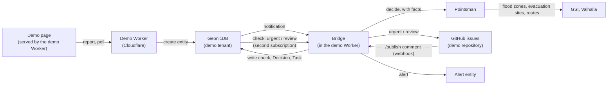

# FIWARE demo: storyboard

Issue #46. What the demo shows, for whom, and how it runs. The other issues in
the [FIWARE demo milestone](https://github.com/geolonia/pointsman/milestone/2)
build it.

## Decisions (2026-10-07)

- **Audience:** FIWARE developers and city IT staff, with a focus on disaster
  prevention and response (防災). They should understand the flow in the first
  minute, and find the real NGSI-LD data one click away.
- **Scenario:** checking reported road restrictions before they are
  published to residents. The entities are `RoadRestriction` from
  [datamodels.jp](https://datamodels.jp/models/transportation/RoadRestriction/).
- **No Docker, no servers to run.** Static pages, Cloudflare Workers, the
  GeonicDB context broker, and GitHub. See [How it runs](#how-it-runs).
- **Languages:** English and Japanese, like the landing page.

## The scenario

During heavy rain, a city's disaster headquarters receives reports of closed
or restricted roads: from field staff, patrols, other offices. Each report
becomes a `RoadRestriction` entity in the context broker. Without help,
someone at the headquarters checks every report before it appears on the
public map. On a bad day that is hundreds of reports, and the urgent ones must
not wait in the queue.

Pointsman does the first check on every report, within about a second:

| Question | Type | Why |
|---|---|---|
| `category`: which category of the national road information legend fits? | choice (10) | Reports arrive as free text; the category (通行止(異常気象等), 車線規制, …) is what the public map shows. |
| `status_matches`: does the status (closed, limited, open) match the description? | yes/no | Catches "closed" on a road that the text says is passable. |
| `danger`: are people in danger or trapped, or is emergency access blocked? | yes/no | These go to a person first, not to the queue. |
| `clarity`: is the report clear enough to publish? | score (4 levels) | Vague reports need a call back. |

And the profile turns the answers into one of three actions:

- **`urgent`**: `danger` is likely (≥ 0.7), or the place is in a river flood
  zone of 3 m or deeper and `danger` is at least 0.4 (a fact rule, version
  2; see "Spatial facts and the chain"). A person looks at it now.
- **`publish`**: clear, consistent, confident category, no danger. It goes to
  the public map without waiting.
- **`review`**: everything else goes to the normal queue, also a report with
  `danger` at least 0.4 whose flood zone could not be looked up.

The profile is [examples/profiles/road-restriction-check.yaml](../examples/profiles/road-restriction-check.yaml).

### Tried with Clef-flash (2026-10-07)

Six reports, each run three times (`pnpm dev:live`); the answers were the same
every time, about 0.5 s per report.

| Report | Action | Answers |
|---|---|---|
| Underpass flooded by heavy rain, fully closed since 10:45, detour named | publish | closedWeather 0.96, matches 0.92, danger 0.47, clarity 2.69 |
| Landslide buried the road, a car with a person inside | **urgent** | closedWeather 0.93, danger 0.96 |
| Status "closed", but the text says one lane is open, alternating | review | alternatingOneWay 0.85, matches: **no** 0.95 |
| Water pipe works, left lane closed 9:00–17:00 | publish | laneRestriction 0.95, matches 0.85, clarity 2.60 |
| "The road seems blocked" (no road name) | review | closedWeather 0.47, clarity 1.17 |
| English: fallen tree blocks both lanes since 7 am | publish | closedWeather 0.92, clarity 2.75 |

The flooded underpass is a good example to show: the model was unsure about
danger (0.47, just under the 0.5 that `publish` allows). Showing the number
next to the action helps people understand that thresholds are a choice the
city makes, not something the model decides.

### Checked again (2026-10-15)

A week later, five of the nine prepared reports missed their expected
action in one language or both. Each missed one threshold by a little: the
model's answers had moved. Each text got one sentence (added, or for
日比谷通り rewritten) that states what the report already implied, so the
event is the same
(geolonia/pointsman-demo#33):

| Report | Added | Answer that missed | Before → after |
|---|---|---|---|
| Flooded underpass (publish) | No one is hurt and no cars are stuck. | danger (must be under 0.5) | Japanese 0.55 → 0.02 |
| Water pipe works (publish) | Traffic passes in the right lane. | status matches (0.8 or more) | 0.795–0.798 → 0.86 Japanese, 0.83 English |
| Fallen tree, 飯田橋 bridge and street (urgent) | Ambulances cannot get through. | danger (0.7 or more) | English 0.60–0.63 → 0.92 |
| Fallen tree, 日比谷通り (publish) | Heavy rain and strong wind brought it down (first sentence rewritten). | category (0.85 or more) | Japanese 0.71 → 0.92 |

All 18 texts (9 reports, 2 languages) were checked with `pnpm dev:live`.
Lesson: keep a margin from the thresholds, and check the examples again
after a model update.

## Storyboard

Most visitors know nothing about FIWARE, decision services or AI, and many
are not native English speakers. So the page is a guided flow in three
numbered steps (geolonia/pointsman-demo#30), with the technical layer behind
"How it works". Beside the steps is one map with a switch: the
**headquarters view** with every report, and the **residents' view** with
only what is published. The base map is gray, so only the reports and the
flood zones are in colour.

1. **Pick a report.** One sentence sets the scene: heavy rain, reports coming
   in. Four prepared reports, one for each outcome: a clear report, an
   unclear one, someone in danger, and one near an evacuation site. More
   examples are folded away. Everything is in English and Japanese.
2. **Pointsman decides.** The steps appear one after the other, with the
   total time: saved in the data platform, the AI answered four
   questions, facts about the place were looked up, the city's rule
   decided. The answers are plain questions with a confidence word ("very
   sure", "unsure") instead of raw probabilities. The facts are marked as
   public data, not AI. The rule is one sentence. The real NGSI-LD data is
   behind "Show the data in the data platform (for developers)".
3. **What happens next.** The outcome in plain words, and the map zooms to
   the report. A `publish` report shows up in the residents' view. Near an
   evacuation site, the second check (the chain) adds its facts and the
   alert. For `review` and `urgent` reports, the visitor who sent the report
   is "the person on duty": Publish or Reject. Their answer goes to the
   broker, and to Pointsman for `review` reports, like a review on GitHub
   (marked `reviewedBy` = `demo:visitor`). The page says why it matters: it
   shows how often the AI was right.

"How it works" explains the way of a report in four parts (the report, how
the data platform passes it on through the bridge, Pointsman, the result)
and lists the profile, the bridge and the source, plus
the recent reports and the decisions waiting for a person, with the NGSI-LD
query that finds them. Team members also resolve reviews in the GitHub
review queue (`/publish`, `/reject`, corrections such as
`/category laneRestriction`).

### What the viewer should take away

- Pointsman reads the entity as it is: no mapping code between the broker and
  the model, just paths in the profile.
- The decision is data in the broker: other FIWARE apps can subscribe to it
  or query it (for example `q=check=="urgent"`; the attribute name and
  format are decided in #47, following the Decision data model, #52).
- People stay in charge: the city sets the thresholds, and everything that is
  not clear goes to a person, with the reason.
- Places are checked with spatial data, not by the model: the rules read
  facts such as "inside a 3 to 5 m flood zone" or "the way around on foot is
  316 m longer" (below).

## Spatial facts and the chain

Three additions after the first version (October 2026):

- **Facts in the rules** (#64, #65, #70): for each report, Pointsman looks up
  the river flood zone (GSI hazard map tiles) and the nearest evacuation site
  (GSI). The profile `road-restriction-check` version 2 sends a report in a
  flood zone of 3 m or deeper to a person (`urgent`) when the text alone
  would only be `review`. The model never sees the facts (spike #60); the page
  lists them with their source.
- **A chain of decisions** (#66): for reports decided `urgent` or `review`, a
  second profile (`evacuation-access-check`) asks whether the closure cuts
  people off from their evacuation site. Facts: the nearest site and the way
  around on foot (Valhalla, OpenStreetMap). Near a site, with a long way
  around and no way through on foot, it raises an `Alert` (Smart Data Models)
  for the site's staff. Its `Decision` entity links step 1
  (`wasInformedBy`).
- **Tasks** (#81, with geolonia/pointsman-demo#17): each `urgent` or
  `review` report also becomes a `Task` entity (datamodels.jp Task model) for
  a person, so any app that lists tasks from the broker shows the work. Resolving the review on GitHub marks it
  completed.

Two prepared reports show the chain with the same text: a closed bridge in
飯田橋三丁目 (+316 m on foot, evacuation site 443 m away: alert) and a street
in 飯田橋四丁目 (+143 m: no alert).

Decisions follow the Decision model on datamodels.jp
(https://datamodels.jp/models/decision/Decision/).

## How it runs

- **Demo page:** static files served by the demo Worker
  (https://pointsman-demo.geolonia.workers.dev, repository
  geolonia/pointsman-demo). It only talks to the demo Worker, never to the
  broker directly.
- **Demo Worker:** creates entities from the page (checked and limited, see
  below), returns the entities for the maps, and runs the bridge (#47) on
  `/notify`, through a Cloudflare queue (#88): when Pointsman or the broker
  is down for a while, notifications are retried for about 14 hours, then
  kept in a dead-letter queue (tested with a 3.5-minute outage on
  2026-10-15). Broker and Pointsman
  credentials stay in the Worker.
- **GeonicDB:** a demo tenant, with two subscriptions on `RoadRestriction`:
  new reports to `/notify`, and step 1's `urgent` and `review` results to
  `/notify?route=evacuation` (the chain). GeonicDB behaves correctly for the
  bridge's writes (#41) and supports the shared-secret header
  (`receiverInfo`).
- **Pointsman:** the production Worker, with the demo's two profiles
  (`road-restriction-check`, `evacuation-access-check`) in the config
  repository and its own API token, limited to those two profiles.
- **GitHub:** issues in a public demo repository as the review queue, and a
  webhook back to the Worker for the review comments.
- **Development:** `wrangler dev` for the Worker against a GeonicDB test
  tenant. No containers. Anyone can point the bridge at another NGSI-LD
  broker; the findings in #41 say which brokers need care.

### Limits for a public demo

- Prepared reports are the default; free text is limited in length and
  protected with Cloudflare Turnstile.
- Rate limit per visitor and a daily ceiling on Pointsman calls; when it is
  reached, the page shows recorded results instead of failing.
- Entities, decisions and demo issues are deleted after a day (a cron in the
  Worker). The page asks people not to write personal data.
- Issues are only created for prepared reports, or after a person approves
  free text, so the public cannot write into the GitHub repository directly.
- A visitor can decide only a prepared report they sent themselves (with a
  key the page got when it sent it), only while it waits for a person, and
  only once.

## Where the open points went

- #47 (bridge), #48 (environment), #49 (page): done.
- #50: the ideas list; evacuation sites and the chain became #66.
- Geocoding for reports with only an address: #65.
