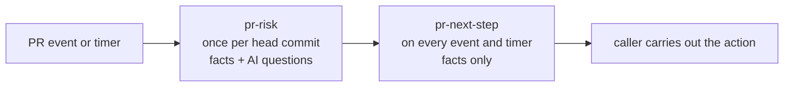

# Design: the next step for a pull request

Status: draft for discussion, 2026-10-21. Nothing here is built.

Pointsman decides what happens next with a pull request in the geolonia
GitHub org: which AI review service reviews it, whether to wait for a free
review or pay for one, whether to ask a person, or whether the change is
trivial enough to approve without a review. Today the `pr-review-flow` skill
(geolonia/skills) makes this decision with its `review-next` script. This
design moves the decision into two Pointsman profiles and leaves the skill
as a thin client.

## Why

AI code review is a bottleneck: CodeRabbit has an hourly allowance per
developer, and paid reviews cost money. `review-next` manages that, but:

- It runs inside each person's agent, so results can differ per person
  (plugin version, other skills, personal settings).
- Who decides that a PR needs no review (docs only, a version bump) is not
  clear, and such a PR still needs an approval, so people bypass rulesets.
- Its outcomes are not logged in one place, so nobody can measure how often
  a decision was wrong.

Pointsman gives the same versioned rules for everyone, a log of every
decision, and a review queue for people.

## What Pointsman does and does not do

Pointsman only decides. A caller carries out the action: posts a review
command, pays, requests a reviewer, or approves. Pointsman's engine never gets
write access to GitHub.

## The decision chain

Two profiles, linked with `requires` ([decision-chains.md](decision-chains.md)):

- **`pr-risk`** runs once per head commit (`ref: github:<owner>/<repo>#<n>@<sha>`).
  It classifies the change: `trivial`, `bump`, `normal` or `high`. It is the
  only profile with AI questions, so the model is asked once per push.
- **`pr-next-step`** runs again on every PR event and on a timer while a PR
  waits. It reads `pr-risk` and the current review state and returns the
  action. It has no AI questions (`model: none`), so re-running it is cheap.

A new push gives a new `ref`, so both run again.

## Actions

| Action | The caller does | Was in `review-next` |
| --- | --- | --- |
| `done` | Nothing (merged, closed, or already reviewed) | `done` |
| `wait-ready` | Nothing; the author marks the PR ready once | `wait-ready` |
| `in-progress` | Nothing; decide again later | `in-progress` |
| `approve` | Approve the head commit as the Pointsman app (see [Approval](#approval-identity-and-rulesets)) | new; replaces `skip` |
| `coderabbit-approve` | Post `@coderabbitai approve` | `approve` |
| `review` | Post `@coderabbitai review` | `review` |
| `check` | Post `@coderabbitai rate limit` (free) | `check` |
| `wait` / `queue` | Nothing; decide again at `retryAt` | `wait` / `queue` |
| `pay` | Post `@coderabbitai review --use-credits` | `pay` (automatic) |
| `pay-ask` | Ask the author first; pay only on a yes | `pay` with `confirm` |
| `use-copilot` | Add the CodeRabbit ignore line, request Copilot | `use-copilot` |
| `copilot` | Request a Copilot review | `copilot` |
| `fleet` | As `use-copilot`, with the "Same change as" line | `fleet` |
| `restore-coderabbit` | Remove the ignore line | `restore-coderabbit` |
| `ask-person` | Request a review from a person | `human` |

`approve` (an approval by the Pointsman app) and `coderabbit-approve` (asking
CodeRabbit to approve) get different names on purpose.

## Inputs: facts and AI questions

Rules can read only AI answers, facts and earlier decisions, not the request
state ([profile-format.md](profile-format.md#policy-conditions)). So the
review state must come in as facts. This needs a new fact provider:
**Pointsman reads GitHub itself**, with a read-only GitHub App. The caller
sends only the repository, the PR number and the head commit. A caller cannot
claim "docs only" or "CI is green"; Pointsman looks it up.

Proposed facts (names and fields are a sketch):

| Fact | Fields (examples) | From |
| --- | --- | --- |
| `pr` | `open`, `merged`, `draft`, `wip_title`, `files`, `changed_lines`, `author_member`, `author_bot`, `fork` | GitHub PR |
| `risky` | `any`, `count` for the risky path list | changed paths |
| `trivial_paths` | `all` for the docs/lockfile path list | changed paths |
| `bump` | `version_only`, `semver` (`patch`, `minor`, `major`), `ecosystem` | manifest and lockfile diff |
| `ci` | `green`, `pending` | check runs and statuses on the head |
| `coderabbit` | `installed`, `ignored`, `reviewed_head`, `in_progress`, `approved_head`, `rebase_only`, `changes_requested`, `unresolved_threads`, `outside_diff_findings`, `billable_files`, `price_stated` | statuses, reviews, comments |
| `copilot` | `requested`, `reviewed_head`, `approved_head`, `reviews` | reviews, requested reviewers |
| `fleet` | `claimed`, `same`, `approved` | the PR named in "Same change as" |
| `budget` | `available`, `wait_minutes`, `allowance_per_hour`, `observed_minutes_ago` | CodeRabbit's rate limit replies |
| `queue` | `ahead`, `claims`, `wait_minutes` (wait plus the PRs ahead) | Pointsman's own log: the author's other waiting PRs |
| `spend` | `per_pr_usd_after`, `per_5h_usd_after`, `paid_for_head` | Pointsman's own log (see [Ledger](#the-spend-ledger)) |

Path lists (`risky`, `trivial_paths`) are fact settings in the profile, like
a fact's `layer` today, so changing them is a profile change with a new
version. A fact that cannot be read is missing, and a rule with a missing fact
never matches, so a GitHub outage can never lead to `approve`.

AI questions, in `pr-risk` only:

| Question | Type | Use |
| --- | --- | --- |
| `matches_title` | `noul` | Does the diff do what the title and description say? |
| `changes_behaviour` | `noul` | Does a docs or config change alter something that runs (a command people copy, a script, CI)? |

**AI answers can only make a decision stricter.** The PR title, description
and diff are written by the author and can try to steer the model. So every
rule that leads to `trivial` or `bump` needs the facts to be true *and*
the AI answers to be harmless; no rule turns a `normal` or `high` change into
`trivial` because of an AI answer. If the model is tricked, the worst case is
the same as having no AI questions.

## Rules

### `pr-risk`

First match wins:

1. `high`: `facts.risky.any`, or `facts.pr.changed_lines > 800`.
2. `trivial`: `facts.trivial_paths.all`, `changed_lines <= 40`,
   `facts.pr.author_member`, not `fork`, `matches_title.yes >= 0.8`,
   `changes_behaviour.yes < 0.2`.
3. `bump`: author is Dependabot, `facts.bump.version_only`, `semver` is not
   `major`, no risky path (GitHub Actions bumps touch `.github/workflows/**`,
   so they stay `high`).
4. Default `normal`.

### `pr-next-step`

The same order as `review-next` today (SKILL.md section 5), with the
policy.json and caps values written into the rules:

1. Not open: `done`.
2. Draft or `WIP` in the title: `wait-ready`.
3. CodeRabbit review running, or Copilot requested: `in-progress`.
4. Fleet claim holds and no ignore line: `fleet`; claim fails and ignore line
   present: `restore-coderabbit`.
5. CodeRabbit ignored or not installed: Copilot approved the head: `done`;
   `copilot.reviews >= 3`: `ask-person`; Copilot reviewed the head: `done`;
   else `copilot`.
6. CodeRabbit reviewed the head: not approved, no unresolved threads, no
   findings outside the diff: `coderabbit-approve`; else `done`.
7. Approved before and `rebase_only`, not `high`: `coderabbit-approve`.
8. `trivial` or `bump`, CodeRabbit not involved yet, `facts.ci.green`:
   `approve`. CI still pending: `in-progress`.
9. Budget unknown: `check`.
10. A free review and no PR of the author ahead: `review`.
11. Wait within the limit (15 min for up to 5 billable files, 60 min above):
    `wait`.
12. Up to 4 billable files, price stated by CodeRabbit, not `high`,
    `spend.per_pr_usd_after` and `spend.per_5h_usd_after` within the caps,
    not `paid_for_head`: `pay`.
13. Up to 4 billable files otherwise: `pay-ask`.
14. Default: `queue`.

The Copilot-instead settings (`insteadWhenLimited`, `insteadAfterMin`,
`trivialApprover`, `highRisk`) are personal in `caps.json` today. In a shared
profile they become one team setting each, or are dropped (open question 3).

`review-next.test.mjs` has the cases for all of these; they become the
profile's test cases, so a difference shows up before the shadow phase.

## Where it runs

| Option | Good | Bad |
| --- | --- | --- |
| A. A workflow in each repo, like `actions/triage` | Known pattern | A file in every repo; many runs per PR (statuses, comments, reviews); no secrets on fork PRs; approving with `GITHUB_TOKEN` needs an org setting |
| B. A GitHub App with webhooks to a small executor Worker | Installed once for the org; one place for credentials; a cron for waiting PRs | A new service to run |
| C. Only the agent (skill calls Pointsman over MCP) | Nothing new to run | Works only while someone's session runs, which is today's problem |

**Proposal: B**, with the skill as a thin client (C) during the rollout and
for actions the app cannot do (see open question 4). The executor:

- receives PR, review, status and comment events, and calls `pr-risk` and
  `pr-next-step`;
- re-decides waiting PRs from a cron at their `retryAt`;
- carries out only a fixed list of actions (like the label allow-list in
  `actions/triage`);
- shows the current decision as a check run "Next step" on the PR (not a
  comment, so no notifications), with a link to the decision.

Two apps keep write access away from the engine: a read-only app for
Pointsman's fact provider, and the executor's app with `pull_requests: write`.

## Approval identity and rulesets

- The executor approves as its GitHub App, with `commit_id` set to the head
  commit Pointsman decided on.
- CodeRabbit's and Copilot's approvals already count under our rulesets, so a
  bot approval is not new. It still needs to be tested in a sandbox repo:
  does an app approval count for "required approvals", "approval of the most
  recent push", and code owner review? An app cannot be a code owner through a
  team, so repos that require code owner review would still need a person.
- A push after the approval must remove it. Rulesets must dismiss stale
  approvals on push, and the executor also dismisses its own approval on every
  `synchronize` event.
- `approve` only in repos that opt in (a custom property, for example
  `pointsman-approve: true`), never on fork PRs or PRs by outside
  contributors.
- Whether a bot may approve at all is a team and security decision (open
  question 1).

## The spend ledger

Today each person has a ledger in a secret gist (`caps.json` and payments),
and a hook records each payment.

Proposal: **Pointsman's decision log is the ledger.** Every `pay` decision
counts at its price, also when the caller did not carry it out (totals can
only overestimate, as today). `spend.paid_for_head` stops a second payment for
the same commit. The caps are rules in the profile: the same for everyone,
changed by a PR to the profile. CodeRabbit's monthly spending cap stays the
last limit. The gist is retired at the end of the rollout.

If the executor is not the only one who can pay (people can still post the
command by hand), the log misses those payments. CodeRabbit's monthly cap
still holds; a fact that reads paid review comments on GitHub could close the
gap later.

## Rollout

1. **Team answers** the open questions below, at least 1, 3 and 4.
2. **Build** the GitHub fact provider, the two profiles, and their tests from
   `review-next.test.mjs`.
3. **Replay** `pr-risk` with a test token over the last 30 days of merged PRs
   in a few repos. For each PR it calls `trivial` or `bump`, check whether a
   review found a real problem. That estimates how often `approve` would have
   been wrong, before anything acts on it.
4. **Shadow, 2 to 3 weeks.** `review-next` runs as today and also calls
   `pr-next-step`, sending its own action in the state (`log.store_state` with
   only repo, PR, head and that action). Nothing acts on Pointsman's answer. A
   weekly query lists agreement and every difference; each difference is
   explained and fixed in the profile or in `review-next`. Continue when the
   differences are understood and no `approve` was given where a review later
   found a real problem.
5. **Pointsman decides, people approve.** `review-next` becomes a thin client
   that prints Pointsman's action. `approve` is in `people_check`: a person
   confirms it in Pointsman's review queue, and the callback lets the executor
   approve. The log shows how often people overruled it.
6. **The app approves** trivial PRs on its own in opted-in repos, then more
   repos. The decide code and the gist ledger are removed from the skill.

## Open questions for the team

1. May a bot approve trivial PRs? In which repos, and on which branches?
2. What counts as trivial and as a bump: docs only up to 40 lines? Dependabot
   patch and minor bumps? Production dependencies too, or dev dependencies
   only?
3. Caps and Copilot settings: one team setting in the profile, or per person
   as today? Who reviews changes to them?
4. Does CodeRabbit act on commands posted by another app, and whose allowance
   does it use? Does `--use-credits` work from an app? If not, review commands
   stay with the author's session (the skill posts them, Pointsman decides).
5. Can an app request a Copilot review through the API?
6. Who answers `ask-person`: code owners, a rotation, or the author's choice?
7. Where do the profiles live: here as examples, or in the private deployment
   config?
8. Which repos join the shadow phase?

## What this does not fix

- CodeRabbit's allowance itself: Pointsman spends it better, it does not make
  it larger.
- Review quality: a trivial approval says the change is small and low risk,
  not that it is correct.
- Work pushed after ready: still a counted review each time.
