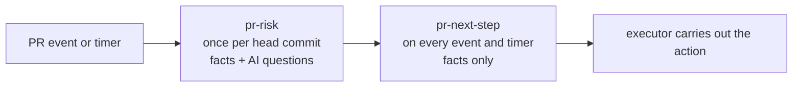

# Design: the next step for a pull request

Status: draft for discussion, 2026-10-21. Nothing here is built.

Pointsman decides what happens next with a pull request in the geolonia
GitHub org: which AI review service reviews it, whether to wait for a free
review or pay for one, whether to ask a person, or whether the change is
small enough to approve without a review. Today the `pr-review-flow` skill
(geolonia/skills) makes this decision with its `review-next` script. This
design moves the decision into Pointsman profiles. People see Pointsman
as a GitHub App that joins a repository, like CodeRabbit does.

## Why

AI code review is a bottleneck: CodeRabbit has an hourly allowance per
developer, and paid reviews cost money. `review-next` manages that, but:

- It runs inside each person's agent, so results can differ per person
  (plugin version, other skills, personal settings).
- Who decides that a PR needs no review (docs only, a version bump) is not
  clear, and such a PR still needs an approval, so people bypass rulesets.
- Its outcomes are not logged in one place, so nobody can measure how often
  a decision was wrong.

Pointsman gives the same versioned rules for everyone, a log of every
decision, and a review queue for people.

## Pointsman as a GitHub App

Seen from a repository, Pointsman is a reviewer, like CodeRabbit. Its GitHub
App is simply called **Pointsman**, with no "bot" in the name.

- An org admin installs the Pointsman app on selected repositories (or
  all of them). That is how Pointsman "joins" a repo.
- On each PR it shows its decision as a check run **"Pointsman: next step"**
  (for example "Waiting for a free CodeRabbit review, about 12 min"), with a
  link to the decision. A check run gives no notifications, unlike comments.
- It carries out the decision: posts a review command, requests Copilot or a
  person, and, where the team allows it, approves trivial PRs.

Behind the app are two parts, so that the part that reads PR text never
holds write access:

| Part | Does | GitHub access |
| --- | --- | --- |
| Pointsman engine (this repo) | Looks up facts, asks the model, applies the profile, logs the decision | A second, read-only app, used only for facts |
| Executor (small Worker, deployed with the engine) | Receives webhooks, calls the engine, carries out the action, re-decides waiting PRs from a cron | The Pointsman app: `pull_requests: write`, `checks: write` |

The executor carries out only a fixed list of actions, like the label
allow-list in `actions/triage`. It checks the webhook signature, ignores
replayed deliveries, and keeps the app's private key as a Worker secret.

Configuration lives in the deployment's private config repository, as
CodeRabbit's org settings live in a private repository of their own: the
profiles, path lists, caps and the list of orgs that can pay. A change is a
PR there, reviewed like code, and each decision logs the profile version it
used. A per-repo file (like `.coderabbit.yaml`) is not planned: a PR could
change it in the same PR it is judged on. If one is added later, it is read
from the base branch and can only make rules stricter.

The read-only app needs: metadata, contents, pull requests, checks, commit
statuses and custom properties, all read, plus organization members (read),
for `author_member`.

Several webhooks for one PR can arrive at once. The executor handles one PR
at a time (for example one Durable Object per PR) and carries out each
decision at most once, so two events cannot both post a review command, pay
or approve.

Other ways to run it, and why not first:

| Option | Why not first |
| --- | --- |
| A workflow in each repo, like `actions/triage` | A file in every repo; many runs per PR (statuses, comments, reviews); no secrets on fork PRs; approving with `GITHUB_TOKEN` needs an org setting |
| Only the agent (the skill calls Pointsman over MCP) | Works only while someone's session runs, which is today's problem. Still used during the rollout, and for commands the app cannot post (open question 4) |

### One job of several

Seen more widely, the app can take on more operations work over time: PR
review routing is the first job; security checks by repo level and alert
triage could follow. The team owns the rules; the app applies them the same
way every time and logs each decision. To keep that safe as it grows:

- Each job is its own profile, with its own list of actions the executor may
  carry out.
- A GitHub App has one set of permissions, so the executor asks GitHub for a
  short-lived token with only the permissions of the job at hand
  (installation tokens can be limited to fewer permissions than the app has).
- Jobs that need admin rights (repo settings) get their own app and threat
  model, not more rights on this one.
- Every decision is in the log, and people correct it through the review
  queue.

## The decision chain

Profiles linked with `requires` ([decision-chains.md](decision-chains.md)):



- **`pr-risk`** classifies the change: `approvable`, `bump`, `normal`,
  `sensitive` or `high`, or `incomplete` when facts are missing. It is the only profile with AI questions. It runs
  once per head commit (`ref: github:<owner>/<repo>#<n>@<sha>`), and again
  when the title, description or base branch changes (an `edited` event) or
  when its last answer came from missing facts. A newer `pr-risk` decision
  replaces the earlier one.
- **`pr-next-step`** runs again on PR events and on a timer while a PR waits.
  It reads `pr-risk` and the current review state and returns the action. It
  has no AI questions (`model: none`), so re-running it is cheap.
- **`pr-approve-confirm`** is used only while people confirm approvals
  (rollout step 5, see [Confirmed approvals](#confirmed-approvals)).

A new push gives a new `ref`, so all of them run again.

## Actions

| Action | The executor does | Was in `review-next` |
| --- | --- | --- |
| `done` | Nothing (merged, closed, already reviewed or approved) | `done` |
| `wait-ready` | Nothing; the author marks the PR ready once | `wait-ready` |
| `in-progress` | Nothing; decide again in 5 min | `in-progress` |
| `retry` | Nothing; a fact could not be read; decide again in 5, 10, 20 min, then only on the next event, with "Pointsman cannot read this PR" in its check run | new (was `error` or an unknown state) |
| `approve` | Approve the head commit as the Pointsman app (see [Approval](#approval-and-rulesets)) | new; replaces `skip` |
| `confirm-approve` | Open a `pr-approve-confirm` decision, so a person confirms the approval | new, rollout step 5 only |
| `coderabbit-approve` | Post `@coderabbitai approve` | `approve` |
| `request-review` | Post `@coderabbitai review` | `review` |
| `check` | Post `@coderabbitai rate limit` (free) | `check` |
| `wait` | Nothing; decide again when the wait ends | `wait` |
| `queue` | Nothing; too large to pay for, waits for a free review | `queue` |
| `pay` | Post `@coderabbitai review --use-credits` | `pay` (automatic) |
| `pay-ask` | Ask the author; pay only on a yes | `pay` with `confirm` |
| `use-copilot` | Add the CodeRabbit ignore line, request Copilot | `use-copilot` |
| `copilot` | Request a Copilot review | `copilot` |
| `fleet` | As `use-copilot`, with the "Same change as" line | `fleet` |
| `restore-coderabbit` | Remove the ignore line | `restore-coderabbit` |
| `security-review` | Start the repository's security review and request code owners (see [Security levels](#repository-security-levels)) | new |
| `split` | Ask the author to split the PR | new |
| `ask-person` | Request a review from a person | `human` |

Names chosen on purpose:

- `approve` (an approval by the Pointsman app) and `coderabbit-approve`
  (asking CodeRabbit to approve) are different things.
- `review` is a reserved action in Pointsman ("a person decides", the default
  of `people_check`), so posting `@coderabbitai review` is `request-review`.
  `pr-risk` and `pr-next-step` set `people_check: []`.

Pointsman has no `retryAt`: rules cannot compute times. The executor takes
the wait from the decision's facts (`facts.queue.wait_minutes`) and decides
again after that, at most 10 minutes later, as `review-next` does today.

## Inputs: facts and AI questions

Rules can read only AI answers, facts and earlier decisions, not the request
state ([profile-format.md](profile-format.md#policy-conditions)). So the
review state must come in as facts. That needs new fact types: **Pointsman
reads GitHub itself**, with its read-only app. The executor sends only the
repository, the PR number and the head commit it was told about. A caller
cannot claim "docs only" or "CI is green"; Pointsman looks it up.

All GitHub facts of one decision come from one snapshot, read once at the
start (PR, files, reviews, statuses, checks, comments, repo properties), so
they describe the same moment. The snapshot records its head commit; if it
differs from the commit in the request, every GitHub fact is missing and the
rules return `retry`.

Proposed facts (names and fields are a sketch):

| Fact | Fields (examples) | From |
| --- | --- | --- |
| `pr` | `open`, `merged`, `draft`, `wip_title`, `files`, `changed_lines`, `author_member`, `author_dependabot` (login `dependabot[bot]` and type Bot), `all_commits_by_author`, `fork` | GitHub PR |
| `repo` | `approve_allowed`, `personal_data` (`yes`, `no`, `unset`), `visibility`, `archived` from custom properties; `can_pay`: the owner is in the profile's list of orgs with CodeRabbit credits | repository custom properties, profile setting |
| `risky` | `any`, `count` for the risky path list | changed paths |
| `approvable_paths` | `all` for the list of paths that may be approved; false for an empty diff | changed paths |
| `sensitive_paths` | `any` for persistence, logging, API, auth and infrastructure paths | changed paths |
| `bump` | `applies`, `version_only`, `semver`, `dev_only`, `registry_changed`, `manifest_lines`, `release_age_days` | manifest and lockfile diff |
| `ci` | `green`, `pending`: required checks only, without Pointsman's own check run; `green` is false when the repo has no required checks | checks and statuses on the head |
| `changes_requested` | `any` (CodeRabbit, Copilot or a person) | reviews |
| `pointsman` | `approved_head`, `security_review_head` (`none`, `running`, `passed`, `failed`) | the app's own reviews, the security review's check run |
| `coderabbit` | `installed`, `ignored`, `reviewed_head`, `in_progress`, `approved_head`, `rebase_only`, `changes_requested`, `unresolved_threads`, `outside_diff_findings`, `billable_files`, `price_stated` | statuses, reviews, comments |
| `copilot` | `requested`, `reviewed_head`, `approved_head`, `reviews` | reviews, requested reviewers |
| `fleet` | `claimed`, `same`, `approved` | the PR named in "Same change as", only in repos where the read app is installed |
| `budget` | `known`, `available`, `wait_minutes`, `allowance_per_hour`, `observed_minutes_ago`, `taken_by_other_pr` | CodeRabbit's rate limit replies |
| `queue` | `ahead`, `wait_minutes` (the wait plus the PRs ahead) | Pointsman's log: the author's other waiting PRs |
| `spend` | `per_pr_usd_after`, `per_5h_usd_after`, `paid_for_head` | Pointsman's log (see [Ledger](#the-spend-ledger)) |

**Missing and not applicable are different.** A fact is *missing* when it
could not be read (GitHub down, rate limited, too slow). A fact that does not
apply is still known: `bump.applies` is false on a docs PR, `fleet.claimed`
is false without a claim, `budget.known` is false before CodeRabbit's first
reply. Rules test these fields; they never count as missing.

A custom property that is not set is a known value, not a missing fact, so
repos without the new properties keep today's flow: `approve_allowed` is
false unless the repo opted in, and `personal_data` is `unset` when
`handles-personal-data` is not set. An `unset` repo gets no approvals (they
need `no`) and no security review (it needs `yes`); everything else works as
usual. Only org admins may change these properties (the
property is not editable by repository admins), so a repo admin cannot opt a
repo into approvals or clear its personal-data flag.

Path lists are fact settings in the profile, like a fact's `layer` today, so
changing them is a profile change with a new version. The list of paths that
may be approved is an **allow-list**, narrower than `review-next`'s trivial
list, because an approval is a stronger outcome than skipping CodeRabbit:

```yaml
approvable_paths: ["docs/**/*.md", "README.md", "**/README.md", "CHANGELOG.md", "changes/*.md"]
```

So lockfiles, `*.txt`, and files that instruct agents (`AGENTS.md`,
`CLAUDE.md`, `.claude/**`, `**/SKILL.md`, prompt files) are never
approvable.

AI questions, in `pr-risk` only:

| Question | Type | Use |
| --- | --- | --- |
| `matches_title` | `noul` | Does the diff do what the title and description say? |
| `changes_behaviour` | `noul` | Does a docs or config change alter something that runs (a command people copy, a script, CI)? |
| `personal_data` | `noul` | Does the change store, log or return personal data (names, emails, addresses, locations)? |

### Two safety rules

**A missing fact never leads to `approve` or `pay`.** In Pointsman a rule
with a missing fact never matches. That protects positive conditions
(`facts.ci.green == true`) but not negative ones: a missing `risky` fact
would just skip the `high` rule. So:

- An early rule of each profile catches missing facts: `pr-risk` returns
  `incomplete`, `pr-next-step` returns `retry` (after "not open: `done`", so a
  merged PR is never stuck).
- Rules that lead to `approvable`, `bump`, `approve` or `pay` write every
  condition as a positive, known value (`facts.risky.any == false`, not
  `not facts.risky.any`).
- Tests cover each fact missing.

**AI answers can only make a decision stricter.** The PR title, description
and diff are written by the author and can try to steer the model. Every
rule that leads to `approvable` or `bump` needs the facts to be true *and*
the AI answers to be harmless; an AI answer alone never makes a change
approvable. If the model is tricked, the worst case is the same as having no
AI questions, so the real protection is the facts. The thresholds (lines,
probabilities) are public in the profile; they are not a secret and do not
need to be. Between the two `personal_data` thresholds (0.2 to 0.3) a change
is `normal` on purpose: not approved, and not sent to the security review.

## Repository security levels

Repository custom properties become facts (`facts.repo.*`), so Pointsman can
treat repos differently by their security or privacy level, the same way
rulesets already target repos by property.

- `approve_allowed` (for example a property `pointsman-approve: true`): the
  app approves only in repos that opted in.
- `personal_data`, from `handles-personal-data` (a property planned by Geolonia's operations team):
  in these repos, a PR that touches `sensitive_paths` or `risky` paths, or
  where the model sees personal data, is `sensitive`. Pointsman never
  approves there.
- Other properties (public or private, production or not) can be added the
  same way, as one fact type that reads all properties.

A `sensitive` PR:

1. Over 800 changed lines: `split` (ask the author to split it).
2. Otherwise `security-review`: the executor starts the repository's security
   review and requests the code owners. The review itself is not part of the
   executor, because it reads PR text and the whole repository: it runs
   where the repository's own CI runs (for example a workflow with an AI
   security agent and the threat model, started by a label), with no access
   to the Pointsman app's key. It reports as a check run on the head. The
   workflow follows the `secure-github-actions` rules (no
   `pull_request_target` with PR code), its job has a read-only token and
   only its own model key, with a spending limit, since PR text can try to
   steer the agent. Fork PRs in these repos get `ask-person`: the workflow
   gets no secrets there.
3. When that check run passed (`facts.pointsman.security_review_head ==
   'passed'`), the PR continues with the normal CodeRabbit flow; failed:
   `ask-person`. The code owners' approval is required by the repo's
   ruleset, not by Pointsman.

## Rules

### `pr-risk`

First match wins:

1. Any fact missing: `incomplete`. `pr-next-step` answers `retry` to it and
   the executor runs `pr-risk` again, so a partial snapshot never decides the
   class.
2. `sensitive`: `facts.repo.personal_data == 'yes'`, and
   `facts.sensitive_paths.any == true`, `facts.risky.any == true`,
   `facts.pr.changed_lines > 800` or `personal_data.yes >= 0.3`.
3. `high`: `facts.risky.any == true`, or `facts.pr.changed_lines > 800`.
4. `approvable`: `facts.repo.approve_allowed == true`,
   `facts.repo.personal_data == 'no'`, `facts.risky.any == false`,
   `facts.approvable_paths.all == true`, `facts.pr.changed_lines <= 40`,
   `facts.pr.author_member == true`, `facts.pr.fork == false`,
   `matches_title.yes >= 0.8`, `changes_behaviour.yes < 0.2`,
   `personal_data.yes < 0.2`.
5. `bump`: `facts.repo.approve_allowed == true`,
   `facts.repo.personal_data == 'no'`,
   `facts.pr.author_dependabot == true`,
   `facts.pr.all_commits_by_author == true` (nobody else pushed to the
   branch), `facts.bump.version_only == true`, `facts.bump.semver == 'patch'`,
   `facts.bump.dev_only == true`, `facts.bump.registry_changed == false`,
   `facts.bump.manifest_lines <= 10`, `facts.bump.release_age_days >= 3`,
   `facts.risky.any == false` (GitHub Actions bumps touch
   `.github/workflows/**`, so they stay `high`).
6. Default `normal`.

### `pr-next-step`

The order follows `review-next` today (SKILL.md section 5), with the
policy.json and caps values written into the rules. New compared with
`review-next`: rules 2, 5, 10, 11 and the split of its `pay` into rules 15
and 16.

1. Not open: `done`.
2. Any fact missing, the snapshot is of another head commit, or `pr-risk`
   is `incomplete`: `retry`.
3. Draft or `WIP` in the title: `wait-ready`.
4. CodeRabbit review running, Copilot requested, or the security review
   running: `in-progress`.
5. `pr-risk` is `sensitive`: as in [Security levels](#repository-security-levels)
   (`split`, `security-review`, `ask-person`, or on to rule 7 once passed).
   Before the fleet rule, because the fleet claim is written by the author.
6. Fleet claim holds, the head is not approved yet, no ignore line: `fleet`.
   Claim fails and the ignore line is there: `restore-coderabbit`.
7. CodeRabbit ignored or not installed: Copilot approved the head: `done`;
   Copilot reviewed `maxReviews` times: `ask-person`; Copilot reviewed the
   head: `done`; else `copilot`.
8. CodeRabbit reviewed the head: not approved, no unresolved threads, no
   findings outside the diff: `coderabbit-approve`. Approved and `high`, with
   a second Copilot review on for high risk: `copilot`. Else `done`.
9. Approved before, `rebase_only`, not `high`: `coderabbit-approve`.
10. Pointsman already approved the head: `done`.
11. `approvable` or `bump`, CodeRabbit not involved yet, the repo still
    allows approvals and does not handle personal data (read again here, in
    case a property changed after `pr-risk`),
    `facts.changes_requested.any == false`, `facts.ci.green == true`:
    - without confirmations: `approve`;
    - with confirmations: no `pr-approve-confirm` decision yet:
      `confirm-approve`; its review still open: `in-progress`; a person
      answered `approve`: `approve`; a person answered `decline`: on to
      rule 12.

    CI still pending: `in-progress`.
12. Budget not known, or the free review went to another PR: `check`.
13. A free review and no PR of the author ahead: `request-review`.
14. Wait within the limit (15 min for up to 5 billable files, 60 min above):
    `wait`.
15. Wait over the limit, up to 4 billable files, `facts.repo.can_pay`, price
    stated by CodeRabbit for this head, not `high`,
    `spend.per_pr_usd_after` and `spend.per_5h_usd_after` within the caps,
    not `paid_for_head`: `pay`.
16. Wait over the limit, up to 4 billable files, `facts.repo.can_pay`:
    `pay-ask`.
17. Default: `queue`.

Not yet placed: the Copilot-instead settings (`insteadWhenLimited`,
`insteadAfterMin`, `trivialApprover`) with their guards (Copilot reviewed too
often, CodeRabbit's open change request), and `review-next`'s draft
sub-cases (CodeRabbit not installed, drafts reviewed in this repo). The
Copilot settings are personal in `caps.json` today; in a shared profile each
becomes one team setting, or is dropped (open question 3).

`review-next.test.mjs` has the cases for all of these. They become the
profiles' test cases. That needs a test harness with mock GitHub facts and
earlier decisions: test tokens cannot send `decisions`, and the mock facts
cover only the spatial types today.

## Fact provider notes

- New fact types with GitHub as the source. Each fact has 3 s today; one
  shared snapshot per decision keeps that possible for most PRs. Only what
  cannot change for a commit (its files and diff) is cached by head commit;
  CI, reviews, comments and budget are read fresh for every decision, since
  they can lead to `approve` or `pay`. Right before approving, the executor
  also reads the head, CI and change requests again. Very large PRs (many pages of files or
  reviews) may need a longer limit, or a snapshot the executor prepares in
  the background. A GitHub rate limit or timeout makes the facts missing
  (`error` or `timeout`).
- `queue` and `spend` read Pointsman's own log: other decisions of
  `pr-next-step` made by the same client (the executor's token), so token
  scoping stays as it is. Reading the log for a fact is new: facts read
  external data today.
- The executor handles one PR at a time, but two PRs can still decide at the
  same moment. For money, all `pay` decisions go through one serialized step
  per org, so two PRs cannot both use the last of a cap. CodeRabbit's monthly
  cap stays the last limit.
- `budget` comes from CodeRabbit's replies to `@coderabbitai rate limit`,
  which are per developer. Pointsman reads the latest reply for the PR's
  author on any PR, not only this one.

## Approval and rulesets

- The executor approves as the Pointsman app, with `commit_id` set to the
  head commit Pointsman decided on. Right before approving, it reads the head
  again and stops if it changed.
- A push after the approval must remove it. Rulesets must dismiss stale
  approvals on push, and the executor also dismisses its own approval on
  every `synchronize` event.
- To verify in a sandbox repo: does an app approval count for "required
  approvals" and for "approval of the most recent push"? Is an approval
  posted on an older `commit_id` just after a push dismissed or ignored? Code
  owner review would still need a person, since CODEOWNERS lists users and
  teams.
- `approve` only in opted-in repos, never in repos that handle personal
  data, never on fork PRs or PRs by people outside the org.
- A compromised member account could open docs PRs that the app approves.
  Limits: the narrow path list, the line limit, and the log shows every
  approval by author.
- Whether an app may approve at all is a team and security decision (open
  question 1).

### Confirmed approvals

In rollout step 5, a person confirms each approval. This uses a third
profile, `pr-approve-confirm` (`model: none`, `requires: pr-risk`, default
`review`, `people_answers: [approve, decline]`), not `people_check` on
`pr-next-step`. The reason: once a person resolves a review of a profile with
`requires`, Pointsman refuses new decisions of that profile for the same
`ref` (`409 resolved_by_person`). On `pr-next-step` that would stop the PR
until the next push. On the separate profile only the confirmation is
locked, which is what we want.

- `pr-next-step` returns `confirm-approve`; the executor makes one
  `pr-approve-confirm` decision and does not make another while it is open.
- `pr-next-step` reads it as an optional earlier decision: `approve` from a
  person leads to `approve`; `decline` skips rule 11, so the PR goes on to
  CodeRabbit as usual.
- The callback tells the executor when the person answered.
- To check while building: the `409` applies per profile and `ref`, as
  assumed here.

## The spend ledger

Today each person has a ledger in a secret gist (`caps.json` and payments),
and a hook records each payment.

Proposal: **Pointsman's decision log is the ledger.** Every `pay` decision
counts at its price, also when it was not carried out (totals can only
overestimate, as today). `spend.paid_for_head` stops a second payment for the
same commit. The caps are rules in the profile: the same for everyone,
changed by a PR to the profile. CodeRabbit's monthly spending cap stays the
last limit. The gist is retired at the end of the rollout.

Payments people post by hand are not in the log. CodeRabbit's monthly cap
still holds; a fact that reads paid review comments on GitHub could close the
gap later.

## Rollout

1. **Team answers** the open questions below, at least 1, 3 and 4.
2. **Build** the GitHub facts, the profiles, the test harness and the
   executor (without write actions at first). Set the repo properties
   (`pointsman-approve`, `handles-personal-data`) in the shadow repos.
3. **Replay** `pr-risk` with a test token over the last 30 days of merged PRs
   in a few repos. For each PR it calls `approvable` or `bump`, check whether
   a review found a real problem. That estimates how often `approve` would
   have been wrong, before anything acts on it.
4. **Shadow, 2 to 3 weeks.** The app is installed in a few repos and only
   writes its check run. `review-next` runs as today and also calls
   `pr-next-step`, sending its own action in the state (`log.store_state`
   with only repo, PR, head and that action). A weekly query lists agreement
   and every difference; each difference is explained and fixed in the
   profile or in `review-next`. Continue when the differences are understood
   and no `approve` was given where a review later found a real problem.
5. **Pointsman decides, people confirm approvals.** The executor carries out
   the actions; `review-next` becomes a thin client that prints Pointsman's
   action. Each approval needs a person's yes (see
   [Confirmed approvals](#confirmed-approvals)). The log shows how
   often people said no.
6. **The app approves on its own** in opted-in repos, then more repos. The
   decide code and the gist ledger are removed from the skill.

## Open questions for the team

1. May the Pointsman app approve PRs? In which repos, and on which branches?
2. What may be approved: docs only up to 40 lines? Dependabot patch bumps of
   dev dependencies only, or more?
3. Caps and Copilot settings: one team setting in the profile, or per person
   as today? Who reviews changes to them?
4. Does CodeRabbit act on commands posted by another app, and whose allowance
   does it use? Does `--use-credits` work from an app? If not, review commands
   stay with the author's session (Pointsman decides, the skill posts).
5. Can an app request a Copilot review through the API?
6. Who answers `ask-person` and `security-review`: code owners, a rotation, or
   the author's choice?
7. Which repo properties exist, and who sets them (the profiles and path
   lists live in the private config repository)?
8. Which repos join the shadow phase?

## What this does not fix

- CodeRabbit's allowance itself: Pointsman spends it better, it does not make
  it larger.
- Review quality: an approval of a small change says it is small and low
  risk, not that it is correct.
- Work pushed after ready: still a counted review each time.
