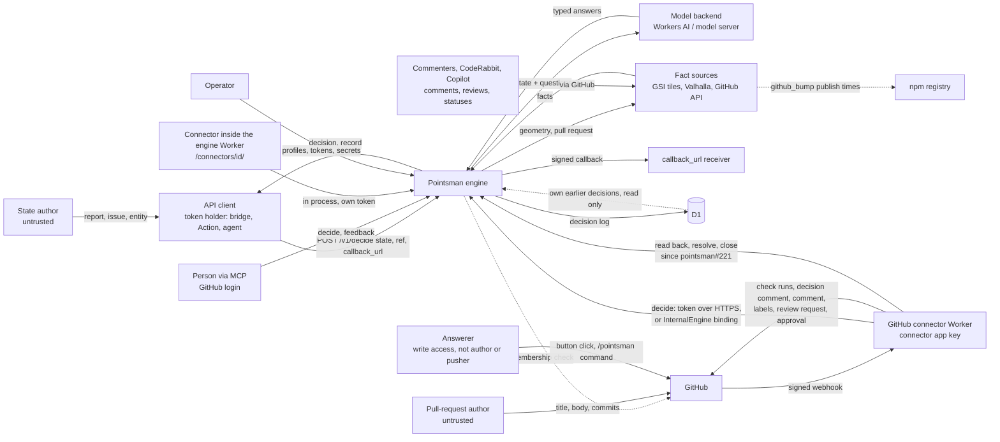

# Threat model — Pointsman

## 1.1 Header

- **Project**: Pointsman (geolonia/pointsman), a decision service on Cloudflare
  Workers: typed questions in, typed answers with probabilities and an action
  out.
- **Version binding**: release tag `v0.16.0`, commit
  `8eea43df5b881e5a50b4f4c21a4235650e9db92a` on `main` (2026-10-25 JST),
  pointsman#223. History: bound to `v0.14.2`
  (`a5cf423c6d340cb0ff24ab4d80563d739c6978ce`, 2026-10-24, pointsman#204)
  before the re-binding of 2026-10-25; bound to `v0.12.0`
  (`ef2f822dd52a6f070feb90c6454950080b8af230`, 2026-10-23, pointsman#189)
  before the amendment of 2026-10-24; bound to `v0.5.0`
  (`b373daecaf7df06027961a1754c7a6260bb0f6e6`, 2026-10-22) before the
  amendment of 2026-10-23; first bound to
  `e1d3591e1b2f6c782f2941e4477923fd88e2addc` (2026-10-16), re-bound to
  `65ec5dae4da01027133f4861df60de3b5847f199` (pointsman#135) for the GitHub
  facts, re-bound to `20bdc8198c9383ec9de68cbd36139832bf8c6373`, the merge
  of pointsman#143, and re-bound to `v0.5.0` (2026-10-22). The re-binding
  to `v0.5.0` follows code that moved into `src/decide.ts`, the Cloudflare
  store files and the fact-module packages under `packages/` (pointsman#153,
  #154, #155); behaviour is unchanged except for the amendments listed
  under "Date / author". The re-binding to `v0.12.0` follows the
  amendment of 2026-10-23; the code that moved since `v0.5.0`
  (`packages/facts-github` is now `packages/github`, the FIWARE bridge's
  code is now `packages/fiware`) is cited at its new place. The
  re-binding to `v0.14.2` follows the amendment of 2026-10-24. The
  re-binding to `v0.16.0` (2026-10-25) covers what `v0.15.0` changed in
  code (pointsman#216 and #217) and releases the amendment of 2026-10-25
  (pointsman#221 and #222, asking a person), which until then described
  code in no release: every claim marked "since pointsman#221" or "since
  pointsman#222" now carries `v0.16.0` and holds at the bound commit. After
  the merge of pointsman#222 (`d048d71`) the tag changed only version
  numbers and the changelog; pointsman#219 (between `v0.15.0` and
  `v0.16.0`) changed only this repository's own CodeRabbit settings
  (`.coderabbit.yaml`), which no deployment reads. The code is cited at
  its place in the bound commit. A report against an earlier release is
  triaged without the claims marked as added since a later one (for
  `v0.14.2`, without those since pointsman#216, #217, #221 and #222); a
  report against a later commit is triaged against the model as it stood
  at that commit, not against this model.
- **Date / author**: 2026-10-16, drafted for the maintainer, Daniel Kastl, who
  ratifies the claims in §1.18. Amended 2026-10-20 for the detour fact's
  opt-in `route` (pointsman#100): the §1.6 row, `P-STATE-NOT-STORED` and
  `R-DATA-MINIMISATION`; and for detour lookups with 8 s, parallel calls and
  one retry (`P-FACT-LOOKUP-BOUNDED`); and for the bridge refusing redirects
  (pointsman#105, §1.5 "Redirects"); and for decision chains (pointsman#101,
  docs/decision-chains.md): the §1.7 rows for `decisions`, `Idempotency-Key`
  and the resolve `action`, the §1.8 decision rows, `P-TOKEN-SCOPE`,
  `P-TEST-TOKEN-ISOLATED`, `P-ACTION-FROM-POLICY`, `P-REVIEW-RESOLVED-ONCE`
  and the new `P-CHAIN-INPUTS-FROM-LOG`; and for the bridge's routes with
  `requires`: `P-BRIDGE-LOOP-GUARD` and `P-BRIDGE-SAFE-TO-REPEAT`; and for
  the decision graph export (`GET /v1/profiles/{id}/graph`, §1.7 and §1.8
  rows). Amended 2026-10-22 for GitHub pull-request facts (pointsman#135) and
  re-bound to its merge commit, including the `github_pr` fields
  `pushed_by_author` (the head repository's activity list) and
  `author_sole_code_owner` (the base branch's `CODEOWNERS` and team
  members): the `engine-facts` family in §1.2 to §1.10,
  the new `P-GITHUB-READ-ONLY`, `P-GITHUB-FACTS-FOR-HEAD` and
  `P-GITHUB-REQUIRED-CHECKS`, the GitHub parts of `P-FACTS-NEVER-GUESSED`,
  `P-FACT-LOOKUP-BOUNDED`, `P-SECRETS-NOT-LOGGED` and
  `D-FACT-DATA-AS-PUBLISHED`, the new disclaimers `D-GITHUB-CHECK-NAMES`,
  `D-GITHUB-CREDENTIAL-REACH`, `D-GITHUB-RATE-LIMIT` and
  `D-CODEOWNERS-SIZE`, five `R-GITHUB-*` obligations and five misuse
  patterns; the maintainer answered its three
  questions (Q25 to Q27) on 2026-10-21. Amended 2026-10-22 for the bounds on
  reading `CODEOWNERS` (pointsman#143): `D-CODEOWNERS-SIZE` is lifted, and
  its size, pattern and matching limits are now part of
  `P-FACT-LOOKUP-BOUNDED` (the §1.7 rows follow). The re-binding also takes
  in pointsman#142 (the activity list read page by page, up to 500 entries,
  back to the push that created the branch; the §1.7 rows).
  Amended 2026-10-22 for fact modules (pointsman#154, #155, docs/modules.md)
  and re-bound to `v0.5.0`: the `engine-api`, `engine-facts`,
  `engine-callbacks` and `config-repo` families in §1.2 (new file paths),
  the module-level state in §1.5, the new §1.6 row for `engine.json`
  `modules` (which modules, and so which fact sources, a deployment has; a
  `FACTS_*` setting no chosen module reads is a config error, a value that
  is empty or `off` is ignored; a profile
  version whose facts no chosen module answers fails before the model
  call), the new §1.7 row for `engine.json` `modules`, `versions` in the
  §1.8 decision rows, the fact modules and the `yaml` package in §1.9 (a
  module runs inside the Worker and is handed only its own settings), and
  §1.16. The `github_workflows` fact (pointsman#141), merged after the
  previous binding, was not covered by this model then (§1.16; covered
  since the amendment of 2026-10-24).
  Amended 2026-10-23 and re-bound to `v0.12.0` for two changes: the
  `github_bump` fact (pointsman#180, #186; v0.10.0 and v0.11.0), which
  adds `registry.npmjs.org` as an outbound host and more GitHub reads, and
  the internal call (pointsman#188, v0.12.0), a new entry point of the
  engine Worker (`InternalEngine`) that takes no token. The GitHub
  connector Worker (`connectors/github`, pointsman#160, #162, #171), which
  reaches the engine through either path, joins as the new family
  `connector-github`. Added: the npm registry as a collaborator and a
  new actor (the package publisher) in §1.2, §1.9 and §1.10; the internal
  call and the connector in §1.4 (boundary 4), §1.5, §1.6
  (`INTERNAL_CLIENT` and the connector's settings and app permissions),
  §1.7, §1.8 and the matrix; `github_bump` in `P-GITHUB-READ-ONLY`,
  `P-GITHUB-FACTS-FOR-HEAD`, `P-FACTS-NEVER-GUESSED` and
  `P-FACT-LOOKUP-BOUNDED`; the new properties
  `P-INTERNAL-CLIENT-FROM-ENGINE`, `P-CONNECTOR-WEBHOOK-SIGNED`,
  `P-CONNECTOR-ACTIONS-MAPPED`, `P-CONNECTOR-APPROVE-HEAD` and
  `P-CONNECTOR-TOKEN-SCOPED`; the disclaimers `D-BUMP-PNPM9-DEV-ONLY`,
  `D-NPM-REGISTRY-TRUSTED`, `D-INTERNAL-ACCOUNT-TRUST`,
  `D-CONNECTOR-TRUSTS-ENGINE`, `D-CONNECTOR-KEY-REACH` and
  `D-APPROVAL-ON-FACTS`; the obligations `R-GITHUB-BUMP-PAIR`,
  `R-INTERNAL-CALL`, `R-CONNECTOR-APPS` and `R-CONNECTOR-APPROVE`; seven
  misuse patterns; `KNF-INTERNAL-CALL-NO-TOKEN`; the operational state of
  2026-10-23 in §1.2; and four questions, Q28 to Q31, which the
  maintainer answered on 2026-10-23 as proposed (§1.18). The other
  changes between `v0.5.0` and `v0.12.0` were listed in §1.16 as not
  covered.
  Amended 2026-10-24 and re-bound to `v0.14.2` for every change since
  `v0.12.0` and for everything §1.16 listed as not covered. Since
  `v0.12.0`: the fact `github_app_approval` and the connector's action
  `keep_approval` (pointsman#191); the connector's check of the engine's
  answer and its refusal of test decisions (pointsman#193, the hardening
  candidate of Q28); the decision comment, the signals on check runs, the
  railway drawing and the stations from GitHub's review decision
  (pointsman#195, #196, #200), with the `closed` and review events and a
  GraphQL read of the connector; `SECURITY.md` with reporting by email
  (pointsman#199); the printed revoke command of `tokens.mjs`
  (pointsman#202); the website at `pointsman.net` (pointsman#168, #169,
  #203, §1.3). Formerly not covered, now covered: the facts
  `github_workflows` (pointsman#141, with the `yaml` parser),
  `github_release` (pointsman#171) and `github_copilot` with the GraphQL
  reads of the review state (pointsman#165); the CodeRabbit module
  `@pointsman/coderabbit` and its four fact types (pointsman#166, #167);
  facts from the decision log (`src/log-facts.ts`, pointsman#167); and
  connectors inside the engine Worker (`/connectors/<id>/…`,
  `connectorsFor`, its queue consumer, pointsman#159). Added: the
  collaborators CodeRabbit and Copilot and the commenter role in §1.2; the
  in-process connector path and the decision log as a fact input in §1.4
  and §1.7; `FACTS_CODERABBIT`, `modules.connectors` and the connector's
  `comment`, `signals` and `keep_approval` in §1.6; the new properties
  `P-LOG-FACTS-OWN-CLIENT`, `P-SERVICE-ACCOUNT-ONLY`,
  `P-CONNECTOR-ANSWER-CHECKED`, `P-CONNECTOR-COMMENT-NO-PR-TEXT` and
  `P-CONNECTORS-IN-ENGINE-API-ONLY`, and wider `P-GITHUB-READ-ONLY`,
  `P-GITHUB-FACTS-FOR-HEAD`, `P-FACTS-NEVER-GUESSED`,
  `P-FACT-LOOKUP-BOUNDED`, `P-CONNECTOR-ACTIONS-MAPPED`,
  `P-CONNECTOR-APPROVE-HEAD`, `P-CONNECTOR-TOKEN-SCOPED` and
  `P-CONNECTOR-WEBHOOK-SIGNED`; the disclaimers `D-WORKFLOWS-BEST-EFFORT`,
  `D-RELEASE-NOT-WHO`, `D-SERVICE-STATE-AS-STATED`,
  `D-LOG-FACTS-NOT-ATOMIC`, `D-CONNECTOR-SHOWS-DECISION` and
  `D-CONNECTOR-OWN-REVIEW-EVENTS`, and a narrower
  `D-CONNECTOR-TRUSTS-ENGINE`; the obligations `R-APP-APPROVAL-BOT`,
  `R-WORKFLOWS-TO-PERSON`, `R-RELEASE-PAIR`, `R-CONNECTOR-PUBLIC-DECISIONS`
  and `R-CONNECTORS-IN-ENGINE`, and a wider `R-CONNECTOR-APPROVE`; nine
  misuse patterns; and four questions, Q32 to Q35, which the maintainer
  answered on 2026-10-24 as proposed (§1.18).
  Amended 2026-10-25, before the code was released (re-bound to
  `v0.16.0` the same day, see below), for asking a person inside the pull
  request (pointsman#147;
  part 1 pointsman#221, part 2 pointsman#222): the engine route
  `POST /v1/reviews/{id}/close` and the internal calls `InternalEngine.get`,
  `resolve` and `close`; the GitHub connector keeping a decision a person
  checks as the question for its head, reading it back, closing it and
  acting on the person's answer; and answers given inside the pull request
  with buttons on the connector's check runs and, where a deployment
  switches it on, the `/pointsman <answer> <commit>` comment. Added: the
  Answerer role and a wider commenter in §1.2 and §1.10; the answer
  events, the close route and the new internal calls in §1.4, §1.5 and
  §1.7; `GITHUB_CONNECTOR` `answers` and the app's permissions and events
  in §1.6; buttons, notes and "answered by" in §1.8; the new properties
  `P-CONNECTOR-ANSWER-AUTHORIZED`, `P-CONNECTOR-ANSWER-BOUND` and
  `P-CONNECTOR-COMMAND-EXACT`, and wider `P-TOKEN-SCOPE`,
  `P-REVIEW-RESOLVED-ONCE`, `P-INTERNAL-CLIENT-FROM-ENGINE`,
  `P-CONNECTOR-WEBHOOK-SIGNED`, `P-CONNECTOR-ACTIONS-MAPPED`,
  `P-CONNECTOR-APPROVE-HEAD`, `P-CONNECTOR-TOKEN-SCOPED`,
  `P-CONNECTOR-ANSWER-CHECKED` and `P-CONNECTOR-COMMENT-NO-PR-TEXT`; the
  disclaimers `D-RESOLVE-BY-SCOPE`, `D-CONNECTOR-ANSWER-WINDOW`,
  `D-CONNECTOR-ANSWER-CAPS`, `D-ANSWERER-RECORDED` and
  `D-COMMAND-SHORT-COMMIT`, and wider `D-REVIEWER-IDENTITY` and
  `D-INTERNAL-ACCOUNT-TRUST`; the obligation `R-CONNECTOR-ANSWERS` and
  wider `R-CONNECTOR-APPROVE`, `R-CONNECTOR-APPS`, `R-INTERNAL-CALL` and
  `R-DATA-MINIMISATION`; five misuse patterns; §1.3 and §1.16 for what is
  not an answer. The maintainer answered the seven questions of the threat
  review on pointsman#147 (Q36 to Q42) on 2026-10-25 as proposed, and the
  one new question, Q43, the same day with a code change instead of the
  proposed limit (pointsman#222, `ca11f53`: a command whose 12 characters
  start more than one of the pull request's last 100 heads is refused).
  Re-bound 2026-10-25 to `v0.16.0`, which released pointsman#221 and #222,
  and amended for what `v0.15.0` changed: pointsman#216 (the GitHub
  connector refuses a profile with `once_per_head` that maps an action to
  `approve` or `keep_approval`, and a review event about one of its own
  reviews, sent by its own bot account, starts no run) and pointsman#217
  (the CodeRabbit fact `ignored` leaves out only whole summary blocks;
  docs/modules.md says how the CodeRabbit facts find earlier decisions).
  Changed: the §1.6 `runs` row, the §1.7 rows for the webhook, the
  CodeRabbit reads, the decision log and the connector's configuration,
  the matrix row for the connector's recursive topology; wider
  `P-CONNECTOR-WEBHOOK-SIGNED` and `P-CONNECTOR-APPROVE-HEAD` (no longer
  narrowed by `once_per_head`); a narrower `D-CONNECTOR-OWN-REVIEW-EVENTS`
  and a more precise `D-SERVICE-STATE-AS-STATED`; `R-CONNECTOR-APPROVE`;
  in §1.14 one misuse pattern removed, one changed and one added; §1.16.
  No new question.
  Amended 2026-10-25 again, before the code was released, for the GitHub
  connector's action `copilot_review` (pointsman#220): it asks Copilot for
  a review with a fixed reviewer and no settings. The rest of
  pointsman#220 (CodeRabbit commands and paid reviews) was not built,
  because CodeRabbit ignores commands from a GitHub App (decided
  2026-10-25). Changed: the §1.6 `actions` row, §1.8's review requests;
  a wider `P-CONNECTOR-ACTIONS-MAPPED`; the disclaimers
  `D-CONNECTOR-COPILOT-COST` and `D-CONNECTOR-COPILOT-DATA`; the
  obligation `R-CONNECTOR-COPILOT`; one misuse pattern; §1.16. The
  maintainer answered the four questions of the threat review on
  pointsman#220 (Q44 to Q47) on 2026-10-25 as proposed.
  Each re-binding also updated the code citations that had moved; the rest
  still stands as of the bound commit.
- **Generation metadata**: produced with AI assistance. Model/agent: Claude
  Fable 5.1 (`claude-fable-5-1`) in Claude Code; effort: default. Skills used:
  the Alpha-Omega `threat-model` plugin, version 1.2.1 at commit
  `192fd60cd0afe8851128ce4c68ed68c174c11948` (orchestrator plus
  `threat-model-recon`, `threat-model-surface`, `threat-model-interview` in
  draft-first mode, `threat-model-authoring`, `threat-model-backtest`,
  `threat-model-sidecar`). No MCP servers were used. The amendment for
  GitHub facts was drafted with Claude Opus 5.5 (`claude-opus-5-5`) in Claude
  Code with the same plugin version and commit: the prose by hand from the
  code and docs of pointsman#135, then the plugin's `validate_model.py` and
  `export_json.py`; recon, interview and backtest were not run again over
  the whole model. The re-binding to `v0.5.0` was done the same way, with
  Claude Opus 5.5 and the same plugin version and commit: every moved
  citation and every "Search:" command re-run at the bound commit. The
  amendment of 2026-10-23 and the re-binding to `v0.12.0` were done the
  same way (Claude Opus 5.5, the same plugin version and commit): the prose
  by hand from the code and docs of pointsman#180, #186 and #188 and of the
  connector (`connectors/github`, `packages/github/src/connector`), every
  moved citation and every "Search:" command re-run at the bound commit;
  recon, interview and backtest were not run again over the whole model.
  Its questions (Q28 to Q31) were picked from sections A (hosted service),
  B (LLM in the loop) and G (meta) of the Geolonia question bank of the
  `threat-model-geolonia` skill. The amendment of 2026-10-24 and the
  re-binding to `v0.14.2` were done the same way (Claude Opus 5.5, the
  same plugin version and commit, the plugin's skills copied from the
  pinned checkout): the prose by hand from the code at `a5cf423` and the
  documents of the changes listed under "Date / author", every moved
  citation and every "Search:" command re-run at the bound commit; recon,
  interview and backtest were not run again over the whole model. Its
  questions (Q32 to Q35) come from sections A (hosted service), B (LLM in
  the loop) and G (meta) of the same question bank. The amendment of
  2026-10-25 was done the same way (Claude Opus 5.5, the same plugin
  version and commit, the plugin's skills copied from the pinned
  checkout): the prose by hand from the code and documents of
  pointsman#221 and #222 and the threat review on pointsman#147, every
  citation that moved since `v0.14.2` found by a script that compares the
  cited line at the tag with the tree; recon, interview and backtest were
  not run again. Its questions Q36 to Q42 come from that threat review,
  Q43 from section A (hosted service) of the question bank. The
  re-binding to `v0.16.0` was done the same way (Claude Opus 5.5, the
  same plugin version and commit): the prose by hand from the code and
  documents of pointsman#216 and #217 at the tag, every `file:line`
  citation and every "Search:" command re-checked at the bound commit;
  recon, interview and backtest were not run again; no question was
  picked from the question bank, because the code left none open. The
  amendment for `copilot_review` was done the same way (Claude Opus 5.5,
  the same plugin version and commit): the prose by hand from the code and
  documents of pointsman#220 and its threat review, every citation into
  the changed files re-checked; recon, interview and backtest were not run
  again. Its questions Q44 to Q47 come from that threat review (section A,
  hosted service, of the question bank: cost and outside services).
- **Reporting cross-reference**: a finding that violates a §1.11 claimed
  property is reported privately, through GitHub's private vulnerability
  reporting for this repository or by email to `security@pointsman.net`,
  as `SECURITY.md` says; only the latest release gets fixes. A finding that lands in §1.3 or §1.12 is closed
  citing this document.
- **Status**: accepted, 2026-10-16; the amendments of 2026-10-23,
  2026-10-24 and 2026-10-25 accepted the same day each (the first of
  2026-10-25 before its code was released; re-bound to `v0.16.0` the same
  day, with no new question; the amendment for `copilot_review`, also of
  2026-10-25, before its code is released, so it re-binds at the next
  release). The maintainer answered all 24 questions
  of the first draft in one wave on 2026-10-16, the three questions of
  the amendment for GitHub pull-request facts (Q25 to Q27) on 2026-10-21,
  the four of the amendment of 2026-10-23 (Q28 to Q31) on 2026-10-23, and
  the four of the amendment of 2026-10-24 (Q32 to Q35) on 2026-10-24,
  and the eight of the amendment of 2026-10-25 (Q36 to Q43) on 2026-10-25,
  and the four of the amendment for `copilot_review` (Q44 to Q47) on
  2026-10-25, accepting every proposed answer except Q43's, which was answered with a
  code change; the matching claims carry *(maintainer, 2026-10)* and no
  **inferred** or **assumption** tag remains. Closure constraint: an
  **inferred** claim may escalate a report but never close it, and an
  **assumption** closes only what the triage policy below permits. Nothing
  shipped up to `v0.16.0` is listed as not covered (§1.16); `copilot_review`
  (pointsman#220) is covered before its release.
- **Triage policy**: `strict` (kept by maintainer ruling, 2026-10). Should an
  **assumption** be added in a later revision, it escalates and never closes.
  See §1.17.
- **Provenance legend**: *(documented, source)* = stated in the named public
  source of this repository; *(maintainer, YYYY-MM)* = confirmed by the
  maintainer in answer to this process; *(assumption, QN)* = a conservative
  default the author applies now, to be ratified by question `QN` in §1.18;
  *(inferred, QN)* = reasoned from code without a committed default, open as
  question `QN` in §1.18.
- **Glossary**: a short plain-language glossary is at the end of this document
  (Appendix A).
- **Draft confidence**: 459 documented / 83 maintainer / 0 inferred / 0 assumption.
  Counted as the plugin's validator counts, over §1.2 to §1.19: one count per
  parenthesised tag, by its first kind, so a combined tag such as
  *(documented, source; maintainer, 2026-10)* counts once as documented; the
  tags in this header and its legend are not counted.
- **Backtest note**: no historical corpus was available; the backtest routed N synthesized
  cases only (N = 16, a 16-item corpus). The repository has no advisories, no issues labelled
  security, and no issues closed as "by design" or "wontfix". The 16 cases
  cover all 8 component families and all 8 contract dimensions in 14 clusters,
  and were re-routed after the maintainer's wave of 2026-10-16. Dispositions:
  3 `VALID`, 6 `KNOWN-NON-FINDING` (closed), 2 `BY-DESIGN: property-disclaimed`
  (closed), 2 `OUT-OF-MODEL: trusted-input` (closed), 1
  `OUT-OF-MODEL: non-default-build` (closed), 1
  `OUT-OF-MODEL: dependency-contract` (closed), 1
  `OUT-OF-MODEL: adversary-not-in-scope` (closed), 0 `VALID-HARDENING`, 0
  `MODEL-GAP`. Fail-safe figure: 0 of 0 historically-fixed items route to a
  closing disposition (there are none). 13 of 16 close outright, every close
  licensed by a **documented** or **maintainer** claim; the share is high
  because the maintainer ratified the design positions on prompt steering,
  callback hosts and state size, not because a disclaimer was widened. No
  contradictions, because there is no historical call to contradict. The
  routing table is producer-side (`.threat-model/backtest.md`, ignored by
  git) and not in the repository, as the skill asks; the figures here are
  the only published part, so a reviewer cannot recheck them from the tree.
  The backtest was not run again for the GitHub-facts amendment, the
  re-binding to `v0.5.0`, the amendment of 2026-10-23, the amendment of
  2026-10-24, the amendment of 2026-10-25 or the re-binding to `v0.16.0`.
- **Sibling models**: none. The FIWARE bridge, the GitHub connector, the
  two GitHub Actions and the config-repository template are component
  families of this model (§1.2).
  The demo repository `geolonia/pointsman-demo` is out of scope (§1.3).

Pointsman answers fixed questions about a piece of data ("state") with a
language model, then applies rules that people wrote to the typed answers and
returns an action. Every decision is logged with its profile version and the
model that answered. It runs as one Cloudflare Worker per deployment, with the
profiles and configuration in a private repository owned by the integrator.

> **Triager quick-start.** Given an inbound finding:
> 0. Read the triage policy above (`strict`). It decides what an
>    **assumption** may do in step 8.
> 1. Locate the sink → look up its row in the §1.7 input-trust table (or the
>    §1.8 output statement, for "downstream may assume X" findings).
> 2. Locate the contract dimension → for numeric domain and representational
>    limits, failure/exception atomicity, recursive or cyclic topology,
>    callback/collaborator execution, serialization/reconstruction,
>    reference/object lifecycle, concurrency/reentrancy, resource complexity,
>    or the project-specific `x-prompt-injection` and `x-probabilistic-result`
>    dimensions, follow the component's row in the §1.7 matrix to its owning
>    claim.
> 3. Check the required attacker capability and control kind against
>    §1.7/§1.10; distinguish data from size, type/class, callback code,
>    collaborator implementation, resource name and serialized state.
> 4. Check the affected component against §1.2/§1.3, and any required
>    configuration against §1.6.
> 5. If the root cause is in a dependency, apply §1.9.
> 6. Apply §1.17's precedence order, beginning with an exact §1.15 match.
> 7. Assign exactly one §1.17 disposition, citing the licensing section and its
>    provenance. If none fits, assign `MODEL-GAP` and trigger §1.16; do not
>    improvise.
> 8. **Before closing, check the provenance of the claim that licenses the
>    close.** This gate applies to every `OUT-OF-MODEL: *`, `BY-DESIGN: *` and
>    `KNOWN-NON-FINDING` route; `VALID` and `MODEL-GAP` are unaffected.
>    - **documented** or **maintainer** → close.
>    - **inferred** → **escalate, never close**, under either policy.
>    - **assumption** → escalate under `strict` (this model). Under `relaxed`
>      it licenses only a **provisional** close for `trusted-input`,
>      `adversary-not-in-scope`, `unsupported-component`,
>      `non-default-build` or a non-security-critical `property-disclaimed`.
>    - An **assumption** never closes `KNOWN-NON-FINDING`, a
>      security-critical `property-disclaimed` or `dependency-contract`.
>    - A disclaimer that rests on the **absence** of a statement never closes a
>      security-critical report, whatever its tag. §1.12 marks the basis of
>      each disclaimer.
>    Record the outcome as `closed`, `provisional` or `escalated` (§1.17). An
>    escalated finding keeps its disposition; it is not a `MODEL-GAP`.

## 1.2 Scope and intended use

Pointsman's intended use is a first check of things that arrive in a system
and that someone would otherwise look at first: a resident's road report, a
new issue, a deploy that seems stuck *(documented, README "What it does, in
plain words")*. A client system sends a state to `POST /v1/decide/{profile}`;
the model answers the profile's questions; the profile's policy turns the
answers into an action, `auto`, `review` or a custom one *(documented, README
"How a request looks")*.

Deployment shape: one Worker per integrator, deployed from a private
configuration repository that pins one engine commit and holds the profiles
*(documented, docs/deployment.md "Deployment" table)*. The integrator in the
Alpha-Omega sense is the owner of that private repository. A shared,
multi-tenant hosted Pointsman is not a deployment the project describes;
this model treats it as unsupported *(maintainer, 2026-10)*.

Operational state that matters for threats, as of 2026-10-23: the
maintainer's deployment maps the GitHub connector's `approve` action for
documentation, release and dependency-bump pull requests. Release pull
requests and Dependabot patch bumps of development dependencies are
approved on facts alone; documentation pull requests need the facts and,
in addition, AI answers within thresholds, which can only stop an
approval, never give one on their own *(maintainer, 2026-10)*. As of
2026-10-24 this holds unchanged at `v0.14.2`, with
`keep_approval` mapped for the "already approved" decision, the decision
comment switched on, release pull requests recognised by `github_release`
and bumps by `github_bump`, and no approval resting on `github_workflows`,
`github_copilot` or the CodeRabbit facts *(maintainer, 2026-10)*. So an
error in the GitHub facts (`P-FACTS-NEVER-GUESSED`,
`P-GITHUB-FACTS-FOR-HEAD`, `P-GITHUB-REQUIRED-CHECKS`) or in the
connector's approval rules (`P-CONNECTOR-APPROVE-HEAD`) can approve a
pull request in a live repository; whether the approval is enough to
merge is the repository's ruleset (`R-CONNECTOR-APPROVE`).

Roles, as this model uses them *(maintainer, 2026-10)*:

- **State author**: whoever writes the data that ends up in `state`: a
  resident filing a report, a GitHub issue author, a sensor or an app writing
  to a FIWARE broker. Untrusted.
- **API client (token holder)**: a system the integrator set up with a scoped
  API token: the bridge, a GitHub Action, an agent. Trusted for the profiles
  in its token's scope, and only for those.
- **Reviewer**: a person who resolves `review` decisions or sends feedback,
  through a client that holds a token, or through MCP after a GitHub login.
  Trusted for the profiles they reach.
- **Operator / integrator**: owns the Cloudflare account, the config
  repository, the tokens and the secrets. Trusted.
- **Pull-request author**: whoever opens or pushes to a pull request that a
  GitHub fact reads or that the GitHub connector handles: they choose its
  files, title, description and commits, and in a pull request from the
  same repository also its workflows; `github_workflows` reads those
  workflow files and `github_release` the patches as the author wrote them.
  Untrusted. The client names only the
  pull request; the facts come from GitHub. For a dependency bump the
  author is usually Dependabot, but anyone who can push to the branch is an
  author too *(documented, docs/profile-format.md `github_bump`: "It says
  nothing about who made the change")*.
- **Commenter**: whoever may comment on or review a pull request (in a
  public repository, any GitHub account): they write comments, among them
  commands to CodeRabbit (`@coderabbitai rate limit`, a paid review), and
  reviews. Untrusted. The CodeRabbit facts count a command only from the
  pull request's author, an organization owner or member, or an app the
  profile names, and read the services' state only from the services' own
  accounts *(documented, docs/profile-format.md "CodeRabbit reviews": "Only
  CodeRabbit's own account counts"; docs/modules.md "Facts from reviews and
  comments")*. People with write access can edit a bot's comment; such an
  edit makes the CodeRabbit facts missing *(documented, docs/profile-format.md
  "CodeRabbit reviews")*. Since pointsman#222 (`v0.16.0`), where a deployment switches
  the command on, a comment can also be `/pointsman <answer> <commit>`; it
  counts only when its writer passes the checks for an Answerer (below)
  *(documented, docs/github-connector.md "Answering in the pull request")*.
- **Answerer** (since pointsman#222, `v0.16.0`): a person who answers a question of
  the GitHub connector inside the pull request, with a button on its check
  run or with the comment command. Only a GitHub user with write access to
  the repository (`write`, `maintain` or `admin`) who is neither the pull
  request's author nor the person who pushed its head commit, checked with
  GitHub when the answer comes in *(documented, docs/github-connector.md
  "Who may answer"; maintainer, 2026-10)*. Trusted for the answers offered
  for one open question on the current head, and only for those; their
  answer is the action the connector carries out, an approval where the
  deployment maps one *(documented, docs/github-connector.md "What
  follows")*. A token holder of the profile can answer the same question
  in Pointsman's review queue without these checks (`D-RESOLVE-BY-SCOPE`).
- **Workers in the engine's Cloudflare account**: a Worker with a service
  binding to the engine's `InternalEngine` entrypoint decides as the client
  `INTERNAL_CLIENT` names, without a token. Whoever can deploy a Worker in
  the account is the operator (trusted); the bound Worker, normally the
  GitHub connector, is trusted for that client's profiles *(documented,
  docs/adapters.md "Internal calls": "the trust boundary is the account")*.
- **Collaborators**: the model backend (Workers AI, optionally an HTTP model
  server), the public data sources behind facts (GSI tiles, a Valhalla
  server, the npm registry for `github_bump`), GitHub (identity, the pull
  requests behind GitHub facts, and the webhooks and API the GitHub
  connector uses), the review services CodeRabbit and Copilot (their bot
  accounts' reviews, comments and commit statuses, which the CodeRabbit and
  `github_copilot` facts read through GitHub), the context broker (for the
  bridge), and, for the GitHub connector, the engine. Trusted to
  receive what the engine sends them; their answers are data the engine
  checks for shape, not for truth (§1.9).

### Component families

| Family | Representative entry point | Touches outside the process? | In model? | Provenance |
| --- | --- | --- | --- | --- |
| `engine-api` — REST API, auth, input mapping, model adapters, policy, decision log (`src/app.ts`, `decide.ts`, `auth.ts`, `auth-kv.ts`, `input.ts`, `policy.ts`, `feedback.ts`, `log.ts`, `log-d1.ts`, `log-facts.ts`, `models/*`, `profiles/store.ts`, `profiles/store-kv.ts`, `index.ts`, and `internal.ts` with the `InternalEngine` entrypoint in `index.ts`); in `index.ts` also the host for connectors inside the engine Worker (`connectorsFor`, the `/connectors/<id>/…` dispatch, the in-process engine and the queue consumer) | `POST /v1/decide/{profile}`; `InternalEngine.decide` (internal call, no token; since pointsman#221 (`v0.16.0`) also `get`, `resolve` and `close`); `POST /v1/reviews/{id}/close` (since pointsman#221, `v0.16.0`); `/connectors/<id>/…` | network (model backend), D1, KV read | in | *(documented, README "API"; docs/adapters.md "Internal calls"; docs/connectors.md "Where it runs")* |
| `engine-facts` — spatial facts, GitHub pull-request facts (`github_pr`, `github_paths`, `github_checks`, `github_property`, `github_workflows`, `github_copilot`, `github_app_approval`, `github_release` and `github_bump`) and the CodeRabbit facts (`coderabbit`, `coderabbit_budget`, `coderabbit_queue`, `coderabbit_spend`), answered by the fact modules a deployment chooses (`src/facts.ts`, `src/modules/registry.ts`; the packages `packages/module-api`, `packages/facts-gsi`, `packages/facts-valhalla`, the facts role of `packages/github`, which was `packages/facts-github` before `v0.6.0`, and `packages/coderabbit`); a lookup may read the asking client's own decision log (`src/log-facts.ts`) | `lookupFacts` for a profile with `facts` | network (GSI tile hosts, Valhalla, `api.github.com` with REST and GraphQL reads, `registry.npmjs.org` for `github_bump`), Workers cache, D1 read | in | *(documented, docs/profile-format.md "Facts", "GitHub pull requests", "CodeRabbit reviews", "GitHub workflows"; docs/modules.md "Facts from the decision log")* |
| `engine-callbacks` — review callbacks and the cron retry (`src/callbacks.ts`, `deliver`/`retryDueCallbacks` in `decide.ts`) | `POST /v1/reviews/{id}/resolve`, cron `*/5 * * * *` | network (client-supplied `callback_url`), D1 | in | *(documented, docs/reviews.md "Callbacks")* |
| `engine-mcp` — MCP endpoint and GitHub OAuth (`src/mcp.ts` and `src/oauth.ts`) | `/mcp`, `/authorize`, `/callback`, `/oauth/*` | network (github.com, api.github.com, client metadata URLs), KV `OAUTH_KV` | in | *(documented, docs/mcp.md)* |
| `bridge` — FIWARE bridge, the module `@pointsman/fiware` (`packages/fiware/src/*`), in its own Worker (`bridge/src/index.ts`) or inside the engine Worker (placement `engine`, served at `/connectors/fiware/…`, with the engine's queue consumer) | `POST /notify`, `POST /reviews` (or `/connectors/fiware/notify` and `/connectors/fiware/reviews`), queue consumer | network (broker, Pointsman, or the engine in process), Cloudflare Queue | in | *(documented, bridge/README.md "Why a bridge"; docs/connectors.md "Where it runs")* |
| `connector-github` — the GitHub connector in its own Worker (`connectors/github/src/index.ts`, `connectors/github/src/engine-binding.ts`; the connector role of `@pointsman/github`, `packages/github/src/connector/*`, with the decision comment in `comment.ts` and, since pointsman#222 (`v0.16.0`), answers given in the pull request in `answers.ts`) | `POST /webhook` (GitHub webhooks; since pointsman#222 (`v0.16.0`) also `check_run` `requested_action` and `issue_comment` `created` as answers); the `PullRequest` Durable Object's alarm | network (`api.github.com` REST reads and writes and one GraphQL read with the connector app; the engine over HTTPS with a token or through the `InternalEngine` binding: decide, and since pointsman#221 (`v0.16.0`) read back, resolve and close), Durable Object storage | in | *(documented, docs/github-connector.md)* |
| `action-triage` — GitHub Action (`actions/triage/`) | `triage.mjs` on `issues` events | network (Pointsman, GitHub API), filesystem (`GITHUB_OUTPUT`, step summary), env | in | *(documented, actions/triage/README.md)* |
| `action-deploy-watch` — GitHub Action (`actions/deploy-watch/`) | `watch.mjs` around a deploy command | child processes (`bash`, `aws`), network (Pointsman), env, filesystem | in | *(documented, actions/deploy-watch/README.md)* |
| `config-repo` — the config-repository template and the engine scripts its workflows and the operator run (`template/config-repo/`, `scripts/tokens.mjs`, `scripts/publish-profiles.mjs`, `scripts/validate-profiles.mjs`, `scripts/check-config.mjs`, `scripts/check-profile-versions.mjs`, `scripts/lib/modules.mjs`, and the build `pnpm --dir engine build` that both workflows run: `scripts/build-modules.mjs`, which reads `engine.json` `modules`, `scripts/build-profiles.mjs` and `scripts/build-openapi-validators.mjs`) | the Validate and Deploy workflows; `node scripts/tokens.mjs create` | network (Cloudflare API through wrangler), KV and D1 writes | in | *(documented, docs/deployment.md "Set up"; package.json "build"; template/config-repo/.github/workflows/validate.yml and deploy.yml "pnpm --dir engine build")* |
| `examples/profiles/`, `site/`, `docs-site/`, `brand/`, `docs/spikes/`, `test/`, `scripts/check-public.mjs`, `scripts/check-core.mjs`, `scripts/ai-gateway.mjs`, `scripts/docs-reference.mjs` | n/a | varies | out (§1.3) | *(documented, README "Decision profiles": "This repository holds only example profiles")* |
| `geolonia/pointsman-demo` (separate repository) | n/a | n/a | out (§1.3) | *(documented, docs/fiware-demo.md "How it runs")* |

In this model, "GitHub facts" means the nine fact types of
`@pointsman/github`: `github_pr`, `github_paths`, `github_checks`,
`github_property`, `github_workflows`, `github_copilot`,
`github_app_approval`, `github_release` and `github_bump`. "CodeRabbit
facts" means the four types of `@pointsman/coderabbit`, which read GitHub
through the same snapshot of the pull request and with the GitHub module's
credential *(documented, docs/profile-format.md "CodeRabbit reviews":
"through the same snapshot as the GitHub facts"; "Settings: `FACTS_CODERABBIT`
`on` reads GitHub with the GitHub module's settings")*.

The GitHub connector is a family of its own: it runs in its own Worker with
its own GitHub App, the only part of a deployment that holds a key that can
write to GitHub, and it reaches the engine only as a client, through its
token or the internal call *(documented, docs/github-connector.md "The two
GitHub apps": "The part that reads pull-request text ... never holds a key
that can write")*. Its adversary is the pull-request author and, since
pointsman#222 (`v0.16.0`), whoever clicks its buttons or comments a command; the
engine is its trusted collaborator.

The bridge shares the engine's release cadence and maintainer but has its own
adversary model (the broker's writers). This draft keeps it in one model as a
family, with a question whether it should become a sibling model
*(maintainer, 2026-10)*.

## 1.3 Out of scope (explicit non-goals)

- **Example profiles** (`examples/profiles/`) are examples. They are built
  into the Worker only with `PROFILE_SOURCE=bundled`, which the development
  config uses and which the README marks "development only" *(documented,
  README "Development")*. A finding that needs a bundled example profile in
  production routes to `OUT-OF-MODEL: non-default-build` (§1.6).
- **The mock model and the mock fact provider** (`src/models/mock.ts`,
  `MockFactProvider` in `src/facts.ts`, and each module's mock from
  `mockProvider` in `packages/module-api`, behind `FACTS_MODE: mock` and
  `FACTS_GITHUB: mock`)
  answer every state the same way and exist for development and tests
  *(documented, docs/models.md "MODEL_MODE" table; docs/profile-format.md
  "Fact providers" table and the `FACTS_GITHUB` settings table)*. A deployment that
  uses them is unsupported (§1.6).
- **Spikes** (`docs/spikes/`, including `probe.mjs`, `bridge.js`,
  `dmn-evaluate.js`) are exploration, not shipped code *(documented, the
  spike documents' titles "Spike:")*. Findings there are
  `OUT-OF-MODEL: unsupported-component`.
- **The website** (`site/`, `docs-site/`, `brand/`, the Pages workflow and
  the documentation scripts) publishes static pages and holds no secrets or
  decisions *(maintainer, 2026-10)*. Since `v0.14.2` it is
  `https://pointsman.net`, a Worker with static assets only, no code,
  deployed by Cloudflare's GitHub app from `main`; at `v0.14.2` builds of
  other branches got a preview URL (`preview_urls: true`); preview URLs
  were turned off after `v0.14.2` (pointsman#209); the Pages workflow only
  redirects the old address *(documented, docs-site/wrangler.jsonc header
  comment; .github/workflows/pages.yml header comment)*.
- **Tests and fixtures** (`test/`) and the developer scripts that check the
  repository (`scripts/check-public.mjs`, `ai-gateway.mjs`) do not run in a
  deployment *(maintainer, 2026-10)*. `scripts/check-core.mjs` runs only in
  `pnpm typecheck`, which the template workflows do not run *(documented,
  package.json "typecheck"; template/config-repo/.github/workflows)*. The
  build scripts (`build-modules.mjs`, `build-profiles.mjs`,
  `build-openapi-validators.mjs`) do run in the config repository's
  workflows and belong to the `config-repo` family (§1.2).
- **Other ways to answer the GitHub connector's question** (since
  pointsman#222, `v0.16.0`): a GitHub review (an approval or a change request) does
  not answer it, code owners have no say beyond write access, and a pull
  request from a fork cannot be answered inside the pull request
  *(documented, docs/github-connector.md "Not answered in the pull
  request"; maintainer, 2026-10)*. A person answers those in Pointsman's
  review queue.
- **The demo** (`geolonia/pointsman-demo`): its page, its Worker, its
  Turnstile and rate limits are a separate repository with its own limits
  *(documented, docs/fiware-demo.md "Limits for a public demo")*. It is not
  modelled here even though it mounts the bridge.
- **Threats not defended against**, each with a reason:
  - A person with access to the Cloudflare account, the config repository's
    `main` branch or its deploy secrets has already won: they can deploy any
    engine, write any token hash into `TOKENS`, and edit the decision log. The
    project's own guard is that the deploy workflow only runs code from
    `geolonia/pointsman` at the pinned commit *(documented, docs/deployment.md
    "Updating the engine")*.
  - The Cloudflare platform (Workers isolation, KV, D1, Queues, Workers AI,
    the AI Gateway) is trusted; its faults are its own *(maintainer, 2026-10)*.
  - Network observers: every documented transport is https (the engine
    refuses plain http for callbacks, model servers and routing servers except
    loopback); TLS is the platform's *(documented, docs/models.md "Model
    server" table; openapi.yaml `DecideRequest.callback_url` pattern)*.
  - Co-tenants on Cloudflare, timing side channels and the model's own
    training data are out of this model's layer *(maintainer, 2026-10)*.
  - Correctness of the model's judgement: the project states that answers
    move between model versions and tells integrators to keep a margin from
    their thresholds *(documented, docs/fiware-demo.md "Checked again
    (2026-10-15)": "Lesson: keep a margin from the thresholds")*. A wrong but
    well-formed answer is not a security finding (§1.12 `D-MODEL-ACCURACY`).

## 1.4 Trust boundaries and data flow

There are three boundaries, one per hop, and a fourth for the GitHub
connector:

1. **Client → engine**: the API token authenticates the client; `state`,
   `ref` and `callback_url` come from the client, and `state` carries data the
   state author wrote *(documented, README "API tokens"; maintainer, 2026-10)*.
   An internal call crosses the same boundary without a token: the engine
   names the client from its own `INTERNAL_CLIENT` setting, and only a Worker
   in the same Cloudflare account with a binding can reach the entrypoint
   *(documented, docs/adapters.md "Internal calls")*. Since pointsman#221 (`v0.16.0`)
   the entrypoint also has `get`, `resolve` and `close`, each the same code
   as its HTTP route (`GET /v1/decisions/{id}`, `POST /v1/reviews/{id}/resolve`
   and `/close`) after the token check *(documented, docs/adapters.md
   "Internal calls": "the HTTP route and the internal call run the same
   code")*. A connector inside
   the engine Worker crosses it too, in process: its requests go to the
   engine's own `/v1/` routes with its own token, through the same token
   check *(documented, docs/connectors.md "Where it runs": "It reaches only
   the engine's API (`/v1/`), with its own token")*; its own routes
   (`/connectors/<id>/…`) are reached from the internet and carry the
   connector's own authentication, for the bridge the shared secret
   *(documented, bridge/README.md "Configuration")*.
2. **Engine → collaborators → engine**: the engine sends the state and the
   questions to the model backend, the geometry to the fact providers and
   the pull request (repository, number, head commit) to GitHub, and checks
   what comes back for shape only *(documented, docs/profile-format.md
   "Engine answer format": "Answers that do not fit the profile ... are
   rejected with a `model_error`")*. The GitHub answers include what the
   pull-request author, commenters and the review services wrote (files,
   workflow files, patches, comments, reviews, statuses). A fact lookup may
   also read the asking client's own earlier decisions from the decision
   log, read only *(documented, docs/modules.md "Facts from the decision
   log")*.
3. **Engine → downstream**: the decision, the decision record and the signed
   callback are the engine's outputs; the client, the bridge, the Actions and
   the broker act on them (§1.8).
4. **GitHub → connector → GitHub**: GitHub's webhook reaches the connector
   Worker, which checks its signature, reads the pull request again with its
   own app, asks the engine (boundary 1) and writes check runs and, where
   the deployment maps a decision to one, a comment, labels, a review
   request or an approval *(documented, docs/github-connector.md "How it
   works", "Actions")*. It also reads GitHub's review decision (one
   GraphQL query) and keeps one decision comment per pull request up to
   date when the deployment switches it on *(documented,
   docs/github-connector.md "The decision comment")*. Since pointsman#221 (`v0.16.0`)
   it keeps a decision a person checks as the question for its head and
   profile, reads it back from the engine instead of deciding again, and
   closes it in the engine when the head moves, the pull request closes or
   what it rests on changes; since pointsman#222 (`v0.16.0`) a click on a button of its
   check run (`check_run` `requested_action`) and, where switched on, a
   comment (`issue_comment` `created`) are answers: the connector checks
   the person with GitHub and resolves the question in the engine
   (boundary 1) *(documented, docs/github-connector.md "Asking a person",
   "Answering in the pull request")*.

Reachability preconditions per family:

- `engine-api`: a finding matters if it is reachable from a request that
  carries a valid token, or from the `state`, `ref` or `callback_url` such a
  request carries, or from a model backend's response *(maintainer, 2026-10)*. A
  finding that needs an invalid or missing token to succeed is a finding
  against `P-AUTH-REQUIRED` (§1.11).
- `engine-facts`: reachable from the geometry at a profile's `at` path in the
  client's state, from the pull request (`repo`, `number`, `head`) at a
  GitHub fact's `at` path, or from a tile, routing, GitHub API or npm
  registry response; for the GitHub and CodeRabbit facts that includes the
  workflow files, patches, comments, reviews and statuses those responses
  carry, the head statuses of the repository's newest other pull requests,
  and the asking client's own earlier decisions *(documented,
  docs/profile-format.md "Facts" table, `at`; "GitHub pull requests";
  "CodeRabbit reviews"; docs/modules.md "Facts from the decision log")*.
- `engine-callbacks`: reachable from `callback_url` and from the receiver's
  response *(documented, docs/reviews.md "Callbacks")*.
- `engine-mcp`: reachable from an MCP tool call with a valid API token or
  OAuth access token, or from the OAuth routes before login (consent page,
  client registration, GitHub callback) *(documented, docs/mcp.md
  "Authentication")*.
- `bridge`: reachable from a notification that carries the shared secret,
  from the entity bodies in it, from a queue message, or from a broker or
  Pointsman response, in its own Worker or under `/connectors/fiware/`
  inside the engine Worker *(documented, bridge/README.md "Configuration",
  `NOTIFY_SECRET`; docs/connectors.md "Where it runs")*.
- `action-triage`: reachable from the issue title and body in the event
  payload, or from Pointsman's response *(documented, actions/triage/triage.mjs
  header comment: "The issue text is untrusted input")*.
- `action-deploy-watch`: reachable from CloudFormation stack events or from
  Pointsman's response. The `run` command and the stack names come from the
  workflow and are trusted *(documented, actions/deploy-watch/action.yml
  `run`: "Comes from the workflow, never from event data")*.
- `config-repo`: reachable from a pull request to the config repository or
  from the operator's own command line; both are trusted authors (§1.7).
- `engine-api`, connectors inside the engine Worker: reachable from any
  request to `/connectors/<id>/…`, which goes to that connector before the
  `/v1/` routes and their token check, so the connector's own
  authentication applies; the in-process engine takes only `/v1/` URLs of
  its own origin; a connector off (none of its settings set) answers 404,
  one half set 500 `not_configured`; and from a queue batch, which goes to
  the connector with a queue set up when exactly one has one (with none,
  or two or more, the batch is retried every 300 s) *(documented, docs/connectors.md
  "Where it runs"; `src/index.ts` `connectorsFor` and `worker` comments)*.
- `engine-api`, internal call: reachable only from a Worker in the same
  Cloudflare account with a service binding to `InternalEngine`, and only
  when the engine has `INTERNAL_CLIENT`; the arguments (`profile`, the
  request body, `options`) are then checked as a request is *(documented,
  docs/adapters.md "Internal calls"; `src/internal.ts` `decideInternal`
  header comment)*. Since pointsman#221 (`v0.16.0`) also from the id that `get`,
  `resolve` and `close` take, and the body `resolve` takes *(documented,
  `src/internal.ts` `byIdInternal` and `resolveInternal` comments)*.
- `connector-github`: reachable from a webhook that carries a valid
  `X-Hub-Signature-256` (pull-request events, reviews submitted or
  dismissed, finished check suites, and with the decision comment or
  answers on also `closed`), from the pull request the connector then reads
  from GitHub (its title, description and, with `diff`, its diff, all
  written by the pull-request author), from a GitHub API response (also
  the review decision and the reviews' states, commits and authors), or from
  the engine's answer *(documented, docs/github-connector.md "Safety",
  "The decision comment"; `packages/github/src/connector/webhook.ts`
  `targetsOf` comment)*. Since pointsman#221 (`v0.16.0`) also from a decision read
  back from the engine; since pointsman#222 (`v0.16.0`), where answers are on, from a
  signed `check_run` `requested_action` or (with the command)
  `issue_comment` `created` webhook, with its sender and the comment's
  text, and from GitHub's answers about the person's permission and the
  head branch's newest push *(documented, docs/github-connector.md
  "Answering in the pull request"; `packages/github/src/connector/webhook.ts`
  `answerOf` comment)*. A
  webhook without a valid signature is a finding against
  `P-CONNECTOR-WEBHOOK-SIGNED` (§1.11).

## 1.5 Assumptions about the environment

- **Runtime**: Cloudflare Workers (`compatibility_date` 2026-10-01), one
  isolate per request batch; module-level state (the bundled
  store, the OAuth server map, and the providers each fact module keeps in
  its `packages/facts-*/src/index.ts`: the GSI provider with its tile memory
  cache, the Valhalla routers, the GitHub fact providers with a GitHub App's
  installation tokens, and the CodeRabbit providers in
  `packages/coderabbit/src/index.ts`, which reuse those tokens) is shared between
  requests of one isolate and is not shared across isolates *(maintainer, 2026-10)*.
  The snapshot of a pull request is per decision: every GitHub and
  CodeRabbit fact of one decision shares it, and no request shares it with
  another *(documented, docs/modules.md "Facts from reviews and comments")*.
  A fact that reads the decision log reads it as it is at that moment, not
  as a snapshot from the start of the decision *(documented, docs/modules.md
  "Facts from the decision log")*.
  The GitHub connector keeps each pull request's state (seen deliveries,
  check-run and action records, its own approvals and, since pointsman#216
  (`v0.15.0`), the ids of the newest 50 reviews it gave, kept after a
  dismissal too) in that pull request's
  Durable Object, which runs one event at a time *(documented,
  docs/github-connector.md "How it works"; `packages/github/src/connector/pull-request.ts`
  header comment)*. The decision comment's record (the decisions it shows,
  the comment's id and the hash of its last body) and the last read of the
  reviews are kept there too *(documented, docs/github-connector.md "The
  decision comment")*. Since pointsman#221 (`v0.16.0`) so are the questions asked (per
  head and profile, with the hash of what each rests on) and the questions
  still to be closed; since pointsman#222 (`v0.16.0`) the answers waiting (at most 5),
  the hour's answer counts, the button removals still to be done and the
  pull request's last 100 heads (with answers on). An
  answer is taken in the object's alarm, before the run, one at a time
  *(documented, `packages/github/src/connector/pull-request.ts` header
  comment; `packages/github/src/connector/answers.ts` header comment)*.
- **Storage consistency**: D1 is strongly consistent and holds the decision
  log and the profile-version registry; KV is eventually consistent, so a
  revoked token can work for up to about 60 seconds elsewhere, and a new
  profile version can be visible in the index before its key *(documented,
  README "API tokens": "KV can take up to about 60 seconds"; docs/deployment.md
  "Profile versions"; `src/profiles/store-kv.ts` `KvProfileStore` comment)*.
- **Clock**: the engine uses the Worker's clock for `created_at`,
  callback timestamps and retry scheduling *(maintainer, 2026-10)*.
- **Scheduling**: a cron trigger every five minutes retries due callbacks and
  purges expired OAuth records *(documented, wrangler.jsonc `triggers`
  comment; docs/reviews.md "Callbacks")*.
- **Concurrency**: a review can be resolved once; two resolves race on a
  single `UPDATE ... WHERE review_status = 'pending'` *(documented,
  docs/reviews.md "Review queue": "A second resolve, also at the same moment,
  answers 409")*. A callback is claimed before it is sent, so the first
  delivery and the cron retry do not send the same attempt twice
  *(maintainer, 2026-10)*. Since pointsman#221 (`v0.16.0`) a review can also be
  closed by the client that made the decision, with an update that
  matches only a pending review of that client (`src/log-d1.ts:294`), so
  of a close and a resolve at the same moment only one succeeds
  *(documented, docs/reviews.md "Closing a review": "Of a close and a
  resolve at the same moment, only one succeeds")*.

### No-surprise side-effects inventory

Negative claims are tagged by how good the scan was. Commands run in the
modeled tree.

- **Outbound network, engine**: the engine fetches only these hosts: the
  model backend (`src/models/http.ts:67`, operator URL; or the `AI` binding,
  `src/models/workers-ai.ts:39`), the GSI tile hosts
  `disaportaldata.gsi.go.jp` and `cyberjapandata.gsi.go.jp`
  (`packages/facts-gsi/src/provider.ts`, fixed URLs), the Valhalla server
  (`packages/facts-valhalla/src/router.ts`,
  operator URL), the client-supplied `callback_url` (`src/callbacks.ts:69`),
  `github.com` and `api.github.com` (`src/oauth.ts`), `api.github.com` for
  GitHub and CodeRabbit facts (`packages/github/src/provider.ts`, the fixed `API` constant; GET
  requests to the REST API, POST requests to `/graphql` with the two
  queries defined in `packages/github/src/reviews.ts`, never a mutation,
  and one POST that creates a GitHub App installation
  token), and, through the OAuth library, the client-ID metadata document
  URL an MCP client names (`clientIdMetadataDocumentEnabled: true`,
  `src/oauth.ts`), and, for `github_bump`, `https://registry.npmjs.org/<package>`
  (`packages/github/src/npm.ts`, the fixed `REGISTRY` constant; GET only,
  without the GitHub token or any other credential). The GraphQL calls go
  through one function that refuses any text that does not start with
  `query` (`packages/github/src/provider.ts:297`). The
  GitHub connector Worker fetches `api.github.com` with its own app
  (`packages/github/src/connector/github.ts`, the fixed `API` constant;
  reads, one GraphQL query for the review decision and the reviews'
  states, and writes of check runs, comments, labels, review requests,
  reviews and review dismissals; since pointsman#222 (`v0.16.0`) also a person's
  permission on the repository, the head branch's newest activity entry,
  and check runs with buttons) and the engine at `POINTSMAN_URL`
  (`packages/github/src/connector/engine.ts` `httpEngine`), or reaches the
  engine through its service binding, which is not a fetch. Search:
  `grep -rn 'fetch(' src bridge/src packages/*/src connectors/*/src | grep -v ':\s*//'` — 29 hits at `v0.14.2` and at `v0.16.0` (the connector's calls to the engine share one fetch since pointsman#221, `v0.16.0`):
  the outbound calls listed above, the fetch functions handed to the fact
  modules and the connectors, the in-process engine for connectors inside
  the engine Worker (`src/index.ts` `connectorsFor`, which is not a network
  call: it hands the request to the engine's own routes, and refuses any URL
  but its own `/v1/` ones, `src/index.ts:218`), and the Hono/MCP/OAuth
  library and Worker entry points that serve inbound requests. A fact source is reached only when the deployment chooses its
  module in `engine.json` (§1.6). All outbound fetches are limited to public addresses by the
  `global_fetch_strictly_public` compatibility flag *(documented, wrangler.jsonc
  comment: "Outgoing fetches (review callbacks, OAuth client metadata) reach
  only public addresses"; the same flag in `template/config-repo/wrangler.jsonc`
  and `bridge/wrangler.jsonc`; docs/profile-format.md "Settings" for GitHub
  facts: "Making the token is the only request that is not a read")*. The library hole: `@modelcontextprotocol/server`
  and `@cloudflare/workers-oauth-provider` could fetch on the engine's behalf;
  only the metadata-document fetch is known *(maintainer, 2026-10)*.
- **Redirects**: the engine's outbound calls to the model server, the
  routing server, the callback receiver and the GitHub API use
  `redirect: 'manual'` and treat a 3xx as an error (`src/models/http.ts:76`,
  `packages/facts-valhalla/src/router.ts:181` with the check at
  `packages/facts-valhalla/src/router.ts:242`,
  `src/callbacks.ts:78`, `packages/github/src/provider.ts:284` and the installation-token
  request at `packages/github/src/provider.ts:238`, with the check at
  `packages/github/src/provider.ts:272`), the npm registry reads
  (`packages/github/src/npm.ts` `publishTimes`: an answer that is not 200 fails the
  fact), the GitHub connector's GitHub calls and its HTTP calls to the
  engine (`redirect: 'manual'` in `packages/github/src/connector/github.ts`
  and `packages/github/src/connector/engine.ts`; a 3xx is an error there,
  never followed), except the organization-membership read, where
  a 302 means that GitHub does not tell, so `author_member` has no value
  (`packages/github/src/provider.ts:811`); no redirect is followed there either
  *(documented, docs/profile-format.md "Detours":
  "Redirects are not followed (they would carry the key to another host)";
  "Missing GitHub facts": "a redirect (not followed: it would carry the token
  elsewhere)")*.
  The bridge's calls to the broker and to Pointsman do the same
  (`packages/fiware/src/bridge.ts` `send`): a 3xx is an error, checked before the
  body is read, so the broker credentials, the Pointsman token and the
  entity never reach a redirect target *(documented, bridge/README.md "Configuration": "The
  bridge does not follow redirects")*.
- **Child processes, environment, filesystem**: none in the engine, the
  bridge and the GitHub connector. Search:
  `grep -rn "child_process\|spawn(\|execFile\|process\.env\|\beval(\|new Function" src bridge/src packages/*/src connectors/*/src`
  — 1 hit, `packages/github/src/workflows.ts:482`, a list of words
  the `github_workflows` fact looks for in workflow files, not a call: the
  fact parses those files with the `yaml` package and never runs or
  evaluates them *(documented, docs/profile-format.md "GitHub workflows":
  "Nothing is run")*. The engine reads its configuration from Worker bindings and
  vars only *(maintainer, 2026-10)*. `action-deploy-watch` spawns `bash -c <run>`
  in its own process group and runs the `aws` CLI
  (`actions/deploy-watch/watch.mjs:17,118`); both Actions read `INPUT_*` and
  `GITHUB_*` environment variables and append to `GITHUB_OUTPUT` and
  `GITHUB_STEP_SUMMARY` *(documented, the Actions' header comments and
  `action.yml` inputs)*.
- **Storage writes, engine**: D1 `decisions` and `feedback` rows
  (`src/log-d1.ts`; since pointsman#221 (`v0.16.0`) also the close of a review, an
  update of its status only), the Workers cache for GSI tiles (`packages/facts-gsi/src/provider.ts:196`),
  `OAUTH_KV` (the purge cursor at `src/oauth.ts:278` and the OAuth library's
  grants and tokens). The engine never writes to `TOKENS` or `PROFILES`;
  tokens are written by `scripts/tokens.mjs` and profiles by
  `scripts/publish-profiles.mjs`, both run by the operator. Search:
  `grep -rn '\.put(\|\.delete(' src packages/*/src` — hits only in `src/oauth.ts` (OAUTH_KV),
  `packages/facts-gsi/src/provider.ts` (cache, memory map), in-memory
  maps in `packages/github/src` (installation tokens, a set in
  `workflows.ts`) *(maintainer, 2026-10)*; at `v0.14.2` also a map local
  to one call in `packages/coderabbit/src/budget.ts` (`queueAhead`) and the
  GitHub connector's Durable Object storage in
  `packages/github/src/connector/pull-request.ts` (and, since
  pointsman#222, `packages/github/src/connector/answers.ts`), which runs in the
  connector's own Worker *(documented, `packages/github/src/connector/pull-request.ts`
  header comment: "One object per pull request holds its state")*. GitHub
  and CodeRabbit facts write nothing, and facts from the decision log only
  read it (a `SELECT` of the asking client's rows, `src/log-d1.ts:141`): a GitHub App's installation tokens are held in
  memory only, until 5 minutes before they expire *(documented,
  docs/profile-format.md "Settings": "The token is kept until 5 minutes
  before it expires")*.
- **Logging**: the engine writes to the Workers log (`observability`
  enabled) through `console.error` and `console.log` in 10 places in `src/`,
  none in the fact modules (the bridge in 9 places, 7 in
  `packages/fiware/src/bridge.ts` and 2 in `bridge/src/index.ts`; the GitHub
  connector in 15 at `v0.14.2`, and at `v0.16.0` in 35: 19
  in `packages/github/src/connector/pull-request.ts`, 13 in
  `packages/github/src/connector/answers.ts` and 3 in
  `connectors/github/src/index.ts`, plus one `console.warn` for a
  leftover `POINTSMAN_TOKEN`; an answer's log line names the decision id,
  never who answered); by design these messages carry
  the reason, never the state, a token, an API key or a model response
  *(documented, README "API tokens": "They never appear in logs, responses or
  the decision log"; docs/models.md "Model server": "Errors and logs never
  include the request, the response body or the key")*. The AI Gateway, when
  configured with `collect_logs: true`, stores every model call including the
  state *(documented, docs/models.md "Logs hold the state")*.
- **Global state**: no process-wide mutation beyond the module-level caches
  named above *(maintainer, 2026-10)*.

## 1.6 Build-time and configuration variants

Support posture, not defaultness, controls routing. A defect in a supported
configuration is in-model even when the configuration is not the default.

| Knob | Where | Default | Effect on the model | Posture | Provenance |
| --- | --- | --- | --- | --- | --- |
| `PROFILE_SOURCE=bundled` | wrangler vars | `bundled` in the dev config; `kv` in the template | serves the example profiles built into the Worker | dev-only; `kv` is the production posture | *(documented, README "Development": "`wrangler.jsonc` in this repository is for development only")* |
| `MODEL_MODE=mock` | wrangler vars | `mock` in the dev config; `workers-ai` in the template | every model id answered by a fixed mock, independent of the state | dev-only | *(documented, docs/models.md "MODEL_MODE" table: "development and tests")* |
| `engine.json` `modules.facts` | config repository | unset: every module in this repository | chooses the fact modules the Worker bundles and the validator uses, and so which fact sources (GSI, Valhalla, GitHub) the deployment can reach; only this repository's modules can be named, and a pinned `@version` must match; a `FACTS_*` setting that no chosen module reads stops the Worker (a config error; a value that is empty or `off` is ignored); a published profile version whose facts no chosen module answers fails before the model call (a config error) | supported | *(documented, docs/modules.md "Choosing modules"; `src/index.ts` `factsFor`)* |
| `FACTS_MODE` (`off`, `mock`, `gsi`) | wrangler vars | `off` | `off`: every fact is missing; `mock`: fixed answers; `gsi`: public GSI data | `off` and `gsi` supported; `mock` dev-only | *(documented, docs/profile-format.md "Fact providers" table)* |
| `FACTS_GITHUB` (`off`, `mock`, `token`, `app`) with the Worker secret `FACTS_GITHUB_TOKEN`, or `FACTS_GITHUB_APP_ID` and the Worker secret `FACTS_GITHUB_APP_PRIVATE_KEY` | wrangler vars, Worker secrets | `off` | `off`: every GitHub fact is missing (`unavailable`); `mock`: fixed answers; `token` and `app`: pull requests are read from `api.github.com` with that credential | `off`, `token` and `app` supported; `mock` dev-only | *(documented, docs/profile-format.md "Settings" table for `FACTS_GITHUB`)* |
| `FACTS_CODERABBIT` (`off`, `mock`, `on`) | wrangler vars | `off` | `off`: every CodeRabbit fact is missing; `mock`: fixed answers; `on`: CodeRabbit's reviews, comments and statuses are read from GitHub with the GitHub module's credential, which `on` requires (`FACTS_GITHUB` `token` or `app`); the module is handed those GitHub settings too | `off` and `on` supported; `mock` dev-only | *(documented, docs/profile-format.md "CodeRabbit reviews", Settings; `packages/coderabbit/src/index.ts` header comment)* |
| `engine.json` `modules.connectors` | config repository | with `modules` but without `connectors`: none; without `modules`: every module, connectors off until their settings are set | which connectors with the placement `engine` the engine Worker bundles and serves under `/connectors/<id>/`; each gets only the settings its module lists; a half-configured one answers 500 | supported | *(documented, docs/connectors.md "Choosing connectors", "Where it runs")* |
| `FACTS_GITHUB_IGNORE_CHECK` | wrangler vars | unset | the named check run never counts as a required check, so the deployment's own Pointsman check is not waited for | supported; narrows `P-GITHUB-REQUIRED-CHECKS` by one check name the operator chooses; a profile cannot set it | *(documented, docs/profile-format.md "Settings": "It is a deployment setting, not a profile field, so a profile cannot drop a real check")* |
| `INTERNAL_CLIENT` | engine wrangler vars | unset | unset: every internal call is refused (500 `not_configured`); set: every Worker in the account with a binding to `InternalEngine` decides as this client (since pointsman#221 (`v0.16.0`) also reads its decisions, resolves the reviews of these profiles and closes its own), with these profiles (1 to 100, listed; the wildcard is refused), never as a test token, without expiry | supported; removing it is the only way to switch internal calls off | *(documented, docs/adapters.md "Internal calls"; `src/internal.ts` `internalClient`)* |
| `MODEL_SERVER_URL` with plain `http://` | wrangler vars / `.dev.vars` | unset | sends the state unencrypted; accepted only for loopback hosts | loopback only; any other `http://` is refused at startup (`checkServerUrl`) | *(documented, docs/models.md "Model server" table)* |
| `AI_GATEWAY_ID` | wrangler vars | set in the template | routes model calls through the AI Gateway with logs, a 600 calls/min rate limit and a 10 s timeout; without it, direct Workers AI calls | both supported | *(documented, docs/models.md "Workers AI and AI Gateway")* |
| AI Gateway `collect_logs` | `ai-gateway.json` | `true` | the gateway keeps every model call including the state | supported; voids `P-STATE-NOT-STORED` for the gateway's logs | *(documented, docs/models.md "Logs hold the state")* |
| `CALLBACK_SECRET` | Worker secret | unset | unset: no callback is ever sent; the callback state says why | supported (callbacks off) | *(documented, docs/reviews.md "Callbacks": "Without that secret, nothing is sent")* |
| GitHub login (`PUBLIC_URL`, `GITHUB_CLIENT_ID`, `GITHUB_CLIENT_SECRET`, `ALLOWED_GITHUB_ORGS`, `OAUTH_KV`) | wrangler vars, secret, binding | unset | all set: people may log in to `/mcp`; none: `/mcp` takes API tokens only; some: every request fails with a configuration error | both supported; a partial configuration is refused | *(documented, docs/mcp.md "Setting up GitHub login": "Set all of these or none")* |
| `global_fetch_strictly_public` | `compatibility_flags` | present in the engine, template, bridge and connector wrangler configs | outbound fetches reach only public addresses | required; a deployment without it is unsupported and voids `P-OUTBOUND-PUBLIC-ONLY` | *(maintainer, 2026-10)* |
| `log.store_state: true` | per profile | `false` | stores the full state in D1 instead of only its hash | supported; voids `P-STATE-NOT-STORED` for that profile | *(documented, docs/decision-log.md "What is stored")* |
| `route: true` on a `detour` fact | per profile | `false` | the fact keeps the way around, whose ends are the section's place in the state; stored with the decision, returned by the API and MCP, and written by the bridge into the Decision entity | supported; narrows `P-STATE-NOT-STORED` for that profile (the place, not the rest of the state) | *(documented, docs/decision-log.md "What is stored")* |
| `mcp.visible: true` | per profile | `false` | the profile is listed and callable through MCP, by every logged-in person and by tokens in scope | supported | *(documented, docs/mcp.md "Only profiles that set `mcp.visible: true`")* |
| Test tokens (`tokens.mjs create --test`) | token record `test: true` | not set | decisions are made but not logged, marked `test: true`; the token may only decide and list profiles over REST | supported | *(documented, README "API tokens")* |
| Bridge `BRIDGE_QUEUE` | bridge binding | unset | with a queue, notifications are answered 202 and handled later with retries; without it, in the broker's request | both supported | *(documented, bridge/README.md "Reliable delivery (queue)")* |
| Bridge `BROKER_TOKEN` / `BROKER_API_KEY` | bridge secrets | unset | the broker credentials the bridge writes with; both set is refused | one of them | *(documented, bridge/README.md "Configuration" secrets table)* |
| Connector `POINTSMAN` binding, or `POINTSMAN_URL` with the secret `POINTSMAN_TOKEN` | connector wrangler config | `POINTSMAN_URL` in the example config | the binding: internal calls, no token; otherwise HTTPS (http only for loopback) with the connector's token; neither, or the binding and `POINTSMAN_URL` both, is refused (500); a `POINTSMAN_TOKEN` next to the binding is not used and logs a warning | both supported | *(documented, docs/github-connector.md "How it reaches Pointsman"; `packages/github/src/connector/engine.ts` `engineSetting`)* |
| Connector `GITHUB_CONNECTOR` `actions` | connector wrangler vars | unset (shadow mode: neutral check runs only) | maps a profile's decision action to `comment`, `label`, `request_reviewer`, `approve`, `keep_approval` (nothing on GitHub; the approval of the head stays; only in a profile that also maps `approve`) or, since pointsman#220, `copilot_review` (a Copilot review request, no settings); the list is fixed, a deployment cannot add a kind | supported; `approve` needs a ruleset that dismisses stale approvals (`R-CONNECTOR-APPROVE`) | *(documented, docs/github-connector.md "Actions", "When the approval stays")* |
| Connector `GITHUB_CONNECTOR` `comment` and `signals` | connector wrangler vars | unset (no decision comment; default signals) | `comment.profiles` (1 to 10): one comment per pull request with the latest decision of each listed profile, updated in place, and the `closed` event taken; `signals`: the colour and a word (1 to 40 letters, digits, spaces and `, . ' ( ) -`) per profile and action, used in the comment and in every check run's title | supported; the comment makes the tokens ask for Pull requests: write | *(documented, docs/github-connector.md "The decision comment", "Signals")* |
| Connector `GITHUB_CONNECTOR` `runs` (`requires`, `skip_drafts`, `once_per_head`, `diff`, `recheck`) | connector wrangler vars | unset (every profile asked on every run, title and description only) | chains profiles; `diff` adds the pull request's diff (1,000 to 100,000 characters) to the state the model sees; `once_per_head` reuses a decision until the commit, title, description or settings change; since pointsman#216 (`v0.15.0`) a profile with `once_per_head` that maps an action to `approve` or `keep_approval` is a config error (`packages/github/src/connector/settings.ts:325`) | supported | *(documented, docs/github-connector.md "Chains")* |
| Connector `GITHUB_CONNECTOR` `answers` (`profiles`, `command`), since pointsman#222 (`v0.16.0`) | connector wrangler vars | unset (a person answers only in Pointsman's review queue) | `profiles`: the profiles whose questions may be answered in the pull request, each with 1 to 10 offered answers (action names, not `review`); a profile with at most 3 answers of at most 20 characters gets buttons on its check run; `command`: the comment `/pointsman <answer> <commit>`, off unless `true`; a profile with more or longer answers needs the command, else the setting is refused; with answers on, the tokens ask for Contents: read and the `closed` event is taken | supported; switch on only where everyone with write access may approve (`R-CONNECTOR-ANSWERS`) | *(documented, docs/github-connector.md "Answering in the pull request"; `packages/github/src/connector/settings.ts` `answersOf`)* |
| Connector app permissions | the connector's GitHub App | Checks: write, Pull requests and Metadata: read | Pull requests: write for actions and for the decision comment; Contents: read for `diff` on a private repository; Contents: write for an approval that counts toward a ruleset's required approvals; since pointsman#222 (`v0.16.0`) Contents: read and the event Check run for answers, and Issues: read and the event Issue comment for the command. The connector's tokens ask only for what its settings use, never Contents: write | supported; the key itself carries every permission the app has (`D-CONNECTOR-KEY-REACH`) | *(documented, docs/github-connector.md "The two GitHub apps", "Actions", "Switching it on")* |
| Action `cancel-update` | `action.yml` | `true` | also runs `aws cloudformation cancel-update-stack` when a deploy is stopped | supported | *(documented, actions/deploy-watch/README.md "Inputs")* |

## 1.7 Assumptions about inputs

### Per-input-operand trust table

Coverage: 103 rows cover all 11 REST routes (since pointsman#221 (`v0.16.0`) with
`POST /v1/reviews/{id}/close`), the `/mcp` endpoint with its 6
tools, the 7 OAuth routes (grouped), the bridge's 2 routes and queue
consumer (also inside the engine Worker), the internal calls, every GitHub
and CodeRabbit fact's reads, the GitHub connector, both Actions, and the
config repository's inputs. Every route in
`src/app.ts` has at least one row. Headers and indirect inputs (model
responses, tile bytes, broker responses, the token record) are tabled where
they are security-relevant.

| Entry point | Input operand | Attacker-controllable? | Control kind | Caller must enforce | Provenance |
| --- | --- | --- | --- | --- | --- |
| every `/v1/*` route | `Authorization: Bearer <token>` header | yes (anyone can send a header); accepted only when its SHA-256 matches a record in `TOKENS` | data | none — `P-AUTH-REQUIRED` | *(documented, README "API tokens")* |
| every `/v1/*` route | the token record (`client`, `profiles`, `test`) read from KV | no — written only by the operator with `scripts/tokens.mjs` | serialized-state | keep `TOKENS` writable only by operators | *(documented, docs/deployment.md "Deployment" table)* |
| `InternalEngine.decide` (internal call) | the caller: which Worker calls | only whoever can deploy a Worker in the engine's Cloudflare account and bind the entrypoint; that is the operator | resource-name | none — the engine names the client from `INTERNAL_CLIENT`, never from the caller; without it the call is refused (`P-INTERNAL-CLIENT-FROM-ENGINE`) | *(documented, docs/adapters.md "Internal calls": "the engine decides, not the caller")* |
| `InternalEngine.decide` (internal call) | `profile`, the request body (`state`, `ref`, `decisions`, `callback_url`), `options` (`idempotencyKey`, `version`) | yes, as far as the bound Worker passes on what a state author wrote (the GitHub connector passes the pull-request author's title, description and diff) | data, resource-name, x-prompt-text | none — checked as `POST /v1/decide` is after the token check: the body goes through JSON, the same profile scope, idempotency per client and decision log; an unknown option, a non-string profile or key, or a version that is not an integer is refused | *(documented, docs/adapters.md "Internal calls"; `src/internal.ts` `decideInternal` comment)* |
| `InternalEngine.decide` (internal call) | `INTERNAL_CLIENT` (client name, profiles) | no — operator, in the engine's config | serialized-state | must be a JSON object with only `client` (as a token's client name) and `profiles` (1 to 100 profile ids, `"*"` refused), else every internal call is refused | *(documented, `src/internal.ts` `internalClient` comment)* |
| `InternalEngine.get`, `resolve`, `close` (since pointsman#221, `v0.16.0`) | the decision id, and for `resolve` the body (`action`, `correct`, `by`, `note`) | yes, as far as the bound Worker passes on what others wrote (the GitHub connector passes only ids it kept, and a checked person's answer with `by`) | resource-name, data | none — an id that is not a string is 400; then checked as `GET /v1/decisions/{id}`, `POST /v1/reviews/{id}/resolve` and `/close` are after the token check: the profile scope of `INTERNAL_CLIENT`, `people_answers`, and for `close` only decisions that client made; the body goes through JSON | *(documented, docs/adapters.md "Internal calls"; `src/internal.ts` `byIdInternal` and `resolveInternal` comments)* |
| `GET /v1/profiles` | none beyond the token | — | — | — | *(documented, openapi.yaml `/v1/profiles`)* |
| `GET /v1/profiles/{id}/graph` | `{id}` path, `format` and `lang` query | yes (token holder) | resource-name, data | none — scope checked before the lookup; the graph holds only profiles in scope (`P-TOKEN-SCOPE`); `format` must be `json`, `dmn` or `svg` and `lang` `en` or `ja`, else 400 | *(documented, openapi.yaml `/v1/profiles/{id}/graph`)* |
| `GET /v1/profiles/{id}/explain` | `{id}` path, `version`, `lang` and `format` query | yes (token holder, also a test token) | resource-name, data | none — scope checked before the lookup (`P-TOKEN-SCOPE`); a required profile out of scope is not read or named; it reads no decisions, so test tokens may use it; `version` must match `^[1-9][0-9]{0,8}$`, `lang` `en` or `ja`, `format` `json` or `text`, else 400 | *(documented, docs/profile-format.md "Explain")* |
| `POST /v1/profiles/{id}/replay` | `{id}` path | yes (token holder) | resource-name | none — scope checked before the lookup, then every profile it requires, before anything in the body is compared, so a 409 never confirms a guessed hidden profile id (`P-TOKEN-SCOPE`); test tokens refused | *(documented, docs/profile-format.md "Replay")* |
| `POST /v1/profiles/{id}/replay` | `policy` body (rules, default, people_check, people_answers) | yes (token holder) | data | none — shape checked (action names, at most 500 rules), then compiled with the engine's parser before the log is read; never evaluated as code | *(documented, openapi.yaml `/v1/profiles/{id}/replay`)* |
| `POST /v1/profiles/{id}/replay` | `questions`, `facts`, `requires`, `version`, `limit` body | yes (token holder) | data, size | none — lists only, compared with sorted keys and at most 20 levels deep (deeper is a 409); `limit` 1–500 decisions | *(documented, openapi.yaml `/v1/profiles/{id}/replay`)* |
| `POST /v1/profiles/{id}/replay` | the response | n/a | data | it lists up to 50 changed decisions of the profile with their ids, refs and the person's answer, from every client, as `GET /v1/reviews` does for pending ones; give replay only to tokens that may see the profile's decisions | *(maintainer, 2026-10)* |
| `POST /v1/decide/{profile}` | `{profile}` path | yes (token holder) | resource-name | none — scope checked before the lookup (`P-TOKEN-SCOPE`) | *(documented, docs/decision-log.md "A token sees and corrects only decisions of profiles in its scope")* |
| `POST /v1/decide/{profile}` | `?version` query | yes (token holder) | data | none — must match `^[1-9][0-9]{0,8}$`, else 400 | *(documented, openapi.yaml `/v1/decide/{profile}` `version` parameter)* |
| `POST /v1/decide/{profile}` | `state` body field (string, object or array) | **yes, by the state author** through the client | data, size, x-prompt-text | treat it as untrusted data: never put it in a shell, a query or a template; do not include secrets or personal data unless `log.store_state` and gateway logging are intended | *(documented, openapi.yaml `DecideRequest.state`: "free text, or any JSON object or array")* |
| `POST /v1/decide/{profile}` | `state` size and nesting | yes (state author) | size | the engine sets no limit; the platform's request body limit applies; rate-limit at the edge | *(documented, openapi.yaml `DecideRequest.state` has no `maxLength`; maintainer, 2026-10)* |
| `POST /v1/decide/{profile}` | `ref` | yes (token holder; often derived from attacker-named things such as an issue number) | data | 1–200 characters; it is logged and returned, so no secrets | *(documented, openapi.yaml `DecideRequest.ref`)* |
| `POST /v1/decide/{profile}` | `decisions` (names → decision ids) | yes (token holder) | resource-name | none — only ids are taken; each must be a logged decision of the named profile, in scope, with the same `ref` and client, not replaced; every other id gives the same 400 (`P-CHAIN-INPUTS-FROM-LOG`) | *(documented, docs/profile-format.md "Decision chains")* |
| `POST /v1/decide/{profile}` | `Idempotency-Key` header | yes (token holder) | data | 1–200 printable ASCII characters; keys are per client, so one client cannot reach another's decision with a key | *(documented, docs/decision-log.md "Repeated requests")* |
| `POST /v1/decide/{profile}` | `callback_url` | yes (token holder) | resource-name | https only; any public host; refused for test tokens | *(documented, openapi.yaml `DecideRequest.callback_url`; README "A test token ... gets no callbacks")* |
| `POST /v1/decide/{profile}` | the profile read from the store (questions, rules, `input` paths, `facts`, `log`, `mcp`) | no — authored by the integrator, validated before publication | serialized-state, x-policy-rules | validate with `validate-profiles.mjs`; bump the version | *(documented, docs/deployment.md "Profile versions"; `src/profiles/store.ts` header: "Profiles are validated before they reach a store")* |
| `POST /v1/decide/{profile}` | the model response (`answers`, `model`) | partly — the model backend is a collaborator; its answers are shaped by the state | collaborator-implementation, data | none — `P-ANSWER-SHAPE` rejects answers that do not fit the profile | *(documented, docs/profile-format.md "Engine answer format")* |
| `POST /v1/decide/{profile}` | the server-reported `model` name (HTTP model server) | no — the configured name is stored, not the server's field | data | none | *(maintainer, 2026-10)* |
| `POST /v1/decide/{profile}` | the `model` name reported by Workers AI | no — trusted collaborator | data | none | *(maintainer, 2026-10)* |
| `POST /v1/decide/{profile}` | geometry at each fact's `at` path | yes (state author, within the client's payload) | data, size | none — `P-FACT-LOOKUP-BOUNDED`; a bad geometry is `no_location` | *(documented, docs/profile-format.md "Facts" table, `at`)* |
| `POST /v1/decide/{profile}` | the pull request at a GitHub fact's `at` path (`repo`, `number`, `head`) | yes (token holder, and the state author when the client copies it from an event) | resource-name, data | none — `repo` must be `owner/name` with a name other than `.` or `..`, `number` a whole number from 1 and `head` a full 40-character commit id, else `no_pr` and nothing is sent to GitHub; the facts are for that head only (`P-GITHUB-FACTS-FOR-HEAD`); which repositories can be named is `D-GITHUB-CREDENTIAL-REACH` | *(documented, docs/profile-format.md "Missing GitHub facts", `no_pr`)* |
| `POST /v1/decide/{profile}` | a GitHub fact's settings in the profile (`paths`, `except`, `property`) | no — authored by the integrator, validated before publication | x-policy-rules, size | 1 to 100 globs in `paths`, at most 100 in `except`; a glob that misses files is the profile author's error (§1.14) | *(documented, docs/profile-format.md "GitHub pull requests", fact settings table)* |
| `GET /v1/decisions/{id}` | `{id}` | yes (token holder) | resource-name | none — must be a UUID and in scope, else 404 | *(documented, docs/decision-log.md "Other decisions answer 404, as if they did not exist")* |
| `POST /v1/decisions/{id}/feedback` | `correct` | yes (token holder) | data, type-class | none — checked against the decision's profile version | *(documented, docs/decision-log.md "Feedback")* |
| `POST /v1/decisions/{id}/feedback` | `by`, `note` | yes (token holder) | data | `by` 1–100 characters, `note` ≤ 1000; `by` is recorded as given, not verified | *(documented, openapi.yaml `Feedback` schema; migrations/0001 comment "who corrected it, as given by the client")* |
| `GET /v1/stats/{profile}` | `{profile}`, `?days` | yes (token holder) | resource-name, data | none — scope checked; `days` 1–90 | *(documented, openapi.yaml `/v1/stats/{profile}`)* |
| `GET /v1/reviews` | `?profile` | yes (token holder) | resource-name | none — scope checked; at most 100 rows returned | *(documented, docs/reviews.md "Review queue")* |
| `POST /v1/reviews/{id}/resolve` | `action` | yes (token holder) | data | one of the profile's `people_answers`, else 400; it is the final action the client will act on; any token whose scope has the profile may resolve, also a decision another client made, and since pointsman#221 (`v0.16.0`) a question of the GitHub connector, which then carries out the action mapped to the answer (`D-RESOLVE-BY-SCOPE`): list `people_answers` | *(documented, docs/reviews.md "`action` is the final answer"; docs/github-connector.md "Asking a person", Who can answer)* |
| `POST /v1/reviews/{id}/resolve` | `correct`, `by`, `note` | yes (token holder) | data, type-class | as for feedback; `by` is recorded as given; since pointsman#222 (`v0.16.0`) the GitHub connector sends `github:<login> (<account id>)` after its own check of the person, and no `correct` | *(documented, docs/reviews.md "Review queue")* |
| `POST /v1/reviews/{id}/close` (since pointsman#221, `v0.16.0`) | `{id}` | yes (token holder) | resource-name | none — a UUID of a decision that the token's own client made, of a profile in its scope, else 404 as if it did not exist; a test token gets 403; only a pending review, else 409; it becomes `superseded`, sends no callback, and a later resolve gets 409 (`P-TOKEN-SCOPE`, `P-REVIEW-RESOLVED-ONCE`) | *(documented, docs/reviews.md "Closing a review")* |
| cron `scheduled()` | the due callbacks read from D1 | no — the engine's own records | serialized-state | none | *(documented, docs/reviews.md "Retries are run by the Worker's cron trigger")* |
| outbound callback | the receiver's HTTP status | yes (whoever is at `callback_url`) | data | none — any 2xx is delivered; else retried up to 6 attempts, then `failed` | *(documented, docs/reviews.md "Answer with any 2xx status")* |
| outbound callback | the receiver's body and redirects | yes | data | none — the body is ignored, a 3xx is an error (`src/callbacks.ts:78`) | *(maintainer, 2026-10)* |
| `engine-facts` tile fetch | PNG and GeoJSON tile bytes from GSI | no — public data from a fixed host, decoded by the engine's own PNG and GeoJSON readers | data, serialized-state | none — an unknown legend colour or unreadable tile is `error`, never a guess | *(documented, docs/profile-format.md "A colour that is not in the legend fails the lookup")* |
| `engine-facts` routing | the Valhalla response (`trip.summary.length`, `error_code`) | no — operator-chosen server over OpenStreetMap data | data | none — a 3xx is an error; a missing length is an error | *(documented, docs/profile-format.md "Detours")* |
| `engine-facts` GitHub reads | the pull request, its commits and files, the base branch's rules and protection, check runs, commit statuses, workflow runs, membership and custom properties | partly — GitHub is a trusted collaborator, but titles, file names, commits and check-run names are written by the pull-request author | data, size | none — answers are shape-checked and counted (`P-FACT-LOOKUP-BOUNDED`); a wrong shape, a redirect, a rate limit or too many files or checks is `error`, never a guess (`P-FACTS-NEVER-GUESSED`); globs are matched without regular expressions | *(documented, docs/profile-format.md "One snapshot", "Missing GitHub facts")* |
| `engine-facts` GitHub reads | the head repository's activity list (up to the newest 500 entries for the head branch, back to the push that created it; the head repository can be a fork) | partly — GitHub records who pushed; the fork and its branch belong to the pull-request author | data | none — the head repository's name from GitHub's answer must be `owner/name`, with a name other than `.` or `..`; a 403 or 404 on the first page makes `pushed_by_author` `unavailable`; a later page that is not shown leaves the pushes older than it unknown; a commit whose push stays unknown makes it `unavailable`, unless a known push by someone else already makes it `no`; pushes older than the push that created the branch belong to an earlier branch with the same name and are left out; the next page is asked for with only the `after` cursor from GitHub's `Link` header (at most 500 characters), never the URL it names, so every request stays on the GitHub API; other failures fail the fact | *(documented, docs/profile-format.md "GitHub pull requests" table, `pushed_by_author`, and "One snapshot"; the cursor: packages/github/src/provider.ts:557)* |
| `engine-facts` GitHub reads | the base branch's `CODEOWNERS` file and the members of the teams it names | no — written by whoever can change the base branch, not by the pull request, which is read from the head; teams belong to their organization | data, size | none — a pattern or section header the engine does not read (`!`, `[ ]`, escaped spaces), or a file or team that cannot be read, makes the whole `github_pr` fact missing (`error` or `unavailable`); a `github_pr` lookup reads the activity list every time, and `CODEOWNERS` and the file list when the pull request changes 1 to 1,000 files (with no changed file or more than 1,000, `author_sole_code_owner` is false and neither is read), whether or not the rules use those fields, so such a failure makes every condition on `github_pr` unknown; a missing fact never matches a rule, which blocks only where the rules are written as `R-GITHUB-POSITIVE-RULES` asks; team members are read 100 at a time, and a team of more than 100 counts as not the only owner; `@org/.` and `@org/..` are not teams; patterns are matched with the engine's own glob matcher, without regular expressions built from them; a file over 128 KiB, a pattern over 1,024 characters, or matching that takes more than 50 million steps makes `github_pr` missing (`error`), and comments are removed in one pass (`P-FACT-LOOKUP-BOUNDED`) | *(documented, docs/profile-format.md "GitHub pull requests" table, `author_sole_code_owner`)* |
| `engine-facts` GitHub App | the installation lookup and the installation-token response | no — GitHub at the fixed host, asked with the app's signed JWT | data | none — the token is kept in memory until 5 minutes before it expires and is never logged (`P-SECRETS-NOT-LOGGED`) | *(documented, docs/profile-format.md "Settings": "The token is kept until 5 minutes before it expires")* |
| `engine-facts` `github_bump` GitHub reads | each changed `package.json` read whole at the head, the patches of the lockfiles and `.npmrc`, and, when the rest says dev only, the head tree and every other `package.json` blob | yes (pull-request author: every byte of these files) | data, size | none — a `package.json` over 512 KB, more than 50 in the tree, a tree GitHub cut short, a file without a patch, a patch that does not fit, or more than 30 bumped versions makes the fact missing; at most 51 more GitHub requests within the GitHub facts' 5 seconds (`P-FACT-LOOKUP-BOUNDED`); whatever is not understood gives the stricter value | *(documented, docs/profile-format.md "One snapshot" and the `github_bump` row)* |
| `engine-facts` `github_bump` registry read | the package names and versions it asks the registry about | yes (pull-request author: they come from the changed files) | resource-name | none — a name must be a lower-case npm name, optionally scoped, before it is read; the URL is the fixed host with the name, its `/` encoded | *(documented, `packages/github/src/bump.ts` `NPM_NAME` comment; `packages/github/src/npm.ts` `documentUrl` comment)* |
| `engine-facts` `github_bump` registry read | the package document from `https://registry.npmjs.org/<package>`: its `time` object | partly — the registry is a trusted collaborator (`D-NPM-REGISTRY-TRUSTED`); the package's publisher chooses what and when to publish, the registry records the time | data, size | none — read as a stream without a credential, only the `time` entries of the asked versions kept, at most 64 MB, 8 seconds, no redirect; an answer that is not 200, a document without the versions, or a time that is not an ISO time makes the fact missing; a time in the future counts as 0 days | *(documented, `packages/github/src/npm.ts` header comment; docs/profile-format.md "One snapshot")* |
| `engine-facts` `github_workflows` reads | the changed workflow files, `action.yml` files and scanner settings at the head commit and at the base tip, and the head and base trees | yes (pull-request author: every byte of the files at the head) | data, size, serialized-state | none — parsed with the `yaml` package under YAML 1.2 core only (no directives, custom tags, merge keys or duplicate keys; one document), at most 100 aliases and 50,000 values per file, at most 50 parsed files of 256 KB; anything outside that, or an unexpected shape at a key that matters, counts the file as `unparsed`, never skipped; nothing is run or evaluated; `${{ }}` is read by a small tokenizer (`P-FACT-LOOKUP-BOUNDED`, `D-WORKFLOWS-BEST-EFFORT`) | *(documented, docs/profile-format.md "GitHub workflows", "Parser limits")* |
| `engine-facts` `github_release` reads | the changed files with their status and patch (the pull-request files list) | yes (pull-request author: every changed line) | data | none — a file without a patch, a renamed, new or removed file other than a changelog, a removed changelog line, a line that is not the same line with one version replaced by a higher one, or more than 8 versions in a line gives `version_only` false (`P-FACTS-NEVER-GUESSED`); it says nothing about who made the change (`D-RELEASE-NOT-WHO`) | *(documented, docs/profile-format.md `github_release` row)* |
| `engine-facts` `github_copilot`, `github_app_approval` reads | the pull request's reviews (REST) and its review requests and review threads (GraphQL) | partly — reviews and requests are written by whoever may review or request; GitHub records the author's account | data | none — only reviews and requests of the service's own bot account count: Copilot's login and account id; for `github_app_approval` the account type Bot, the login `<app>[bot]` and, with `bot_id`, the account id (`P-SERVICE-ACCOUNT-ONLY`); reviews are read up to 5 pages, then the pull request again (a push in between is `stale`); more than 100 review requests fails the fact | *(documented, docs/profile-format.md `github_copilot` and `github_app_approval` rows; "Missing GitHub facts", `stale`)* |
| `engine-facts` `github_app_approval` | the fact's `app` slug and `bot_id` in the profile | no — authored by the integrator, validated before publication | resource-name | the slug must match `APP_SLUG`; set `bot_id`, else an app that took over a deleted app's slug counts too (`R-APP-APPROVAL-BOT`) | *(documented, docs/profile-format.md "GitHub pull requests" settings table, `bot_id`: "Set it")* |
| `engine-facts` CodeRabbit reads | the reviews, conversation comments, the head commit's status history, review threads, the editors of comments and reviews (GraphQL), the base-to-commit comparisons for `rebase_only`, and the head statuses of the 5 newest other pull requests of the repository | partly — anyone who may comment writes comments; CodeRabbit's bot writes its own; people with write access can edit a bot's comment | data, size | none — only CodeRabbit's account counts (reviews and statuses by its login and account id, comments by its bot through its GitHub App); when anyone else last edited one of its comments or reviews, or the editors cannot be read, the fact is missing; reviews and comments up to 5 pages, statuses up to 3 pages, editors up to 100 (`P-SERVICE-ACCOUNT-ONLY`, `P-FACT-LOOKUP-BOUNDED`); CodeRabbit's text is parsed for its stated budget, price and billable count, which are what it stated (`D-SERVICE-STATE-AS-STATED`) | *(documented, docs/profile-format.md "CodeRabbit reviews")* |
| `engine-facts` CodeRabbit reads | the pull request's description (`ignored`) and commands in comments (`@coderabbitai rate limit`, a paid review with `--use-credits`) | **yes (pull-request author, and commenters)** | data | none — `ignored` is the author's own statement, read outside CodeRabbit's own summary blocks, and since pointsman#217 (`v0.15.0`) only whole blocks (start and end marker) are left out, as the GitHub connector does, so a lone start marker hides nothing (`packages/coderabbit/src/coderabbit.ts:30`); a budget reply counts only when every command in the 10 minutes before it was the author's; a paid review command counts only from the author, an organization owner or member, or an app in `payer_apps`, and only when CodeRabbit acted on the head within 10 minutes | *(documented, docs/profile-format.md "CodeRabbit reviews", `ignored`, `coderabbit_budget`, `paid_for_head`)* |
| `engine-facts` facts from the decision log | the asking client's earlier decisions (`DecisionContext.log.recent`): id, time, ref, profile, action and facts | no — the engine's own records of that client, made from earlier lookups; their values came from GitHub and the client's own states | serialized-state | none — only the asking client's decisions, of profiles its token may use, not discarded, at most 1,000 per read, none for a test token (`P-LOG-FACTS-OWN-CLIENT`); a full read makes the CodeRabbit facts missing; the read is not a snapshot (`D-LOG-FACTS-NOT-ATOMIC`); what earlier decisions are found by is up to the module: the CodeRabbit facts find the queue's history, the spend and `taken_by_other_pr` by their fact's name, and the budget readings by their fields under any fact name, always among the client's decisions of the same profile (documented since pointsman#217, `v0.15.0`; the code is that of pointsman#167) | *(documented, docs/modules.md "Facts from the decision log")* |
| `/mcp` | `Authorization` header: `pm_` API token or OAuth access token | yes | data | none — API tokens go to the token store, other tokens to the OAuth server (`P-AUTH-REQUIRED`) | *(documented, docs/mcp.md "Authentication")* |
| `/mcp` `list_profiles` | none | — | — | — | *(documented, docs/mcp.md "Tools")* |
| `/mcp` `decide` | `profile`, `state` (string or object), `ref`, `decisions`, `idempotency_key` | yes (the agent, and the state author behind it) | resource-name, data, x-prompt-text | as for `POST /v1/decide`; only MCP-visible profiles in scope; others look unknown | *(documented, docs/mcp.md "Decisions through MCP")* |
| `/mcp` `get_decision` | `decision_id` | yes | resource-name | none — UUID, in scope and MCP-visible, else unknown; `callback_url` and `state` are not shown | *(documented, docs/mcp.md "Tools"; `src/mcp.ts` `get_decision`)* |
| `/mcp` `explain_profile` | `profile`, `lang`, `version` | yes | resource-name | none — only MCP-visible profiles in scope; others look unknown; a required profile that is not visible is not read or named | *(documented, docs/mcp.md "Tools")* |
| `/mcp` `replay_profile` | `profile`, `policy`, `version`, `limit`, `questions`, `facts`, `requires` | yes | resource-name, data | as for `POST /v1/profiles/{id}/replay`, with MCP visibility in place of the token scope; a profile that is not visible looks unknown | *(documented, docs/mcp.md "Tools")* |
| `/mcp` `submit_feedback` | `decision_id`, `correct`, `note` | yes (a logged-in person) | data, type-class | people only; recorded under their GitHub login | *(documented, docs/mcp.md "Feedback is a person's judgement")* |
| `GET /authorize` | the OAuth authorization request (client id, redirect URI, PKCE challenge) | yes (any MCP client) | data, resource-name | none — parsed by the OAuth library; the consent page shows the client name and redirect host, marked unverified when self-registered | *(documented, docs/mcp.md "MCP clients register themselves")* |
| `POST /authorize` | form `handle`, `decision` | yes (the person's browser) | data | none — the library binds the handle to the consent | *(maintainer, 2026-10)* |
| `GET /callback` | `code`, `state` from GitHub | yes (whoever reaches the URL) | data | none — `state` resumes the library's upstream flow; `code` is exchanged with PKCE and the client secret; membership is checked before a grant | *(documented, docs/mcp.md "Only active members of the allowed GitHub organizations get in")* |
| `/oauth/register`, `/oauth/token`, `/.well-known/*` | client metadata, token requests | yes (any MCP client) | data, serialized-state | none — the OAuth library's contract (§1.9) | *(maintainer, 2026-10)* |
| `engine-mcp` membership check | GitHub's `/user` and membership responses | no — trusted identity provider | data | none | *(documented, docs/mcp.md "GitHub is only the login step")* |
| `/connectors/<id>/…` (connectors inside the engine Worker) | the path, method, headers and body of the request | yes (anyone who can reach the engine Worker) | data, resource-name | none — the id picks one chosen connector with the placement `engine`; an unknown or switched-off one is 404; the request goes to the connector before the `/v1/` routes, so the connector's own check applies (for the bridge `x-bridge-secret`, `P-BRIDGE-NOTIFY-SECRET`) | *(documented, docs/connectors.md "Where it runs"; `src/index.ts` `toConnector` comment)* |
| `/connectors/<id>/…` | the connector's settings, taken from the engine Worker's environment | no — operator | serialized-state | only the names its module lists are handed to it (`src/index.ts:226`); keep them as Worker secrets of the engine; the list is reviewed with the module, but code in the same Worker could still reach more (`R-CONNECTORS-IN-ENGINE`) | *(documented, docs/connectors.md "Where it runs": "code in the same Worker could still reach more")* |
| in-process engine of a connector | the URL, token and body a connector inside the engine Worker sends | partly — the connector's code is first-party; the body carries what the connector's senders wrote | resource-name, data, x-prompt-text | none — only the engine's own `/v1/` URLs after normalisation (`src/index.ts:218`), through the same routes and token check as any client (`P-CONNECTORS-IN-ENGINE-API-ONLY`) | *(documented, docs/connectors.md "Where it runs")* |
| engine queue consumer | a queue batch | no — written by the engine Worker's own connector | serialized-state | none — handed to the only connector with a queue set up; with none or more than one, the whole batch is retried after 300 s (`src/index.ts:276`) | *(documented, docs/connectors.md "Where it runs": "The Worker's queue consumer hands the messages to its only connector with a queue set up")* |
| `bridge` `POST /notify`, `POST /reviews` | `x-bridge-secret` header | yes (anyone who can reach the Worker); accepted only when equal to `NOTIFY_SECRET` | data | none — `P-BRIDGE-NOTIFY-SECRET` | *(documented, bridge/README.md "Configuration": "other notifications are refused")* |
| `bridge` `POST /notify` | `?route` | yes (with the secret) | resource-name | none — must name a configured route | *(documented, bridge/README.md "Chains of decisions")* |
| `bridge` `POST /notify` | notification `data[]`: entity ids, types and attribute values | yes — written by whoever may write entities in the broker tenant, delivered by the broker | data, size, x-prompt-text | the broker's access control decides who may write; the bridge forwards the whole entity as `state` | *(documented, bridge/README.md "The subscription"; maintainer, 2026-10)* |
| `bridge` `POST /reviews` | a `Decision` entity (`reviewStatus`, `finalAction`, `reviewedBy`, `reviewedAt`, `corrections`) | yes — whoever may write Decision entities | data | the broker's access control; `reviewedBy` is taken as written | *(documented, bridge/README.md "Who may resolve is decided by the broker's access control")* |
| `bridge` `POST /reviews` | a completed `Task` entity (`progress`, `statusLabel`, `refersTo`, `dateModified`) | yes — whoever may write Task entities | data | the broker's access control; only labels in `BRIDGE_WORK_ORDERS` map to an action | *(documented, bridge/README.md "Work orders from other apps")* |
| `bridge` queue consumer | queue message bodies | no — written by the bridge's own `/notify` and `/reviews` | serialized-state | none; a malformed message is dropped | *(maintainer, 2026-10)* |
| `bridge` broker reads | entity JSON from the broker | partly — the broker is trusted; the content is what writers put there | data, collaborator-implementation | none | *(maintainer, 2026-10)* |
| `bridge` Pointsman calls | the decision JSON | no — Pointsman is the bridge's trusted collaborator; shape-checked | data | none | *(maintainer, 2026-10)* |
| `bridge` configuration | `BRIDGE_ROUTES`, `BRIDGE_WORK_ORDERS`, URLs, secrets | no — operator | serialized-state | https URLs; one broker credential, not both | *(documented, bridge/README.md "Configuration")* |
| `action-triage` | `url`, `token`, `profile`, `labels`, `review-label`, `github-token` inputs | no — workflow author | data, resource-name | `url` https (http on loopback only), no query, fragment or credentials; `labels` is the allow-list | *(documented, actions/triage/README.md "Inputs")* |
| `action-triage` | `issue.title`, `issue.body` from the event payload | **yes (issue author)** | data, x-prompt-text | none — sent to Pointsman as JSON, never to a shell or the summary (`P-TRIAGE-ALLOWLIST`) | *(documented, actions/triage/README.md "The issue text is sent to Pointsman as JSON data; it is never used in a shell command")* |
| `action-triage` | Pointsman's decision (`action`, `answers`) | no — trusted collaborator; only mapped answers become labels | data | none | *(documented, actions/triage/README.md "Only labels you list in `labels` are ever applied")* |
| `action-deploy-watch` | `run`, `stacks` inputs | no — workflow author; `run` is executed with `bash -c` | callback-code, resource-name | set `run` in the workflow; never build it from event data; `stacks` must match `^[A-Za-z][A-Za-z0-9-]{0,127}$` | *(documented, actions/deploy-watch/action.yml `run` description)* |
| `action-deploy-watch` | `url`, `token`, `profile`, `quiet-minutes`, `interval-seconds`, `consecutive`, `kill-after-seconds`, `cancel-update` | no — workflow author | data, resource-name | as for the triage action | *(documented, actions/deploy-watch/README.md "Inputs")* |
| `action-deploy-watch` | CloudFormation stack events (`describe-stack-events`) | conditional — the account's own stacks; `ResourceStatusReason` can carry text from templates or AWS | data | none — passed to Pointsman as JSON, truncated to 300 characters per reason | *(maintainer, 2026-10)* |
| `action-deploy-watch` | Pointsman's `action` | no — trusted collaborator; only `cancel`, twice in a row by default, stops the deploy | data | none — a failing Pointsman never cancels | *(documented, actions/deploy-watch/README.md "If Pointsman cannot be reached, nothing is cancelled")* |
| `connector-github` `POST /webhook` | `X-Hub-Signature-256` and the body | yes (anyone who can reach the Worker); accepted only with a valid HMAC-SHA256 of the body under the webhook secret | data, size | none — 401 before the body is parsed; a body over 2 MB gets 413, also without a Content-Length (`P-CONNECTOR-WEBHOOK-SIGNED`) | *(documented, docs/github-connector.md "Safety")* |
| `connector-github` `POST /webhook` | `X-GitHub-Delivery`, `X-GitHub-Event` and the payload (repository, pull-request number, action, the check suite's app) | only GitHub, once the signature holds; GitHub signs only the body | data, resource-name | none — a delivery id and a body hash seen in the last 7 days are dropped as a replay (at most the 500 newest entries per pull request); only `pull_request` (opened, reopened, synchronize, ready for review, converted to draft, edited, and `closed` with the decision comment on), `pull_request_review` (submitted, dismissed; since pointsman#216, `v0.15.0`, not an event about a review the connector recorded giving, among the newest 50, when its sender is the connector's own bot account, read from GitHub; a person's or another app's dismissal of its approval still starts a run, `D-CONNECTOR-OWN-REVIEW-EVENTS`) and finished `check_suite` events start a run; events for other repositories and the connector's own check suites are ignored; the event is only a hint: the pull request is read again with the connector's own token; since pointsman#222 (`v0.16.0`), where answers are on, `check_run` `requested_action` and, with the command, `issue_comment` `created` are answers, never runs of their own: dropped as a replay by their delivery id only, queued (at most 5) and taken in the alarm (`P-CONNECTOR-ANSWER-BOUND`); with answers on, `closed` is taken too | *(documented, docs/github-connector.md "Safety"; `packages/github/src/connector/webhook.ts` header comment)* |
| `connector-github` GitHub reads | the pull request (head, draft, base, title, description, fork or not, labels, requested reviewers) and, with `diff`, its diff | yes (pull-request author: title, description, diff, commits) | data, size, x-prompt-text | none — title cut to 300 and description to 8,000 characters, CodeRabbit's whole summary blocks left out; the diff read only up to its limit, `diff_truncated` when cut or refused; the head is a 40-character SHA, else the run fails | *(documented, docs/github-connector.md "How it works", "Chains")* |
| `connector-github` GitHub reads | comments, reviews and check runs, read as traces of the connector's own actions, and the decision comment it updates | partly — anyone who may comment or review writes them; a comment counts only when the connector's app made it; an approval and the decision comment only when the connector app's own bot account (`<slug>[bot]`, type Bot) wrote it with the connector's marker; only reviews whose ids the connector recorded are dismissed | data | none — a person's or another app's comment or review with the same marker is never taken for its own (`packages/github/src/connector/github.ts:308` and `packages/github/src/connector/github.ts:380`) | *(documented, docs/github-connector.md "Actions": "Another app's review with the same marker is never taken for its own"; "The decision comment", Rules)* |
| `connector-github` GitHub reads | GitHub's review decision and the newest 100 reviews (one GraphQL query: state, commit, author; no text) | partly — reviewers choose their reviews; GitHub decides the review decision under the repository's rules | data | none — only where the train of the line stands; a GraphQL error, a rate limit or a push since the pull request was read leaves the train where the last read put it, never further; logins are only compared, never shown | *(documented, docs/github-connector.md "The decision comment", Line)* |
| `connector-github` engine answer | the decision (`decision_id`, `action`, `profile`, `ref`, `profile_version`, `rule`, `facts`, `review`, `test`, `answers`) | no — the engine is the connector's trusted collaborator (`D-CONNECTOR-TRUSTS-ENGINE`) | data | none — every field the connector reads is checked before anything is done (`P-CONNECTOR-ANSWER-CHECKED`); a test decision or an answer that fails the check is not acted on, and an approval of the head is withdrawn; `answers` is not checked, and only values of the known shapes are shown; 5xx and 429 are retried, another 4xx is logged and nothing is shown | *(documented, docs/github-connector.md "Safety": "The engine's answer is checked"; "No test decisions")* |
| `connector-github` `check_run` `requested_action` (since pointsman#222, `v0.16.0`) | the sender, the check run (its app, id, head commit, `external_id` and pull requests) and the button's identifier | yes (whoever can click; GitHub signs the event) | data, resource-name | none — only a sender of type `User` (never a bot, an app or `ghost`), only the connector app's own check runs, a 40-character head, an identifier matching `^[1-3]-[0-9a-f]{8}$`; the payload only finds the pull request's object; the click counts only on a check run the object recorded for the current head, for the open question with that decision id (`P-CONNECTOR-ANSWER-BOUND`), and only from a person who passes `P-CONNECTOR-ANSWER-AUTHORIZED` | *(documented, docs/github-connector.md "Answering in the pull request", The buttons; `packages/github/src/connector/webhook.ts` `answerOf` comment)* |
| `connector-github` `issue_comment` `created` (since pointsman#222 (`v0.16.0`), only with `command`) | the sender, the comment's author and text, the issue's pull request and number | **yes (any commenter; in a public repository, any GitHub account)** | data | none — only a comment on a pull request whose author is the sender, a `User`; the whole comment, trimmed, must be one line `/pointsman <answer> <commit>` (`P-CONNECTOR-COMMAND-EXACT`); a commit prefix that starts more than one of the pull request's last 100 heads is refused (`D-COMMAND-SHORT-COMMIT`); edits and deletions never answer; then as for a click | *(documented, docs/github-connector.md "Answering in the pull request", The command)* |
| `connector-github` GitHub reads for an answer (since pointsman#222, `v0.16.0`) | the pull request again (open, head, fork, the author's account id), the person's collaborator permission with the account GitHub gives for the login, and the head branch's newest activity entry (its type, the commit it ended at, its actor) | no — GitHub, read with the connector's token when the answer is taken, never kept | data | none — people compared by account id; `write` or `admin` only (maintain counts as write), a 404 counts as no access; the newest push must have ended at the head and name its actor; any read that fails refuses the answer (`P-CONNECTOR-ANSWER-AUTHORIZED`) | *(documented, docs/github-connector.md "Who may answer"; `packages/github/src/connector/github.ts` `permission` and `headPusher` comments)* |
| `connector-github` a decision read back (since pointsman#221, `v0.16.0`) | the engine's record of a kept question (`GET /v1/decisions/{id}` or `get`): `review` `pending`, `resolved` with `final_action`, or `superseded` | partly — the engine is trusted; `final_action` is what whoever resolved it gave (`D-RESOLVE-BY-SCOPE`) | data | none — checked as any answer, with the question's `decision_id`; `final_action` must be an action name; `superseded` or 404 drops the question; another refusal is shown and nothing is done (`P-CONNECTOR-ANSWER-CHECKED`) | *(documented, docs/github-connector.md "Safety", "Asking a person")* |
| `connector-github` configuration | `GITHUB_CONNECTOR` (`repos`, `profiles`, `actions`, `runs`, `comment`, `signals`, since pointsman#222 (`v0.16.0`) `answers`), `GITHUB_APP_ID`, `GITHUB_APP_PRIVATE_KEY`, `GITHUB_WEBHOOK_SECRET`, `POINTSMAN_URL`, `POINTSMAN_TOKEN`, the `POINTSMAN` binding | no — operator | serialized-state | unknown keys refused; labels, logins, action names, comment text and signal words checked; `keep_approval` only in a profile that also maps `approve`; since pointsman#216 (`v0.15.0`) neither `approve` nor `keep_approval` in a profile with `once_per_head`; the webhook secret at least 20 characters, the key a PEM key; `POINTSMAN_URL` https (http only for loopback) | *(documented, docs/github-connector.md "Settings"; `packages/github/src/connector/settings.ts`)* |
| `config-repo` Validate / Deploy workflows | `profiles/*.yaml` | no — pull-request authors are the integrator's own contributors; `main` is protected | serialized-state, x-policy-rules | protect `main`; require the Validate check | *(documented, template/config-repo/README.md "Protect `main`")* |
| `config-repo` workflows | `engine.json` `modules` | no — the config repository's own contributors; `main` is protected | resource-name | none — names outside this repository's module catalog, a module listed twice or a pinned version that differs fail the config check and the build | *(documented, docs/modules.md "Choosing modules"; docs/deployment.md "Set up")* |
| `config-repo` workflows | `engine.json` `ref` | no — the repository is fixed to `geolonia/pointsman` in the workflow; `ref` must be a 40-character SHA | resource-name | change `ENGINE_REPOSITORY` only on purpose | *(documented, docs/deployment.md "Updating the engine")* |
| `config-repo` workflows | `wrangler.jsonc`, `ai-gateway.json`, the `production` environment secrets | no — operator | serialized-state | placeholders refused (`check-config.mjs`); secrets only in the three Cloudflare steps | *(documented, docs/deployment.md "What the workflows do")* |
| `scripts/tokens.mjs` | `create`, `rotate`, `revoke`, `list`; `--client`, `--profiles`, `--test`, `--keep-old`, `--hash`, `--local`/`--remote`, `--config` | no — operator at a terminal | data | `--profiles '*'` only on purpose; store the printed token as a secret; a client name is unique (`create` refuses a name in use), because chained decisions must come from the same client | *(documented, README "API tokens")* |

### Size, shape and rate

- `state`: any JSON value or non-empty string; no size or depth limit in the
  engine *(documented, openapi.yaml `DecideRequest.state`; maintainer, 2026-10)*.
- `ref` ≤ 200, `by` ≤ 100, `note` ≤ 1000 characters; `days` 1–90; reviews
  listed 100 at a time *(documented, openapi.yaml)*.
- Profiles: 1–64 questions, 2–255 choice options, 2–10 score levels, ≤ 16
  facts *(documented, docs/profile-format.md "Fields")*.
- Facts: a LineString of at most 1000 positions; a flood lookup reads at most
  16 tiles, a shelter lookup at most 9; a detour section is at most 5 km; 3 s
  per fact, 10 s per tile load; failures are `missing`, never a hang
  *(maintainer, 2026-10)*.
- GitHub facts: one snapshot per decision and 5 s for all of them; at most
  1,000 changed files, 250 commits, 300 check runs, 100 commit statuses and
  100 workflow runs; 1 to 100 globs per path list *(documented,
  docs/profile-format.md "One snapshot")*. `pushed_by_author` reads up to 5
  pages of 100 activity entries, back to the push that created the branch;
  pushes older than the pages read stay unknown, which makes it
  `unavailable` unless a known push by someone else already makes it `no`
  *(documented,
  docs/profile-format.md "GitHub pull requests" table)*.
- `github_bump`: each changed `package.json` up to 512 KB; with dev only,
  the head tree and at most 50 `package.json` files (at most 51 more GitHub
  requests, in the same 5 s); at most 30 bumped versions, each one registry
  read; registry documents read as a stream up to 64 MB, 8 s for all
  registry reads; the fact may take 10 s in all *(documented,
  docs/profile-format.md "One snapshot")*.
- `github_workflows`: at most 50 parsed files per pull request, 256 KB each,
  100 aliases and 50,000 values per file; `github_release`: at most 8
  versions per line; `github_copilot` and `github_app_approval`: reviews up
  to 5 pages of 100, at most 100 review requests (more fails the fact)
  *(documented, docs/profile-format.md "Parser limits"; the
  `github_release` row; `packages/github/src/provider.ts` `MAX_REVIEW_PAGES`)*.
- CodeRabbit facts: reviews and comments up to 5 pages of 100, the head's
  statuses up to 3 pages, editors of at most 100 comments and 100 reviews,
  the head statuses of 5 other pull requests, comparisons only below 300
  files; facts from the decision log at most 1,000 decisions per read, from
  the last 24 hours (the spend: up to 168) *(documented,
  docs/profile-format.md "CodeRabbit reviews"; docs/modules.md "Facts from
  the decision log")*.
- GitHub connector: webhook bodies up to 2 MB; title 300 and description
  8,000 characters in the state; `diff` 1,000 to 100,000 characters; a run
  starts 20 s after an event, one at a time per pull request; delivery ids
  and body hashes kept 7 days, at most the 500 newest per pull request; lists of comments and reviews read up to 10
  pages of 100; the review decision with the newest 100 reviews once per
  run that draws the line, and again after an approval or a dismissal; at
  most one write of the decision comment per run; lines of its drawing at
  most 60 columns; 60 s for each call to the engine; since pointsman#221 (`v0.16.0`) a
  close that fails tried again at most every 5 minutes, 10 times or for a
  day; since pointsman#222 (`v0.16.0`), per pull request and clock hour, at most 3
  answers from one account (not counting one refused because GitHub or
  Pointsman failed), 30 answers that call GitHub (which also bounds the
  hour's accounts to 30) and 10 permission lookups, all counted before
  anything is written on GitHub, one note per hour for a dropped answer,
  at most 5 answers waiting, at most 3 buttons per check run with labels
  of at most 20 characters, 1 to 10 offered answers per profile *(documented,
  docs/github-connector.md "How it works", "Safety", "Chains", "Asking a
  person", Limits;
  `packages/github/src/connector/github.ts` `#list` comment;
  `packages/github/src/connector/pull-request.ts` `SEEN_MAX`)*.
- Model calls: 10 s timeout (gateway and HTTP adapter default); fallback
  models are tried in order *(documented, docs/models.md)*.
- Rate: the engine applies no per-token rate limit or quota; the AI Gateway
  limits the deployment as a whole to 600 model calls per minute
  *(documented, docs/models.md "rate limit 600 calls per minute")*.
  Internal calls do not pass the edge, so a firewall or Cloudflare rate
  limit on `/v1/` does not see them *(documented, docs/adapters.md
  "Internal calls": "edge rules on `/v1/` (a firewall, Cloudflare rate
  limits) do not see internal calls")*. GitHub
  facts count against the GitHub credential's own rate limit; a
  rate-limited read is `error` (§1.12 `D-GITHUB-RATE-LIMIT`) *(documented,
  docs/profile-format.md "Missing GitHub facts", `error`)*.

### Contract-dimension matrix

One row per required dimension for every in-scope family, plus two
project-specific dimensions, `x-prompt-injection` (what a state author can do
to the answers) and `x-probabilistic-result` (what a probability means). A
`disclaimed` row routes to a §1.12 ID; a `claimed` row to a §1.11 ID.

| Component | Dimension | Status | Conditions / boundary | Routes to | Provenance |
| --- | --- | --- | --- | --- | --- |
| engine-api | numeric domain | claimed | `version` 1–999999999, `days` 1–90, probabilities 0–1, score within the level range; anything else is 400 or `model_error` | §1.11 `P-ANSWER-SHAPE` | *(documented, openapi.yaml; docs/profile-format.md "Engine answer format")* |
| engine-api | failure atomicity | claimed | a decision is logged before it is returned; a failed log is a 500 and no decision; a review resolves (or, since pointsman#221 (`v0.16.0`), is closed) once or not at all | §1.11 `P-DECISION-LOGGED-FIRST`, `P-REVIEW-RESOLVED-ONCE` | *(documented, docs/decision-log.md; docs/reviews.md)* |
| engine-api | recursive/cyclic topology | disclaimed | `state` may be arbitrarily nested; the engine neither limits depth nor promises a bound; JSON has no cycles | §1.12 `D-STATE-SIZE` | *(documented, openapi.yaml `DecideRequest.state`)* |
| engine-api | callback execution | claimed | policy conditions are parsed and evaluated by the engine's own parser; nothing from a profile or a state runs as code | §1.11 `P-POLICY-NOT-CODE` | *(documented, docs/profile-format.md "The engine evaluates conditions with its own parser; nothing is run as code")* |
| engine-api | serialization/reconstruction | claimed | profiles, tokens and decisions are plain JSON read with `JSON.parse`; no class reconstruction; the `model` field from an HTTP model server is not stored | §1.11 `P-ANSWER-SHAPE` | *(maintainer, 2026-10)* |
| engine-api | reference lifecycle | N/A — stateless per request; the module-level caches hold profiles and adapters, not request data | — | — | *(maintainer, 2026-10)* |
| engine-api | concurrency/reentrancy | claimed | concurrent resolves of one review (since pointsman#221 (`v0.16.0`) also closes): exactly one succeeds | §1.11 `P-REVIEW-RESOLVED-ONCE` | *(documented, docs/reviews.md "A second resolve, also at the same moment, answers 409")* |
| engine-api | resource complexity | disclaimed | no engine-side limit on the size of `state`; policy evaluation is linear in rules × answers; model and fact calls are time-limited; the maintainer chose to disclaim the bound | §1.12 `D-STATE-SIZE` | *(maintainer, 2026-10)* |
| engine-api | x-prompt-injection | disclaimed | a state author can steer the answers; they cannot make the engine return an answer outside the profile's types and options, or an action the policy does not produce for those answers | §1.12 `D-PROMPT-INJECTION`; §1.11 `P-ANSWER-SHAPE`, `P-ACTION-FROM-POLICY` | *(maintainer, 2026-10)* |
| engine-api | x-probabilistic-result | disclaimed | `p` is the model's probability of `value`, not a calibrated accuracy; answers move between model versions | §1.12 `D-MODEL-ACCURACY` | *(documented, docs/fiware-demo.md "Checked again (2026-10-15)")* |
| engine-facts | numeric domain | claimed | positions within WGS 84 ranges; a third coordinate is dropped; non-finite numbers are refused; a pull request `number` is a whole number from 1 and `head` 40 hexadecimal characters, else `no_pr` | §1.11 `P-FACT-LOOKUP-BOUNDED`, `P-GITHUB-FACTS-FOR-HEAD` | *(documented, docs/profile-format.md "Missing GitHub facts"; maintainer, 2026-10)* |
| engine-facts | failure atomicity | claimed | a failed or slow lookup is recorded as `missing` with a reason; the decision still completes; a missing fact never makes a rule match; when GitHub has another head commit, every GitHub fact of the decision is `stale`; a push while the file list, the reviews, the comments or the review threads are read makes the facts that use them `stale` | §1.11 `P-FACTS-NEVER-GUESSED`, `P-GITHUB-FACTS-FOR-HEAD` | *(documented, docs/profile-format.md "A missing fact is never guessed"; "Missing GitHub facts")* |
| engine-facts | recursive/cyclic topology | N/A — geometries are flat lists of positions | — | — | *(documented, docs/profile-format.md "Facts" table, `at`: Point or LineString)* |
| engine-facts | callback execution | N/A — no caller-supplied code; providers are operator-configured | — | — | *(documented, docs/profile-format.md "Fact providers")* |
| engine-facts | serialization/reconstruction | claimed | tile PNGs are decoded by the engine's own decoder (8-bit, non-interlaced only); GeoJSON tiles are parsed and reduced to point lists; GitHub answers are JSON checked field by field; `CODEOWNERS` is read by the engine's own parser, and a pattern or section header it does not read makes the fact missing; workflow files are parsed as YAML 1.2 core with limits, into maps without a prototype, and a file outside them is `unparsed`; CodeRabbit's comments are read with fixed patterns; anything else is `error` | §1.11 `P-FACTS-NEVER-GUESSED` | *(documented, docs/profile-format.md "Missing GitHub facts": "an answer of the wrong shape"; "Parser limits"; maintainer, 2026-10)* |
| engine-facts | reference lifecycle | claimed | tiles are cached for a day in memory (64 entries) and in the Workers cache; a failed load is not kept; a GitHub App's installation tokens are kept in memory until 5 minutes before they expire, never stored | §1.11 `P-FACT-LOOKUP-BOUNDED`, `P-SECRETS-NOT-LOGGED` | *(documented, docs/profile-format.md "Tiles are cached for a day"; "Settings")* |
| engine-facts | concurrency/reentrancy | claimed | a tile load is shared between lookups in one isolate and is not cancelled by one lookup's timeout; the GitHub and CodeRabbit facts of one decision read each part once, at the same time, and read the pull request again after its files, reviews and comments, so a push in between is `stale`; facts from the decision log read it as it is, so two decisions at the same moment can miss each other (`D-LOG-FACTS-NOT-ATOMIC`) | §1.11 `P-FACT-LOOKUP-BOUNDED`, `P-GITHUB-FACTS-FOR-HEAD`; §1.12 `D-LOG-FACTS-NOT-ATOMIC` | *(documented, docs/profile-format.md "One snapshot"; docs/modules.md "Facts from the decision log"; maintainer, 2026-10)* |
| engine-facts | resource complexity | claimed | ≤ 1000 positions, ≤ 200 samples, ≤ 16 flood tiles, ≤ 9 shelter tiles, ≤ 5 km detour section, 3 s per fact (8 s and ≤ 6 routing calls per detour), 10 s per tile load; GitHub: 5 s for all GitHub facts of a decision, ≤ 1,000 files, ≤ 250 commits, ≤ 300 check runs, ≤ 100 statuses and workflow runs, ≤ 5 pages of 100 activity entries, ≤ 100 globs per list matched in time linear in pattern and path length; `CODEOWNERS` patterns go through the same matcher, once per changed file and pattern, from a file of at most 128 KiB with patterns of at most 1,024 characters, and at most 50 million matching steps per decision; `github_bump`: `package.json` files up to 512 KB, at most 50 in the tree, at most 30 bumped versions, registry documents streamed up to 64 MB with 8 s for all registry reads; `github_workflows`: at most 50 parsed files of 256 KB, 100 aliases and 50,000 values per file; reviews and comments up to 5 pages, statuses up to 3, editors up to 100; at most 1,000 logged decisions per read | §1.11 `P-FACT-LOOKUP-BOUNDED` | *(documented, docs/profile-format.md "One snapshot", "Parser limits", "CodeRabbit reviews"; maintainer, 2026-10)* |
| engine-facts | x-prompt-injection | N/A — the model does not see the facts, and facts do not reach the model | — | — | *(documented, docs/profile-format.md "The model does not see the facts")* |
| engine-facts | x-probabilistic-result | N/A — facts are measured, not estimated | — | — | *(documented, docs/profile-format.md "Facts are computed by spatial operations instead")* |
| engine-callbacks | numeric domain | claimed | at most 6 attempts with fixed delays (1 min, 5 min, 30 min, 2 h, 12 h); timestamps are Unix seconds | §1.11 `P-CALLBACK-SIGNED` | *(documented, docs/reviews.md "Callbacks")* |
| engine-callbacks | failure atomicity | disclaimed | delivery is at least once; a lost 2xx causes a repeat | §1.12 `D-EXACTLY-ONCE` | *(documented, docs/reviews.md "A callback can arrive more than once")* |
| engine-callbacks | recursive/cyclic topology | N/A — one POST per attempt; no redirects are followed | — | — | *(maintainer, 2026-10)* |
| engine-callbacks | callback execution | disclaimed | the receiver at `callback_url` is whoever the token holder named; the engine does not authenticate the receiver; it signs the payload so the receiver can authenticate the engine | §1.12 `D-CALLBACK-ANY-PUBLIC-HOST` | *(maintainer, 2026-10)* |
| engine-callbacks | serialization/reconstruction | N/A — the receiver's body is ignored | — | — | *(maintainer, 2026-10)* |
| engine-callbacks | reference lifecycle | claimed | a callback is claimed with a 60 s lease before an attempt; only the claimant records the outcome | §1.11 `P-CALLBACK-SIGNED` | *(maintainer, 2026-10)* |
| engine-callbacks | concurrency/reentrancy | claimed | the first delivery and the cron retry cannot send the same attempt twice (the claim) | §1.11 `P-CALLBACK-SIGNED` | *(maintainer, 2026-10)* |
| engine-callbacks | resource complexity | claimed | 10 s per attempt; the cron handles at most 50 due callbacks per run | §1.11 `P-CALLBACK-SIGNED` | *(documented, docs/reviews.md "a timeout of 10 seconds")* |
| engine-callbacks | x-prompt-injection | N/A — no model involved | — | — | *(documented, docs/reviews.md "Callbacks")* |
| engine-callbacks | x-probabilistic-result | N/A — the payload carries final answers, not probabilities | — | — | *(documented, docs/reviews.md callback example)* |
| engine-mcp | numeric domain | claimed | access tokens live 1 h, grants 7 days | §1.11 `P-OAUTH-ORG-MEMBERSHIP` | *(documented, docs/mcp.md "Pointsman access tokens last one hour, and a login lasts at most 7 days")* |
| engine-mcp | failure atomicity | claimed | MCP decisions go through the same checks and log as REST | §1.11 `P-DECISION-LOGGED-FIRST` | *(documented, docs/mcp.md "Decisions through MCP")* |
| engine-mcp | recursive/cyclic topology | N/A — stateless Streamable HTTP; no sessions | — | — | *(documented, docs/mcp.md "Streamable HTTP, stateless")* |
| engine-mcp | callback execution | disclaimed | the OAuth library fetches a client-ID metadata document from the URL the client names; dynamic client registration is open | §1.12 `D-OPEN-CLIENT-REGISTRATION` | *(documented, docs/mcp.md "MCP clients register themselves (dynamic client registration, or a client ID metadata document)")* |
| engine-mcp | serialization/reconstruction | claimed | tool inputs are validated with zod schemas; grant props are stored encrypted by the library | §1.11 `P-MCP-VISIBILITY` | *(maintainer, 2026-10)* |
| engine-mcp | reference lifecycle | disclaimed | organization membership is checked only at login; a removed member keeps access until the grant ends | §1.12 `D-MEMBERSHIP-AT-LOGIN-ONLY` | *(documented, docs/mcp.md "Membership is checked at login")* |
| engine-mcp | concurrency/reentrancy | N/A — stateless per request; the OAuth library owns its handles | — | — | *(maintainer, 2026-10)* |
| engine-mcp | resource complexity | disclaimed | no per-person rate limit; the cron purges expired OAuth records 100 at a time | §1.12 `D-RATE-LIMIT` | *(maintainer, 2026-10)* |
| engine-mcp | x-prompt-injection | disclaimed | as for `engine-api`; the MCP caller is often itself an LLM agent | §1.12 `D-PROMPT-INJECTION` | *(maintainer, 2026-10)* |
| engine-mcp | x-probabilistic-result | disclaimed | as for `engine-api` | §1.12 `D-MODEL-ACCURACY` | *(documented, docs/mcp.md "Tools": "typed answers with probabilities")* |
| bridge | numeric domain | claimed | queue messages ≤ 120 KB, batches ≤ 100 messages / 250 KB; retries 30 s doubling to 1 h; `reviewedBy` ≤ 100 characters | §1.11 `P-BRIDGE-SAFE-TO-REPEAT` | *(documented, bridge/README.md "Reliable delivery (queue)"; "Work orders from other apps")* |
| bridge | failure atomicity | disclaimed | NGSI-LD has no conditional update; between a read and a write another writer can get through; the Decision entity is created before the result property so a retry does not decide twice | §1.12 `D-BRIDGE-RACE-WINDOWS` | *(documented, bridge/README.md "Reviews resolved in the broker": "NGSI-LD has no conditional update, so there is a short window")* |
| bridge | recursive/cyclic topology | claimed | the input hash and attribute-level PATCH keep the bridge's own writes from starting a new decision | §1.11 `P-BRIDGE-LOOP-GUARD` | *(documented, bridge/README.md "How it avoids loops")* |
| bridge | callback execution | N/A — the bridge runs no caller code; routes are operator configuration; inside the engine Worker it is the same code, with the engine in process in place of `POINTSMAN_URL` | — | — | *(documented, bridge/README.md "Configuration"; `packages/fiware/src/config.ts` header comment)* |
| bridge | serialization/reconstruction | claimed | entities are plain JSON; attribute values are read by NGSI-LD kind (`value`, `object`, `languageMap`, `vocab`, `json`); dates are checked as RFC 3339 | §1.11 `P-BRIDGE-SAFE-TO-REPEAT` | *(maintainer, 2026-10)* |
| bridge | reference lifecycle | claimed | a Task's id is derived from entity id, attribute and input hash, so a retry finds the Task it made; the bridge's own Tasks are recognised by id | §1.11 `P-BRIDGE-SAFE-TO-REPEAT` | *(documented, bridge/README.md "Task entities")* |
| bridge | concurrency/reentrancy | disclaimed | two notifications for the same Decision at the same moment can both send the same feedback; with a queue, `max_concurrency: 1` is the operator's job | §1.12 `D-BRIDGE-RACE-WINDOWS` | *(documented, bridge/README.md "Two notifications for the same Decision at the same moment can both send the same corrections")* |
| bridge | resource complexity | claimed | one Pointsman call and a bounded number of broker calls per entity; entities larger than a queue message are handled inline | §1.11 `P-BRIDGE-LOOP-GUARD` | *(maintainer, 2026-10)* |
| bridge | x-prompt-injection | disclaimed | the whole entity is the state; whoever writes an entity writes the prompt text | §1.12 `D-PROMPT-INJECTION` | *(maintainer, 2026-10)* |
| bridge | x-probabilistic-result | disclaimed | probabilities are written to the broker as sub-properties for people to read; the action is the value | §1.12 `D-MODEL-ACCURACY` | *(documented, bridge/README.md "The result on the entity")* |
| action-triage | numeric domain | claimed | label names 1–50 characters; mapping keys ≤ 100 characters; 30 s timeout | §1.11 `P-TRIAGE-ALLOWLIST` | *(documented, actions/triage/README.md "Inputs")* |
| action-triage | failure atomicity | claimed | when Pointsman fails, the review label is added and the step fails; no issue is left unlabelled | §1.11 `P-TRIAGE-ALLOWLIST` | *(documented, actions/triage/README.md "Pointsman cannot be reached or fails: the review label, and the step fails")* |
| action-triage | recursive/cyclic topology | N/A — one event, one decision, one label call | — | — | *(documented, actions/triage/README.md)* |
| action-triage | callback execution | claimed | the issue text never reaches a shell or the step summary | §1.11 `P-TRIAGE-ALLOWLIST` | *(documented, actions/triage/README.md)* |
| action-triage | serialization/reconstruction | claimed | the event is `JSON.parse`d from `GITHUB_EVENT_PATH`; only `issues` events with `opened`/`reopened` and no `pull_request` are handled | §1.11 `P-TRIAGE-ALLOWLIST` | *(documented, actions/triage/triage.mjs comment "Only new (or reopened) issues")* |
| action-triage | reference lifecycle | N/A — no state between runs | — | — | *(documented, actions/triage/README.md)* |
| action-triage | concurrency/reentrancy | N/A — one run per event | — | — | *(documented, actions/triage/README.md)* |
| action-triage | resource complexity | claimed | one Pointsman call, one GitHub API call | §1.11 `P-TRIAGE-ALLOWLIST` | *(documented, actions/triage/README.md)* |
| action-triage | x-prompt-injection | disclaimed | the issue author writes the prompt text; the labels an answer can produce come from the allow-list | §1.12 `D-PROMPT-INJECTION`; §1.11 `P-TRIAGE-ALLOWLIST` | *(maintainer, 2026-10)* |
| action-triage | x-probabilistic-result | disclaimed | the job summary shows `p`; the policy threshold decides | §1.12 `D-MODEL-ACCURACY` | *(documented, actions/triage/README.md "The job summary shows the answers, their probabilities")* |
| action-deploy-watch | numeric domain | claimed | `consecutive` ≥ 1, `interval-seconds` ≥ 0.05, `kill-after-seconds` ≥ 0; stack names bounded | §1.11 `P-WATCH-FAILSAFE` | *(documented, actions/deploy-watch/README.md "Inputs")* |
| action-deploy-watch | failure atomicity | claimed | an unreachable Pointsman or unreadable stack never cancels; the exit code is the command's, or 1 after a cancel | §1.11 `P-WATCH-FAILSAFE` | *(documented, actions/deploy-watch/README.md "If Pointsman cannot be reached, nothing is cancelled")* |
| action-deploy-watch | recursive/cyclic topology | N/A — a polling loop bounded by the deploy command's lifetime | — | — | *(documented, actions/deploy-watch/README.md "How it decides")* |
| action-deploy-watch | callback execution | N/A — `run` is executed with `bash -c` as written and is a trusted workflow-author input (§1.7); the Action does not sanitise it |  — | *(documented, actions/deploy-watch/action.yml `run`: "Comes from the workflow, never from event data")* |
| action-deploy-watch | serialization/reconstruction | claimed | `aws` CLI JSON is parsed and reduced to a fixed set of fields, reasons truncated to 300 characters | §1.11 `P-WATCH-FAILSAFE` | *(maintainer, 2026-10)* |
| action-deploy-watch | reference lifecycle | claimed | the deploy command runs in its own process group; SIGTERM then SIGKILL after `kill-after-seconds` | §1.11 `P-WATCH-FAILSAFE` | *(documented, actions/deploy-watch/README.md "Inputs": `kill-after-seconds`)* |
| action-deploy-watch | concurrency/reentrancy | N/A — one watcher per job | — | — | *(documented, actions/deploy-watch/README.md)* |
| action-deploy-watch | resource complexity | claimed | one Pointsman call per quiet interval at most | §1.11 `P-WATCH-FAILSAFE` | *(documented, actions/deploy-watch/README.md "Rule first")* |
| action-deploy-watch | x-prompt-injection | disclaimed | stack event text is the prompt; a steered answer can at most stop a deploy, after `consecutive` cancel answers | §1.12 `D-PROMPT-INJECTION`; §1.11 `P-WATCH-FAILSAFE` | *(maintainer, 2026-10)* |
| action-deploy-watch | x-probabilistic-result | disclaimed | the profile's policy threshold decides `cancel` | §1.12 `D-MODEL-ACCURACY` | *(documented, actions/deploy-watch/README.md "Pointsman for unclear cases")* |
| connector-github | numeric domain | claimed | a pull-request `number` is a positive whole number, the head a 40-character SHA, the app id a number; `diff` 1,000 to 100,000, `recheck` 5 to 120 minutes | §1.11 `P-CONNECTOR-WEBHOOK-SIGNED` | *(documented, docs/github-connector.md "Chains", "Settings")* |
| connector-github | failure atomicity | claimed | the record of a check run or an action is written before it is made; a stopped run is settled by the trace on GitHub, or done again only after 10 minutes; a refused action is not tried again for that commit; since pointsman#222 (`v0.16.0`) an answer that fails a check resolves nothing and is not tried again (the person answers again), and a resolved answer whose basis changed before the run is not acted on | §1.11 `P-CONNECTOR-ACTIONS-MAPPED`, `P-CONNECTOR-ANSWER-BOUND` | *(documented, docs/github-connector.md "Actions": "The record is written before the action and closed after it")* |
| connector-github | recursive/cyclic topology | claimed | events of its own check suites are ignored, so its check runs do not start the next run; since pointsman#216 (`v0.15.0`) neither do events about its own reviews (an approval, a dismissal) sent by its own bot, except one that arrives before the run that gave the review has recorded it, one about a review older than the newest 50 it keeps, or one while its bot's login cannot be read, which start one more run each (`D-CONNECTOR-OWN-REVIEW-EVENTS`) | §1.11 `P-CONNECTOR-WEBHOOK-SIGNED`; §1.12 `D-CONNECTOR-OWN-REVIEW-EVENTS` | *(documented, docs/github-connector.md "Safety": "Its own check runs' events are ignored too"; "How it works", 1; maintainer, 2026-10)* |
| connector-github | callback execution | N/A — no caller code runs; the action kinds are a fixed list in the connector | — | — | *(documented, docs/github-connector.md "Actions": "a deployment can switch actions on, never add one")* |
| connector-github | serialization/reconstruction | claimed | webhook bodies are parsed only after the signature check; GitHub answers are checked field by field; every field of the engine's answer that the connector reads is checked, and a test decision is never acted on; what it writes into the decision comment and the check runs is checked names, cleaned reasons and answers of known shapes, in code blocks | §1.11 `P-CONNECTOR-WEBHOOK-SIGNED`, `P-CONNECTOR-ANSWER-CHECKED`, `P-CONNECTOR-COMMENT-NO-PR-TEXT`; §1.12 `D-CONNECTOR-TRUSTS-ENGINE` | *(documented, docs/github-connector.md "Safety"; "The decision comment", Rules)* |
| connector-github | reference lifecycle | claimed | its approvals stand only for the commit they were given on: after a push they are dismissed on every run, and an approval of the same commit is withdrawn when a later decision neither approves nor keeps it (`keep_approval`), waits for a person, is a test decision or is not a valid answer; the decision comment is one per pull request, found again only among its own bot's comments; since pointsman#221 (`v0.16.0`) a question is kept per head and profile until it is answered, the head moves, the pull request closes, the profile leaves the settings or what it rests on changes, and is then closed in the engine (since pointsman#222 (`v0.16.0`) its buttons removed) | §1.11 `P-CONNECTOR-APPROVE-HEAD`, `P-CONNECTOR-COMMENT-NO-PR-TEXT`, `P-CONNECTOR-ANSWER-BOUND` | *(documented, docs/github-connector.md "Actions", "When the approval stays", "The decision comment")* |
| connector-github | concurrency/reentrancy | claimed | one Durable Object per pull request runs one run at a time; a burst of events becomes one run; a run handles up to 5 rounds of new events, and a later event's alarm picks up the rest; since pointsman#222 (`v0.16.0`) answers are queued and taken one at a time before the run; of two answers, or an answer and a close, the engine's first wins and the connector reads back what stands | §1.11 `P-CONNECTOR-ACTIONS-MAPPED`, `P-CONNECTOR-ANSWER-BOUND` | *(documented, docs/github-connector.md "How it works"; `packages/github/src/connector/pull-request.ts` `run` comment)* |
| connector-github | resource complexity | claimed | 2 MB per webhook; one run per pull request at a time, 20 s after the last event; each profile asked once per run; lists read up to 10 pages; a recheck at most `max` times per commit; since pointsman#222 (`v0.16.0`) the answer caps per pull request and hour (§1.7 "Size, shape and rate"), which many accounts together can use up (`D-CONNECTOR-ANSWER-CAPS`) | §1.11 `P-CONNECTOR-WEBHOOK-SIGNED`; §1.12 `D-CONNECTOR-ANSWER-CAPS` | *(documented, docs/github-connector.md "How it works", "Chains")* |
| connector-github | x-prompt-injection | disclaimed | the pull-request author writes the title, description and diff that the profile's model reads; a steered answer can produce any action the profile's policy allows for those answers, and an approval where the policy allows it on those answers | §1.12 `D-APPROVAL-ON-FACTS`; §1.13 `R-CONNECTOR-APPROVE` | *(maintainer, 2026-10)* |
| connector-github | x-probabilistic-result | N/A — the connector maps the decision's action; the comment and the check runs show the answers' values, not the probabilities | — | — | *(documented, docs/github-connector.md "The decision comment", Switch: "not the probabilities")* |
| config-repo | numeric domain | claimed | `engine.json` `ref` must be a 40-character SHA; profile `version` is a positive integer that must increase | §1.11 `P-PROFILE-VERSION-IMMUTABLE` | *(documented, docs/deployment.md "Profile versions"; template deploy workflow "Read engine.json")* |
| config-repo | failure atomicity | claimed | the deploy stops before any Cloudflare change when config, profiles or the dry run fail; a changed published version stops the publish and writes nothing | §1.11 `P-PROFILE-VERSION-IMMUTABLE` | *(documented, docs/deployment.md "What the workflows do")* |
| config-repo | recursive/cyclic topology | N/A — no graph inputs | — | — | *(documented, docs/deployment.md)* |
| config-repo | callback execution | claimed | the workflows run only code from `geolonia/pointsman` at the pinned commit; a pull request cannot point them elsewhere | §1.11 `P-PROFILE-VERSION-IMMUTABLE` | *(documented, docs/deployment.md "Updating the engine")* |
| config-repo | serialization/reconstruction | claimed | profiles are validated against the schema and their policy compiled before publication | §1.11 `P-POLICY-NOT-CODE` | *(documented, docs/deployment.md "Validate")* |
| config-repo | reference lifecycle | claimed | old profile versions stay in KV so feedback on old decisions is checked against the version that made them | §1.11 `P-PROFILE-VERSION-IMMUTABLE` | *(documented, docs/deployment.md "Old versions stay in KV")* |
| config-repo | concurrency/reentrancy | claimed | deploys run one at a time (`concurrency: deploy`); D1 registration is strongly consistent | §1.11 `P-PROFILE-VERSION-IMMUTABLE` | *(documented, migrations/0002 comment; template deploy workflow `concurrency`)* |
| config-repo | resource complexity | N/A — a deploy pipeline, not a request path | — | — | *(documented, docs/deployment.md)* |
| config-repo | x-prompt-injection | N/A — no state reaches a model here | — | — | *(documented, docs/deployment.md)* |
| config-repo | x-probabilistic-result | N/A | — | — | *(documented, docs/deployment.md)* |

Stateful postconditions: a failed model call tries the next fallback model and
then answers 502 with nothing logged; a failed log write answers 500 with
nothing returned; a failed fact lookup records `missing` and the decision
completes *(documented, docs/models.md; docs/decision-log.md;
docs/profile-format.md "A missing fact is never guessed")*.

## 1.8 Assumptions and guarantees about outputs

| Output channel | Component | Taint | Downstream must not assume | Provenance |
| --- | --- | --- | --- | --- |
| the decision (`answers`, `action`, `profile`, `profile_version`, `model`, `rule`, `facts`, `decision_id`, `ref`, `created_at`, `test`, `requires`, `replaces`, `review`, `versions`) | engine-api | constrained: `answers[*].value` is a boolean, a listed option or a level index; `action` is one of the profile's rule actions or its default; `ref` is the client's string unchanged; `facts[*].source` is a ≤ 200-character string from the provider; `versions` is the engine version and the chosen modules that answer the profile's fact types, with their versions (recorded also when a fact is missing or its module is switched off) | that the action is right (`D-MODEL-ACCURACY`), that `p` is a calibrated accuracy, that a `test: true` decision was logged or will reach the review queue | *(documented, docs/profile-format.md "Engine answer format"; README "API tokens" on test tokens; docs/decision-log.md "What is stored", `versions`; docs/modules.md "Versions in the decision log")* |
| the decision record (`GET /v1/decisions/{id}`): the decision plus `client`, `state_hash`, optional `state`, `review`, `callback`, `feedback[]`, `requires`, `idempotency_key`, `versions` (absent for decisions made before modules) | engine-api | constrained as above; `callback_url` and `request_digest` are never returned; a required decision of a profile outside the reader's scope is shown as `{decision: null}`; `state` only with `log.store_state`; `feedback[*].by` and `review.resolved_by` are client-asserted strings; since pointsman#222 (`v0.16.0`), for an answer the GitHub connector took, `resolved_by` is `github:<login> (<account id>)` of the person it checked (`D-ANSWERER-RECORDED`) | that `by`/`resolved_by` names a verified person (`D-REVIEWER-IDENTITY`), that `state_hash` hides the input from someone who can guess it (`D-STATE-HASH-NOT-PSEUDONYM`), that the record is tamper-evident (`D-LOG-TAMPER-EVIDENCE`) | *(documented, docs/decision-log.md "What is stored", "`callback_url` ... not returned by the API"; docs/modules.md "Versions in the decision log": "Decisions made before modules have no `versions`")* |
| the review list (`GET /v1/reviews`) | engine-api | constrained; `callback_url` and `callback` are stripped | — | *(documented, docs/reviews.md "Review queue")* |
| the answer of a close (`POST /v1/reviews/{id}/close`, since pointsman#221, `v0.16.0`) | engine-api | constrained: the decision id and `review.status` `superseded`, or a fixed error; no callback is sent; `GET /v1/stats/{profile}` counts it under `superseded` | that anybody looked at a closed review, or that it was resolved | *(documented, docs/reviews.md "Closing a review")* |
| the decision graph (`GET /v1/profiles/{id}/graph`) | engine-api | constrained: profile ids, versions, titles and descriptions, actions and answers, question, input and fact names, model names, data-source names; never a decision or a state; XML and SVG text and attributes escaped; the SVG has no script, links or external references | that the XML is safe for any parser setting (it has no DTD and no entities); that profile titles are safe to show unescaped by a consumer that inlines the SVG's text elsewhere | *(documented, openapi.yaml `/v1/profiles/{id}/graph`)* |
| stats (`GET /v1/stats/{profile}`) | engine-api | counts only; no single decision, no state | — | *(documented, docs/decision-log.md "Counts only, no single decisions")* |
| error bodies (`{error: {code, message}}`) | engine-api | assembled from fixed messages; a validation message can name a field, a profile id and version, or an option list from the profile, never the state or a token | — | *(maintainer, 2026-10)* |
| the Workers log | engine-api, engine-facts, engine-mcp | reasons only: model name and error message, fact name and reason, decision id for callbacks; no state, token, key or model response | — | *(documented, docs/models.md "Errors and logs never include the request, the response body or the key")* |
| the model request (state and questions) sent to the backend | engine-api | **the state is forwarded as received**, with the input mapping applied when the profile has one; no sanitisation | that the backend keeps nothing: the AI Gateway logs it when `collect_logs` is on; a model server's retention is its own (`D-STATE-TO-BACKEND`) | *(documented, docs/models.md "Logs hold the state")* |
| fact queries to GSI and Valhalla | engine-facts | the geometry from the client's state, as coordinates; the Valhalla request carries exclusion polygons derived from it and the operator's API key | that the location is not shared with those hosts | *(documented, docs/profile-format.md "Fact providers", "Detours")* |
| reads from `api.github.com` | engine-facts | the repository, pull-request number and head commit from the state, with the GitHub credential; GET requests, POST requests to `/graphql` with the two fixed queries (never a mutation), and one POST that creates a GitHub App installation token; for the CodeRabbit facts also the repository's newest other pull requests | that GitHub does not learn which pull requests the deployment decides about | *(documented, docs/profile-format.md "Settings": "Making the token is the only request that is not a read")* |
| reads from `https://registry.npmjs.org/<package>` | engine-facts | for `github_bump` only: the names of the packages a pull request bumps, without the GitHub token or any other credential | that the registry does not learn which packages the deployment's repositories bump | *(documented, docs/profile-format.md `github_bump` row: "read without the GitHub token")* |
| GitHub and CodeRabbit fact values in the decision (`facts.<name>` of such a fact) | engine-facts | constrained: booleans and numbers, `pushed_by_author` (`yes`, `no` or `unavailable`), `github_bump.semver` and `github_release.level` (`major`, `minor`, `patch` or `none`), `github_release.from` and `to` (a version such as `1.2.3` or `1.2.3-rc.1`, or empty), and `github_property.value`, the text of a repository custom property (a list sorted and joined with commas); `source` names only the pull request (`GitHub owner/name#7 at 1a2b3c4`, for CodeRabbit facts with `(CodeRabbit)`); text for people that rules cannot read: `github_workflows.detail`, up to 20 findings joined by new lines, each a file path from the pull request with every character outside `A-Z a-z 0-9 . _ / @ + -` replaced by `?` and cut to 200, an optional line number, the field name and a fixed description that names a job, action, trigger or scope only when it is a plain name (`packages/github/src/workflows.ts:569`); and the CodeRabbit facts' `author` (the pull request author's login) and `pull_request` (`owner/repo#n`) | that a property value or a display text (`detail`, `author`) is safe for any grammar: `detail` can hold `@`, so rendered as Markdown a path can mention someone; that `author_member` or `all_commits_verified` makes the change trustworthy; that `github_release.version_only` or a `github_workflows` count of zero says who made the change or that it is safe (`D-RELEASE-NOT-WHO`, `D-WORKFLOWS-BEST-EFFORT`); that a CodeRabbit budget, price or spend is exact (`D-SERVICE-STATE-AS-STATED`, `D-LOG-FACTS-NOT-ATOMIC`); that `github_checks.green` means the intended jobs ran (`D-GITHUB-CHECK-NAMES`); that `pushed_by_author: yes` shows who wrote the commits, or that `author_sole_code_owner` means nobody else should look (it is only as good as the base branch's `CODEOWNERS`) | *(documented, docs/profile-format.md "GitHub pull requests" table; "Settings": "A fact's `source` names only the pull request"; "GitHub workflows", `detail`; "CodeRabbit reviews": "as text for people (rules cannot use it)")* |
| the answer of an internal call (`InternalEngine.decide`; since pointsman#221 (`v0.16.0`) also `get`, `resolve` and `close`) | engine-api | the same status and JSON body as `POST /v1/decide` (and the other three routes); a configuration error is 500 `not_configured`, any other error 500 `internal_error`, with the reason only in the engine's log | that it came from another client than `INTERNAL_CLIENT`; that it passed edge rules | *(documented, docs/adapters.md "Internal calls"; `src/index.ts` `InternalEngine` comment)* |
| the signed callback (`POST callback_url`) | engine-callbacks | constrained: the final action and answers, `resolved_by` as given by the resolving client, `ref` as given; signed with HMAC-SHA256 over `timestamp.body` | that it arrives exactly once (`D-EXACTLY-ONCE`); that it is authentic without checking the signature and timestamp (§1.13 `R-VERIFY-CALLBACK`) | *(documented, docs/reviews.md "Callbacks")* |
| MCP tool results | engine-mcp | the same decision and record as REST, as JSON text; `get_decision` strips `callback_url` and `state` | as for the REST outputs; also that the tool description text is an instruction to act on | *(documented, docs/mcp.md "Tools"; `src/mcp.ts` `get_decision`)* |
| the consent and failure pages | engine-mcp | HTML assembled from the client's registered name, domain and redirect host, HTML-escaped | that a self-registered client name is verified (`D-OPEN-CLIENT-REGISTRATION`) | *(documented, `src/oauth.ts` `consentPage`: "This app registered itself; its name is not verified")* |
| the answers of a connector inside the engine Worker (`/connectors/<id>/…`) | engine-api, bridge | the connector's own answers, as in its own Worker; a configuration error is 500 `not_configured`, an unknown or switched-off connector 404, with the setting's name only in the log | that a request to `/connectors/` passed edge rules on `/v1/` | *(documented, docs/connectors.md "Where it runs")* |
| the result property, Decision entity and Task entity written to the broker | bridge | constrained: the action, answer values from the closed set, probabilities, profile and model names, the input hash, fact values and ≤ 200-character `source` strings; the Task `name` is assembled from the action and an entity attribute's text; `reviewedBy` and `finalAction` on a review are passed through from the resolving app | that the Task name or `reviewedBy` is safe for any grammar; that the result is the latest decision after a race (`D-BRIDGE-RACE-WINDOWS`) | *(documented, bridge/README.md "The result on the entity", "Task entities", "Reviews resolved in the broker")* |
| the bridge's HTTP response to the broker | bridge | lists what happened per entity id: skip reasons, decision ids, error reasons with HTTP statuses; never the entity or the Pointsman body | — | *(documented, bridge/README.md "Failures and retries": "The response lists what happened to each entity")* |
| check runs `Pointsman: <profile>` | connector-github | always conclusion `neutral`, so they never block a merge; the title is the decision's signal and action; the summary is from the decision (the action, the profile and its version, the rule, what was done or why not, missing facts with their reason, the decision id); the details are the line (the pull request's station from GitHub) and the switch (how many facts were read, which are missing with the engine's reason, the AI answers' values); never pull-request text (`P-CONNECTOR-COMMENT-NO-PR-TEXT`); a test decision or an invalid answer gets a fixed text; since pointsman#221 (`v0.16.0`) the title ends in `: a person checks first` while a question is open, and in `: a person's answer` or (since pointsman#222, `v0.16.0`) `: answered by <login>`, a checked login without `@`, once answered; since pointsman#222 (`v0.16.0`), where answers are on and the question is open, up to 3 buttons (label an offered answer, description `Pointsman: answer <answer>`, identifier the answer's place and the first 8 characters of the decision id), the exact commands with the head's first 12 characters, and a fixed line when an answer was not taken | that a check run means a person or the profile approved the pull request; that a button can be clicked only by people who may answer (the connector checks the person, `P-CONNECTOR-ANSWER-AUTHORIZED`); that the answers it shows are hidden from the pull-request author (`D-CONNECTOR-SHOWS-DECISION`) | *(documented, docs/github-connector.md introduction: "The check runs stay `neutral`"; "How it works", 4)* |
| the decision comment | connector-github | only with `comment` set: one comment per pull request by the connector's bot, with a hidden marker, a table of the latest decision of each listed profile (profile, signal, action, rule) and, in code blocks, the line and each switch; no decision ids, times, reviewers, review text or pull-request text; profile and action names are checked names, reasons cleaned to plain characters and cut, an AI answer's option shown only when it is a plain name; written only when its text changed, at most once per run; on a closed pull request updated once; since pointsman#221 (`v0.16.0`) a person's answer in the column "Decision", with "a person" or (since pointsman#222, `v0.16.0`) "answered by <login>" in "Set by", and, with the command on, the exact commands for an open question with the head's first 12 characters | that a person wrote or checked it; that the answers it shows are hidden from the pull-request author or the public (`D-CONNECTOR-SHOWS-DECISION`); that its train's station is more than what GitHub's review decision said at the last read | *(documented, docs/github-connector.md "The decision comment", Rules: "Nothing from the pull request")* |
| comments, labels and review requests | connector-github | only where a deployment maps a decision action to one: a fixed comment text from the settings (written by the operator, so it may hold Markdown, links or mentions) with a marker and the decision id, never text from the pull request; labels and logins from the settings; since pointsman#220 a Copilot review request with the one fixed reviewer, at most one Copilot review per head whoever asked, never for a fork | that a label was set only by the connector (anyone who may label can set it); that Copilot reviewed (GitHub may refuse the request, then the action is refused) | *(documented, docs/github-connector.md "Actions" table, "Copilot reviews")* |
| approvals | connector-github | an `APPROVE` review on the decided head commit (`commit_id`) with the connector's marker, the decision id and the profile; never for drafts or forks; dismissed after a push or when a later decision on that commit neither approves nor keeps it (`keep_approval`) | that the approval rests on a person's review, or on more than the profile's facts and answers for that commit (`D-APPROVAL-ON-FACTS`); that it counts for merging only where the ruleset dismisses stale approvals (`R-CONNECTOR-APPROVE`) | *(documented, docs/github-connector.md "Actions", For `approve` also)* |
| the request to the engine | connector-github | `state.pull_request` with the repository, number, head, title (300), description (8,000, CodeRabbit blocks left out) and, with `diff`, the diff; `ref` `github:owner/name#7@<commit>`; an idempotency key that changes on every run; since pointsman#221 (`v0.16.0`) also `GET /v1/decisions/{id}` and `POST /v1/reviews/{id}/close` for the questions it kept, and since pointsman#222 (`v0.16.0`) `POST /v1/reviews/{id}/resolve` with `action` (an offered answer) and `by` `github:<login> (<account id>)`, never `correct` | that the title, description or diff are anything but the author's text; that `by` was checked by anyone but the connector (`D-REVIEWER-IDENTITY`) | *(documented, docs/github-connector.md "How it works")* |
| labels and the job summary | action-triage | labels only from the allow-list; the summary shows answers (closed set), probabilities, labels and the decision id | that the summary is free of issue text — it is by design, but the answer values come from the profile the operator wrote | *(documented, actions/triage/README.md)* |
| `GITHUB_OUTPUT` (`decision-id`, `action`, `result`) | both Actions | constrained: a UUID, an action name or `error`, `finished`/`cancelled` | — | *(documented, the Actions' READMEs "Outputs")* |
| signals to the deploy command and `cancel-update-stack` calls | action-deploy-watch | side effects, no data | that a cancel always means the deploy was stuck (`D-MODEL-ACCURACY`) | *(documented, actions/deploy-watch/README.md "Cancel only when sure")* |
| the printed token (`tokens.mjs create`) | config-repo | the token itself, once, on stdout; only its hash goes to KV | that it is shown again | *(documented, README "API tokens": "the token is shown once when it is created")* |

## 1.9 Assumptions about dependencies

Runtime dependencies of the engine (`package.json` `dependencies`): `hono`
4.13, `zod` 4.6, `@modelcontextprotocol/server` 2.3,
`@cloudflare/workers-oauth-provider` 1.2, `yaml` 2.9 (in the Worker used
only by the `github_workflows` fact, which parses with it the workflow
files a pull-request author wrote, under the limits of §1.7; the
config-repository scripts also use it to read profiles), and the fact-module packages of this
repository (`@pointsman/module-api`, `@pointsman/facts-gsi`,
`@pointsman/facts-valhalla`, `@pointsman/github`, which was
`@pointsman/facts-github` before `v0.6.0`, `@pointsman/coderabbit` and
`@pointsman/fiware`, pnpm workspace packages bundled into the Worker, not
from npm) *(documented, package.json;
docs/modules.md "Modules in this repository")*. The fact modules are
first-party code with the engine's version, not third-party dependencies:
a defect in them is in-model (`engine-facts`). The engine hands each
module only its own settings, the names its definition lists (`factsFor` in `src/index.ts`); the
module runs in the same isolate as the engine. The CodeRabbit module lists
the GitHub module's settings among its own, so it is handed the GitHub
credential too and reads GitHub with it *(documented,
`packages/coderabbit/src/index.ts` header comment)*. A connector inside the
engine Worker is handed only the settings its module lists, the same way
(`connectorsFor` in `src/index.ts`) *(documented, docs/connectors.md
"Where it runs")*. Only this repository's
modules can be chosen (`CATALOG` in `scripts/lib/modules.mjs`)
*(documented, `src/index.ts` `factsFor`; docs/modules.md "Not yet")*.
docs/modules.md "Trust" says that a module runs inside the Worker, next to
its secrets, and that "a module from someone else needs a review before a
deployment chooses it" *(documented, docs/modules.md "Trust")*. The
bridge and the two Actions have no npm dependencies *(documented, the
Actions' header comments: "no dependencies"; the bridge's code in
`packages/fiware/src` imports only the platform and `@pointsman/module-api`)*.
The GitHub connector Worker bundles `@pointsman/github` and
`@pointsman/module-api` from this repository and no third-party package
*(documented, `connectors/github/src/index.ts` imports)*. `scripts/tokens.mjs` imports the engine's `src/auth.ts` so that
the token format and hash are the same *(documented, scripts/tokens.mjs
header)*.

| Dependency | Relied on for | Violation triaged | Provenance |
| --- | --- | --- | --- |
| `hono` | routing: every `/v1/*` request passes the token middleware before a handler runs; path parameters are what the route says | upstream (`dependency-contract`) when Hono breaks its routing contract; here when the engine registers a route outside the middleware | *(maintainer, 2026-10)* |
| `zod` | MCP tool input validation (types of `profile`, `state`, `decision_id`, `correct`) | upstream | *(maintainer, 2026-10)* |
| `@modelcontextprotocol/server` | MCP protocol handling in stateless Streamable HTTP mode; it owns request framing, never authentication (the engine authenticates before calling it) | upstream | *(maintainer, 2026-10)* |
| `@cloudflare/workers-oauth-provider` | the OAuth 2.1 authorization server: PKCE, consent handles, dynamic client registration, client-ID metadata documents, token issuance and validation, encrypted grant props, purge of expired data | upstream | *(documented, docs/mcp.md "Pointsman is its own OAuth 2.1 authorization server (workers-oauth-provider)")* |
| Cloudflare Workers platform (isolates, KV, D1, Workers cache, Queues, cron, `global_fetch_strictly_public`) | isolation between deployments, KV and D1 consistency as documented, the public-only fetch restriction | out of scope (§1.3) | *(maintainer, 2026-10)* |
| Workers AI models `clef` and `clef-flash`, optionally behind the AI Gateway | answering the questions in the documented format; keeping the state confidential beyond the gateway's own logs | the format: here, as `model_error`; confidentiality: `D-STATE-TO-BACKEND` | *(documented, docs/profile-format.md "Model API format")* |
| an HTTP model server (optional) | the same format at `POST /v1/systemone`; reachable over https | the format: here; the server's conduct: `D-STATE-TO-BACKEND` | *(documented, docs/models.md "Model server")* |
| GSI tile servers (`disaportaldata.gsi.go.jp`, `cyberjapandata.gsi.go.jp`) | flood hazard zones and evacuation sites as published, with their legend and `last-modified` dates | a changed legend fails closed here; wrong data is `D-FACT-DATA-AS-PUBLISHED` | *(documented, docs/profile-format.md "Layers of `gsi`")* |
| a Valhalla server over OpenStreetMap data (optional) | route lengths with and without an exclusion polygon | `D-FACT-DATA-AS-PUBLISHED` | *(documented, docs/profile-format.md "Detours")* |
| GitHub (OAuth app, `/user`, organization membership API) | who the person is and whether they are an active member at login time | upstream; the login-only check is `D-MEMBERSHIP-AT-LOGIN-ONLY` | *(documented, docs/mcp.md "GitHub is only the login step")* |
| the GitHub REST API (`api.github.com`) for GitHub facts | the pull request, its commits and files, the base branch's rules and protection, check runs, commit statuses, workflow runs, organization membership and custom properties, the head repository's activity list, the base branch's `CODEOWNERS` and team members, as GitHub shows them to the credential; creating a GitHub App installation token | upstream when GitHub breaks its API contract; what GitHub reports is `D-FACT-DATA-AS-PUBLISHED`; its rate limit is `D-GITHUB-RATE-LIMIT` | *(documented, docs/profile-format.md "GitHub pull requests", "Settings")* |
| the GitHub GraphQL API (`api.github.com/graphql`) for GitHub and CodeRabbit facts and the connector | answering the fixed read queries (review requests and threads, editors of comments and reviews; for the connector the review decision and the newest reviews) for the pull request named, with the head commit; errors in the answer | upstream when GitHub breaks its contract; an answer with errors (also a rate limit, which GraphQL answers with 200) fails the fact or leaves the train where it was | *(documented, docs/profile-format.md "Missing GitHub facts"; docs/github-connector.md "The decision comment")* |
| CodeRabbit and Copilot, as their GitHub accounts | their reviews, comments and commit statuses, by their bot accounts (login and account id; CodeRabbit's comments through its GitHub App), and CodeRabbit's stated budget, price and billable count in its own words | what they wrote is `D-SERVICE-STATE-AS-STATED`; a change of their wording makes values unknown or missing, never guessed | *(documented, docs/profile-format.md "CodeRabbit reviews"; the `github_copilot` row)* |
| the npm registry (`https://registry.npmjs.org`) for `github_bump` | the `time` object of a package's document: when each version was published, as the registry records it | upstream when the registry breaks its contract; what it reports is `D-NPM-REGISTRY-TRUSTED` | *(documented, `packages/github/src/npm.ts` header comment; docs/profile-format.md `github_bump` row)* |
| the GitHub REST API for the GitHub connector, and GitHub webhooks | pull-request events signed with the webhook secret; the pull request, its diff, comments and reviews as GitHub shows them to the connector app; creating check runs, comments, labels, review requests, reviews and dismissals; counting an app's approval toward a ruleset only with write access; since pointsman#222 (`v0.16.0`) a person's collaborator permission, the repository's activity list (the newest push to the head branch), check runs with requested actions (buttons), and `check_run` and `issue_comment` webhooks | upstream when GitHub breaks its contract; the ruleset's settings are the integrator's (`R-CONNECTOR-APPROVE`); GitHub's record of permissions and pushes is taken as GitHub gives it (`D-CONNECTOR-ANSWER-WINDOW`) | *(documented, docs/github-connector.md "Safety", "Actions", "Switching it on")* |
| Cloudflare service bindings and named entrypoints (`WorkerEntrypoint`) | a named entrypoint has no URL: the Worker's address and routes reach only its default export; only a Worker in the same account with a binding can call it | out of scope (§1.3, the platform); the account-wide trust is `D-INTERNAL-ACCOUNT-TRUST` | *(documented, docs/adapters.md "Internal calls": "A named entrypoint has no URL")* |
| Cloudflare Durable Objects (connector) | one object per name, its storage, and alarms that run one at a time and are retried on a thrown error | out of scope (§1.3, the platform) | *(documented, `connectors/github/src/index.ts` comment on `alarm`)* |
| the NGSI-LD context broker (bridge) | storing entities, delivering notifications to the subscription endpoint with `receiverInfo`, enforcing who may write | the broker's access control is `D-BRIDGE-BROKER-ACCESS-CONTROL`; broker-specific quirks are documented per broker | *(documented, bridge/README.md "Failures and retries"; docs/spikes/fiware-bridge.md)* |
| GitHub Actions runtime, the GitHub API, `bash`, the `aws` CLI (Actions) | the event payload, label API, process control and CloudFormation reads | upstream | *(documented, the Actions' READMEs)* |
| `wrangler` (operator tooling) | writing tokens to KV, publishing profiles, applying migrations, deploying | upstream | *(documented, docs/deployment.md "Set up")* |

Routing rule: a dependency failing its own documented contract while
Pointsman's use is conformant routes to `OUT-OF-MODEL: dependency-contract`
and is forwarded upstream. Pointsman misusing a dependency is in-model.
Vendored copies: none; nothing third-party is checked into the tree
*(documented, package.json; the tree has no `vendor/` or `third_party/`)*.

## 1.10 Adversary model

The deployment context is one Worker per integrator on Cloudflare, with the
integrator's own tokens, profiles and secrets *(documented,
docs/deployment.md)*. A hosted multi-tenant Pointsman is not in this list
(§1.3).

| Actor | In scope? | Capabilities held | Capabilities excluded | Goals | Provenance |
| --- | --- | --- | --- | --- | --- |
| **State author** (resident, issue author, entity writer, anyone whose text a client forwards) | yes | write the text and data in `state`, including instructions aimed at the model; choose its size and shape; choose the geometry a fact reads | no token; cannot choose the profile, the rules or the callback URL; cannot see the decision unless the client shows it | make the policy pick a wrong action (publish a false report, hide an urgent one, label an issue, cancel a deploy); exhaust the model budget; smuggle text into downstream systems | *(maintainer, 2026-10)* |
| **Token holder beyond its scope** (a compromised or over-curious client) | yes | everything a token allows for its profiles: decide, read, feedback, resolve, list reviews, set `callback_url`; many requests; resolve a pending review of a profile in scope that another client made, since pointsman#221 (`v0.16.0`) also a question of the GitHub connector, which then carries out the mapped action (`D-RESOLVE-BY-SCOPE`); since pointsman#221 (`v0.16.0`) close the reviews of its own client's decisions | no access to other profiles' decisions or existence; cannot read `callback_url` or tokens; cannot write profiles or tokens; cannot close another client's review | read other profiles' decisions; resolve reviews it should not; make the engine POST to a host of its choice; run up the bill | *(documented, docs/decision-log.md "A token sees and corrects only decisions of profiles in its scope"; maintainer, 2026-10)* |
| **Unauthenticated network client** | yes | send any request to any route | no valid token or grant | bypass authentication; abuse the OAuth routes; find profiles | *(documented, README "Every request needs `Authorization: Bearer <token>`")* |
| **MCP client / agent** (self-registered OAuth client, or an agent with a token) | yes | register a client with any name and metadata URL; drive a person through consent; call tools in scope | no grant without the person's consent and GitHub membership; API tokens' scopes apply | obtain a grant under a misleading name; make an agent act on a steered decision | *(documented, docs/mcp.md "MCP clients register themselves")* |
| **Logged-in person** (active member of an allowed GitHub organization) | yes, as a limited actor | decide and read on every MCP-visible profile; submit feedback in their own name | profiles without `mcp.visible`; REST routes; tokens | pollute feedback; read decisions of visible profiles they were not meant to see | *(documented, docs/mcp.md "People may use every MCP-visible profile")* |
| **Callback receiver** (whoever is at `callback_url`) | yes | receive signed payloads; answer any status; redirect | cannot forge a signature without `CALLBACK_SECRET`; cannot make the engine follow a redirect | learn the final answer; keep retries coming | *(documented, docs/reviews.md "Callbacks"; maintainer, 2026-10)* |
| **Model backend** (Workers AI, AI Gateway, model server) | yes, as a collaborator | see every state and question; answer anything | cannot name an action; cannot change the stored model name (HTTP adapter) | with a malformed answer: nothing; with a well-formed wrong answer: a wrong action (`D-MODEL-ACCURACY`) | *(maintainer, 2026-10)* |
| **Public data sources** (GSI, Valhalla/OSM) | yes, as collaborators | serve tiles and routes | cannot inject anything but fact values of the documented types | wrong facts | *(maintainer, 2026-10)* |
| **Pull-request author** (anyone who can open or push to a pull request that a GitHub fact reads) | yes | choose the changed files and their names, the title, the commits and their signatures; push at any time; in a pull request from the same repository, change its workflows and so the check runs they report | cannot change the base branch's rules or protection, the workflows a ruleset requires, the base branch's `CODEOWNERS` (it is read from the base branch, not from the pull request), GitHub's record of who pushed, or the repository's custom properties; cannot choose the profile, the rules or the `head` the client names | make an allowing rule match: a "docs only" change that is not, a green check that is not the intended job, a decision for a commit other than the one acted on | *(documented, docs/profile-format.md "GitHub pull requests": "The client names only the pull request"; "One snapshot": "a pull request can change that one"; the `github_pr` row: "by the `CODEOWNERS` file of the base branch")* |
| **Pull-request author against the GitHub connector** | yes | everything above; write the title, description and diff the connector sends to the profile's model; trigger runs with events (push, edit, ready for review, a review); close or convert to draft at any time; read every check run and the decision comment, so see the AI answers' values and the rule each decision took, and try again with a new edit | cannot reach the connector without GitHub's signature; cannot choose the connector's profiles, `actions`, `runs`, `comment` or `signals`; cannot make the connector write text from the pull request into a comment or a check run; cannot get an approval for a draft, a fork, or a commit other than the decided head; since pointsman#222 (`v0.16.0`) cannot answer a question on their own pull request or on a head they pushed | an approval, label or review request the change should not get; a run of AI questions on every event (cost); tuning text against the shown answers (`D-CONNECTOR-SHOWS-DECISION`); a writer's answer carried over to a commit the writer did not look at (`D-COMMAND-SHORT-COMMIT`) | *(documented, docs/github-connector.md "Safety", "Actions", "The decision comment"; maintainer, 2026-10)* |
| **Commenter** (anyone who may comment on or review the pull request) | yes | write comments, commands to CodeRabbit and reviews; edit their own comments; with write access, edit a bot's comment; since pointsman#222 (`v0.16.0`), with the command on, write `/pointsman <answer> <commit>` and so use up the hour's answer caps (`D-CONNECTOR-ANSWER-CAPS`) | cannot write as CodeRabbit's, Copilot's or the connector's bot account; cannot make a command count for the author's budget or a paid review unless they are the author, an organization owner or member, or a listed app; cannot answer the GitHub connector's question without passing `P-CONNECTOR-ANSWER-AUTHORIZED` | make a CodeRabbit or Copilot fact say the service reviewed, approved or stated a budget when it did not; make the connector take a comment or review for its own | *(documented, docs/profile-format.md "CodeRabbit reviews"; docs/modules.md "Facts from reviews and comments")* |
| **Answerer** (since pointsman#222, `v0.16.0`: a person with write access who answers the GitHub connector's question in the pull request) | yes, as a limited actor | answer one open question on the current head with one of the offered answers; their answer is the action the connector carries out, an approval where the deployment maps one | cannot answer a pull request they wrote, a head they pushed, a fork's pull request, a closed or answered question, an older head's check run, or with an answer not offered; cannot write text into the check run or the comment beyond their checked login | approve a change they had a hand in without pushing it last (`D-CONNECTOR-ANSWER-WINDOW`); a stolen session of a writer answering as them | *(documented, docs/github-connector.md "Who may answer", "What else is checked"; maintainer, 2026-10)* |
| **Review services** (CodeRabbit, Copilot) | yes, as collaborators | review, comment and set statuses through their own accounts; state budgets and prices in their own words | cannot change any field but the values the facts derive from what they wrote | wrong review state, budget or price (`D-SERVICE-STATE-AS-STATED`) | *(documented, docs/profile-format.md "CodeRabbit reviews")* |
| **npm package publisher and the npm registry** (`github_bump`) | the publisher yes; the registry as a collaborator | the publisher chooses what to publish and when, and so the version a bump pull request moves to; the registry records the publish time | the publisher cannot set the recorded time; a registry answer cannot change any field but `release_age_days`, and a malformed one makes the fact missing | a malicious release that is old enough for a profile's age rule (`D-NPM-REGISTRY-TRUSTED`) | *(maintainer, 2026-10)* |
| **Worker deployer in the engine's Cloudflare account** | no — the operator; has already won | deploy a Worker with a binding to `InternalEngine` and decide as `INTERNAL_CLIENT` without a token (since pointsman#221 (`v0.16.0`) also read its decisions, resolve the reviews of its profiles and close its own); also change the engine Worker itself | — | — | *(documented, docs/adapters.md "Internal calls": "the entrypoint gives no one more than they have")* |
| **GitHub** (pull-request facts) | yes, as a collaborator | answer the reads; rate-limit; redirect | cannot make the engine write to a repository or follow a redirect; cannot inject anything but fact values of the documented types | wrong or missing facts | *(documented, docs/profile-format.md "Missing GitHub facts")* |
| **Broker entity writer** (bridge) | yes | create and change entities, Decision and Task entities within the broker's access control | cannot reach the bridge without the shared secret except through the broker | trigger decisions, resolve reviews under a chosen `reviewedBy`, create loops | *(documented, bridge/README.md "Who may resolve is decided by the broker's access control"; maintainer, 2026-10)* |
| **Context broker** (bridge) | no — trusted collaborator | deliver notifications, store entities, redirect | — | — | *(maintainer, 2026-10)* |
| **Operator / integrator, Cloudflare account holder, config-repo `main` writer** | no — has already won | deploy, read and change every store | — | — | *(documented, docs/deployment.md "Deployment" table)* |
| **Reviewer with a valid token or grant** | no — trusted for the profiles they reach | resolve, correct | — | — | *(maintainer, 2026-10)* |
| **Workflow author** (Actions) | no — trusted | set `run`, `stacks`, `labels`, secrets | — | — | *(documented, actions/deploy-watch/action.yml `run`)* |
| **Cloudflare platform, co-tenants, network observers, GitHub as identity provider** | no | — | — | — | *(maintainer, 2026-10)* |

## 1.11 Security properties the project provides

Each property states its conditions, violation symptom, tier, provenance and
what voids it.

- **`P-AUTH-REQUIRED`** — every `/v1/*` request and every `/mcp` request needs
  a valid API token (or, on `/mcp`, a valid OAuth access token); without one
  the answer is 401 and nothing else happens. Symptom:
  `x-authentication-bypass`. Tier: security-critical. *(documented, README
  "API tokens": "Every request needs `Authorization: Bearer <token>`")*.
  Voided by: nothing. Search:
  `grep -n "app\.\(get\|post\|all\|use\)(" src/app.ts` — every `/v1/*` route
  is registered after the `app.use('/v1/*', …)` middleware at
  `src/app.ts:28`; `/mcp` authenticates on lines 231 (OAuth resource server) and 233 (API tokens) of `src/app.ts`; the remaining
  routes are the OAuth flow (which issues grants only after GitHub membership)
  and the 404 handler. An internal call is not an HTTP request and carries
  no token; who may make one is `P-INTERNAL-CLIENT-FROM-ENGINE`.
- **`P-TOKEN-SCOPE`** — a token acts only on the profiles in its record;
  decisions, reviews and stats of other profiles answer 403 or 404 as if they
  did not exist, and the scope is checked before the profile lookup so a
  token cannot learn which profiles exist outside its scope. Symptom:
  `x-authorization-bypass`, `info-leak`. Tier: security-critical.
  *(documented, docs/decision-log.md "A token sees and corrects only decisions
  of profiles in its scope. Other decisions answer 404, as if they did not
  exist")*. Voided by: a token created with `--profiles '*'`
  (`src/auth.ts:96`, `record.profiles.includes('*')`), and a person logged in
  through OAuth, whose scope is `['*']` over MCP-visible profiles
  (`src/mcp.ts:26`). Both are documented behaviour, and the maintainer confirmed them as the
  only two off-switches *(maintainer, 2026-10)*. The scope also covers the
  decisions a chained profile reads: a required decision of a profile outside
  the scope is refused like an unknown id, and `GET /v1/decisions/{id}` and
  MCP `get_decision` show it as `{decision: null}` (`visibleRequires` in
  `src/chains.ts`). Since pointsman#221 (`v0.16.0`) a token may close only the pending
  reviews of decisions its own client made: for any other decision, also
  one of a profile in its scope, the close answers 404 as if it did not
  exist (`closeAnswer`, `src/internal.ts:162`) *(documented, docs/reviews.md
  "Closing a review": "Only the client that made the decision may close
  it")*.
- **`P-TOKEN-HASHED`** — only the SHA-256 hash of a token is stored; the
  token is 32 random bytes and is printed once; a leaked `TOKENS` namespace
  does not yield usable tokens. Symptom: `info-leak`. Tier:
  security-critical. *(documented, README "API tokens": "Only a SHA-256 hash
  of each token is stored"; `src/auth.ts` header: "Tokens are 32 random bytes,
  so a plain hash is enough")*. Voided by: nothing. Search:
  `grep -rn "TOKENS\|tokenKey" src scripts/tokens.mjs` — the only write is
  `scripts/tokens.mjs:162` with `tokenKey(hash)`.
- **`P-TEST-TOKEN-ISOLATED`** — a test token may only `POST /v1/decide` and
  `GET /v1/profiles`; its decisions are marked `test: true`, are not logged,
  never reach the review queue or the stats, get no callback, and `/mcp`
  refuses the token. Symptom: `x-unlogged-decision-acted-on`, `info-leak`.
  Tier: security-critical. *(documented, README "API tokens": "A test token
  may only decide (and list its profiles) over the REST API, not over MCP,
  and gets no callbacks")*. Voided by: nothing. Search:
  `grep -n "\.test" src/app.ts src/mcp.ts src/decide.ts` — the checks on lines 38 and 225 of `src/app.ts`, the unlogged return at
  `src/decide.ts:278`, and the callback refusal in `makeDecision` (`src/decide.ts`). A test token
  also cannot send `decisions` or decide a profile with `requires`, so it
  never reads logged decisions (`makeDecision`, docs/decision-chains.md).
  The client of internal calls is never a test token *(documented,
  `src/internal.ts` header comment: "It is never a test token and never
  expires")*.
- **`P-ANSWER-SHAPE`** — a model answer is accepted only when every question
  of the profile is answered with the right type, every option or level is
  one the profile lists, every probability is in 0–1 and a score is within
  the level range; anything else is a `model_error` and the next fallback
  model is tried; a decision's `answers[*].value` is therefore always a
  boolean, a listed option or a listed level. Symptom: `bad-data-accepted`.
  Tier: security-critical (it is what keeps a steered model from producing
  arbitrary output). *(documented, docs/profile-format.md "Engine answer
  format": "Answers that do not fit the profile ... are rejected with a
  `model_error`")*. Voided by: nothing. Search:
  `grep -rn "normalizeAnswers" src` — called on the only decision path,
  `src/decide.ts:245`, for every adapter.
- **`P-ACTION-FROM-POLICY`** — the action is the first rule whose condition
  is true over the typed answers, facts and required decisions, else the
  profile's default; a
  model cannot name an action, and a rule never matches on an unknown
  (missing-fact) comparison. Symptom: `x-unauthorized-action`. Tier:
  security-critical. *(documented, README "People's rules decide ... The AI
  does not decide alone"; docs/profile-format.md "Policy conditions")*.
  Voided by: nothing in the engine; a profile whose default action is a
  consequential one is the integrator's choice (§1.13 `R-REVIEW-PATH`).
- **`P-CHAIN-INPUTS-FROM-LOG`** — what a profile with `requires` reads from
  earlier decisions comes from the decision log, never from the request: the
  caller sends only ids, and each must be a logged decision of the named
  profile, in the token's scope, with the request's `ref`, made by the same
  client and not replaced; the earlier decisions must fit each other (an
  optional one that does not fit is left out, a required one refused; only
  decisions that passed every check above can be left out, so this tells the
  caller nothing about other decisions); every other id gives the same 400,
  so a token cannot learn which decisions exist.
  The decision keeps what its rules read (`requires`). Symptom:
  `x-authorization-bypass`, `x-unauthorized-action`, `info-leak`. Tier:
  security-critical. *(documented, docs/profile-format.md "Decision chains":
  "Pointsman reads them from the decision log; the caller cannot claim a
  result")*. Voided by: nothing; test tokens cannot use it
  (`P-TEST-TOKEN-ISOLATED`). Search: `loadRequired` in `src/chains.ts`.
- **`P-POLICY-NOT-CODE`** — profile conditions are parsed by the engine's own
  parser and evaluated as data; nothing from a profile or a state is
  executed; conditions are compiled at validation time so a bad reference
  fails validation, not a request. Symptom: `x-code-execution`. Tier:
  security-critical. *(documented, docs/profile-format.md "The engine
  evaluates conditions with its own parser; nothing is run as code")*. Voided
  by: nothing. Search: `grep -rn "\beval(\|new Function" src packages/*/src` — 0 hits.
- **`P-FACTS-NEVER-GUESSED`** — a fact that cannot be looked up is recorded as
  `missing` with a reason; a comparison with a missing fact is unknown and
  never makes a rule match; a tile colour outside the legend or a malformed
  provider result is an error, not a value; a GitHub answer of the wrong
  shape, a redirect, a rate limit or too many files or checks is `error`,
  and a pull request with another head commit is `stale`; a `CODEOWNERS`
  file or team that cannot be read, or a pattern or section header the
  engine does not read, makes the whole `github_pr` fact missing, and pushes GitHub does not show
  make `pushed_by_author` `unavailable` unless a known push by someone else
  already makes it `no`; for `github_bump`, a file it cannot read (no
  patch, a patch that does not fit the file, a `package.json` over 512 KB,
  a tree cut short, more than 50 `package.json` files or more than 30
  bumped versions) or a registry that does not answer with the publish
  time makes the whole fact missing, and whatever it does not understand
  gives the stricter value (`applies` false, `semver` `none`,
  `registry_changed` true, `dev_only` false, `release_age_days` 0);
  `github_workflows` counts a file it cannot read safely as `unparsed` and
  never skips it; `github_release` gives `version_only` false for anything
  it does not recognise as a version step; `github_copilot` and
  `github_app_approval` count only the service's own account; a CodeRabbit
  fact is missing when one of CodeRabbit's comments or reviews was last
  edited by someone else, when the editors cannot be read, and, for the
  three that read the decision log, when there is no log (a test token,
  `no_log`) or a read is full; the model never sees the facts. Symptom: `bad-data-accepted`, `wrong-output`. Tier:
  security-critical (a guessed flood depth changes whether a report goes to
  a person; a guessed "docs only" skips a review; a guessed "dev patch only"
  approves a dependency bump). *(documented,
  docs/profile-format.md "A missing fact is never guessed"; "The model does
  not see the facts"; "Missing GitHub facts"; the `github_bump` row: "makes
  the whole fact missing"; "Parser limits": "it is never skipped"; "CodeRabbit
  reviews")*. Voided by: nothing. Search:
  `grep -n "missing" src/policy.ts src/facts.ts` — the three-valued
  evaluation at `src/policy.ts:406`. A profile version whose facts no
  chosen module answers is refused before the model call (a config error,
  `src/decide.ts:220`), not looked up as missing facts *(documented,
  docs/modules.md "Choosing modules")*. The CodeRabbit checks: the edit
  check at `packages/coderabbit/src/provider.ts:66`, the full log read at
  `packages/coderabbit/src/provider.ts:174`, no log at
  `packages/coderabbit/src/provider.ts:162`; `github_release` at
  `packages/github/src/release.ts:105` and `packages/github/src/release.ts:136`.
- **`P-FACT-LOOKUP-BOUNDED`** — a fact lookup does bounded work for any
  geometry: at most 1000 positions, 200 samples, 16 flood tiles, 9 shelter
  tiles, a 5 km detour section, 3 s per fact (8 s and ≤ 6 routing calls per detour) and 10 s per tile load;
  for GitHub facts 5 s per decision, at most 1,000 files, 250 commits, 300
  check runs, 100 statuses, 100 workflow runs and up to 5 pages of 100 activity entries,
  and globs matched without regular expressions; the base branch's
  `CODEOWNERS` is read only up to 128 KiB, with patterns of at most 1,024
  characters, its comments removed in one pass, and at most 50 million
  steps of matching the changed files against its patterns per decision;
  `github_bump` reads each `package.json` up to 512 KB, at most 50 of them
  in the tree (at most 51 more GitHub requests, in the same 5 s), at most
  30 bumped versions with one registry read each, each registry document
  as a stream up to 64 MB and only its `time` object kept, 8 s for all
  registry reads; `github_workflows` parses at most 50 files of 256 KB,
  with at most 100 aliases and 50,000 values each; reviews and comments
  are read up to 5 pages, statuses up to 3, editors and review requests up
  to 100; the CodeRabbit facts read the head statuses of at most 5 other
  pull requests and at most 1,000 logged decisions per read;
  exceeding a bound is `error` or `timeout` (for `github_workflows`,
  `unparsed`), never a hang. Symptom: `hang`,
  `unbounded-allocation`. Tier: correctness-only.
  *(documented, docs/profile-format.md "One snapshot"; maintainer, 2026-10)*.
  Voided by: nothing found. Search:
  `grep -n "MAX_\|> 16\|> 9\|TIMEOUT" packages/module-api/src/capabilities.ts packages/facts-gsi/src/provider.ts packages/facts-valhalla/src/router.ts packages/github/src/definition.ts packages/github/src/provider.ts packages/github/src/codeowners.ts`
  — the limits at `packages/module-api/src/capabilities.ts:23`, `packages/github/src/definition.ts:88` (GitHub),
  `packages/facts-gsi/src/provider.ts:100`, `packages/facts-gsi/src/provider.ts:137`, `packages/facts-valhalla/src/router.ts:27`,
  `packages/github/src/provider.ts:47`, `packages/github/src/provider.ts:49`, `packages/github/src/provider.ts:55` and, for
  `CODEOWNERS`, `packages/github/src/codeowners.ts:24` to `packages/github/src/codeowners.ts:28`; for `github_bump`,
  `packages/github/src/provider.ts:64`, `packages/github/src/provider.ts:66`, `packages/github/src/bump.ts:59`,
  `packages/github/src/npm.ts:18` and `packages/github/src/npm.ts:20`, with the size check in `publishTimes`
  (`packages/github/src/npm.ts:147`); for `github_workflows`
  `packages/github/src/workflows.ts:20`, `packages/github/src/workflows.ts:22`, `packages/github/src/workflows.ts:106` and
  `packages/github/src/workflows.ts:108`.
- **`P-DECISION-LOGGED-FIRST`** — every decision made with a normal token is
  stored in D1, with its profile version, model, answers, facts, rule, client
  name and state hash, before it is returned; if the log cannot be written
  the client gets a 500 and no decision; MCP decisions go through the same
  log. Symptom: `x-unlogged-decision`, `integrity-bypass`. Tier:
  security-critical. *(documented, docs/decision-log.md "Every decision is
  stored in D1 ... before it is returned"; docs/mcp.md "Decisions through
  MCP")*. Voided by: a test token (`src/decide.ts:278`, `if (client.test)
  return`), by design and marked in the response.
- **`P-PROFILE-VERSION-IMMUTABLE`** — a published profile id and version never
  change content: the deploy registers each version's content hash in D1 and
  stops before writing when the hash differs; old versions stay readable so
  a decision's profile version can always be re-read; the workflows run only
  the engine at the pinned commit of `geolonia/pointsman`. Symptom:
  `integrity-bypass`. Tier: security-critical. *(documented,
  docs/deployment.md "Profile versions": "A published version never
  changes"; "Updating the engine")*. Voided by: a deployment that publishes profiles without the template's
  Deploy workflow, or writes `profile:<id>:<version>` keys directly into
  `PROFILES` (the registration that refuses a changed hash lives in
  `scripts/publish-profiles.mjs`, run only by that workflow, and the engine
  reads whatever the key holds at `src/profiles/store-kv.ts:23`); the account
  holder who can do that is out of scope (§1.3).
- **`P-STATE-NOT-STORED`** — by default the decision log keeps only a
  SHA-256 of the canonical state, not the state; `callback_url` is never
  returned; tokens never appear in logs, responses or the decision log.
  Symptom: `info-leak`. Tier: security-critical. *(documented,
  docs/decision-log.md "By default only the hash of the state is kept")*.
  Voided by: `log.store_state: true` on a profile (`src/decide.ts:286`), the AI
  Gateway's `collect_logs: true` (`ai-gateway.json`; documented in
  docs/models.md "Logs hold the state"), and a model server's own retention
  (`D-STATE-TO-BACKEND`). The first two are §1.6 rows. Narrowed by: `route:
  true` on a `detour` fact, which keeps the section's place in the stored
  facts (`packages/facts-valhalla/src/router.ts`; §1.6 row).
- **`P-SECRETS-NOT-LOGGED`** — API keys for the model server and the routing
  server, the callback secret, the GitHub client secret, and the GitHub fact
  token, GitHub App key and installation tokens never appear in logs, error
  messages or responses; outbound calls that carry a key or a token refuse
  redirects so it cannot be sent to another host. Symptom: `info-leak`.
  Tier: security-critical. *(documented, docs/models.md "Errors and logs never
  include ... the key"; docs/profile-format.md "The key is never logged and
  never sent to browsers"; "Settings": "The token and the key are never
  logged")*. Voided by: nothing found. Search:
  `grep -rn "console\.\(log\|error\)" src packages/*/src bridge/src connectors/*/src` — 34 hits:
  10 in `src` (9 `console.error`, 1 `console.log`), each logging a message
  built from an error's `message`, a name, a setting's name or a count, or
  an unexpected error object as the HTTP routes do; 9 of the same kind for
  the bridge (7 in `packages/fiware/src/bridge.ts`, 2 in
  `bridge/src/index.ts`); 15 for the GitHub connector (12 in
  `packages/github/src/connector/pull-request.ts`, 3 in
  `connectors/github/src/index.ts`), which log the repository, the pull
  request's number, the profile, the error's message or status and, for an
  answer that is not a decision, the name of the field that failed the
  check, never its value, the app's key, an installation token or `POINTSMAN_TOKEN` *(documented,
  docs/github-connector.md "Safety", Retries: "the error is logged without the token
  or key")*.
- **`P-REVIEW-RESOLVED-ONCE`** — a pending review resolves exactly once; a
  concurrent or repeated resolve answers 409; the correction is stored as
  feedback in the same transaction only when the resolve succeeded. Symptom:
  `data-race`, `x-double-resolution`. Tier: correctness-only. *(documented,
  docs/reviews.md "A review can be resolved once")*. No switch affects it.
  A review replaced by a newer decision of a chained profile is
  `superseded`: it cannot be resolved (409, checked in the same `UPDATE`) and
  sends no callback. A chained decision made while a person resolved the one
  it replaces is logged as discarded (`discarded_at`) and answered with 409
  `resolved_by_person`, also on a retry with the same idempotency key, so the
  person's answer stays. Since pointsman#221 (`v0.16.0`) the client that made a
  decision can also close its pending review: it becomes `superseded`,
  sends no callback, and a later resolve or close answers 409; of a close
  and a resolve, or of two closes, only one succeeds, each in one update
  that matches only a pending review (`src/log-d1.ts:267`,
  `src/log-d1.ts:294`) *(documented, docs/reviews.md "Closing a review")*.
- **`P-CALLBACK-SIGNED`** — every callback carries `x-pointsman-timestamp` and
  `x-pointsman-signature`, an HMAC-SHA256 over `<timestamp>.<body>` with
  `CALLBACK_SECRET`; without the secret no callback is sent; attempts are
  claimed before sending so one attempt is never sent twice by two runs;
  delivery stops after 6 attempts. Symptom: `integrity-bypass` (a forged
  callback accepted by a receiver that checks the signature). Tier:
  security-critical. *(documented, docs/reviews.md "Every callback is signed
  with the Worker secret `CALLBACK_SECRET`")*. Voided by: nothing in the
  engine. Search: `grep -n "sign(\|x-pointsman-signature" src/callbacks.ts` —
  the one send site at `src/callbacks.ts:69` always signs. A receiver that
  does not verify is a §1.14 misuse.
- **`P-GITHUB-READ-ONLY`** — GitHub facts (all nine types) and CodeRabbit facts only read: the engine sends GET requests to the fixed host `api.github.com`, POST requests to its `/graphql` with only the two queries defined in `packages/github/src/reviews.ts` (review requests and threads; editors of comments and reviews), and, with a GitHub App, one POST that creates an installation token, which since `v0.6.0` asks only for the permissions the facts use, as read; a GraphQL text that does not start with `query` is refused before it is sent, so no mutation is sent; `github_bump` also sends GET requests to the fixed host `registry.npmjs.org`, without the GitHub token or any other credential; it never changes a repository, a pull request, a comment or a check; redirects are not followed, so the token never reaches another host; a fact's `source` names only the pull request (for `github_bump` followed by "npm registry", for CodeRabbit facts by "(CodeRabbit)"); facts from the decision log only read it. Symptom: `x-unauthorized-write`, `info-leak`. Tier: security-critical. *(documented, `packages/github/src/npm.ts` header comment; `packages/github/src/provider.ts` header comment; docs/profile-format.md "Settings": "Making the token is the only request that is not a read (GraphQL queries are sent as POST, but they only read)")*. Voided by: nothing in the engine; a credential with write permissions does not make the engine write, but widens what a leaked Worker secret can do (`R-GITHUB-CREDENTIAL`). Search: `grep -n "method:\|redirect:" packages/github/src/provider.ts` — the GET at `packages/github/src/provider.ts:284`, the token POST at `packages/github/src/provider.ts:238` and the GraphQL POST at `packages/github/src/provider.ts:299`, all with `redirect: 'manual'`, the `query` check before it at `packages/github/src/provider.ts:297`, and the 3xx check at `packages/github/src/provider.ts:272`; the registry GET in `publishTimes` (`packages/github/src/npm.ts:131`) with `redirect: 'manual'` and only the `accept` and `user-agent` headers.
- **`P-GITHUB-FACTS-FOR-HEAD`** — the GitHub and CodeRabbit facts of a decision describe the head commit the request names, read as one snapshot shared by both modules: the pull request and its commits are checked against `head`, and when GitHub has another head commit, every GitHub and CodeRabbit fact of the decision is `stale` (missing); the pull request is read again after its file list, its reviews and its comments, and a push in between makes the facts that use them (`github_paths`, `github_bump`, `github_workflows`, `github_release`, `github_copilot`, `github_app_approval`, the CodeRabbit facts, and `github_pr` through `author_sole_code_owner`) `stale`; the GraphQL answers carry the head commit and are checked against it; `github_bump` reads every `package.json` and the tree at the head commit the request names, `github_workflows` the head tree and the base tip read with the pull request; `github_checks` and the head's statuses are read by the head commit id; CodeRabbit text counts for the head only when it names the head commit; a pull request the state does not name in the documented form is `no_pr`, and nothing is sent. Symptom: `x-toctou`, `wrong-output`. Tier: security-critical (an allowing rule must not match on files the client did not see). *(documented, docs/profile-format.md "GitHub pull requests": "If the pull request on GitHub has another head commit, every GitHub fact is missing"; "One snapshot")*. Voided by: nothing in the engine; what the client does after the decision is its own (`R-GITHUB-ACT-ON-HEAD`). Search: `grep -n "FactStaleError" packages/github/src/provider.ts` — the head checks at `packages/github/src/provider.ts:664`, `packages/github/src/provider.ts:673` and `packages/github/src/provider.ts:794`, after the reviews and comments at `packages/github/src/provider.ts:1013`, and for the GraphQL answers at `packages/github/src/provider.ts:1050` and `packages/github/src/provider.ts:1065`.
- **`P-GITHUB-REQUIRED-CHECKS`** — `github_checks` counts only the required checks of the base branch (its rulesets and its protection) and the workflows that a ruleset requires, on the head commit: a check that a rule ties to an app counts only from that app; a commit status counts only where any app may report; a required workflow counts only through the run GitHub started for the ruleset, never through a workflow at the same path that the pull request can change; a check run and a status that disagree give the stricter result; with no required checks `green` is false; only the check named by the deployment's `FACTS_GITHUB_IGNORE_CHECK` is left out. Symptom: `x-check-bypass`, `wrong-output`. Tier: security-critical. *(documented, docs/profile-format.md "One snapshot": "A workflow that a ruleset requires counts only through a run that GitHub started for the ruleset")*. Voided by: nothing in the engine; it is never stronger than the base branch's rules (`D-GITHUB-CHECK-NAMES`). Search: `grep -n "required_workflows\|r.app === null\|x.required" packages/github/src/provider.ts` — the ruleset-run flag at `packages/github/src/provider.ts:521` and its filter at `packages/github/src/provider.ts:859` and the app match at `packages/github/src/provider.ts:863` and `packages/github/src/provider.ts:865`.
- **`P-INTERNAL-CLIENT-FROM-ENGINE`** — an internal call (`InternalEngine.decide`, and since pointsman#221 (`v0.16.0`) `get`, `resolve` and `close`) is made as the client the engine's own `INTERNAL_CLIENT` setting names, with that setting's profiles, never as a client or scope the caller names; without the setting every internal call is refused (500 `not_configured`); the setting must list its profiles (`"*"` is refused); the call is never a test token and runs the same code as `POST /v1/decide` after the token check (profile scope, body, idempotency per client, decision log; facts from the decision log see that client only, `P-LOG-FACTS-OWN-CLIENT`); since pointsman#221 (`v0.16.0`) `get`, `resolve` and `close` run the same code as `GET /v1/decisions/{id}`, `POST /v1/reviews/{id}/resolve` and `/close` after the token check (`getAnswer`, `resolveAnswer`, `closeAnswer`: the profile scope, `people_answers`, and only that client's own decisions for `close`); the body goes through JSON, so only JSON values reach the engine. Symptom: `x-authorization-bypass`, `x-unlogged-decision-acted-on`. Tier: security-critical. *(documented, docs/adapters.md "Internal calls"; `src/internal.ts` header comment)*. Voided by: nothing in the engine. Who may call is the Cloudflare account, not the engine (`D-INTERNAL-ACCOUNT-TRUST`). Search: `grep -n "internalClient\|decideInternal\|decideAnswer" src/index.ts src/internal.ts src/app.ts` — the client from the setting at `src/index.ts:327`, the refusal without it at `src/internal.ts:183`, the record without `test` or expiry at `src/internal.ts:201`, and both paths through `decideAnswer` (`src/internal.ts:220`; the HTTP route in `src/app.ts`).
- **`P-CONNECTOR-WEBHOOK-SIGNED`** — the GitHub connector acts on a webhook only when its `X-Hub-Signature-256` is a valid HMAC-SHA256 of the body under the webhook secret (compared by WebCrypto's verify, in constant time); nothing is read from the body before the check; bodies over 2 MB are refused while they are read; a delivery id or a body hash seen in the last 7 days is dropped as a replay (each pull request keeps at most the 500 newest entries, two per event, so after about 250 events in 7 days the oldest ones are forgotten); events for repositories outside `GITHUB_CONNECTOR` `repos` and of its own check suites are ignored, and only the pull-request, review and check-suite events of §1.7 start a run (`closed` only with the decision comment or answers on, and then it only updates the comment and closes the open questions: Pointsman is not asked to decide, `packages/github/src/connector/index.ts:83`); since pointsman#216 (`v0.15.0`) a review event about one of its own reviews starts no run when its sender, of type Bot, is the connector's own bot account (its login read from GitHub; when that read fails, the event starts a run) and the review is among the newest 50 it recorded giving (the sender at `packages/github/src/connector/webhook.ts:102`, the check at `packages/github/src/connector/pull-request.ts:238`, the record at `packages/github/src/connector/pull-request.ts:1023`); and the event is only a hint, since every run reads the pull request again with the connector's own token. Since pointsman#222 (`v0.16.0`), where answers are on, a signed `check_run` `requested_action` and, with the command, an `issue_comment` `created` event are taken as answers, never as runs of their own: they are dropped as a replay by their delivery id only (a second click has the same body and is a new answer; the engine's once-only resolve guards against a repeat, `packages/github/src/connector/pull-request.ts:234`), queued (at most 5) and taken one at a time in the pull request's object (`P-CONNECTOR-ANSWER-BOUND`). Symptom: `x-authentication-bypass`, `x-replay`. Tier: security-critical. *(documented, docs/github-connector.md "Safety")*. Voided by: a webhook secret that leaks or is short (at least 20 characters is enforced). Search: `grep -n "verifySignature\|readCapped\|replay" packages/github/src/connector/index.ts packages/github/src/connector/webhook.ts packages/github/src/connector/pull-request.ts` — the capped read at `packages/github/src/connector/index.ts:64`, the check at `packages/github/src/connector/index.ts:67`, the verify at `packages/github/src/connector/webhook.ts:22`, the replay check at `packages/github/src/connector/pull-request.ts:235`.
- **`P-CONNECTOR-ACTIONS-MAPPED`** — the connector writes to GitHub only its `neutral` check runs, the decision comment where `comment` is set, the dismissal of its own approvals, and beyond them only the action a deployment maps to a profile's decision action in `GITHUB_CONNECTOR` `actions`, from the fixed list `comment` (a fixed text from the settings with a marker and the decision id, never pull-request text), `label`, `request_reviewer`, `approve`, `keep_approval` (nothing on GitHub) and, since pointsman#220, `copilot_review` (a review request for Copilot with the one fixed reviewer `copilot-pull-request-reviewer[bot]` and no settings; not done when Copilot is already requested or already reviewed the head, known by its account id and type `Bot`, so at most one Copilot review per head whoever asked; done only when GitHub's answer lists Copilot, else refused; never for a fork's or a closed pull request); each at most once per head commit, profile and kind, with its record written before it; nothing while the decision waits for a person (`review: pending`); nothing for a test decision or an answer that is not a decision (`P-CONNECTOR-ANSWER-CHECKED`); a refused action is not tried again for that commit. Since pointsman#221 (`v0.16.0`), once a person answered the decision (in Pointsman's queue, or since pointsman#222 (`v0.16.0`) in the pull request), their answer is the action and goes through the same table and rules; an answer mapped to nothing only answers the question. Since pointsman#222 (`v0.16.0`) the connector also writes buttons on its check runs while a question is open, a fixed line on a check run when an answer was not taken, and removes the buttons; it writes no reply comment. Symptom: `x-unauthorized-write`, `wrong-output`. Tier: security-critical. *(documented, docs/github-connector.md "Actions": "This is the whole list: a deployment can switch actions on, never add one"; "Asking a person": "The answer is the action")*. Voided by: nothing in the connector; what an action means for merging is the repository's rules (`R-CONNECTOR-APPROVE`). Search: `grep -n "case 'comment'\|case 'label'\|case 'request_reviewer'\|case 'approve'\|case 'copilot_review'" packages/github/src/connector/pull-request.ts` — the dispatch in `#perform`, and the person check at `packages/github/src/connector/pull-request.ts:877`; the closed list of kinds at `packages/github/src/connector/settings.ts:98`; for `copilot_review` the fork check at `packages/github/src/connector/pull-request.ts:898`, the check for an earlier request or review at `packages/github/src/connector/pull-request.ts:925`, and in `packages/github/src/connector/github.ts` the account check at line 179 and the checked answer in `requestCopilot` at line 324.
- **`P-CONNECTOR-APPROVE-HEAD`** — an approval is given only on the head commit the decision was made on (the pull request is read again right before, and the review names that commit as `commit_id`), never for a draft, a closed pull request or one from a fork; after a push the connector dismisses its own earlier approvals on every run, and when a later decision on the same commit is mapped neither to `approve` nor to `keep_approval`, waits for a person, is a test decision or is not a valid answer, its approval of that commit is withdrawn (an open approve record is first settled by its trace, so the approval is dismissed, not only forgotten; a withdrawal that fails is shown on the check run and tried again); if an older approval cannot be dismissed, it approves nothing in that run; it dismisses only approvals whose ids it recorded, and takes only reviews by its own bot account (`<slug>[bot]`, type Bot) with its marker for its own. Since pointsman#221 (`v0.16.0`) an approval that a person's answer leads to is given under the same rules, on the head commit the question was about, read again right before; a question still pending withdraws it. Symptom: `x-toctou`, `x-unauthorized-write`. Tier: security-critical. *(documented, docs/github-connector.md "Actions", For `approve` also; "When the approval stays")*. Voided by: a ruleset or branch protection without "Dismiss stale pull request approvals when new commits are pushed": then an approval of an older commit counts for merging until the next run dismisses it (`R-CONNECTOR-APPROVE`). Search: `grep -n "approve" packages/github/src/connector/pull-request.ts` — the draft and fork check at `packages/github/src/connector/pull-request.ts:895`, the fresh read at `packages/github/src/connector/pull-request.ts:925`, the stale dismissal before any profile is asked at `packages/github/src/connector/pull-request.ts:324`, the keep-or-withdraw rule at `packages/github/src/connector/pull-request.ts:862` and `packages/github/src/connector/pull-request.ts:863`, and the own-bot check at `packages/github/src/connector/github.ts:380`. Since pointsman#216 (`v0.15.0`) a profile with `once_per_head`, which is not asked again on the same commit and so would neither keep nor withdraw, cannot map `approve` or `keep_approval`: the settings refuse it as a config error (`packages/github/src/connector/settings.ts:325`; docs/github-connector.md "When the approval stays"). Narrowed by: a `keep_approval` mapped to an action the profile also gives where the approval should not stand (the connector cannot tell which rule gave it, `R-CONNECTOR-APPROVE`).
- **`P-CONNECTOR-TOKEN-SCOPED`** — the connector's installation tokens are made for the one repository of the pull request and ask only for the permissions its settings use: Metadata and Pull requests read and Checks write; Pull requests write only when `actions` or the decision comment are set (`packages/github/src/connector/settings.ts:355`); Contents read only when a profile has `diff` or, since pointsman#222 (`v0.16.0`), answers are on, to read who pushed the head from the repository's activity (`readsContents`, `packages/github/src/connector/settings.ts:350`); a person's permission is read with Metadata read; never Contents write, and never more than the app has; the connector app's key is only in the connector's own Worker, and the engine never holds a key that can write. Symptom: `x-privilege-escalation`, `x-unauthorized-write`. Tier: security-critical. *(documented, docs/github-connector.md "Safety", "Write access only here"; "The two GitHub apps")*. Voided by: nothing for the tokens; the key itself carries every permission the app has (`D-CONNECTOR-KEY-REACH`). Search: `grep -n "PERMISSIONS\|scopeFor\|new GitHubAppAuth" packages/github/src/connector/github.ts` — the permission sets at `packages/github/src/connector/github.ts:19` to `packages/github/src/connector/github.ts:23` and the per-repository auth at `packages/github/src/connector/github.ts:204`.
- **`P-CONNECTOR-ANSWER-CHECKED`** — before the connector does anything with an engine answer, by either path (HTTPS or the internal call), it checks every field it reads: `decision_id` a UUID, `action` an action name (`^[a-z0-9][a-z0-9_-]{0,63}$`), `profile` the profile it asked, `ref` the ref it sent, `profile_version` a positive integer, `rule` null or an index, and where present `facts` (names and their `missing` and `reason`), `review` (`pending`, or since pointsman#221 (`v0.16.0`) `resolved` with `final_action` an action name, when read back; `superseded` and every other status are not acted on, `packages/github/src/connector/engine.ts:118`) and `test` (a boolean); a decision read back must carry the question's `decision_id`; who answered in the pull request (`answered_by`) is the connector's own note and is never taken from the engine's answer (`packages/github/src/connector/engine.ts:132`); an answer that fails is not acted on, kept or sent on to a later profile, is logged with the field's name only and shown as `invalid answer: nothing done`; a decision with `test: true` is never acted on (no action, no `keep_approval`) and shown as `test decision: nothing done`; in both cases an approval of the head commit by that profile is withdrawn; a kept `once_per_head` decision is checked again before it is used. Symptom: `x-unlogged-decision-acted-on`, `bad-data-accepted`, `x-unauthorized-write`. Tier: security-critical. *(documented, docs/github-connector.md "Safety": "The engine's answer is checked"; "No test decisions")*. Voided by: nothing in the connector; which action the engine gives and the facts' values are still taken as the engine's (`D-CONNECTOR-TRUSTS-ENGINE`). Search: `grep -n "checkDecision" packages/github/src/connector/*.ts` — the check at `packages/github/src/connector/engine.ts:109` to `packages/github/src/connector/engine.ts:133`, its use for every 2xx answer at `packages/github/src/connector/pull-request.ts:1040`, and the branch that acts on nothing else at `packages/github/src/connector/pull-request.ts:371`.
- **`P-CONNECTOR-COMMENT-NO-PR-TEXT`** — the decision comment and the check runs' titles, summaries and details carry no text from the pull request (title, description, diff, branch names, commit messages, reviewers, review text): they are built from the checked decision (`P-CONNECTOR-ANSWER-CHECKED`), the head commit's id, GitHub's review decision and the settings; profile and action names are checked names; a fact's reason is one of a fixed set: the missing reasons the chosen modules declare, a fact input's missing reason, `unavailable`, `timeout` or `error` (`src/facts.ts:153`), never text from GitHub; it is also cut and cleaned to letters, digits, spaces and `_ . , : ; ( ) / = + -`, so `@ # < > [ ] \`` and every other character are replaced (the cleaning alone would let a bare URL or `_x_` through, and the check run's summary prints the reason outside a code block, so the fixed set is what keeps it plain); an AI answer is shown only as yes or no, a level number, or an option that is a plain name (else `?`); the drawings are in code blocks whose backticks are replaced; a signal's word from the settings has no `:` or `/`, so no link or emoji code; so text in the pull request cannot reach either of them, and no part of them can carry a mention or HTML; the comment is found and edited only among comments by the connector's own bot account with its marker, never a person's or another app's. Since pointsman#222 (`v0.16.0`) the buttons, the commands listed and the line when an answer was not taken are fixed text, offered answers (action names checked in the settings), the first 8 characters of the decision id and the head's first 12 characters; who answered is shown only as a login that matches GitHub's login pattern, without `@`, so it mentions nobody. Symptom: `x-markup-injection`, `x-spoofing`. Tier: security-critical (a comment or check run in the app's name). *(documented, docs/github-connector.md "The decision comment", Rules: "Nothing from the pull request"; `packages/github/src/connector/comment.ts` header comment)*. Voided by: nothing in the connector; the fixed text of a `comment` action is the operator's own Markdown (§1.8). Search: `grep -n "clean(\|fence\|NAME.test" packages/github/src/connector/comment.ts` — the cleaning at `packages/github/src/connector/comment.ts:237`, the answers at `packages/github/src/connector/comment.ts:250`, the code blocks at `packages/github/src/connector/comment.ts:322`, the signal word at `packages/github/src/connector/settings.ts:231`, and the own-bot check at `packages/github/src/connector/github.ts:308`.
- **`P-CONNECTOR-ANSWER-AUTHORIZED`** — since pointsman#222 (`v0.16.0`), an answer given in the pull request is resolved in the engine only when its sender is a GitHub account of type `User` (never a bot, an app or `ghost`); whose collaborator permission on the repository, read from GitHub with the connector's token when the answer is taken, is `write` or `admin` (maintain counts as write; GitHub's "not found" counts as no access), for the same account id as the sender; who is not the pull request's author (by account id); and who is not the actor of the head branch's newest push, which must have ended at the head commit; an answer whose pull request, permission or push cannot be read is refused (fail closed), a pull request from a fork is never answered, and nothing is kept from one answer to the next. Symptom: `x-authorization-bypass`, `x-self-approval`. Tier: security-critical (an answer can lead to an approval). *(documented, docs/github-connector.md "Who may answer"; maintainer, 2026-10)*. Voided by: nothing in the connector; who has write access is the repository owner's (`R-CONNECTOR-ANSWERS`); what changes between the read and the action is `D-CONNECTOR-ANSWER-WINDOW`; an answer given in Pointsman's review queue does not pass these checks (`D-RESOLVE-BY-SCOPE`). Search: `grep -n "refuse(" packages/github/src/connector/answers.ts` — the fork check at `packages/github/src/connector/answers.ts:178`, the author at `packages/github/src/connector/answers.ts:180`, the account and permission at `packages/github/src/connector/answers.ts:194` and `packages/github/src/connector/answers.ts:195`, the pusher at `packages/github/src/connector/answers.ts:203`; the sender's type at `packages/github/src/connector/webhook.ts:147`; the reads in `permission` (`packages/github/src/connector/github.ts:426`) and `headPusher` (`packages/github/src/connector/github.ts:436`).
- **`P-CONNECTOR-ANSWER-BOUND`** — since pointsman#221 and #222 (`v0.16.0`), a person's answer counts only for the question the connector keeps for the current head and profile: a decision a person checks is kept once per pull request, profile and head and read back, not decided anew, while the title, description, base, draft flag, settings and required decisions it rests on stay the same; a click counts only on a check run the connector recorded for the current head, with the identifier of an offered answer and the decision id of the open question; a command only for the one open question on the head whose first 12 characters it names that offers its answer, and not when those characters also start another of the pull request's last 100 heads that the connector ran on (`packages/github/src/connector/answers.ts:310`; the heads are kept by `#seeHead`, `packages/github/src/connector/pull-request.ts:395`, at most `HEADS_KEPT`, `packages/github/src/connector/pull-request.ts:172`); before resolving, the pull request is read again (open, the same head, not a fork) and the engine must still show the question pending; the engine resolves once, and when another answer came first, that one is read back and acted on instead; on a push, a close of the pull request, a change of what it rests on, or the profile leaving the settings, the question is closed in the engine (`superseded`; a late resolve gets 409) and its buttons removed, and an answer to it is not acted on; the answer then goes through the action table and guards of any decision (`P-CONNECTOR-ACTIONS-MAPPED`, `P-CONNECTOR-APPROVE-HEAD`). Symptom: `x-toctou`, `x-replay`, `x-unauthorized-write`. Tier: security-critical. *(documented, docs/github-connector.md "Asking a person", "What else is checked"; maintainer, 2026-10)*. Voided by: nothing in the connector. Narrowed by: a close that fails is tried again (every 5 minutes at most, 10 tries or a day), and until it succeeds the question stays open in Pointsman's queue, though the connector no longer acts on it; a command names the head by 12 characters, and the check against earlier heads covers only those the connector kept (`D-COMMAND-SHORT-COMMIT`). Search: `grep -n "#readBack\|#closeAsked\|startsWith" packages/github/src/connector/pull-request.ts packages/github/src/connector/answers.ts` — the button's binding at `packages/github/src/connector/answers.ts:294`, the command's at `packages/github/src/connector/answers.ts:303`, the read back before the resolve at `packages/github/src/connector/answers.ts:208` and the 409 at `packages/github/src/connector/answers.ts:225`; the basis check at `packages/github/src/connector/pull-request.ts:656` in `#readBack` (`packages/github/src/connector/pull-request.ts:639`), and `#closeAsked` at `packages/github/src/connector/pull-request.ts:696`.
- **`P-CONNECTOR-COMMAND-EXACT`** — since pointsman#222 (`v0.16.0`), a comment is an answer only where the deployment set `answers.command` to `true`, only from an `issue_comment` `created` event on a pull request whose comment was written by the sender, a `User`, and only when the whole comment, trimmed, is one line `/pointsman <answer> <commit>` matching the fixed pattern at `packages/github/src/connector/webhook.ts:140` (an action name in lower case, one space, the head's first 12 hexadecimal characters; no other text, no quote, no code block, no upper case); edits and deletions never answer; a command whose answer more than one open question offers is refused, and so is one whose 12 characters start more than one of the pull request's last 100 heads (`P-CONNECTOR-ANSWER-BOUND`); a button's identifier is the connector's own code, the answer's place and the first 8 characters of the decision id (`packages/github/src/connector/webhook.ts:133`), never an answer name or other text from the payload, and it is mapped through the connector's record; nothing from the comment is written back (no reply comment, a fixed line on the check run). Symptom: `x-command-injection`, `x-spoofing`. Tier: security-critical. *(documented, docs/github-connector.md "Answering in the pull request", The command, The buttons; maintainer, 2026-10)*. Voided by: nothing. The command is off unless switched on (§1.6). Search: `commandOf` and `answerOf` in `packages/github/src/connector/webhook.ts` — the event and author checks at `packages/github/src/connector/webhook.ts:187` and `packages/github/src/connector/webhook.ts:192`.
- **`P-LOG-FACTS-OWN-CLIENT`** — a fact that reads the decision log reads only the asking client's own decisions, of profiles its token may use (others are left out silently), never discarded ones, at most 1,000 per read, with only the columns facts use (id, time, ref, profile, action, facts; never answers, state or `callback_url`), read only; a test token's lookups get no log, so such facts are missing (`no_log`); the internal client reads only its own. Symptom: `info-leak`, `x-authorization-bypass`, `x-unlogged-decision-acted-on`. Tier: security-critical. *(documented, docs/modules.md "Facts from the decision log"; `src/log-facts.ts` header comment)*. Voided by: nothing; a token created with `--profiles '*'` has every profile in its scope, so it reads all of its own client's decisions, never another client's (`P-TOKEN-SCOPE`). Search: `grep -n "canUse\|client.test\|recentFor" src/log-facts.ts src/log-d1.ts` — the scope at `src/log-facts.ts:20`, no context for a test token at `src/log-facts.ts:31`, and the query by client at `src/log-d1.ts:141`.
- **`P-SERVICE-ACCOUNT-ONLY`** — facts that read a service's reviews, comments, review requests or commit statuses count only that service's own account: Copilot by its bot's login and account id; CodeRabbit's reviews and statuses by its bot's login and account id, its comments only when its bot made them through its GitHub App; `github_app_approval` only reviews by an account of type Bot with the login `<app>[bot]` and, with `bot_id`, that account id; text about one head commit counts only when it is tied to that commit; when anyone but CodeRabbit last edited one of its comments or reviews, or the editors cannot be read, the whole CodeRabbit fact is missing. Symptom: `x-spoofing`, `wrong-output`. Tier: security-critical (a faked "CodeRabbit approved" or "the app approved this commit" can let an allowing rule match). *(documented, docs/modules.md "Facts from reviews and comments"; docs/profile-format.md "CodeRabbit reviews": "Anyone else who writes the same text, or an account with the same login, does not count"; the `github_app_approval` row)*. Voided by: a `github_app_approval` fact without `bot_id`, where an app that takes over a deleted app's slug counts (`R-APP-APPROVAL-BOT`). Search: `grep -n "isService\|isAppBot\|commentByCodeRabbit" packages/github/src/reviews.ts packages/coderabbit/src/coderabbit.ts` — the id check at `packages/github/src/reviews.ts:196`, the bot check at `packages/github/src/reviews.ts:239`, the app check at `packages/coderabbit/src/coderabbit.ts:24`, and the edit check at `packages/coderabbit/src/coderabbit.ts:115`.
- **`P-CONNECTORS-IN-ENGINE-API-ONLY`** — a connector inside the engine Worker reaches the engine only through its own `/v1/` routes, in process, with its own token, so each of its decisions passes the same token check, profile scope, policy and decision log as any client's; a URL that is not the in-process origin's `/v1/` after normalisation is refused; the connector is handed only the settings its module lists, not the engine's or other modules'; only connectors chosen in `engine.json` with the placement `engine` are served, under `/connectors/<id>/`, and the Worker's queue goes to its connector with a queue only when there is exactly one: with none, or two or more, no connector gets the batch and it is retried after 300 s (`src/index.ts:276`); one connector's broken settings do not stop another. Symptom: `x-authorization-bypass`, `x-unlogged-decision`. Tier: security-critical. *(documented, docs/connectors.md "The rule: through the public API", "Where it runs")*. Voided by: nothing in the engine; the connector's code runs in the same isolate as the engine's secrets, so the list of settings binds the module's code by review, not by isolation (docs/connectors.md "Trust"). Search: `grep -n "IN_PROCESS\|connector.settings\|consumers.length" src/index.ts` — the URL check at `src/index.ts:218`, the settings at `src/index.ts:226`, the queue at `src/index.ts:276`.
- **`P-OUTBOUND-PUBLIC-ONLY`** — outbound fetches from the engine, the
  bridge and the GitHub connector reach only public addresses: a `callback_url`, a client-ID metadata
  URL or a redirect target on a private or loopback address fails. Symptom:
  `x-ssrf`. Tier: security-critical. *(documented, wrangler.jsonc and
  template/config-repo/wrangler.jsonc comment: "Outgoing fetches (review
  callbacks, OAuth client metadata) reach only public addresses")*. Voided
  by: removing `global_fetch_strictly_public` from the deployment's
  `compatibility_flags` (§1.6).
- **`P-MCP-VISIBILITY`** — through MCP, only profiles with `mcp.visible: true`
  that are in the caller's scope are listed or callable; every other profile,
  and every decision of such a profile, looks unknown; `get_decision` never
  shows `callback_url` or `state`; `submit_feedback` exists only for people.
  Symptom: `x-authorization-bypass`, `info-leak`. Tier: security-critical.
  *(documented, docs/mcp.md "Only profiles that set `mcp.visible: true` are
  listed or callable through MCP ... any other profile looks unknown")*.
  Voided by: nothing. Search: `grep -n "visible(" src/mcp.ts` — checked in
  all four tools.
- **`P-OAUTH-ORG-MEMBERSHIP`** — a person gets a grant only after GitHub
  confirms their login and an active membership in one of
  `ALLOWED_GITHUB_ORGS`; the GitHub token is used for that check and not
  stored; access tokens last 1 hour, grants 7 days; a partial OAuth
  configuration refuses every request instead of leaving `/mcp` open.
  Symptom: `x-authentication-bypass`. Tier: security-critical. *(documented,
  docs/mcp.md "Only active members of the allowed GitHub organizations get in";
  "Set all of these or none")*. Voided by: nothing in the engine; the
  check happens at login only (`D-MEMBERSHIP-AT-LOGIN-ONLY`).
- **`P-BRIDGE-NOTIFY-SECRET`** — the bridge, in its own Worker or inside
  the engine Worker under `/connectors/fiware/`, handles `POST /notify` and
  `POST /reviews` only when `x-bridge-secret` equals `NOTIFY_SECRET`, compared
  in constant time; every other request is 403 or 404. Symptom:
  `x-authentication-bypass`. Tier: security-critical. *(documented,
  bridge/README.md "Configuration": "other notifications are refused")*.
  Voided by: nothing. Search: `grep -n "sameSecret\|pathname" packages/fiware/src/bridge.ts`
  — the two routes at `packages/fiware/src/bridge.ts:316` and the secret check at `packages/fiware/src/bridge.ts:318`.
- **`P-BRIDGE-LOOP-GUARD`** — the bridge stores a hash of the input attribute
  values with the result and skips a notification whose inputs already have
  that hash; it writes with attribute-level `PATCH` so its own write does not
  start a new decision. For a route with `requires` the hash also covers each
  earlier decision's id (and, with `rerunOnReview`, the person's answer on
  it), so a final decision runs again only when an earlier one changes; routes
  that read each other's results in a circle are refused when the routes are
  read.
  Symptom: `x-decision-loop` (repeated model calls for
  one unchanged entity). Tier: correctness-only. *(documented,
  bridge/README.md "How it avoids loops")*. Voided by: a subscription whose
  `notification.attributes` excludes the result attribute (documented as a
  §1.13 obligation, `R-BRIDGE-SUBSCRIPTION`).
- **`P-BRIDGE-SAFE-TO-REPEAT`** — handling a notification twice is safe: a
  review already resolved in Pointsman is not resolved again, feedback already
  sent by the same person is not sent again, a Task is found by its derived
  id, and a review that disagrees with Pointsman's recorded resolution writes
  nothing. Every decide request carries an `Idempotency-Key` from the route,
  the entity and the exact request, so a retry of the same request after
  Pointsman logged the decision gets the same decision; for a route with `requires`, which runs
  from the queue only, a result older than the one on the entity is not
  written. Symptom: `wrong-output`. Tier: correctness-only. *(documented,
  bridge/README.md "Safe to repeat")*. No switch affects it.
- **`P-TRIAGE-ALLOWLIST`** — the triage Action applies only labels from the
  `labels` allow-list, and only for action `auto`; for any other action or any
  failure it applies the review label; the issue text is sent to Pointsman as
  JSON and never reaches a shell command or the job summary. Symptom:
  `x-command-injection`, `x-unlisted-label`. Tier: security-critical.
  *(documented, actions/triage/README.md "Only labels you list in `labels` are
  ever applied. The issue text is sent to Pointsman as JSON data; it is never
  used in a shell command")*. Voided by: nothing. Search:
  `grep -n "child_process\|exec" actions/triage/triage.mjs` — 1 hit,
  `MAPPING.exec(line)` at `actions/triage/triage.mjs:59`, a `RegExp` method,
  not process execution; there is no `child_process` import.
- **`P-WATCH-FAILSAFE`** — the deploy-watch Action stops a deploy only after
  `consecutive` (default 2) `cancel` answers in a row while no stack event
  arrived for `quiet-minutes`; an unreachable or failing Pointsman, or an
  unreadable stack, never cancels. Symptom: `x-unwarranted-cancel`. Tier:
  correctness-only (stopping a deploy is an availability effect on the
  integrator's own pipeline). *(documented, actions/deploy-watch/README.md
  "Cancel only when sure"; "If Pointsman cannot be reached, nothing is
  cancelled")*. Voided by: `consecutive: '1'` in the workflow (an input,
  documented).

### Worked routing examples

Exported from the synthesized backtest and de-identified. Every closing row
carries its status; `VALID` takes none.

| Reported | Sink | Attacker needs | Symptom | Routes to | Licensed by |
| --- | --- | --- | --- | --- | --- |
| A crafted `state` makes the engine return an action that no rule of the profile names | `POST /v1/decide` body `state` | to be the state author | `x-unauthorized-action` | `VALID` | `P-ACTION-FROM-POLICY`, `P-ANSWER-SHAPE` |
| A revoked token still works for about 40 seconds at another location | `Authorization` header | a token that was just revoked | `x-authentication-bypass` (stale) | `KNOWN-NON-FINDING` **(closed)** | `KNF-REVOKED-TOKEN-60S` |
| A 50 MB `state` body makes the Worker exceed its limits | `POST /v1/decide` body size | a token | `unbounded-allocation` | `BY-DESIGN: property-disclaimed` **(closed)** | `D-STATE-SIZE`, a maintainer ruling (2026-10) to disclaim the bound rather than promise one |
| The `run` input of deploy-watch is passed to `bash -c` unsanitised | `actions/deploy-watch` `run` | to write the workflow | `x-command-injection` | `OUT-OF-MODEL: trusted-input` **(closed)** | §1.7 row for `run`, *(documented, action.yml)* |

## 1.12 Security properties the project does *not* provide

Each disclaimer names its boundary, its tier (the worst impact of a report it
would close) and the basis it rests on: a stated limit, or the absence of a
statement. A disclaimer on absence never closes a security-critical report.

| ID | The project does not provide | Conditions / boundary | Tier | False friend? | Provenance |
| --- | --- | --- | --- | --- | --- |
| `D-PROMPT-INJECTION` | resistance to prompt injection: a state author can steer the model's answers with text aimed at the model | the answers only, on `engine-api`, `engine-mcp`, `bridge`, `action-triage`, `action-deploy-watch` (for `connector-github`, where a steered answer can reach an approval, see `D-APPROVAL-ON-FACTS`, Q31); the action stays what the policy produces for those answers (`P-ACTION-FROM-POLICY`), the answers stay inside the profile's types and options (`P-ANSWER-SHAPE`), and `review` sends the case to a person. Basis: a maintainer ruling (2026-10) | security-critical | no | *(maintainer, 2026-10)* |
| `D-MODEL-ACCURACY` | that a well-formed answer is right, that `p` is a calibrated accuracy, or that answers stay the same across model updates | every family that acts on an answer; the project tells integrators to keep a margin from thresholds and to re-check examples after a model update. Basis: stated | correctness-only | yes: `p` looks like accuracy and is the model's probability | *(documented, docs/fiware-demo.md "Lesson: keep a margin from the thresholds, and check the examples again after a model update"; docs/models.md "The decider's probabilities run lower than Clef-flash's")* |
| `D-STATE-CONTENT` | validation of the content of `state` beyond its JSON type and the profile's input mapping; no sanitisation, normalisation or schema check | `engine-api`, `engine-mcp`; the profile's `input` paths select fields, they do not validate them. Basis: stated | correctness-only | no | *(documented, openapi.yaml `DecideRequest.state`: "free text, or any JSON object or array")* |
| `D-STATE-SIZE` | a limit on the size or nesting depth of `state`, or a bound on the work a large state causes in the model call | `engine-api`, `engine-mcp`, `bridge` (the entity is the state); the platform's request limit and the model backend's own limits apply. Basis: a maintainer ruling (2026-10) to disclaim rather than promise a bound | security-critical | no | *(documented, openapi.yaml `DecideRequest.state` has no size constraint; maintainer, 2026-10)* |
| `D-CALLBACK-ANY-PUBLIC-HOST` | an allow-list of callback hosts or authentication of the receiver: a token holder can make the engine POST a signed decision payload to any public https URL | `engine-callbacks`; the payload is the final answer, never a token or secret; private addresses are refused (`P-OUTBOUND-PUBLIC-ONLY`); redirects are not followed. Basis: a maintainer ruling (2026-10) | security-critical | yes: https ≠ "the receiver is who the integrator meant" | *(maintainer, 2026-10)* |
| `D-RATE-LIMIT` | a per-token or per-client rate limit, quota or budget in the engine | every family; the AI Gateway's 600 calls/min is per deployment; edge rate limiting is the operator's (`R-RATE-LIMIT`). Basis: a maintainer ruling (2026-10) to disclaim rather than promise a bound | security-critical | no | *(documented, docs/models.md "rate limit 600 calls per minute" is the only limit named; maintainer, 2026-10)* |
| `D-TOKEN-EXPIRY` | a token without `--expires` lives until revoked; expiry is optional (`tokens.mjs --expires`, since #99) and rotation is `tokens.mjs rotate` | `engine-api`, `engine-mcp`. Basis: a maintainer ruling (2026-10) | correctness-only | no | *(documented, README "API tokens": optional expiry with `--expires`, rotation with `rotate`; maintainer, 2026-10)* |
| `D-REVOCATION-IMMEDIATE` | immediate revocation: a revoked token can keep working for up to about 60 seconds in other locations | `engine-api`, `engine-mcp` API tokens. Basis: stated | correctness-only | no | *(documented, README "After a revoke, KV can take up to about 60 seconds to stop the token everywhere")* |
| `D-MEMBERSHIP-AT-LOGIN-ONLY` | continuous checking of GitHub organization membership: a person removed from the organization keeps MCP access until their grant ends, at most 7 days | `engine-mcp`. Basis: stated | security-critical | no | *(documented, docs/mcp.md "someone removed from the organization keeps access until then")* |
| `D-OPEN-CLIENT-REGISTRATION` | vetting of MCP clients: any client can register itself or name a client-ID metadata document; the consent page shows its name as unverified | `engine-mcp`; the person's consent and GitHub membership are the controls. Basis: stated | correctness-only | yes: a client name on the consent page ≠ a verified publisher | *(documented, docs/mcp.md "MCP clients register themselves"; `src/oauth.ts` `consentPage`: "its name is not verified")* |
| `D-PERSON-SCOPE` | per-person profile scopes: every logged-in person may use every MCP-visible profile | `engine-mcp`. Basis: stated | correctness-only | no | *(documented, docs/mcp.md "People may use every MCP-visible profile")* |
| `D-REVIEWER-IDENTITY` | verification of who a person is: `by` in feedback and `resolved_by` in a resolution are strings the client asserts; the engine authenticates the client's token, not the person; `reviewedBy` on a broker-resolved review is taken as written | `engine-api`, `bridge`, `connector-github`; people on MCP are the exception: their GitHub login is recorded; since pointsman#222 (`v0.16.0`) an answer the GitHub connector took is recorded as `github:<login> (<account id>)` of the person it checked with GitHub (`P-CONNECTOR-ANSWER-AUTHORIZED`), but the engine records it as the connector client's claim, and any other client in scope can send the same string. Basis: stated | security-critical | yes: a name in the log ≠ an authenticated person | *(documented, migrations/0001_decisions.sql comment "who corrected it, as given by the client"; bridge/README.md "the bridge takes `reviewedBy` as written"; docs/reviews.md "Pointsman itself checks the token, not the person")* |
| `D-LOG-TRUTH` | that the decision log proves anything beyond what the engine saw and did: it records that client C sent a state with hash H to profile P version V, that model M answered A, that rule R gave action X at time T; it does not record that the state was true, who the state author was, or that the client acted on the decision | `engine-api`, `engine-mcp`. Basis: stated (the stored columns) | correctness-only | yes: an audit log ≠ proof of the facts it was given | *(documented, docs/decision-log.md "What is stored")* |
| `D-LOG-TAMPER-EVIDENCE` | tamper evidence for the decision log: rows are plain D1 rows in the operator's account, without signing, hash chaining or external anchoring | `engine-api`; the only adversary who can alter it is out of scope (§1.3). Basis: a maintainer ruling (2026-10) | correctness-only | no | *(documented, docs/deployment.md "Deployment" table: "Decision log and feedback | D1 database | your Cloudflare account"; migrations/ hold no integrity columns)* |
| `D-STATE-HASH-NOT-PSEUDONYM` | pseudonymisation through `state_hash`: it is a plain SHA-256 of the canonical JSON, so equal inputs are linkable and a party who can guess the state can confirm it from the hash | `engine-api`; the hash exists to show that the same input was decided twice. Basis: a maintainer ruling (2026-10) | correctness-only | yes: a hash ≠ anonymisation | *(maintainer, 2026-10)* |
| `D-STATE-TO-BACKEND` | confidentiality of the state beyond the engine: the state goes to the model backend as sent; the AI Gateway keeps it in its logs when `collect_logs` is on; a model server's retention is its own | `engine-api`, `engine-mcp`, `bridge`, both Actions. Basis: stated | security-critical | no | *(documented, docs/models.md "Logs hold the state ... Set `collect_logs: false` when inputs must not be kept")* |
| `D-FACT-DATA-AS-PUBLISHED` | correctness or freshness of the data behind facts: a fact is what GSI publishes and what Valhalla routes over OpenStreetMap, dated by the tiles' `last-modified`, or what GitHub reports about a pull request (membership, signatures GitHub verified, check results, who pushed, reviews and who wrote them, statuses) and what the base branch's `CODEOWNERS` says; the engine checks shape and legend, not truth | `engine-facts`. Basis: stated | correctness-only | no | *(documented, docs/profile-format.md "Layers of `gsi`", "Detours"; "GitHub pull requests" table, `pushed_by_author`, `author_sole_code_owner`)* |
| `D-GITHUB-CHECK-NAMES` | that a passing required check came from the job the integrator meant: GitHub matches a required check by its name, and by its app only when the rule names one, so whoever can push a workflow to the repository, such as the author of a pull request from the same repository, can add a job that reports that name | `engine-facts`; `github_checks` is as strong as the base branch's rules, not stronger; workflows that a ruleset requires are not affected (`P-GITHUB-REQUIRED-CHECKS`); the rules are the repository owner's (`R-GITHUB-RULES`). Basis: a maintainer ruling (2026-10) | security-critical | yes: "the required checks passed" ≠ "the intended jobs ran" | *(maintainer, 2026-10)* |
| `D-GITHUB-CREDENTIAL-REACH` | a list of allowed repositories per profile or per token: a GitHub fact reads the pull request the state names, in any repository the deployment's GitHub credential can read, and the decision returns facts about it (booleans, numbers, a custom property value); the members of a team named in that repository's `CODEOWNERS` are read the same way; the CodeRabbit facts also read the head statuses of the repository's 5 newest other pull requests | `engine-facts`; the credential's reach (a fine-grained token's repositories, a GitHub App's installations) is the boundary (`R-GITHUB-REPOSITORIES`); the API token's profile scope still applies (`P-TOKEN-SCOPE`). Basis: a maintainer ruling (2026-10) | security-critical | no | *(maintainer, 2026-10)* |
| `D-GITHUB-RATE-LIMIT` | a GitHub request budget per client or per profile: with `FACTS_GITHUB: token`, every decision of a deployment uses the same token and its rate limit, and when it is used up, GitHub facts are `error` for every client until it resets; with `FACTS_GITHUB: app`, each installation (one per repository owner) has its own installation token and limit, so a used-up installation affects the repositories of that owner, for every client | `engine-facts`; a missing fact never matches a rule (`P-FACTS-NEVER-GUESSED`), so this blocks only where the rules are written as `R-GITHUB-POSITIVE-RULES` asks, and a missing fact that stops an earlier blocking rule can let a later allowing rule match; limiting clients is `R-RATE-LIMIT`. Basis: a maintainer ruling (2026-10) | correctness-only | no | *(maintainer, 2026-10)* |
| `D-BUMP-PNPM9-DEV-ONLY` | a full dev-only check for packages that change only in a `pnpm-lock.yaml` v9: such a lockfile has no dev marks, so `dev_only` checks only that no `package.json` lists the changed package, or a package whose dependency line on it changes, outside `devDependencies`; a runtime dependency that reaches the package through more packages than that is not seen | `engine-facts`, `github_bump`; `package-lock.json` and pnpm v6 lockfiles carry dev marks and are checked by them. Basis: stated | security-critical | yes | *(documented, docs/profile-format.md `github_bump` row: "it does not check whether a runtime dependency reaches it through more packages than that")* |
| `D-NPM-REGISTRY-TRUSTED` | a check of the npm registry's answer beyond its shape, or of what a new version contains: `release_age_days` is the registry's record of when the youngest bumped version was published; a registry that answers wrongly (compromised, or a spoofed answer, which needs a broken TLS connection to `registry.npmjs.org`) can make a new release look old, and an old-enough release can still be malicious; the fact reads no signatures, provenance or advisories | `engine-facts`, `github_bump`; only `release_age_days` comes from the registry, and a malformed or missing answer makes the fact missing (`P-FACTS-NEVER-GUESSED`). A deployment that approves on the age alone accepts what the registry says (`R-GITHUB-BUMP-PAIR`). Basis: a maintainer ruling (2026-10-23, Q30) | security-critical | yes | *(maintainer, 2026-10)* |
| `D-INTERNAL-ACCOUNT-TRUST` | per-caller control of internal calls: every Worker in the engine's Cloudflare account with a binding to `InternalEngine` decides as the `INTERNAL_CLIENT` client (since pointsman#221 (`v0.16.0`) also reads its decisions, resolves the pending reviews of its profiles, also those other clients made, and closes its own), without a token and without expiry; all of them share one decision history and one idempotency space; one caller cannot be revoked alone, and revoking the connector's old token does not stop internal calls; edge rules (a firewall, rate limits) on `/v1/` do not see them | `engine-api`, `connector-github`; the account is the boundary, and whoever can deploy a Worker there can already change the engine Worker (§1.3). Turning it off: remove `INTERNAL_CLIENT` and deploy. Basis: stated | security-critical | no | *(documented, docs/adapters.md "Internal calls"; docs/github-connector.md "Internal call", What that means)* |
| `D-CONNECTOR-TRUSTS-ENGINE` | a check of the engine's decision in the connector beyond its form: since `v0.13.1` the connector checks the fields it reads and refuses test decisions (`P-CONNECTOR-ANSWER-CHECKED`), but it still maps the decision's `action` as the engine gives it and takes the rule, the facts and the answers as the engine's; a well-formed answer from whatever answers at `POINTSMAN_URL` with the connector's token, or from the bound Worker, is acted on | `connector-github`; over HTTPS the answer comes from `POINTSMAN_URL` with the connector's token, through the binding from the bound engine Worker; the engine is the connector's trusted collaborator. Basis: a maintainer ruling (2026-10-23, Q28), narrowed by pointsman#193 | security-critical | no | *(documented, docs/github-connector.md "Safety": "The engine's answer is checked"; maintainer, 2026-10)* |
| `D-CONNECTOR-KEY-REACH` | a limit on what the connector app's private key can do: the down-scoped tokens (`P-CONNECTOR-TOKEN-SCOPED`) limit what the connector's code asks for, not what the key can mint; with the permissions that make an approval count (Contents: Read and write, Pull requests: Read and write), a leaked key can push to and approve pull requests in every repository the app is installed on | `connector-github`; the key is a Worker secret of the connector Worker only. Basis: a maintainer ruling (2026-10-23, Q29) | security-critical | no | *(maintainer, 2026-10)* |
| `D-APPROVAL-ON-FACTS` | a person's review behind an approval: where a deployment maps `approve`, the approval is the profile's decision on that commit and nothing more; a profile that approves on facts alone (no AI question) is exactly as strong as its rules and the facts (`P-FACTS-NEVER-GUESSED`, `P-GITHUB-FACTS-FOR-HEAD`, `P-GITHUB-REQUIRED-CHECKS`); a profile whose approval rests on AI answers about the title, description or diff can be steered by the pull-request author (`D-PROMPT-INJECTION`); where AI answers only add conditions to rules that already require the facts, a steered answer can at most remove that extra check, not approve a change the facts do not allow | `connector-github`, `engine-facts`; contained by the rules the integrator writes (`R-CONNECTOR-APPROVE`, `R-GITHUB-POSITIVE-RULES`). Basis: a maintainer ruling (2026-10-23, Q31) | security-critical | yes | *(maintainer, 2026-10)* |
| `D-WORKFLOWS-BEST-EFFORT` | that a `github_workflows` count of zero means a workflow change is safe: it counts known unsafe patterns in the files it parses; whether a script fetches code is read from a word list, values that reach a script through files are not counted, the code of local actions and the callers of reusable workflows are not read, and the defaults of the repository (a job without `permissions`) are not seen | `engine-facts`, `github_workflows`; every file it cannot read is `unparsed`, never skipped (`P-FACTS-NEVER-GUESSED`); send every `privileged` change to a person (`R-WORKFLOWS-TO-PERSON`). Basis: stated | security-critical | yes: "no finding" ≠ "safe to merge" | *(documented, docs/profile-format.md "GitHub workflows": "This part is best effort: a script can fetch code in ways no word list sees, so send every `privileged` change to a person")* |
| `D-RELEASE-NOT-WHO` | that a pull request with `github_release.version_only` true is a real release, or who made it: it checks only that every changed line is a version step or a changelog addition; the added changelog lines are not read; in `version_text_files` any line may carry the version | `engine-facts`, `github_release`; pair it with `github_pr` (`R-RELEASE-PAIR`). Basis: stated | security-critical | yes: "only a version moved" ≠ "a release by the maintainer" | *(documented, docs/profile-format.md `github_release` row: "It says nothing about who made the change: pair it with `github_pr`")* |
| `D-SERVICE-STATE-AS-STATED` | that a review service's state is true: `github_copilot`, `github_app_approval` and the CodeRabbit facts are what the services' accounts did and wrote on GitHub; CodeRabbit's budget, wait, price and billable count are read from its own words with fixed patterns, so a change of its wording makes them unknown (or, where nothing is stated, the strict default); `installed` from other pull requests' statuses; `ignored` is the author's own line in the description, outside CodeRabbit's whole summary blocks (since pointsman#217, `v0.15.0`, a lone start marker hides nothing) | `engine-facts`; who may write as the service is `P-SERVICE-ACCOUNT-ONLY`. Basis: stated | correctness-only | no | *(documented, docs/profile-format.md "CodeRabbit reviews"; docs/modules.md "Facts from reviews and comments")* |
| `D-LOG-FACTS-NOT-ATOMIC` | a consistent view of the decision log for facts that read it: a read is not a snapshot from the start of the decision, the decision itself is not in it yet, and two decisions made at the same moment can both miss each other; so `coderabbit_queue` can count two pull requests as first, and `coderabbit_spend` can let two pay decisions made at the same moment each stay under a limit that both together pass; a pay decision counts as paid whether or not it was carried out | `engine-facts`, the three CodeRabbit facts that read the log; the client's own decisions only (`P-LOG-FACTS-OWN-CLIENT`). Basis: stated; its tier (a cost limit, not a security control) is a maintainer ruling (2026-10-24, Q35) *(maintainer, 2026-10)* | correctness-only | yes: "per_window_usd_after" ≠ a hard cap | *(documented, docs/modules.md "Facts from the decision log": "two decisions made at the same time can both miss each other"; maintainer, 2026-10)* |
| `D-CONNECTOR-SHOWS-DECISION` | confidentiality of a decision from the pull request's readers: every check run shows the decision's action, rule, version, facts read and missing with their reasons, and the AI answers' values, and the decision comment shows the same for its profiles, to everyone who may read the pull request (in a public repository, anyone); so the author can see how the model answered their text and edit it again | `connector-github`; the probabilities and the decision's other fields are not shown; no text from the pull request is shown (`P-CONNECTOR-COMMENT-NO-PR-TEXT`). Basis: a maintainer ruling (2026-10-24, Q32) | security-critical | no | *(maintainer, 2026-10)* |
| `D-CONNECTOR-OWN-REVIEW-EVENTS` | that no event of the connector's own reviews starts a run: since pointsman#216 (`v0.15.0`) an event about its approval or the dismissal of one starts no run when its own bot account sent it and the review is among the newest 50 it recorded giving; the event of an approval that arrives before the run that gave it has recorded it, an event about an older review, and any such event while its bot's login cannot be read still start one more run 20 s later, which asks every profile not kept by `once_per_head` again (model calls); a person's or another app's dismissal of its approval always starts a run; a profile whose decision changes because of the connector's own approval (without `keep_approval`) can still make it approve and withdraw in turn, on the runs that other events start | `connector-github`; its own check suites are ignored (`P-CONNECTOR-WEBHOOK-SIGNED`); `keep_approval` with `github_app_approval` is the documented way to keep a decision stable (`R-CONNECTOR-APPROVE`). Basis: a maintainer ruling (2026-10-24, Q33), narrowed by its hardening candidate (pointsman#213), which shipped in pointsman#216 | correctness-only | no | *(documented, docs/github-connector.md "How it works", 1; maintainer, 2026-10)* |
| `D-RESOLVE-BY-SCOPE` | a check of who answers the GitHub connector's question outside the pull request: since pointsman#221 (`v0.16.0`) any token whose scope has the profile, and any Worker bound to `InternalEngine` with the profile in `INTERNAL_CLIENT`, can resolve the connector's pending question (also one another client made) with any of the profile's `people_answers`; the connector reads that answer back on its next event or recheck and carries out the action mapped to it, `approve` too, without the checks of `P-CONNECTOR-ANSWER-AUTHORIZED` | `engine-api`, `connector-github`; `people_answers` limits the answers; only the decision's own client can close it; the answer still passes the action table and the approval's head checks (`P-CONNECTOR-ANSWER-BOUND`). Basis: stated, and a maintainer ruling (2026-10-25, Q38, Q39) | security-critical | yes: "a person answered" ≠ "a person with write access answered in the pull request" | *(documented, docs/github-connector.md "Asking a person", Who can answer; docs/adapters.md "Internal calls"; maintainer, 2026-10)* |
| `D-CONNECTOR-ANSWER-WINDOW` | that the person still may answer when the answer is carried out, or that the account is in the hands of the person it names: since pointsman#222 (`v0.16.0`) the permission and the head's pusher are read once, when the answer is taken; access removed between that read and the resolve or the action still counts; a stolen session or token of a person with write access answers as them; only the newest push is looked at, so someone who pushed earlier commits, or wrote them (commit authors and co-authors are not checked), may answer; GitHub's record of permissions and pushes is taken as GitHub gives it | `connector-github`; the ruleset's own rules still apply to the approval (`R-CONNECTOR-ANSWERS`). Basis: stated, and a maintainer ruling (2026-10-25, Q36, Q37) | security-critical | no | *(documented, docs/github-connector.md "Who may answer": "Only that newest push is looked at"; maintainer, 2026-10)* |
| `D-CONNECTOR-ANSWER-CAPS` | that a person who may answer can always answer in the pull request: since pointsman#222 (`v0.16.0`) the answers of a pull request are capped per clock hour, before anything is written on GitHub; about 10 accounts together (30 answers, 3 each) can use up the hour's reads, and then nobody can answer in the pull request until the next hour; the caps are per pull request, and GitHub's rate limit is shared with the rest of the connector | `connector-github`, availability only; the review queue still works, and a dropped answer resolves nothing. Basis: stated | correctness-only | no | *(documented, docs/github-connector.md "Answering in the pull request", Limits: "A known limit")* |
| `D-ANSWERER-RECORDED` | removal of who answered: since pointsman#222 (`v0.16.0`) the answerer's login and account id are stored as `resolved_by` for as long as the decision log keeps decisions (the engine sets no time limit; the operator decides), shown by `GET /v1/decisions/{id}` and `replay` to every token with the profile, sent to a callback where a client set one, and shown as "answered by <login>" to every reader of the pull request | `engine-api`, `connector-github`. Basis: stated, and a maintainer ruling (2026-10-25, Q40) | correctness-only | no | *(documented, docs/github-connector.md "Answering in the pull request", Personal data; maintainer, 2026-10)* |
| `D-CONNECTOR-COPILOT-COST` | a limit on what Copilot reviews cost: since pointsman#220 each Copilot review the connector asks for uses Copilot premium requests, billed as GitHub decides for a request made by an app (most likely the organization); the connector asks at most once per head commit and never for a fork, but has no cap per pull request or per day, so a profile that maps `copilot_review` on every push asks for one review per push | `connector-github`; the profile's rules (`skip_drafts`, a rule on `github_copilot` such as its `reviews` count) decide how many heads get one, and the organization's Copilot budget and policy are the hard limit (`R-CONNECTOR-COPILOT`). Basis: stated, and a maintainer ruling (2026-10-25, Q46) | correctness-only | no | *(documented, docs/github-connector.md "Copilot reviews": "Cost"; maintainer, 2026-10)* |
| `D-CONNECTOR-COPILOT-DATA` | control over what Copilot reads: since pointsman#220 a Copilot review reads the pull request's code and text under the organization's Copilot policy; the connector only asks, and never reads what Copilot writes; the engine's `github_copilot` fact reads only the review's state and commit | `connector-github`; map it only where the organization allows Copilot code review for those repositories (`R-CONNECTOR-COPILOT`). Basis: stated | correctness-only | no | *(documented, docs/github-connector.md "Copilot reviews": "Copilot reads the pull request's code and text")* |
| `D-COMMAND-SHORT-COMMIT` | a command bound to one commit beyond the heads the connector kept: since pointsman#222 (`v0.16.0`) the command names the head by its first 12 hexadecimal characters, and a command whose 12 characters start more than one of the pull request's last 100 heads is refused (`P-CONNECTOR-ANSWER-BOUND`); the list holds only heads the connector ran on while answers were on, so a second commit with the same 12 characters (about 2^48 tries, hours of GPU time) still lets a command meant for one commit answer the question about the other when the commit the person meant is not in the list: pushed out by 100 later heads, a head that came and went within one burst of events that became a single run, or a head from before answers were switched on | `connector-github`, the command only (off by default, §1.6); buttons are bound to one check run and decision and are not affected; the answerer and pusher checks still apply (`P-CONNECTOR-ANSWER-AUTHORIZED`). Basis: stated, and a maintainer ruling (2026-10-25, Q43: a code change instead of an accepted limit) | security-critical | yes: "the command names the commit" ≠ "only that commit" | *(documented, docs/github-connector.md "Answering in the pull request", The command: "a command whose 12 characters start more than one of them is refused"; maintainer, 2026-10)* |
| `D-EXACTLY-ONCE` | exactly-once callback delivery: a callback can arrive more than once when a 2xx answer is lost | `engine-callbacks`. Basis: stated | correctness-only | no | *(documented, docs/reviews.md "A callback can arrive more than once if your 2xx answer is lost")* |
| `D-BRIDGE-BROKER-ACCESS-CONTROL` | its own access control for the broker side: whoever may write entities, Decision entities or completed Task entities in the tenant can trigger decisions, resolve reviews and name `reviewedBy`; the broker's access control owns this | `bridge`. Basis: stated | security-critical | no | *(documented, bridge/README.md "Who may resolve is decided by the broker's access control")* |
| `D-BRIDGE-RACE-WINDOWS` | atomicity across broker writes: NGSI-LD has no conditional update, so a new decision written between a read and a write can be overwritten with an older result, and two simultaneous notifications can send the same feedback twice | `bridge`. Basis: stated | correctness-only | no | *(documented, bridge/README.md "NGSI-LD has no conditional update, so there is a short window")* |
| `D-BRIDGE-DELIVERY` | delivery of notifications: whether a failed notification is retried depends on the broker; without a queue a lost notification leaves a review or work order open | `bridge`. Basis: stated | correctness-only | no | *(documented, bridge/README.md "Whether a broker sends a failed notification again depends on the broker")* |

Well-known attack classes for a service of this kind, in one sentence each:

- **Prompt injection**: not defended at the prompt; contained by typed answers
  and the policy (`D-PROMPT-INJECTION`, `P-ANSWER-SHAPE`).
- **SSRF through `callback_url` and OAuth client metadata URLs**: private
  addresses are refused and redirects are not followed; any public host is
  reachable (`P-OUTBOUND-PUBLIC-ONLY`, `D-CALLBACK-ANY-PUBLIC-HOST`).
- **Credential guessing**: tokens are 256 random bits with a fixed format
  check before any lookup; no lockout is needed or provided
  (`P-TOKEN-HASHED`).
- **Callback replay and forgery**: the engine signs and timestamps; the
  receiver must verify (`P-CALLBACK-SIGNED`, `R-VERIFY-CALLBACK`).
- **Resource exhaustion through large or many requests**: no engine-side size
  or rate limit (`D-STATE-SIZE`, `D-RATE-LIMIT`); fact lookups are bounded
  (`P-FACT-LOOKUP-BOUNDED`).
- **Injection into downstream systems through model output**: answer values
  come from the profile's closed set, so labels, broker properties and
  callbacks carry no free model text (`P-ANSWER-SHAPE`); free text that does
  pass through is named in §1.8.
- **Decision loops between the bridge and the broker**: guarded by the input
  hash (`P-BRIDGE-LOOP-GUARD`), subject to the subscription being set up as
  documented.
- **Faked CI results and time-of-check races on pull requests**: facts are
  for the named head only (`P-GITHUB-FACTS-FOR-HEAD`); a workflow that a
  ruleset requires counts only through GitHub's own run
  (`P-GITHUB-REQUIRED-CHECKS`); a check reported under a required name is as
  strong as the branch's rules (`D-GITHUB-CHECK-NAMES`).
- **Confused deputy through the GitHub credential**: the engine only reads
  (`P-GITHUB-READ-ONLY`), but reads any repository the credential reaches
  (`D-GITHUB-CREDENTIAL-REACH`, `R-GITHUB-REPOSITORIES`).
- **Webhook forgery and replay**: signed bodies only, replays dropped, and
  the event is only a hint (`P-CONNECTOR-WEBHOOK-SIGNED`).
- **An approval for the wrong commit**: only the decided head, never drafts
  or forks, stale ones dismissed, and the ruleset must dismiss stale
  approvals (`P-CONNECTOR-APPROVE-HEAD`, `R-CONNECTOR-APPROVE`).
- **A malicious dependency release approved as a routine bump**: the bump
  facts are strict where they do not understand, but the release's age is
  the registry's and its content is not checked (`D-NPM-REGISTRY-TRUSTED`,
  `D-BUMP-PNPM9-DEV-ONLY`, `R-GITHUB-BUMP-PAIR`).
- **Spoofed review-service state**: only the services' own accounts count,
  and an edit by anyone else makes the CodeRabbit facts missing
  (`P-SERVICE-ACCOUNT-ONLY`); what the services state is theirs
  (`D-SERVICE-STATE-AS-STATED`).
- **Markup, link or mention injection into the bot's comment**: the
  decision comment and the check runs carry no pull-request text
  (`P-CONNECTOR-COMMENT-NO-PR-TEXT`); they do show the decision
  (`D-CONNECTOR-SHOWS-DECISION`).
- **Unsafe workflow changes passed as safe**: counted where known, never
  skipped where unreadable, best effort for scripts
  (`D-WORKFLOWS-BEST-EFFORT`, `R-WORKFLOWS-TO-PERSON`).
- **A connector inside the engine Worker going around the API**: it reaches
  only `/v1/` with its own token (`P-CONNECTORS-IN-ENGINE-API-ONLY`); its
  code is reviewed with its module (`R-CONNECTORS-IN-ENGINE`).
- **A caller without a token**: the internal entrypoint has no URL and the
  engine names the client (`P-INTERNAL-CLIENT-FROM-ENGINE`); the account is
  the boundary (`D-INTERNAL-ACCOUNT-TRUST`).
- **Self-approval through the connector's question**: the author and the
  head's pusher cannot answer, write access is read when the answer comes
  in (`P-CONNECTOR-ANSWER-AUTHORIZED`, `D-CONNECTOR-ANSWER-WINDOW`);
  answers given in Pointsman's review queue are not checked by the
  connector (`D-RESOLVE-BY-SCOPE`).
- **A person's yes taken for another commit or question**: answers are
  bound to the kept question and its head, and a command names the commit
  (`P-CONNECTOR-ANSWER-BOUND`, `P-CONNECTOR-COMMAND-EXACT`,
  `D-COMMAND-SHORT-COMMIT`).
- **Comment floods**: answers are capped per pull request and hour before
  anything is written, at the price of availability (`D-CONNECTOR-ANSWER-CAPS`).

## 1.13 Downstream responsibilities

What the integrator (the config-repository owner), the client operators and
the receivers must do for §1.5–§1.11 to hold.

- **`R-PRIVATE-CONFIG`** — keep the config repository private, protect `main`,
  require the Validate check, and keep `global_fetch_strictly_public` in
  `wrangler.jsonc` *(documented, template/config-repo/README.md "Protect
  `main`"; maintainer, 2026-10)*.
- **`R-SCOPED-TOKENS`** — give every client its own token limited to the
  profiles it needs; use `--profiles '*'` only for administration; store the
  token as a secret and revoke it on a leak *(documented, README "API
  tokens": "Each client gets its own token, which can be limited to some
  profiles")*.
- **`R-RATE-LIMIT`** — rate-limit and budget at the edge (Cloudflare WAF or
  rate-limiting rules) and in the AI Gateway; the engine does not
  (`D-RATE-LIMIT`) *(maintainer, 2026-10)*.
- **`R-REVIEW-PATH`** — treat `review` as a required human step: route
  `review` decisions to people, choose rule thresholds with a margin, re-check
  the profile's examples after a model update, and never make a consequential
  action the policy's default *(documented, docs/fiware-demo.md "Lesson: keep
  a margin from the thresholds")*.
- **`R-IGNORE-TEST-DECISIONS`** — never act on a decision marked `test: true`;
  keep test tokens out of production clients *(documented, README "API
  tokens": "nobody acts on them")*.
- **`R-VERIFY-CALLBACK`** — verify `x-pointsman-signature` with the shared
  `CALLBACK_SECRET`, reject timestamps older than a few minutes, and make the
  handler idempotent on `decision_id` *(documented, docs/reviews.md "Check the
  signature, and reject old timestamps")*.
- **`R-STATE-IS-DATA`** — treat `state` as untrusted data in every client:
  never build a shell command, a query or a template from it; and treat the
  decision's `ref` as a logged, returned string that must not carry secrets
  *(documented, actions/triage/README.md; openapi.yaml `ref`)*.
- **`R-DATA-MINIMISATION`** — do not send secrets in `state`; send personal
  data only when the AI Gateway's `collect_logs` setting and the profile's
  `log.store_state` are what you intend; set `collect_logs: false` when
  inputs must not be kept; set `route: true` on a `detour` fact only where the
  place may be kept *(documented, docs/models.md "Logs hold the state";
  docs/decision-log.md "What is stored")*. Since pointsman#222 (`v0.16.0`) the decision
  log also keeps who answered the GitHub connector's question (login and
  account id) as long as it keeps decisions: give the log a retention that
  fits personal data (`D-ANSWERER-RECORDED`) *(documented,
  docs/github-connector.md "Answering in the pull request", Personal data:
  "the operator decides how long")*.
- **`R-CALLBACK-SECRET`** — set `CALLBACK_SECRET` with `wrangler secret put`
  before clients use `callback_url`; without it no callback is sent
  *(documented, docs/deployment.md "Set the callback secret")*.
- **`R-OAUTH-SETUP`** — for GitHub login: a GitHub App with only Organization
  → Members: Read-only, installed on every allowed organization; set all five
  settings or none; accept that a removed member keeps access for up to 7 days
  or clear `OAUTH_KV` to end grants early *(documented, docs/mcp.md "Setting
  up GitHub login")*.
- **`R-MCP-VISIBLE`** — set `mcp.visible: true` only on profiles that every
  member of the allowed organizations may use, because people get no narrower
  scope (`D-PERSON-SCOPE`) *(documented, docs/mcp.md)*.
- **`R-REVIEWER-ATTRIBUTION`** — if who resolved a review matters, authenticate
  the person in the client and put an account identifier, not a free name, in
  `by` (`D-REVIEWER-IDENTITY`) *(documented, bridge/README.md "`reviewedBy`
  (an account or role, not a personal name)")*.
- **`R-BRIDGE-SUBSCRIPTION`** — for the bridge: a strong `NOTIFY_SECRET` in
  `receiverInfo`; a token limited to the bridge's profiles; broker access
  control for who may write entities, Decision and Task entities; the result
  attribute included in notifications (or `notification.attributes` left
  unset); `max_concurrency: 1` with a queue; one bridge per tenant
  *(documented, bridge/README.md "Configuration", "How it avoids loops",
  "Reliable delivery (queue)")*.
- **`R-ACTION-INPUTS`** — for the Actions: pin by full commit SHA; set `run`,
  `stacks` and `labels` in the workflow, never from event data; give the job
  only `issues: write` (triage) or the CloudFormation permissions named
  (deploy-watch); store the Pointsman token as a secret *(documented, the
  Actions' READMEs "Example workflow"; action.yml `run`)*.
- **`R-GITHUB-CREDENTIAL`** — for GitHub facts: use a fine-grained token or
  a GitHub App with only the read permissions the docs list, store the token
  or key as a Worker secret, replace it on a leak, and set
  `FACTS_GITHUB_IGNORE_CHECK` to the name of your own Pointsman check
  *(documented, docs/profile-format.md "Settings": "Give the app read
  permissions only"; "Permissions (all read)")*.
- **`R-GITHUB-REPOSITORIES`** — give the GitHub credential only the
  repositories whose pull requests the deployment decides about, because
  every token holder of a profile with GitHub facts can name any repository
  it reaches (`D-GITHUB-CREDENTIAL-REACH`) *(maintainer, 2026-10)*.
- **`R-GITHUB-RULES`** — when a pull-request author must not be able to pass
  a required check by naming a job, require those checks as workflows of a
  ruleset, or tie each required check to the app that reports it and limit
  who may change workflows (`D-GITHUB-CHECK-NAMES`) *(maintainer, 2026-10)*.
- **`R-GITHUB-ACT-ON-HEAD`** — act on a decision with GitHub facts only for
  the head commit the request named (for example, report the result on that
  commit), decide again after a new push, and treat `stale` like any other
  missing fact *(documented, docs/profile-format.md "GitHub pull requests":
  "`head` is the commit the client saw"; "Missing GitHub facts")*.
- **`R-GITHUB-POSITIVE-RULES`** — in rules that allow something (approve,
  skip a review), check for missing facts first and write every condition as
  a known, positive value instead of counting on an earlier blocking rule
  *(documented, docs/profile-format.md "GitHub pull requests", "Safety")*.
- **`R-GITHUB-BUMP-PAIR`** — in a profile that allows a dependency bump on `github_bump`, pair it with `github_pr` (`author_dependabot`, `all_commits_verified`, `pushed_by_author`), check `missing` first, and require `registry_changed` false and a `release_age_days` margin you chose; do not treat an old-enough release as a reviewed one (`D-NPM-REGISTRY-TRUSTED`, `D-BUMP-PNPM9-DEV-ONLY`) *(documented, docs/profile-format.md `github_bump` row: "pair it with `github_pr`"; maintainer, 2026-10)*.
- **`R-INTERNAL-CALL`** — for internal calls: keep the permission to deploy Workers in the engine's Cloudflare account (and Cloudflare API tokens with Workers Scripts: Edit) to the people who deploy the engine; list in `INTERNAL_CLIENT` only the connector's profiles, under the client name of its current token; once internal calls work, revoke the connector's token and delete its secret; to switch internal calls off, remove `INTERNAL_CLIENT` and deploy; do not count on edge rules for this path; since pointsman#221 (`v0.16.0`) a bound Worker can also read the client's decisions, resolve the pending reviews of its profiles and close its own, so the same deploy permission guards those *(documented, docs/adapters.md "Internal calls": "Keep that permission to the people who deploy the engine"; docs/github-connector.md "Internal call")*.
- **`R-CONNECTOR-APPS`** — for the GitHub connector: two GitHub Apps, the read-only facts app for the engine and the connector app for the connector Worker only; install both only on the repositories the connector handles; give the connector app only the permissions its settings need; put the key and the webhook secret (made with `openssl rand -hex 32`) only into wrangler; give the connector its own token limited to its profiles, never a test token; since pointsman#222 (`v0.16.0`), for answers in the pull request, also Contents: read and the event Check run, and only for the command Issues: read and the event Issue comment *(documented, docs/github-connector.md "The two GitHub apps": "Install both apps only on the repositories the connector handles"; "Setting it up"; "Switching it on"; maintainer, 2026-10)*.
- **`R-CONNECTOR-APPROVE`** — before mapping a decision to `approve`: turn on "Dismiss stale pull request approvals when new commits are pushed" in the branch's ruleset or protection; keep a person's review where `CODEOWNERS` and the ruleset require one (an app cannot be a code owner); map `approve` only from profiles whose allowing rules follow `R-GITHUB-POSITIVE-RULES` and require the facts; AI answers about text the author wrote may add conditions, never be the basis (`D-APPROVAL-ON-FACTS`); map `keep_approval` only to an action of its own that the profile gives by a rule placed after every blocking rule and requiring everything the approving rule requires except what the approval itself changes; (since pointsman#216, `v0.15.0`, the settings refuse `approve` and `keep_approval` in a profile with `once_per_head`); since pointsman#221 (`v0.16.0`) an answer that maps to `approve` is a person's yes about one commit and needs the same ruleset (`R-CONNECTOR-ANSWERS`) *(documented, docs/github-connector.md "Actions": "Required"; "Code owners"; "When the approval stays": "It must require everything the approving rule requires"; maintainer, 2026-10)*.
- **`R-CONNECTOR-ANSWERS`** — since pointsman#221 and #222 (`v0.16.0`), before asking a person through the GitHub connector or switching on answers in the pull request (`GITHUB_CONNECTOR` `answers`): list `people_answers` in every profile asked this way, so only the answers you mean can be given, also in Pointsman's queue; offer in the pull request only answers that map to an action that profile may take on a person's yes; switch answers on only in repositories where everyone with write access may approve the pull requests in question; in the ruleset keep "Dismiss stale pull request approvals when new commits are pushed" and "Require approval of the most recent reviewable push", and a code owner's own review where `CODEOWNERS` requires one; give the connector app Contents: read and the event Check run for the buttons, and Issues: read and the event Issue comment only for the command; give another client's token, or a Worker bound to `InternalEngine`, a profile the connector asks about only if it may answer its questions (`D-RESOLVE-BY-SCOPE`); deploy the engine before the connector that needs its close and read-back calls *(documented, docs/github-connector.md "Asking a person", "Switching it on": "Switch answers on only where everyone with write access may approve the pull requests in question"; maintainer, 2026-10)*.
- **`R-CONNECTOR-COPILOT`** — since pointsman#220, before mapping a decision to `copilot_review`: map it only in a deployment whose organization allows Copilot code review for the repositories in `repos` (every repository there gets it, no separate list); limit how many commits get a review with `skip_drafts` and a rule on `github_copilot` (for example its `reviews` count); keep a Copilot budget in the organization and watch the premium-request usage; check the first request when switching it on, since a request by a GitHub App was not yet tried *(documented, docs/github-connector.md "Copilot reviews"; maintainer, 2026-10)*.
- **`R-APP-APPROVAL-BOT`** — in a `github_app_approval` fact, set `bot_id` to the account id of the app's bot (`gh api '/users/<slug>[bot]' --jq .id`), so that an app that takes over a deleted app's slug does not count *(documented, docs/profile-format.md "GitHub pull requests" settings table, `bot_id`)*.
- **`R-WORKFLOWS-TO-PERSON`** — in a profile with `github_workflows`, send every change with `privileged`, `unparsed` or `local_unresolved` above zero to a person, and do not approve a workflow change on zero counts alone (`D-WORKFLOWS-BEST-EFFORT`) *(documented, docs/profile-format.md "GitHub workflows": "send every `privileged` change to a person"; "Parser limits": "so a profile can send it to a person")*.
- **`R-RELEASE-PAIR`** — in a profile that allows a release pull request on `github_release`, pair it with `github_pr` (author, signatures, pushes), name the exact version and changelog files, and never list files that run in `version_text_files` (`D-RELEASE-NOT-WHO`) *(documented, docs/profile-format.md `github_release` row and its settings: "Never files that run"; "Name the exact files")*.
- **`R-CONNECTOR-PUBLIC-DECISIONS`** — before using the GitHub connector on a repository whose readers must not see a profile's answers (a public repository, or one with outside contributors), accept that every check run and the decision comment show the action, the rule, the facts' state and the AI answers' values (`D-CONNECTOR-SHOWS-DECISION`), or do not ask that profile there *(maintainer, 2026-10)*.
- **`R-CONNECTORS-IN-ENGINE`** — choose a connector for the engine Worker (`engine.json` `modules.connectors`) only after reviewing its module, since it runs next to the engine's secrets; give it its own token limited to its profiles, never a test token; put its secrets in as Worker secrets of the engine; limit `/connectors/…` at the edge, because edge rules on `/v1/` do not see its calls; run a connector that holds a key that can write to another system in its own Worker *(documented, docs/connectors.md "Where it runs", "Trust")*.
- **`R-DEPLOY-TOOLING`** — run `tokens.mjs` with `--remote` only on purpose
  and keep the printed token out of shell history and logs; deploy only
  through the template's workflows so profile versions stay immutable
  *(documented, README "API tokens"; docs/deployment.md)*.

## 1.14 Known misuse patterns

One line each in this draft; expand before publication.

- Acting on a `test: true` decision as if it were logged
  (`R-IGNORE-TEST-DECISIONS`).
- Reading `p` as "the model is 90 % accurate" and setting thresholds without a
  margin (`D-MODEL-ACCURACY`).
- Citing the decision log as proof that a report was true or that a named
  person resolved it (`D-LOG-TRUTH`, `D-REVIEWER-IDENTITY`).
- Using one `--profiles '*'` token for every client, so the log cannot tell
  clients apart and a leak exposes every profile (`R-SCOPED-TOKENS`).
- Building deploy-watch's `run` or `stacks` from issue or pull-request text
  (`R-ACTION-INPUTS`).
- A callback receiver that acts on the payload without checking the signature
  and timestamp, or that is not idempotent (`R-VERIFY-CALLBACK`).
- A bridge subscription that limits `notification.attributes` to the inputs,
  so the result attribute never arrives and every notification decides again
  (`R-BRIDGE-SUBSCRIPTION`).
- Setting `mcp.visible: true` on a profile whose questions or decisions are
  not for every organization member (`R-MCP-VISIBLE`).
- Putting secrets or an identifying free text into `ref` (`R-STATE-IS-DATA`).
- Sending personal data in `state` with the AI Gateway's logs on and no
  retention decision (`R-DATA-MINIMISATION`).
- Making a consequential action (`publish`, `cancel`) the policy's default
  action, so a missing fact or a steered answer falls through to it
  (`R-REVIEW-PATH`).
- Giving the GitHub fact credential write permissions, or a classic token
  that reaches every repository of its owner, so a leaked Worker secret
  can change repositories (`R-GITHUB-CREDENTIAL`, `R-GITHUB-REPOSITORIES`).
- Mapping `approve` on a branch whose ruleset does not dismiss stale
  approvals, so an approval of an older commit counts after a push until
  the connector's next run (`R-CONNECTOR-APPROVE`).
- Mapping `approve` from a profile whose allowing rule rests on AI answers
  about the title, description or diff, which the author writes, instead
  of requiring the facts and using the answers only as extra conditions
  (`D-APPROVAL-ON-FACTS`, `R-CONNECTOR-APPROVE`).
- Approving a dependency bump on `github_bump` alone, without `github_pr`
  saying who made the commits, or on a `release_age_days` of 0
  (`R-GITHUB-BUMP-PAIR`).
- Giving the GitHub connector a test token: since `v0.13.1` it acts on
  none of its decisions (each check run says `test decision: nothing done`
  and its approvals are withdrawn), so the deployment silently does nothing
  (`P-CONNECTOR-ANSWER-CHECKED`, `R-CONNECTOR-APPS`).
- Using one GitHub App for the facts and the connector, so the Worker that
  sends pull-request text to a model also holds a key that can write
  (`R-CONNECTOR-APPS`).
- Giving `INTERNAL_CLIENT` more profiles than the connector uses, or the
  name of another client, so bound Workers decide in that client's history
  (`R-INTERNAL-CALL`).
- Counting on a firewall or rate-limit rule on `/v1/` to limit the
  connector after switching to internal calls (`D-INTERNAL-ACCOUNT-TRUST`).
- Mapping `keep_approval` to an action that the profile also gives where
  the approval should not stand (a merged pull request, a later rule), or
  by a rule that does not require everything the approving rule requires,
  so a failed check on the same commit keeps the approval
  (`R-CONNECTOR-APPROVE`).
- A profile whose approving decision depends on the connector's own
  approval without a `keep_approval` rule, so the connector approves and
  withdraws in turn on every run that another event starts (a finished
  check suite, a push, a person's review; since pointsman#216, `v0.15.0`,
  its own review events start no run, except as
  `D-CONNECTOR-OWN-REVIEW-EVENTS` says).
- Renaming a profile's `coderabbit_budget`, `coderabbit_queue` or
  `coderabbit_spend` fact while its earlier decisions are still in the
  window the facts read: the budget readings are still found by their
  fields, but `taken_by_other_pr`, the queue's history and the spend are
  read by the fact's name and start from nothing, so the queue and the
  spend count too little until the window has passed
  (`D-LOG-FACTS-NOT-ATOMIC`; docs/modules.md "Facts from the decision
  log").
- Switching answers in the pull request on in a repository where not
  everyone with write access may approve the pull requests in question, or
  without the ruleset's "most recent reviewable push" rule
  (`R-CONNECTOR-ANSWERS`).
- Asking a profile through the connector without `people_answers`, so any
  action of the profile (and `reject`) can be given as the answer
  (`R-CONNECTOR-ANSWERS`).
- Giving another client's token, or a bound Worker, the connector's
  profiles while counting on the connector's checks of who answers
  (`D-RESOLVE-BY-SCOPE`).
- Reading "answered by <login>" or `resolved_by` as more than the
  connector's check at answer time (`D-CONNECTOR-ANSWER-WINDOW`,
  `D-REVIEWER-IDENTITY`).
- Counting on answers in the pull request always being possible, for
  example as the only way to unblock a release (`D-CONNECTOR-ANSWER-CAPS`).
- Mapping `copilot_review` to an action a profile decides on every push,
  with no rule on `github_copilot` and no organization budget, so every
  push uses a Copilot review (`D-CONNECTOR-COPILOT-COST`,
  `R-CONNECTOR-COPILOT`).
- A `github_app_approval` fact without `bot_id` (`R-APP-APPROVAL-BOT`).
- Approving a workflow change because every `github_workflows` count is
  zero, or skipping a person for `privileged` changes
  (`R-WORKFLOWS-TO-PERSON`).
- Approving a release on `github_release.version_only` alone, or listing
  files that run in `version_text_files` (`R-RELEASE-PAIR`).
- Treating `coderabbit_spend` as a hard spending cap when decisions of the
  profile can be made at the same moment (`D-LOG-FACTS-NOT-ATOMIC`).
- Showing `github_workflows.detail`, the CodeRabbit facts' `author` or any
  fact value as Markdown or HTML without escaping (§1.8).
- Using the connector with AI questions on a public repository while
  counting on the author not seeing how the model answered
  (`R-CONNECTOR-PUBLIC-DECISIONS`).
- An allowing rule that counts on an earlier blocking rule while GitHub
  facts can be missing, or a glob such as `*.md` that was meant to cover
  every folder (`R-GITHUB-POSITIVE-RULES`).
- Reading `github_checks.green` as proof that the intended jobs ran when the
  required checks are matched by name only (`D-GITHUB-CHECK-NAMES`,
  `R-GITHUB-RULES`).
- Acting on a decision for a later push of the same pull request
  (`R-GITHUB-ACT-ON-HEAD`).
- Using `author_sole_code_owner` to skip a review while `CODEOWNERS` itself
  is not protected on the base branch, so whoever merges a change to it
  decides who is the only owner (`D-FACT-DATA-AS-PUBLISHED`).

## 1.15 Known non-findings (recurring false positives)

Every entry is discharged by a claim in this document, matched on the
behaviour of the code, scoped to named components, and carries its own
provenance. `KNF-STEERED-ANSWER` and `KNF-CALLBACK-TO-PUBLIC-HOST` joined the
table when the maintainer ratified the design positions behind them
(2026-10). `KNF-INTERNAL-CALL-NO-TOKEN` joined with the amendment of
2026-10-23; it rests on documented claims.

| ID | Components | Symptom / attack class | What gets reported | Conditions for an exact match | Discharged by | Provenance |
| --- | --- | --- | --- | --- | --- | --- |
| `KNF-TOKEN-FAST-HASH` | engine-api, config-repo | credential storage weakness | "API tokens are hashed with plain SHA-256 instead of a slow password hash" | the report concerns `TOKENS` records written by `scripts/tokens.mjs`; the token in question is a `pm_` token of 32 random bytes | `P-TOKEN-HASHED` | *(documented, `src/auth.ts` header: "Tokens are 32 random bytes, so a plain hash is enough (no slow password hash needed)")* |
| `KNF-REVOKED-TOKEN-60S` | engine-api, engine-mcp | stale authentication | "a revoked token still works for up to a minute" | the token was revoked through `scripts/tokens.mjs revoke` less than about 60 seconds before the accepted request | `D-REVOCATION-IMMEDIATE` | *(documented, README "After a revoke, KV can take up to about 60 seconds")* |
| `KNF-REMOVED-MEMBER-7D` | engine-mcp | stale authorization | "a person removed from the GitHub organization can still use MCP" | the grant was issued while the person was an active member; less than 7 days have passed; no new login happened | `D-MEMBERSHIP-AT-LOGIN-ONLY` | *(documented, docs/mcp.md "someone removed from the organization keeps access until then")* |
| `KNF-CALLBACK-DUPLICATE` | engine-callbacks | duplicate delivery | "the same callback arrived twice" | the receiver did not answer 2xx within 10 s on the first attempt, or its 2xx was lost; the payloads are identical | `D-EXACTLY-ONCE` | *(documented, docs/reviews.md "A callback can arrive more than once if your 2xx answer is lost")* |
| `KNF-STATE-IN-GATEWAY-LOGS` | engine-api, engine-mcp | information disclosure | "the full state is visible in the AI Gateway logs although the decision log stores only a hash" | the deployment sets `AI_GATEWAY_ID` and the gateway has `collect_logs: true` | `D-STATE-TO-BACKEND` | *(documented, docs/models.md "Logs hold the state")* |
| `KNF-TRIAGE-TAINT-TO-SUMMARY` | action-triage | taint flow to a sink | "untrusted issue text flows from the event payload to `GITHUB_STEP_SUMMARY` or `GITHUB_OUTPUT`" | the flagged values are the answers, probabilities, labels or decision id; the issue title and body are not among them | `P-TRIAGE-ALLOWLIST` | *(documented, actions/triage/triage.mjs header: "it is never put into a shell command or into the job summary")* |
| `KNF-STEERED-ANSWER` | engine-api, engine-mcp, bridge, action-triage, action-deploy-watch | prompt injection, steered answer | "text in the state made the model answer X" and the policy acted on that well-formed answer | every answer is inside the profile's types and options; the action is the one the policy produces for those answers; no answer outside the set and no action outside the profile's set (either would be `VALID` against `P-ANSWER-SHAPE` or `P-ACTION-FROM-POLICY`) | `D-PROMPT-INJECTION` | *(maintainer, 2026-10)* |
| `KNF-INTERNAL-CALL-NO-TOKEN` | engine-api, connector-github | missing authentication | "`InternalEngine.decide` takes no token, so anyone can decide without one" | the call came through a service binding from a Worker in the engine's own Cloudflare account; it ran as the `INTERNAL_CLIENT` client with that client's profiles; no route or URL of the engine Worker reached the entrypoint (a URL that does would be `VALID` against `P-INTERNAL-CLIENT-FROM-ENGINE`) | `P-INTERNAL-CLIENT-FROM-ENGINE`, `D-INTERNAL-ACCOUNT-TRUST` | *(documented, docs/adapters.md "Internal calls")* |
| `KNF-CALLBACK-TO-PUBLIC-HOST` | engine-callbacks | server-side request forgery to a public host | "a token holder can make the engine POST to any public https URL" | the URL is public and https; the payload is the signed final answer; no private or loopback address was reached and no redirect was followed (either would be `VALID` against `P-OUTBOUND-PUBLIC-ONLY`) | `D-CALLBACK-ANY-PUBLIC-HOST` | *(maintainer, 2026-10)* |

## 1.16 Conditions that would change this model

Revise the model when any of these happens:

- A new entry point: a REST route, an MCP tool, an OAuth flow, a bridge route
  kind, a new Action or client.
- A new model backend or a change in how the state reaches it (for example
  images, or facts in the prompt).
- A new fact type, layer or provider, a new fact module, a module from
  outside this repository (docs/modules.md "Trust"), or a fact that the
  model can see.
- Not yet covered: nothing shipped up to `v0.16.0`. The re-binding to
  `v0.16.0` covered what `v0.15.0` changed in code (pointsman#216, #217)
  and released the amendment of 2026-10-25 (pointsman#221, #222). The amendment of
  2026-10-24 covered what the earlier list named (`github_workflows`,
  `github_release`, `github_copilot` with the GraphQL reads, the CodeRabbit
  module, facts from the decision log, connectors inside the engine
  Worker). What the GitHub connector's documentation lists under "Not yet"
  (check-run conclusions other than `neutral`, paid reviews and
  CodeRabbit commands such as `pay` and `coderabbit-approve`,
  commit-status events, and answers inside the pull request
  from a fork, by code owners or with a GitHub review) does not exist;
  adding any of it changes this model.
- For review-service facts: a command posted to a service, a fact that
  accepts a service's state from an account other than its own, or a fact
  shown to the model.
- For facts from the decision log: a read of another client's decisions, a
  write to the log from a lookup, or a fact that a rule can use to read
  another decision's state.
- For connectors inside the engine Worker: a connector from outside this
  repository, one that reaches the engine other than through `/v1/` with
  its own token, or a second connector with a queue.
- For GitHub facts: a request that writes to GitHub, a GraphQL mutation, a host other than
  `api.github.com` and, for `github_bump`, `registry.npmjs.org`, a
  credential sent to the registry, a fact that reads a repository the
  state does not name, or a profile field that changes which checks count.
- For internal calls: a second internal client, a call beyond `decide`,
  `get`, `resolve` and `close` (the last three since pointsman#221, `v0.16.0`), an
  in-process adapter, an internal call that takes its client or scope from the
  caller, or an entrypoint reachable by a URL.
- For Copilot reviews through the GitHub connector (pointsman#220): a
  reviewer other than Copilot's fixed one, a setting on `copilot_review`,
  a request for a fork's pull request, a second Copilot review of the same
  head, or a read of what Copilot wrote.
- For the GitHub connector: a new action kind, a check-run conclusion
  other than `neutral`, a token that asks for Contents: write, text from
  the pull request in a comment or a check run, a new event that starts a
  run (since `v0.14.0` `closed` with the decision comment, and the review
  events, are covered, and since pointsman#222 (`v0.16.0`) the answer events), a
  change to which of its own events it ignores, or the connector running
  inside the engine Worker.
- For asking a person through the GitHub connector: code owners as
  answerers, a GitHub review as an answer, another answer channel (an MCP
  tool, chat, email), a permission or push read kept between answers, an
  answer for a fork's pull request, a change to who is refused, a command
  that names less of the commit or a shorter list of earlier heads, an answer that does not go through the
  action table, or a question that is decided anew while it is open.
- A change to the token format, the scope semantics, test tokens, or the
  addition of per-person scopes.
- A change to the policy language that adds executable semantics or external
  lookups.
- Removal or weakening of `global_fetch_strictly_public`, redirect handling
  or the https-only rules.
- A dependency change in `@cloudflare/workers-oauth-provider`,
  `@modelcontextprotocol/server` or `hono` that changes authentication or
  routing behaviour.
- A new deployment context: a shared hosted Pointsman, multi-tenancy, or
  Pointsman announced for third-party integrators.
- A new release tag (bind the model to it).
- A report that cannot be routed to exactly one §1.17 disposition.

## 1.17 Triage dispositions

| Disposition | Meaning | Licensed by |
| --- | --- | --- |
| `VALID` | Violates a claimed property, via an in-scope adversary and input. | §1.11, §1.7, §1.10 |
| `VALID-HARDENING` | No §1.11 property violated, but the API makes a §1.14 misuse easy enough to harden. Private; maintainer discretion; usually no CVE. | §1.14 |
| `OUT-OF-MODEL: trusted-input` | Requires attacker control of an input marked trusted. | §1.7 |
| `OUT-OF-MODEL: adversary-not-in-scope` | Requires an excluded attacker capability. | §1.10 |
| `OUT-OF-MODEL: unsupported-component` | Lands in out-of-scope code. | §1.3 |
| `OUT-OF-MODEL: non-default-build` | Requires a §1.6 configuration marked dev-only or unsupported. Non-default alone is not enough. | §1.6 |
| `OUT-OF-MODEL: dependency-contract` | Root cause is a dependency failing its own contract; Pointsman's use is conformant. Forward upstream. | §1.9 |
| `BY-DESIGN: property-disclaimed` | Concerns a property explicitly not provided. | §1.12 |
| `KNOWN-NON-FINDING` | Matches a documented recurring false positive. | §1.15 |
| `MODEL-GAP` | Fits none of the above. | triggers §1.16 |

Precedence (first matching rule wins):

1. An exact §1.15 pattern → `KNOWN-NON-FINDING`.
2. Unsupported component → `OUT-OF-MODEL: unsupported-component`.
3. Unsupported configuration → `OUT-OF-MODEL: non-default-build`.
4. Conformant use of a dependency that violated its own contract →
   `OUT-OF-MODEL: dependency-contract`.
5. Required control of a trusted input → `OUT-OF-MODEL: trusted-input`.
6. Required excluded attacker capability →
   `OUT-OF-MODEL: adversary-not-in-scope`.
7. Explicitly disclaimed property → `BY-DESIGN: property-disclaimed`.
8. Violated claimed property → `VALID`; otherwise an easy-to-prevent §1.14
   misuse may be `VALID-HARDENING`.
9. No unique supported conclusion → `MODEL-GAP`.

Closure constraint, all statuses: a disposition that closes a report against
the reporter (`OUT-OF-MODEL: *`, `BY-DESIGN: *`, `KNOWN-NON-FINDING`) must be
licensed by a **documented** or **maintainer** claim. An **inferred** claim
only escalates, under every policy. Under `strict` (this model) an
**assumption** also only escalates. Under `relaxed` an **assumption** may
license a provisional close for `trusted-input`, `adversary-not-in-scope`,
`unsupported-component`, `non-default-build` or a non-security-critical
`property-disclaimed`, never `KNOWN-NON-FINDING`, a security-critical
`property-disclaimed` or `dependency-contract`. A disclaimer that rests on the
absence of a statement never closes a security-critical report. `VALID` and
`MODEL-GAP` fail safe under every policy. An accepted model has zero
**inferred** and zero **assumption** claims.

Every closing disposition carries a status: `closed` (licensed by a
**documented** or **maintainer** claim), `provisional` (a `relaxed`-policy
**assumption** close; cite the `QN`, keep the §1.18 item open, re-open on
challenge) or `escalated` (the route is right but its claim cannot close yet;
hand to the maintainer with the intended disposition and the blocking `QN`).
Report both, as `DISPOSITION (status)`. An escalated finding is not a
`MODEL-GAP`.

## 1.18 Open questions for the maintainers

Not applicable — all answered and retired: the maintainer answered all 24 questions of the first draft in one wave on 2026-10-16, the three questions of the GitHub-facts amendment on 2026-10-21 (Q25: disclaim required checks matched by name; Q26: no repository allow-list, the GitHub credential's reach is the boundary; Q27: disclaim the shared GitHub rate limit), and the four questions of the amendment of 2026-10-23 on 2026-10-23 (Q28: disclaim the connector's trust in the engine's answer, a check of `test` and of the decision's shape is a hardening candidate; Q29: disclaim the reach of the connector app's key, which stays only in the connector Worker; Q30: disclaim trust in the npm registry, integrators pair `github_bump` with `github_pr` and an age margin; Q31: disclaim a person's review behind a connector approval and prompt injection through the pull request, the integrator's rules are the control), accepting every proposed answer; the claims they ratified carry *(maintainer, 2026-10)* and the questions were retired as the skill's wave procedure requires. The four questions of the amendment of 2026-10-24 were answered on 2026-10-24 as proposed (Q32: disclaim that check runs and the decision comment show the decision and the AI answers to the pull request's readers, the integrator chooses where; Q33: disclaim the runs the connector's own review events start and the approve-and-withdraw cycle, ignoring those events is a hardening candidate, pointsman#213; Q34: the operational state of 2026-10-23 holds at `v0.14.2`, with `keep_approval`, the decision comment, `github_release` and `github_bump`; Q35: the CodeRabbit spend and queue are a cost guide, correctness only, a hard cap belongs at CodeRabbit), and the claims they ratified carry *(maintainer, 2026-10)*. Q28's hardening candidate (check the engine's answer and refuse test decisions) shipped in pointsman#193 (`v0.13.1`) and is now `P-CONNECTOR-ANSWER-CHECKED`; `D-CONNECTOR-TRUSTS-ENGINE` is narrowed to what that check does not cover. The seven questions of the threat review on pointsman#147 (asking a person inside the pull request, before it was built) were answered on 2026-10-25 as proposed (Q36: only people with write access answer, code owners later; Q37: the author and the last pusher of the head are refused, commit authors are not checked; Q38: `InternalEngine.resolve`, the same code as the route, as `INTERNAL_CLIENT`; Q39: the connector keeps the question until it is answered or the head moves, the engine can close a pending review for the client that made it, and an answer given in the review queue counts too; Q40: the answerer is stored as `github:<login> (<account id>)`, shown without a mention, kept as long as the log keeps decisions; Q41: the command is built but off by default, buttons are on wherever answers are on; Q42: a requested GitHub review does not answer the question), and the claims they ratified carry *(maintainer, 2026-10)*. The one question of the amendment of 2026-10-25, Q43 (the command names the head by 12 characters, and a second commit with the same 12 characters costs about 2^48 tries; proposed: accept the limit), was answered on 2026-10-25 with a code change instead: the connector keeps the pull request's last 100 heads and refuses a command whose 12 characters start more than one of them (pointsman#222, `ca11f53`); `D-COMMAND-SHORT-COMMIT` now states only what that check does not cover, and the documentation no longer says "never". The re-binding to `v0.16.0` (2026-10-25) raised no question: pointsman#216 ships the hardening candidate of Q33 (pointsman#213), so `D-CONNECTOR-OWN-REVIEW-EVENTS` keeps Q33's ruling for what is left of it, and refuses `once_per_head` with an approving action (pointsman#212), which the model had listed as a misuse; pointsman#217 aligns the code and the documentation with the two candidate issues of the amendment of 2026-10-24 (pointsman#214, #215). The four questions of the threat review on pointsman#220 (`copilot_review`, before it was built) were answered on 2026-10-25 as proposed (Q44: refused for a fork's pull request; Q45: at most one Copilot review per head, whoever asked, Copilot known by its account id; Q46: no cap per pull request in the connector, the profile and the organization's budget limit it, `D-CONNECTOR-COPILOT-COST`; Q47: every repository of `repos`, no separate list), and the claims they ratified carry *(maintainer, 2026-10)*.

## 1.19 Machine-readable companions

`threat-model.yaml` (schema `threat-model-sidecar/v2`) and `threat-model.json`
(the plugin's `schema.json`, `spec_version` 1) sit beside this file at the
repository root. Authority order: prose > yaml > json. The YAML records the
SHA-256 of the exact prose bytes it was derived from; the JSON is a lossy
export bound only by commit and date and is never a triage input. Regenerate
both whenever this file changes. The JSON's `trust_boundaries` are
hand-completed after export: the plugin's exporter cannot read §1.4's tags
and labels every boundary `inferred`, so the published JSON carries
`documented` with the maintainer ruling as its source, matching §1.4.
After the amendment of 2026-10-23 the JSON was regenerated with the
plugin's exporter and the same hand completion (`description` and
`trust_boundaries`, by a short script), and so it was after the amendment
of 2026-10-24, after the amendment of 2026-10-25 (then with the JSON's
`commit` kept at the `v0.14.2` commit) and after the re-binding to
`v0.16.0`, where the JSON's `commit` is the bound commit (`8eea43d`). The
hand completion sets each boundary's text from fixed strings and asserts
that each added phrase occurs once, so a repeated run cannot repeat it. The JSON's `confidence` has no maintainer or assumption
count: the exporter folds maintainer claims into documented and
assumption claims into inferred, so it reads 542 documented and 0
inferred while §1.1 counts 459, 83, 0 and 0.

## Appendix: prior security-policy back-map

Not applicable — the repository had no `SECURITY.md` and no prior document
that states a threat model at the bound commit `e1d3591`; the change that
adds this model adds a `SECURITY.md` derived from it. Since pointsman#199
(`v0.14.1`) `SECURITY.md` names two private channels (GitHub's private
vulnerability reporting and `security@pointsman.net`) and says that only
the latest release gets fixes; it states no property beyond this model,
and §1.1 follows it. The statements mined for this draft come from the
README, `docs/`, `bridge/README.md`, the Actions' READMEs, `openapi.yaml`,
`wrangler.jsonc` comments and source-file header comments, each cited inline.

## Appendix A: glossary

| Term | Plain meaning |
| --- | --- |
| Threat model | The written security contract between a project and the people who use it. Not a bug list; it describes the project as it is. |
| Integrator / downstream | Here: the owner of the private config repository that deploys Pointsman, and the operators of its clients. The model tells them which risks they own. |
| Triager | Whoever decides whether an incoming report is a real problem for this project, citing the section that justifies the call. |
| Disposition | The single bucket a report lands in after triage (§1.17). The set is closed. |
| Provenance tag | Who said so: **documented** (a public source in this repository), **maintainer** (confirmed in a question wave), **assumption** (a cautious default to be ratified), **inferred** (an open question). Only the first two can close a report. |
| Close / escalate | Closing tells the reporter "not a problem for us" and needs a documented or maintainer claim. Otherwise the report is escalated to the maintainer with the intended disposition. |
| Sink | The specific place data flows into: a request field, an MCP tool argument, a notification attribute. |
| Control kind | What an attacker controls: the data, its size, a resource name, serialized state, collaborator behaviour, or prompt text (`x-prompt-text`). |
| State | The data a client sends to be decided about; the state author is whoever wrote it. |
| Profile | One use of Pointsman: its questions, facts and rules, versioned. Trusted input written by the integrator. |
| Policy | The profile's rules; the first rule whose condition is true gives the action, else the default. |
| Fact | A measured value about a place (flood zone, nearest shelter, detour) or about a pull request (changed files, required checks), that rules can use; never guessed, never shown to the model. |
| Test token | A token whose decisions are made but not logged (`test: true`); for checking profiles. |
| Callback | The signed POST the engine sends to a client's `callback_url` when a review is resolved. |
| Bridge | The Worker that connects a FIWARE context broker to Pointsman. |
| GitHub connector | The Worker that asks Pointsman about pull requests and shows each decision on GitHub as a check run; where the deployment says so, it also comments, labels, asks for a review or approves. |
| Question (GitHub connector) | A decision that waits for a person (`review: pending`), kept by the connector for one head commit and profile until a person answers it or it is closed. |
| Answerer | A person with write access, not the pull request's author or the last pusher of its head, who answers a question with a button or a `/pointsman` command in the pull request. |
| Close (a review) | Taking a pending review out of the queue as `superseded`, by the client that made the decision; no callback, and a later answer is refused. |
| Internal call | A call from another Worker in the same Cloudflare account to the engine's `InternalEngine` entrypoint, through a service binding; it has no URL and no token, and the engine says which client it is. |
| Dependency bump | A pull request, usually from Dependabot, that only moves dependency versions; `github_bump` says whether a pull request is one. |
| Security-critical / correctness-only | The tier of a property or disclaimer: whether a violation is a vulnerability or a bug. |
| False friend | Something that looks like a security guarantee but is not (a hash ≠ anonymisation; `p` ≠ accuracy; a name in the log ≠ an authenticated person). |
| Silence basis | A disclaimer written because nothing promises the property, rather than because the project stated a limit. It never closes a security-critical report. |
| Unratified draft | A model published while claims are unconfirmed. Usable, but it escalates rather than closes on the unconfirmed parts. |
