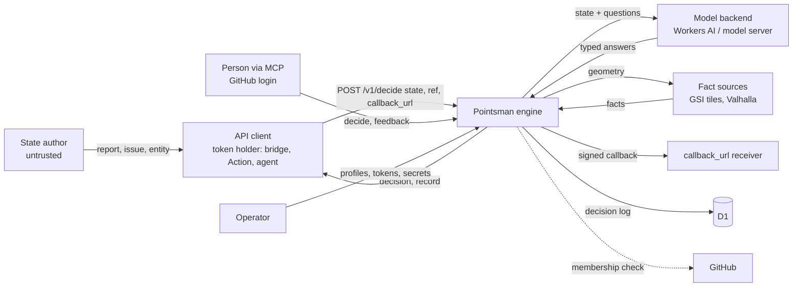

# Threat model — Pointsman

## 1.1 Header

- **Project**: Pointsman (geolonia/pointsman), a decision service on Cloudflare
  Workers: typed questions in, typed answers with probabilities and an action
  out.
- **Version binding**: commit `e1d3591e1b2f6c782f2941e4477923fd88e2addc` on
  `main` (2026-10-16). The repository has no release tags, so the model is
  bound to the commit. A report against a later commit is triaged against the
  model as it stood at that commit, not against this model.
- **Date / author**: 2026-10-16, drafted for the maintainer, Daniel Kastl, who
  ratifies the claims in §1.18. Amended 2026-10-20 for the detour fact's
  opt-in `route` (pointsman#100): the §1.6 row, `P-STATE-NOT-STORED` and
  `R-DATA-MINIMISATION`; and for detour lookups with 8 s, parallel calls and
  one retry (`P-FACT-LOOKUP-BOUNDED`); the rest still stands as of the bound
  commit.
- **Generation metadata**: produced with AI assistance. Model/agent: Claude
  Fable 5.1 (`claude-fable-5-1`) in Claude Code; effort: default. Skills used:
  the Alpha-Omega `threat-model` plugin, version 1.2.1 at commit
  `192fd60cd0afe8851128ce4c68ed68c174c11948` (orchestrator plus
  `threat-model-recon`, `threat-model-surface`, `threat-model-interview` in
  draft-first mode, `threat-model-authoring`, `threat-model-backtest`,
  `threat-model-sidecar`). No MCP servers were used.
- **Reporting cross-reference**: a finding that violates a §1.11 claimed
  property is reported through GitHub's private vulnerability reporting for
  this repository, as `SECURITY.md` says. A finding that lands in §1.3 or §1.12 is closed
  citing this document.
- **Status**: accepted, 2026-10-16. The maintainer answered all 24 questions
  of the first draft in one wave on 2026-10-16 and accepted every proposed
  answer; the matching claims carry *(maintainer, 2026-10)* and no
  **inferred** or **assumption** tag remains. Closure constraint: an **inferred** claim may escalate a report but never
  close it, and an **assumption** closes only what the triage policy below
  permits.
- **Triage policy**: `strict` (kept by maintainer ruling, 2026-10). Should an
  **assumption** be added in a later revision, it escalates and never closes.
  See §1.17.
- **Provenance legend**: *(documented, source)* = stated in the named public
  source of this repository; *(maintainer, YYYY-MM)* = confirmed by the
  maintainer in answer to this process; *(assumption, QN)* = a conservative
  default the author applies now, to be ratified by question `QN` in §1.18;
  *(inferred, QN)* = reasoned from code without a committed default, open as
  question `QN` in §1.18.
- **Glossary**: a short plain-language glossary is at the end of this document
  (Appendix A).
- **Draft confidence**: 259 documented / 70 maintainer / 0 inferred / 0 assumption.
  Counted as the plugin's validator counts, over §1.2 to §1.19: one count per
  parenthesised tag, by its first kind, so a combined tag such as
  *(documented, source; maintainer, 2026-10)* counts once as documented; the
  tags in this header and its legend are not counted.
- **Backtest note**: no historical corpus was available; the backtest routed N synthesized
  cases only (N = 16, a 16-item corpus). The repository has no advisories, no issues labelled
  security, and no issues closed as "by design" or "wontfix". The 16 cases
  cover all 8 component families and all 8 contract dimensions in 14 clusters,
  and were re-routed after the maintainer's wave of 2026-10-16. Dispositions:
  3 `VALID`, 6 `KNOWN-NON-FINDING` (closed), 2 `BY-DESIGN: property-disclaimed`
  (closed), 2 `OUT-OF-MODEL: trusted-input` (closed), 1
  `OUT-OF-MODEL: non-default-build` (closed), 1
  `OUT-OF-MODEL: dependency-contract` (closed), 1
  `OUT-OF-MODEL: adversary-not-in-scope` (closed), 0 `VALID-HARDENING`, 0
  `MODEL-GAP`. Fail-safe figure: 0 of 0 historically-fixed items route to a
  closing disposition (there are none). 13 of 16 close outright, every close
  licensed by a **documented** or **maintainer** claim; the share is high
  because the maintainer ratified the design positions on prompt steering,
  callback hosts and state size, not because a disclaimer was widened. No
  contradictions, because there is no historical call to contradict. The
  routing table is producer-side (`.threat-model/backtest.md`, ignored by
  git) and not in the repository, as the skill asks; the figures here are
  the only published part, so a reviewer cannot recheck them from the tree.
- **Sibling models**: none. The FIWARE bridge, the two GitHub Actions and the
  config-repository template are component families of this model (§1.2).
  The demo repository `geolonia/pointsman-demo` is out of scope (§1.3).

Pointsman answers fixed questions about a piece of data ("state") with a
language model, then applies rules that people wrote to the typed answers and
returns an action. Every decision is logged with its profile version and the
model that answered. It runs as one Cloudflare Worker per deployment, with the
profiles and configuration in a private repository owned by the integrator.

> **Triager quick-start.** Given an inbound finding:
> 0. Read the triage policy above (`strict`). It decides what an
>    **assumption** may do in step 8.
> 1. Locate the sink → look up its row in the §1.7 input-trust table (or the
>    §1.8 output statement, for "downstream may assume X" findings).
> 2. Locate the contract dimension → for numeric domain and representational
>    limits, failure/exception atomicity, recursive or cyclic topology,
>    callback/collaborator execution, serialization/reconstruction,
>    reference/object lifecycle, concurrency/reentrancy, resource complexity,
>    or the project-specific `x-prompt-injection` and `x-probabilistic-result`
>    dimensions, follow the component's row in the §1.7 matrix to its owning
>    claim.
> 3. Check the required attacker capability and control kind against
>    §1.7/§1.10; distinguish data from size, type/class, callback code,
>    collaborator implementation, resource name and serialized state.
> 4. Check the affected component against §1.2/§1.3, and any required
>    configuration against §1.6.
> 5. If the root cause is in a dependency, apply §1.9.
> 6. Apply §1.17's precedence order, beginning with an exact §1.15 match.
> 7. Assign exactly one §1.17 disposition, citing the licensing section and its
>    provenance. If none fits, assign `MODEL-GAP` and trigger §1.16; do not
>    improvise.
> 8. **Before closing, check the provenance of the claim that licenses the
>    close.** This gate applies to every `OUT-OF-MODEL: *`, `BY-DESIGN: *` and
>    `KNOWN-NON-FINDING` route; `VALID` and `MODEL-GAP` are unaffected.
>    - **documented** or **maintainer** → close.
>    - **inferred** → **escalate, never close**, under either policy.
>    - **assumption** → escalate under `strict` (this model). Under `relaxed`
>      it licenses only a **provisional** close for `trusted-input`,
>      `adversary-not-in-scope`, `unsupported-component`,
>      `non-default-build` or a non-security-critical `property-disclaimed`.
>    - An **assumption** never closes `KNOWN-NON-FINDING`, a
>      security-critical `property-disclaimed` or `dependency-contract`.
>    - A disclaimer that rests on the **absence** of a statement never closes a
>      security-critical report, whatever its tag. §1.12 marks the basis of
>      each disclaimer.
>    Record the outcome as `closed`, `provisional` or `escalated` (§1.17). An
>    escalated finding keeps its disposition; it is not a `MODEL-GAP`.

## 1.2 Scope and intended use

Pointsman's intended use is a first check of things that arrive in a system
and that someone would otherwise look at first: a resident's road report, a
new issue, a deploy that seems stuck *(documented, README "What it does, in
plain words")*. A client system sends a state to `POST /v1/decide/{profile}`;
the model answers the profile's questions; the profile's policy turns the
answers into an action, `auto`, `review` or a custom one *(documented, README
"How a request looks")*.

Deployment shape: one Worker per integrator, deployed from a private
configuration repository that pins one engine commit and holds the profiles
*(documented, docs/deployment.md "Deployment" table)*. The integrator in the
Alpha-Omega sense is the owner of that private repository. A shared,
multi-tenant hosted Pointsman is not a deployment the project describes;
this model treats it as unsupported *(maintainer, 2026-10)*.

Roles, as this model uses them *(maintainer, 2026-10)*:

- **State author**: whoever writes the data that ends up in `state`: a
  resident filing a report, a GitHub issue author, a sensor or an app writing
  to a FIWARE broker. Untrusted.
- **API client (token holder)**: a system the integrator set up with a scoped
  API token: the bridge, a GitHub Action, an agent. Trusted for the profiles
  in its token's scope, and only for those.
- **Reviewer**: a person who resolves `review` decisions or sends feedback,
  through a client that holds a token, or through MCP after a GitHub login.
  Trusted for the profiles they reach.
- **Operator / integrator**: owns the Cloudflare account, the config
  repository, the tokens and the secrets. Trusted.
- **Collaborators**: the model backend (Workers AI, optionally an HTTP model
  server), the public data sources behind facts (GSI tiles, a Valhalla
  server), GitHub (identity), the context broker (for the bridge). Trusted to
  receive what the engine sends them; their answers are data the engine
  checks for shape, not for truth (§1.9).

### Component families

| Family | Representative entry point | Touches outside the process? | In model? | Provenance |
| --- | --- | --- | --- | --- |
| `engine-api` — REST API, auth, input mapping, model adapters, policy, decision log (`src/app.ts`, `auth.ts`, `input.ts`, `policy.ts`, `feedback.ts`, `log.ts`, `models/*`, `profiles/store.ts`, `index.ts`) | `POST /v1/decide/{profile}` | network (model backend), D1, KV read | in | *(documented, README "API")* |
| `engine-facts` — spatial facts (`src/facts.ts`, `facts-gsi.ts`, `facts-routing.ts`, `geo.ts`) | `lookupFacts` for a profile with `facts` | network (GSI tile hosts, Valhalla), Workers cache | in | *(documented, docs/profile-format.md "Facts")* |
| `engine-callbacks` — review callbacks and the cron retry (`src/callbacks.ts`, `deliver`/`retryDueCallbacks` in `app.ts`) | `POST /v1/reviews/{id}/resolve`, cron `*/5 * * * *` | network (client-supplied `callback_url`), D1 | in | *(documented, docs/reviews.md "Callbacks")* |
| `engine-mcp` — MCP endpoint and GitHub OAuth (`src/mcp.ts` and `src/oauth.ts`) | `/mcp`, `/authorize`, `/callback`, `/oauth/*` | network (github.com, api.github.com, client metadata URLs), KV `OAUTH_KV` | in | *(documented, docs/mcp.md)* |
| `bridge` — FIWARE bridge Worker (`bridge/src/*`) | `POST /notify`, `POST /reviews`, queue consumer | network (broker, Pointsman), Cloudflare Queue | in | *(documented, bridge/README.md "Why a bridge")* |
| `action-triage` — GitHub Action (`actions/triage/`) | `triage.mjs` on `issues` events | network (Pointsman, GitHub API), filesystem (`GITHUB_OUTPUT`, step summary), env | in | *(documented, actions/triage/README.md)* |
| `action-deploy-watch` — GitHub Action (`actions/deploy-watch/`) | `watch.mjs` around a deploy command | child processes (`bash`, `aws`), network (Pointsman), env, filesystem | in | *(documented, actions/deploy-watch/README.md)* |
| `config-repo` — the config-repository template and the engine scripts its workflows and the operator run (`template/config-repo/`, `scripts/tokens.mjs`, `scripts/publish-profiles.mjs`, `scripts/validate-profiles.mjs`, `scripts/check-config.mjs`, `scripts/check-profile-versions.mjs`) | the Validate and Deploy workflows; `node scripts/tokens.mjs create` | network (Cloudflare API through wrangler), KV and D1 writes | in | *(documented, docs/deployment.md "Set up")* |
| `examples/profiles/`, `site/`, `brand/`, `docs/spikes/`, `test/`, `scripts/build-*.mjs`, `scripts/check-public.mjs`, `scripts/ai-gateway.mjs` | n/a | varies | out (§1.3) | *(documented, README "Decision profiles": "This repository holds only example profiles")* |
| `geolonia/pointsman-demo` (separate repository) | n/a | n/a | out (§1.3) | *(documented, docs/fiware-demo.md "How it runs")* |

The bridge shares the engine's release cadence and maintainer but has its own
adversary model (the broker's writers). This draft keeps it in one model as a
family, with a question whether it should become a sibling model
*(maintainer, 2026-10)*.

## 1.3 Out of scope (explicit non-goals)

- **Example profiles** (`examples/profiles/`) are examples. They are built
  into the Worker only with `PROFILE_SOURCE=bundled`, which the development
  config uses and which the README marks "development only" *(documented,
  README "Development")*. A finding that needs a bundled example profile in
  production routes to `OUT-OF-MODEL: non-default-build` (§1.6).
- **The mock model and the mock fact provider** (`src/models/mock.ts`,
  `MockFactProvider` in `src/facts.ts`) answer every state the same way and
  exist for development and tests *(documented, docs/models.md "MODEL_MODE"
  table; docs/profile-format.md "Fact providers" table)*. A deployment that
  uses them is unsupported (§1.6).
- **Spikes** (`docs/spikes/`, including `probe.mjs`, `bridge.js`,
  `dmn-evaluate.js`) are exploration, not shipped code *(documented, the
  spike documents' titles "Spike:")*. Findings there are
  `OUT-OF-MODEL: unsupported-component`.
- **The website** (`site/`, `brand/`, the Pages workflow) publishes static
  pages and holds no secrets or decisions *(maintainer, 2026-10)*.
- **Tests and fixtures** (`test/`) and the developer scripts that build or
  check the repository (`scripts/build-profiles.mjs`,
  `build-openapi-validators.mjs`, `check-public.mjs`, `ai-gateway.mjs`) do not
  run in a deployment *(maintainer, 2026-10)*.
- **The demo** (`geolonia/pointsman-demo`): its page, its Worker, its
  Turnstile and rate limits are a separate repository with its own limits
  *(documented, docs/fiware-demo.md "Limits for a public demo")*. It is not
  modelled here even though it mounts the bridge.
- **Threats not defended against**, each with a reason:
  - A person with access to the Cloudflare account, the config repository's
    `main` branch or its deploy secrets has already won: they can deploy any
    engine, write any token hash into `TOKENS`, and edit the decision log. The
    project's own guard is that the deploy workflow only runs code from
    `geolonia/pointsman` at the pinned commit *(documented, docs/deployment.md
    "Updating the engine")*.
  - The Cloudflare platform (Workers isolation, KV, D1, Queues, Workers AI,
    the AI Gateway) is trusted; its faults are its own *(maintainer, 2026-10)*.
  - Network observers: every documented transport is https (the engine
    refuses plain http for callbacks, model servers and routing servers except
    loopback); TLS is the platform's *(documented, docs/models.md "Model
    server" table; openapi.yaml `DecideRequest.callback_url` pattern)*.
  - Co-tenants on Cloudflare, timing side channels and the model's own
    training data are out of this model's layer *(maintainer, 2026-10)*.
  - Correctness of the model's judgement: the project states that answers
    move between model versions and tells integrators to keep a margin from
    their thresholds *(documented, docs/fiware-demo.md "Checked again
    (2026-10-15)": "Lesson: keep a margin from the thresholds")*. A wrong but
    well-formed answer is not a security finding (§1.12 `D-MODEL-ACCURACY`).

## 1.4 Trust boundaries and data flow

There are three boundaries, one per hop:

1. **Client → engine**: the API token authenticates the client; `state`,
   `ref` and `callback_url` come from the client, and `state` carries data the
   state author wrote *(documented, README "API tokens"; maintainer, 2026-10)*.
2. **Engine → collaborators → engine**: the engine sends the state and the
   questions to the model backend and the geometry to the fact providers, and
   checks what comes back for shape only *(documented, docs/profile-format.md
   "Engine answer format": "Answers that do not fit the profile ... are
   rejected with a `model_error`")*.
3. **Engine → downstream**: the decision, the decision record and the signed
   callback are the engine's outputs; the client, the bridge, the Actions and
   the broker act on them (§1.8).

Reachability preconditions per family:

- `engine-api`: a finding matters if it is reachable from a request that
  carries a valid token, or from the `state`, `ref` or `callback_url` such a
  request carries, or from a model backend's response *(maintainer, 2026-10)*. A
  finding that needs an invalid or missing token to succeed is a finding
  against `P-AUTH-REQUIRED` (§1.11).
- `engine-facts`: reachable from the geometry at a profile's `at` path in the
  client's state, or from a tile or routing response *(documented,
  docs/profile-format.md "Facts" table, `at`)*.
- `engine-callbacks`: reachable from `callback_url` and from the receiver's
  response *(documented, docs/reviews.md "Callbacks")*.
- `engine-mcp`: reachable from an MCP tool call with a valid API token or
  OAuth access token, or from the OAuth routes before login (consent page,
  client registration, GitHub callback) *(documented, docs/mcp.md
  "Authentication")*.
- `bridge`: reachable from a notification that carries the shared secret,
  from the entity bodies in it, from a queue message, or from a broker or
  Pointsman response *(documented, bridge/README.md "Configuration",
  `NOTIFY_SECRET`)*.
- `action-triage`: reachable from the issue title and body in the event
  payload, or from Pointsman's response *(documented, actions/triage/triage.mjs
  header comment: "The issue text is untrusted input")*.
- `action-deploy-watch`: reachable from CloudFormation stack events or from
  Pointsman's response. The `run` command and the stack names come from the
  workflow and are trusted *(documented, actions/deploy-watch/action.yml
  `run`: "Comes from the workflow, never from event data")*.
- `config-repo`: reachable from a pull request to the config repository or
  from the operator's own command line; both are trusted authors (§1.7).

## 1.5 Assumptions about the environment

- **Runtime**: Cloudflare Workers (`compatibility_date` 2026-10-01), one
  isolate per request batch; module-level state (`gsiFacts`, the bundled
  store, the OAuth server map, the GSI tile memory cache) is shared between
  requests of one isolate and is not shared across isolates *(maintainer, 2026-10)*.
- **Storage consistency**: D1 is strongly consistent and holds the decision
  log and the profile-version registry; KV is eventually consistent, so a
  revoked token can work for up to about 60 seconds elsewhere, and a new
  profile version can be visible in the index before its key *(documented,
  README "API tokens": "KV can take up to about 60 seconds"; docs/deployment.md
  "Profile versions"; `src/profiles/store.ts` `KvProfileStore` comment)*.
- **Clock**: the engine uses the Worker's clock for `created_at`,
  callback timestamps and retry scheduling *(maintainer, 2026-10)*.
- **Scheduling**: a cron trigger every five minutes retries due callbacks and
  purges expired OAuth records *(documented, wrangler.jsonc `triggers`
  comment; docs/reviews.md "Callbacks")*.
- **Concurrency**: a review can be resolved once; two resolves race on a
  single `UPDATE ... WHERE review_status = 'pending'` *(documented,
  docs/reviews.md "Review queue": "A second resolve, also at the same moment,
  answers 409")*. A callback is claimed before it is sent, so the first
  delivery and the cron retry do not send the same attempt twice
  *(maintainer, 2026-10)*.

### No-surprise side-effects inventory

Negative claims are tagged by how good the scan was. Commands run in the
modeled tree.

- **Outbound network, engine**: the engine fetches only these hosts: the
  model backend (`src/models/http.ts:88`, operator URL; or the `AI` binding,
  `src/models/workers-ai.ts:39`), the GSI tile hosts
  `disaportaldata.gsi.go.jp` and `cyberjapandata.gsi.go.jp`
  (`src/facts-gsi.ts`, fixed URLs), the Valhalla server (`src/facts-routing.ts`,
  operator URL), the client-supplied `callback_url` (`src/callbacks.ts:69`),
  `github.com` and `api.github.com` (`src/oauth.ts`), and, through the OAuth
  library, the client-ID metadata document URL an MCP client names
  (`clientIdMetadataDocumentEnabled: true`, `src/oauth.ts`). Search:
  `grep -rn 'fetch(' src bridge/src | grep -v ':\s*//'` — 11 hits, listed
  above plus the Hono/MCP/OAuth library entry points that serve inbound
  requests. All outbound fetches are limited to public addresses by the
  `global_fetch_strictly_public` compatibility flag *(documented, wrangler.jsonc
  comment: "Outgoing fetches (review callbacks, OAuth client metadata) reach
  only public addresses"; the same flag in `template/config-repo/wrangler.jsonc`
  and `bridge/wrangler.jsonc`)*. The library hole: `@modelcontextprotocol/server`
  and `@cloudflare/workers-oauth-provider` could fetch on the engine's behalf;
  only the metadata-document fetch is known *(maintainer, 2026-10)*.
- **Redirects**: the engine's outbound calls to the model server, the
  routing server and the callback receiver use `redirect: 'manual'` and treat
  a 3xx as an error (`src/models/http.ts:97`, `src/facts-routing.ts:117`,
  `src/callbacks.ts:78`) *(documented, docs/profile-format.md "Detours":
  "Redirects are not followed (they would carry the key to another host)")*.
  The bridge's calls to the broker and to Pointsman use the default redirect
  mode, so a redirecting broker would receive the broker credentials and the
  entity at the redirect target; the broker URL is operator-set, so this is a
  trusted-collaborator edge, not an attacker-controlled one *(maintainer, 2026-10)*.
- **Child processes, environment, filesystem**: none in the engine and the
  bridge. Search:
  `grep -rn "child_process\|spawn(\|execFile\|process\.env\|\beval(\|new Function" src bridge/src`
  — 0 hits. The engine reads its configuration from Worker bindings and
  vars only *(maintainer, 2026-10)*. `action-deploy-watch` spawns `bash -c <run>`
  in its own process group and runs the `aws` CLI
  (`actions/deploy-watch/watch.mjs:17,118`); both Actions read `INPUT_*` and
  `GITHUB_*` environment variables and append to `GITHUB_OUTPUT` and
  `GITHUB_STEP_SUMMARY` *(documented, the Actions' header comments and
  `action.yml` inputs)*.
- **Storage writes, engine**: D1 `decisions` and `feedback` rows
  (`src/log.ts`), the Workers cache for GSI tiles (`src/facts-gsi.ts:198`),
  `OAUTH_KV` (the purge cursor at `src/oauth.ts:294` and the OAuth library's
  grants and tokens). The engine never writes to `TOKENS` or `PROFILES`;
  tokens are written by `scripts/tokens.mjs` and profiles by
  `scripts/publish-profiles.mjs`, both run by the operator. Search:
  `grep -rn '\.put(\|\.delete(' src` — hits only in `src/oauth.ts` (OAUTH_KV)
  and `src/facts-gsi.ts` (cache, memory map) *(maintainer, 2026-10)*.
- **Logging**: the engine writes to the Workers log (`observability`
  enabled) through `console.error` and `console.log` in 5 places in `src/`
  (and the bridge in 7 places in `bridge/src/`); by design these messages carry
  the reason, never the state, a token, an API key or a model response
  *(documented, README "API tokens": "They never appear in logs, responses or
  the decision log"; docs/models.md "Model server": "Errors and logs never
  include the request, the response body or the key")*. The AI Gateway, when
  configured with `collect_logs: true`, stores every model call including the
  state *(documented, docs/models.md "Logs hold the state")*.
- **Global state**: no process-wide mutation beyond the module-level caches
  named above *(maintainer, 2026-10)*.

## 1.6 Build-time and configuration variants

Support posture, not defaultness, controls routing. A defect in a supported
configuration is in-model even when the configuration is not the default.

| Knob | Where | Default | Effect on the model | Posture | Provenance |
| --- | --- | --- | --- | --- | --- |
| `PROFILE_SOURCE=bundled` | wrangler vars | `bundled` in the dev config; `kv` in the template | serves the example profiles built into the Worker | dev-only; `kv` is the production posture | *(documented, README "Development": "`wrangler.jsonc` in this repository is for development only")* |
| `MODEL_MODE=mock` | wrangler vars | `mock` in the dev config; `workers-ai` in the template | every model id answered by a fixed mock, independent of the state | dev-only | *(documented, docs/models.md "MODEL_MODE" table: "development and tests")* |
| `FACTS_MODE` (`off`, `mock`, `gsi`) | wrangler vars | `off` | `off`: every fact is missing; `mock`: fixed answers; `gsi`: public GSI data | `off` and `gsi` supported; `mock` dev-only | *(documented, docs/profile-format.md "Fact providers" table)* |
| `MODEL_SERVER_URL` with plain `http://` | wrangler vars / `.dev.vars` | unset | sends the state unencrypted; accepted only for loopback hosts | loopback only; any other `http://` is refused at startup (`checkServerUrl`) | *(documented, docs/models.md "Model server" table)* |
| `AI_GATEWAY_ID` | wrangler vars | set in the template | routes model calls through the AI Gateway with logs, a 600 calls/min rate limit and a 10 s timeout; without it, direct Workers AI calls | both supported | *(documented, docs/models.md "Workers AI and AI Gateway")* |
| AI Gateway `collect_logs` | `ai-gateway.json` | `true` | the gateway keeps every model call including the state | supported; voids `P-STATE-NOT-STORED` for the gateway's logs | *(documented, docs/models.md "Logs hold the state")* |
| `CALLBACK_SECRET` | Worker secret | unset | unset: no callback is ever sent; the callback state says why | supported (callbacks off) | *(documented, docs/reviews.md "Callbacks": "Without that secret, nothing is sent")* |
| GitHub login (`PUBLIC_URL`, `GITHUB_CLIENT_ID`, `GITHUB_CLIENT_SECRET`, `ALLOWED_GITHUB_ORGS`, `OAUTH_KV`) | wrangler vars, secret, binding | unset | all set: people may log in to `/mcp`; none: `/mcp` takes API tokens only; some: every request fails with a configuration error | both supported; a partial configuration is refused | *(documented, docs/mcp.md "Setting up GitHub login": "Set all of these or none")* |
| `global_fetch_strictly_public` | `compatibility_flags` | present in all three wrangler configs | outbound fetches reach only public addresses | required; a deployment without it is unsupported and voids `P-OUTBOUND-PUBLIC-ONLY` | *(maintainer, 2026-10)* |
| `log.store_state: true` | per profile | `false` | stores the full state in D1 instead of only its hash | supported; voids `P-STATE-NOT-STORED` for that profile | *(documented, docs/decision-log.md "What is stored")* |
| `route: true` on a `detour` fact | per profile | `false` | the fact keeps the way around, whose ends are the section's place in the state; stored with the decision, returned by the API and MCP, and written by the bridge into the Decision entity | supported; narrows `P-STATE-NOT-STORED` for that profile (the place, not the rest of the state) | *(documented, docs/decision-log.md "What is stored")* |
| `mcp.visible: true` | per profile | `false` | the profile is listed and callable through MCP, by every logged-in person and by tokens in scope | supported | *(documented, docs/mcp.md "Only profiles that set `mcp.visible: true`")* |
| Test tokens (`tokens.mjs create --test`) | token record `test: true` | not set | decisions are made but not logged, marked `test: true`; the token may only decide and list profiles over REST | supported | *(documented, README "API tokens")* |
| Bridge `BRIDGE_QUEUE` | bridge binding | unset | with a queue, notifications are answered 202 and handled later with retries; without it, in the broker's request | both supported | *(documented, bridge/README.md "Reliable delivery (queue)")* |
| Bridge `BROKER_TOKEN` / `BROKER_API_KEY` | bridge secrets | unset | the broker credentials the bridge writes with; both set is refused | one of them | *(documented, bridge/README.md "Configuration" secrets table)* |
| Action `cancel-update` | `action.yml` | `true` | also runs `aws cloudformation cancel-update-stack` when a deploy is stopped | supported | *(documented, actions/deploy-watch/README.md "Inputs")* |

## 1.7 Assumptions about inputs

### Per-input-operand trust table

Coverage: 56 rows cover all 7 REST routes, the `/mcp` endpoint with its 4
tools, the 7 OAuth routes (grouped), the bridge's 2 routes and queue
consumer, both Actions, and the config repository's inputs. Every route in
`src/app.ts` has at least one row. Headers and indirect inputs (model
responses, tile bytes, broker responses, the token record) are tabled where
they are security-relevant.

| Entry point | Input operand | Attacker-controllable? | Control kind | Caller must enforce | Provenance |
| --- | --- | --- | --- | --- | --- |
| every `/v1/*` route | `Authorization: Bearer <token>` header | yes (anyone can send a header); accepted only when its SHA-256 matches a record in `TOKENS` | data | none — `P-AUTH-REQUIRED` | *(documented, README "API tokens")* |
| every `/v1/*` route | the token record (`client`, `profiles`, `test`) read from KV | no — written only by the operator with `scripts/tokens.mjs` | serialized-state | keep `TOKENS` writable only by operators | *(documented, docs/deployment.md "Deployment" table)* |
| `GET /v1/profiles` | none beyond the token | — | — | — | *(documented, openapi.yaml `/v1/profiles`)* |
| `POST /v1/decide/{profile}` | `{profile}` path | yes (token holder) | resource-name | none — scope checked before the lookup (`P-TOKEN-SCOPE`) | *(documented, docs/decision-log.md "A token sees and corrects only decisions of profiles in its scope")* |
| `POST /v1/decide/{profile}` | `?version` query | yes (token holder) | data | none — must match `^[1-9][0-9]{0,8}$`, else 400 | *(documented, openapi.yaml `/v1/decide/{profile}` `version` parameter)* |
| `POST /v1/decide/{profile}` | `state` body field (string, object or array) | **yes, by the state author** through the client | data, size, x-prompt-text | treat it as untrusted data: never put it in a shell, a query or a template; do not include secrets or personal data unless `log.store_state` and gateway logging are intended | *(documented, openapi.yaml `DecideRequest.state`: "free text, or any JSON object or array")* |
| `POST /v1/decide/{profile}` | `state` size and nesting | yes (state author) | size | the engine sets no limit; the platform's request body limit applies; rate-limit at the edge | *(documented, openapi.yaml `DecideRequest.state` has no `maxLength`; maintainer, 2026-10)* |
| `POST /v1/decide/{profile}` | `ref` | yes (token holder; often derived from attacker-named things such as an issue number) | data | 1–200 characters; it is logged and returned, so no secrets | *(documented, openapi.yaml `DecideRequest.ref`)* |
| `POST /v1/decide/{profile}` | `callback_url` | yes (token holder) | resource-name | https only; any public host; refused for test tokens | *(documented, openapi.yaml `DecideRequest.callback_url`; README "A test token ... gets no callbacks")* |
| `POST /v1/decide/{profile}` | the profile read from the store (questions, rules, `input` paths, `facts`, `log`, `mcp`) | no — authored by the integrator, validated before publication | serialized-state, x-policy-rules | validate with `validate-profiles.mjs`; bump the version | *(documented, docs/deployment.md "Profile versions"; `src/profiles/store.ts` header: "Profiles are validated before they reach a store")* |
| `POST /v1/decide/{profile}` | the model response (`answers`, `model`) | partly — the model backend is a collaborator; its answers are shaped by the state | collaborator-implementation, data | none — `P-ANSWER-SHAPE` rejects answers that do not fit the profile | *(documented, docs/profile-format.md "Engine answer format")* |
| `POST /v1/decide/{profile}` | the server-reported `model` name (HTTP model server) | no — the configured name is stored, not the server's field | data | none | *(maintainer, 2026-10)* |
| `POST /v1/decide/{profile}` | the `model` name reported by Workers AI | no — trusted collaborator | data | none | *(maintainer, 2026-10)* |
| `POST /v1/decide/{profile}` | geometry at each fact's `at` path | yes (state author, within the client's payload) | data, size | none — `P-FACT-LOOKUP-BOUNDED`; a bad geometry is `no_location` | *(documented, docs/profile-format.md "Facts" table, `at`)* |
| `GET /v1/decisions/{id}` | `{id}` | yes (token holder) | resource-name | none — must be a UUID and in scope, else 404 | *(documented, docs/decision-log.md "Other decisions answer 404, as if they did not exist")* |
| `POST /v1/decisions/{id}/feedback` | `correct` | yes (token holder) | data, type-class | none — checked against the decision's profile version | *(documented, docs/decision-log.md "Feedback")* |
| `POST /v1/decisions/{id}/feedback` | `by`, `note` | yes (token holder) | data | `by` 1–100 characters, `note` ≤ 1000; `by` is recorded as given, not verified | *(documented, openapi.yaml `Feedback` schema; migrations/0001 comment "who corrected it, as given by the client")* |
| `GET /v1/stats/{profile}` | `{profile}`, `?days` | yes (token holder) | resource-name, data | none — scope checked; `days` 1–90 | *(documented, openapi.yaml `/v1/stats/{profile}`)* |
| `GET /v1/reviews` | `?profile` | yes (token holder) | resource-name | none — scope checked; at most 100 rows returned | *(documented, docs/reviews.md "Review queue")* |
| `POST /v1/reviews/{id}/resolve` | `action` | yes (token holder) | data | lower-case name, not `review`; it is the final action the client will act on | *(documented, docs/reviews.md "`action` is the final action")* |
| `POST /v1/reviews/{id}/resolve` | `correct`, `by`, `note` | yes (token holder) | data, type-class | as for feedback; `by` is recorded as given | *(documented, docs/reviews.md "Review queue")* |
| cron `scheduled()` | the due callbacks read from D1 | no — the engine's own records | serialized-state | none | *(documented, docs/reviews.md "Retries are run by the Worker's cron trigger")* |
| outbound callback | the receiver's HTTP status | yes (whoever is at `callback_url`) | data | none — any 2xx is delivered; else retried up to 6 attempts, then `failed` | *(documented, docs/reviews.md "Answer with any 2xx status")* |
| outbound callback | the receiver's body and redirects | yes | data | none — the body is ignored, a 3xx is an error (`src/callbacks.ts:78`) | *(maintainer, 2026-10)* |
| `engine-facts` tile fetch | PNG and GeoJSON tile bytes from GSI | no — public data from a fixed host, decoded by the engine's own PNG and GeoJSON readers | data, serialized-state | none — an unknown legend colour or unreadable tile is `error`, never a guess | *(documented, docs/profile-format.md "A colour that is not in the legend fails the lookup")* |
| `engine-facts` routing | the Valhalla response (`trip.summary.length`, `error_code`) | no — operator-chosen server over OpenStreetMap data | data | none — a 3xx is an error; a missing length is an error | *(documented, docs/profile-format.md "Detours")* |
| `/mcp` | `Authorization` header: `pm_` API token or OAuth access token | yes | data | none — API tokens go to the token store, other tokens to the OAuth server (`P-AUTH-REQUIRED`) | *(documented, docs/mcp.md "Authentication")* |
| `/mcp` `list_profiles` | none | — | — | — | *(documented, docs/mcp.md "Tools")* |
| `/mcp` `decide` | `profile`, `state` (string or object), `ref` | yes (the agent, and the state author behind it) | resource-name, data, x-prompt-text | as for `POST /v1/decide`; only MCP-visible profiles in scope; others look unknown | *(documented, docs/mcp.md "Decisions through MCP")* |
| `/mcp` `get_decision` | `decision_id` | yes | resource-name | none — UUID, in scope and MCP-visible, else unknown; `callback_url` and `state` are not shown | *(documented, docs/mcp.md "Tools"; `src/mcp.ts` `get_decision`)* |
| `/mcp` `submit_feedback` | `decision_id`, `correct`, `note` | yes (a logged-in person) | data, type-class | people only; recorded under their GitHub login | *(documented, docs/mcp.md "Feedback is a person's judgement")* |
| `GET /authorize` | the OAuth authorization request (client id, redirect URI, PKCE challenge) | yes (any MCP client) | data, resource-name | none — parsed by the OAuth library; the consent page shows the client name and redirect host, marked unverified when self-registered | *(documented, docs/mcp.md "MCP clients register themselves")* |
| `POST /authorize` | form `handle`, `decision` | yes (the person's browser) | data | none — the library binds the handle to the consent | *(maintainer, 2026-10)* |
| `GET /callback` | `code`, `state` from GitHub | yes (whoever reaches the URL) | data | none — `state` resumes the library's upstream flow; `code` is exchanged with PKCE and the client secret; membership is checked before a grant | *(documented, docs/mcp.md "Only active members of the allowed GitHub organizations get in")* |
| `/oauth/register`, `/oauth/token`, `/.well-known/*` | client metadata, token requests | yes (any MCP client) | data, serialized-state | none — the OAuth library's contract (§1.9) | *(maintainer, 2026-10)* |
| `engine-mcp` membership check | GitHub's `/user` and membership responses | no — trusted identity provider | data | none | *(documented, docs/mcp.md "GitHub is only the login step")* |
| `bridge` `POST /notify`, `POST /reviews` | `x-bridge-secret` header | yes (anyone who can reach the Worker); accepted only when equal to `NOTIFY_SECRET` | data | none — `P-BRIDGE-NOTIFY-SECRET` | *(documented, bridge/README.md "Configuration": "other notifications are refused")* |
| `bridge` `POST /notify` | `?route` | yes (with the secret) | resource-name | none — must name a configured route | *(documented, bridge/README.md "Chains of decisions")* |
| `bridge` `POST /notify` | notification `data[]`: entity ids, types and attribute values | yes — written by whoever may write entities in the broker tenant, delivered by the broker | data, size, x-prompt-text | the broker's access control decides who may write; the bridge forwards the whole entity as `state` | *(documented, bridge/README.md "The subscription"; maintainer, 2026-10)* |
| `bridge` `POST /reviews` | a `Decision` entity (`reviewStatus`, `finalAction`, `reviewedBy`, `reviewedAt`, `corrections`) | yes — whoever may write Decision entities | data | the broker's access control; `reviewedBy` is taken as written | *(documented, bridge/README.md "Who may resolve is decided by the broker's access control")* |
| `bridge` `POST /reviews` | a completed `Task` entity (`progress`, `statusLabel`, `refersTo`, `dateModified`) | yes — whoever may write Task entities | data | the broker's access control; only labels in `BRIDGE_WORK_ORDERS` map to an action | *(documented, bridge/README.md "Work orders from other apps")* |
| `bridge` queue consumer | queue message bodies | no — written by the bridge's own `/notify` and `/reviews` | serialized-state | none; a malformed message is dropped | *(maintainer, 2026-10)* |
| `bridge` broker reads | entity JSON from the broker | partly — the broker is trusted; the content is what writers put there | data, collaborator-implementation | none | *(maintainer, 2026-10)* |
| `bridge` Pointsman calls | the decision JSON | no — Pointsman is the bridge's trusted collaborator; shape-checked | data | none | *(maintainer, 2026-10)* |
| `bridge` configuration | `BRIDGE_ROUTES`, `BRIDGE_WORK_ORDERS`, URLs, secrets | no — operator | serialized-state | https URLs; one broker credential, not both | *(documented, bridge/README.md "Configuration")* |
| `action-triage` | `url`, `token`, `profile`, `labels`, `review-label`, `github-token` inputs | no — workflow author | data, resource-name | `url` https (http on loopback only), no query, fragment or credentials; `labels` is the allow-list | *(documented, actions/triage/README.md "Inputs")* |
| `action-triage` | `issue.title`, `issue.body` from the event payload | **yes (issue author)** | data, x-prompt-text | none — sent to Pointsman as JSON, never to a shell or the summary (`P-TRIAGE-ALLOWLIST`) | *(documented, actions/triage/README.md "The issue text is sent to Pointsman as JSON data; it is never used in a shell command")* |
| `action-triage` | Pointsman's decision (`action`, `answers`) | no — trusted collaborator; only mapped answers become labels | data | none | *(documented, actions/triage/README.md "Only labels you list in `labels` are ever applied")* |
| `action-deploy-watch` | `run`, `stacks` inputs | no — workflow author; `run` is executed with `bash -c` | callback-code, resource-name | set `run` in the workflow; never build it from event data; `stacks` must match `^[A-Za-z][A-Za-z0-9-]{0,127}$` | *(documented, actions/deploy-watch/action.yml `run` description)* |
| `action-deploy-watch` | `url`, `token`, `profile`, `quiet-minutes`, `interval-seconds`, `consecutive`, `kill-after-seconds`, `cancel-update` | no — workflow author | data, resource-name | as for the triage action | *(documented, actions/deploy-watch/README.md "Inputs")* |
| `action-deploy-watch` | CloudFormation stack events (`describe-stack-events`) | conditional — the account's own stacks; `ResourceStatusReason` can carry text from templates or AWS | data | none — passed to Pointsman as JSON, truncated to 300 characters per reason | *(maintainer, 2026-10)* |
| `action-deploy-watch` | Pointsman's `action` | no — trusted collaborator; only `cancel`, twice in a row by default, stops the deploy | data | none — a failing Pointsman never cancels | *(documented, actions/deploy-watch/README.md "If Pointsman cannot be reached, nothing is cancelled")* |
| `config-repo` Validate / Deploy workflows | `profiles/*.yaml` | no — pull-request authors are the integrator's own contributors; `main` is protected | serialized-state, x-policy-rules | protect `main`; require the Validate check | *(documented, template/config-repo/README.md "Protect `main`")* |
| `config-repo` workflows | `engine.json` `ref` | no — the repository is fixed to `geolonia/pointsman` in the workflow; `ref` must be a 40-character SHA | resource-name | change `ENGINE_REPOSITORY` only on purpose | *(documented, docs/deployment.md "Updating the engine")* |
| `config-repo` workflows | `wrangler.jsonc`, `ai-gateway.json`, the `production` environment secrets | no — operator | serialized-state | placeholders refused (`check-config.mjs`); secrets only in the three Cloudflare steps | *(documented, docs/deployment.md "What the workflows do")* |
| `scripts/tokens.mjs` | `--client`, `--profiles`, `--test`, `--hash`, `--local`/`--remote`, `--config` | no — operator at a terminal | data | `--profiles '*'` only on purpose; store the printed token as a secret | *(documented, README "API tokens")* |

### Size, shape and rate

- `state`: any JSON value or non-empty string; no size or depth limit in the
  engine *(documented, openapi.yaml `DecideRequest.state`; maintainer, 2026-10)*.
- `ref` ≤ 200, `by` ≤ 100, `note` ≤ 1000 characters; `days` 1–90; reviews
  listed 100 at a time *(documented, openapi.yaml)*.
- Profiles: 1–64 questions, 2–255 choice options, 2–10 score levels, ≤ 16
  facts *(documented, docs/profile-format.md "Fields")*.
- Facts: a LineString of at most 1000 positions; a flood lookup reads at most
  16 tiles, a shelter lookup at most 9; a detour section is at most 5 km; 3 s
  per fact, 10 s per tile load; failures are `missing`, never a hang
  *(maintainer, 2026-10)*.
- Model calls: 10 s timeout (gateway and HTTP adapter default); fallback
  models are tried in order *(documented, docs/models.md)*.
- Rate: the engine applies no per-token rate limit or quota; the AI Gateway
  limits the deployment as a whole to 600 model calls per minute
  *(documented, docs/models.md "rate limit 600 calls per minute")*.

### Contract-dimension matrix

One row per required dimension for every in-scope family, plus two
project-specific dimensions, `x-prompt-injection` (what a state author can do
to the answers) and `x-probabilistic-result` (what a probability means). A
`disclaimed` row routes to a §1.12 ID; a `claimed` row to a §1.11 ID.

| Component | Dimension | Status | Conditions / boundary | Routes to | Provenance |
| --- | --- | --- | --- | --- | --- |
| engine-api | numeric domain | claimed | `version` 1–999999999, `days` 1–90, probabilities 0–1, score within the level range; anything else is 400 or `model_error` | §1.11 `P-ANSWER-SHAPE` | *(documented, openapi.yaml; docs/profile-format.md "Engine answer format")* |
| engine-api | failure atomicity | claimed | a decision is logged before it is returned; a failed log is a 500 and no decision; a review resolves once or not at all | §1.11 `P-DECISION-LOGGED-FIRST`, `P-REVIEW-RESOLVED-ONCE` | *(documented, docs/decision-log.md; docs/reviews.md)* |
| engine-api | recursive/cyclic topology | disclaimed | `state` may be arbitrarily nested; the engine neither limits depth nor promises a bound; JSON has no cycles | §1.12 `D-STATE-SIZE` | *(documented, openapi.yaml `DecideRequest.state`)* |
| engine-api | callback execution | claimed | policy conditions are parsed and evaluated by the engine's own parser; nothing from a profile or a state runs as code | §1.11 `P-POLICY-NOT-CODE` | *(documented, docs/profile-format.md "The engine evaluates conditions with its own parser; nothing is run as code")* |
| engine-api | serialization/reconstruction | claimed | profiles, tokens and decisions are plain JSON read with `JSON.parse`; no class reconstruction; the `model` field from an HTTP model server is not stored | §1.11 `P-ANSWER-SHAPE` | *(maintainer, 2026-10)* |
| engine-api | reference lifecycle | N/A — stateless per request; the module-level caches hold profiles and adapters, not request data | — | — | *(maintainer, 2026-10)* |
| engine-api | concurrency/reentrancy | claimed | concurrent resolves of one review: exactly one succeeds | §1.11 `P-REVIEW-RESOLVED-ONCE` | *(documented, docs/reviews.md "A second resolve, also at the same moment, answers 409")* |
| engine-api | resource complexity | disclaimed | no engine-side limit on the size of `state`; policy evaluation is linear in rules × answers; model and fact calls are time-limited; the maintainer chose to disclaim the bound | §1.12 `D-STATE-SIZE` | *(maintainer, 2026-10)* |
| engine-api | x-prompt-injection | disclaimed | a state author can steer the answers; they cannot make the engine return an answer outside the profile's types and options, or an action the policy does not produce for those answers | §1.12 `D-PROMPT-INJECTION`; §1.11 `P-ANSWER-SHAPE`, `P-ACTION-FROM-POLICY` | *(maintainer, 2026-10)* |
| engine-api | x-probabilistic-result | disclaimed | `p` is the model's probability of `value`, not a calibrated accuracy; answers move between model versions | §1.12 `D-MODEL-ACCURACY` | *(documented, docs/fiware-demo.md "Checked again (2026-10-15)")* |
| engine-facts | numeric domain | claimed | positions within WGS 84 ranges; a third coordinate is dropped; non-finite numbers are refused | §1.11 `P-FACT-LOOKUP-BOUNDED` | *(maintainer, 2026-10)* |
| engine-facts | failure atomicity | claimed | a failed or slow lookup is recorded as `missing` with a reason; the decision still completes; a missing fact never makes a rule match | §1.11 `P-FACTS-NEVER-GUESSED` | *(documented, docs/profile-format.md "A missing fact is never guessed")* |
| engine-facts | recursive/cyclic topology | N/A — geometries are flat lists of positions | — | — | *(documented, docs/profile-format.md "Facts" table, `at`: Point or LineString)* |
| engine-facts | callback execution | N/A — no caller-supplied code; providers are operator-configured | — | — | *(documented, docs/profile-format.md "Fact providers")* |
| engine-facts | serialization/reconstruction | claimed | tile PNGs are decoded by the engine's own decoder (8-bit, non-interlaced only); GeoJSON tiles are parsed and reduced to point lists; anything else is `error` | §1.11 `P-FACTS-NEVER-GUESSED` | *(maintainer, 2026-10)* |
| engine-facts | reference lifecycle | claimed | tiles are cached for a day in memory (64 entries) and in the Workers cache; a failed load is not kept | §1.11 `P-FACT-LOOKUP-BOUNDED` | *(documented, docs/profile-format.md "Tiles are cached for a day")* |
| engine-facts | concurrency/reentrancy | claimed | a tile load is shared between lookups in one isolate and is not cancelled by one lookup's timeout | §1.11 `P-FACT-LOOKUP-BOUNDED` | *(maintainer, 2026-10)* |
| engine-facts | resource complexity | claimed | ≤ 1000 positions, ≤ 200 samples, ≤ 16 flood tiles, ≤ 9 shelter tiles, ≤ 5 km detour section, 3 s per fact (8 s and ≤ 6 routing calls per detour), 10 s per tile load | §1.11 `P-FACT-LOOKUP-BOUNDED` | *(maintainer, 2026-10)* |
| engine-facts | x-prompt-injection | N/A — the model does not see the facts, and facts do not reach the model | — | — | *(documented, docs/profile-format.md "The model does not see the facts")* |
| engine-facts | x-probabilistic-result | N/A — facts are measured, not estimated | — | — | *(documented, docs/profile-format.md "Facts are computed by spatial operations instead")* |
| engine-callbacks | numeric domain | claimed | at most 6 attempts with fixed delays (1 min, 5 min, 30 min, 2 h, 12 h); timestamps are Unix seconds | §1.11 `P-CALLBACK-SIGNED` | *(documented, docs/reviews.md "Callbacks")* |
| engine-callbacks | failure atomicity | disclaimed | delivery is at least once; a lost 2xx causes a repeat | §1.12 `D-EXACTLY-ONCE` | *(documented, docs/reviews.md "A callback can arrive more than once")* |
| engine-callbacks | recursive/cyclic topology | N/A — one POST per attempt; no redirects are followed | — | — | *(maintainer, 2026-10)* |
| engine-callbacks | callback execution | disclaimed | the receiver at `callback_url` is whoever the token holder named; the engine does not authenticate the receiver; it signs the payload so the receiver can authenticate the engine | §1.12 `D-CALLBACK-ANY-PUBLIC-HOST` | *(maintainer, 2026-10)* |
| engine-callbacks | serialization/reconstruction | N/A — the receiver's body is ignored | — | — | *(maintainer, 2026-10)* |
| engine-callbacks | reference lifecycle | claimed | a callback is claimed with a 60 s lease before an attempt; only the claimant records the outcome | §1.11 `P-CALLBACK-SIGNED` | *(maintainer, 2026-10)* |
| engine-callbacks | concurrency/reentrancy | claimed | the first delivery and the cron retry cannot send the same attempt twice (the claim) | §1.11 `P-CALLBACK-SIGNED` | *(maintainer, 2026-10)* |
| engine-callbacks | resource complexity | claimed | 10 s per attempt; the cron handles at most 50 due callbacks per run | §1.11 `P-CALLBACK-SIGNED` | *(documented, docs/reviews.md "a timeout of 10 seconds")* |
| engine-callbacks | x-prompt-injection | N/A — no model involved | — | — | *(documented, docs/reviews.md "Callbacks")* |
| engine-callbacks | x-probabilistic-result | N/A — the payload carries final answers, not probabilities | — | — | *(documented, docs/reviews.md callback example)* |
| engine-mcp | numeric domain | claimed | access tokens live 1 h, grants 7 days | §1.11 `P-OAUTH-ORG-MEMBERSHIP` | *(documented, docs/mcp.md "Pointsman access tokens last one hour, and a login lasts at most 7 days")* |
| engine-mcp | failure atomicity | claimed | MCP decisions go through the same checks and log as REST | §1.11 `P-DECISION-LOGGED-FIRST` | *(documented, docs/mcp.md "Decisions through MCP")* |
| engine-mcp | recursive/cyclic topology | N/A — stateless Streamable HTTP; no sessions | — | — | *(documented, docs/mcp.md "Streamable HTTP, stateless")* |
| engine-mcp | callback execution | disclaimed | the OAuth library fetches a client-ID metadata document from the URL the client names; dynamic client registration is open | §1.12 `D-OPEN-CLIENT-REGISTRATION` | *(documented, docs/mcp.md "MCP clients register themselves (dynamic client registration, or a client ID metadata document)")* |
| engine-mcp | serialization/reconstruction | claimed | tool inputs are validated with zod schemas; grant props are stored encrypted by the library | §1.11 `P-MCP-VISIBILITY` | *(maintainer, 2026-10)* |
| engine-mcp | reference lifecycle | disclaimed | organization membership is checked only at login; a removed member keeps access until the grant ends | §1.12 `D-MEMBERSHIP-AT-LOGIN-ONLY` | *(documented, docs/mcp.md "Membership is checked at login")* |
| engine-mcp | concurrency/reentrancy | N/A — stateless per request; the OAuth library owns its handles | — | — | *(maintainer, 2026-10)* |
| engine-mcp | resource complexity | disclaimed | no per-person rate limit; the cron purges expired OAuth records 100 at a time | §1.12 `D-RATE-LIMIT` | *(maintainer, 2026-10)* |
| engine-mcp | x-prompt-injection | disclaimed | as for `engine-api`; the MCP caller is often itself an LLM agent | §1.12 `D-PROMPT-INJECTION` | *(maintainer, 2026-10)* |
| engine-mcp | x-probabilistic-result | disclaimed | as for `engine-api` | §1.12 `D-MODEL-ACCURACY` | *(documented, docs/mcp.md "Tools": "typed answers with probabilities")* |
| bridge | numeric domain | claimed | queue messages ≤ 120 KB, batches ≤ 100 messages / 250 KB; retries 30 s doubling to 1 h; `reviewedBy` ≤ 100 characters | §1.11 `P-BRIDGE-SAFE-TO-REPEAT` | *(documented, bridge/README.md "Reliable delivery (queue)"; "Work orders from other apps")* |
| bridge | failure atomicity | disclaimed | NGSI-LD has no conditional update; between a read and a write another writer can get through; the Decision entity is created before the result property so a retry does not decide twice | §1.12 `D-BRIDGE-RACE-WINDOWS` | *(documented, bridge/README.md "Reviews resolved in the broker": "NGSI-LD has no conditional update, so there is a short window")* |
| bridge | recursive/cyclic topology | claimed | the input hash and attribute-level PATCH keep the bridge's own writes from starting a new decision | §1.11 `P-BRIDGE-LOOP-GUARD` | *(documented, bridge/README.md "How it avoids loops")* |
| bridge | callback execution | N/A — the bridge runs no caller code; routes are operator configuration | — | — | *(documented, bridge/README.md "Configuration")* |
| bridge | serialization/reconstruction | claimed | entities are plain JSON; attribute values are read by NGSI-LD kind (`value`, `object`, `languageMap`, `vocab`, `json`); dates are checked as RFC 3339 | §1.11 `P-BRIDGE-SAFE-TO-REPEAT` | *(maintainer, 2026-10)* |
| bridge | reference lifecycle | claimed | a Task's id is derived from entity id, attribute and input hash, so a retry finds the Task it made; the bridge's own Tasks are recognised by id | §1.11 `P-BRIDGE-SAFE-TO-REPEAT` | *(documented, bridge/README.md "Task entities")* |
| bridge | concurrency/reentrancy | disclaimed | two notifications for the same Decision at the same moment can both send the same feedback; with a queue, `max_concurrency: 1` is the operator's job | §1.12 `D-BRIDGE-RACE-WINDOWS` | *(documented, bridge/README.md "Two notifications for the same Decision at the same moment can both send the same corrections")* |
| bridge | resource complexity | claimed | one Pointsman call and a bounded number of broker calls per entity; entities larger than a queue message are handled inline | §1.11 `P-BRIDGE-LOOP-GUARD` | *(maintainer, 2026-10)* |
| bridge | x-prompt-injection | disclaimed | the whole entity is the state; whoever writes an entity writes the prompt text | §1.12 `D-PROMPT-INJECTION` | *(maintainer, 2026-10)* |
| bridge | x-probabilistic-result | disclaimed | probabilities are written to the broker as sub-properties for people to read; the action is the value | §1.12 `D-MODEL-ACCURACY` | *(documented, bridge/README.md "The result on the entity")* |
| action-triage | numeric domain | claimed | label names 1–50 characters; mapping keys ≤ 100 characters; 30 s timeout | §1.11 `P-TRIAGE-ALLOWLIST` | *(documented, actions/triage/README.md "Inputs")* |
| action-triage | failure atomicity | claimed | when Pointsman fails, the review label is added and the step fails; no issue is left unlabelled | §1.11 `P-TRIAGE-ALLOWLIST` | *(documented, actions/triage/README.md "Pointsman cannot be reached or fails: the review label, and the step fails")* |
| action-triage | recursive/cyclic topology | N/A — one event, one decision, one label call | — | — | *(documented, actions/triage/README.md)* |
| action-triage | callback execution | claimed | the issue text never reaches a shell or the step summary | §1.11 `P-TRIAGE-ALLOWLIST` | *(documented, actions/triage/README.md)* |
| action-triage | serialization/reconstruction | claimed | the event is `JSON.parse`d from `GITHUB_EVENT_PATH`; only `issues` events with `opened`/`reopened` and no `pull_request` are handled | §1.11 `P-TRIAGE-ALLOWLIST` | *(documented, actions/triage/triage.mjs comment "Only new (or reopened) issues")* |
| action-triage | reference lifecycle | N/A — no state between runs | — | — | *(documented, actions/triage/README.md)* |
| action-triage | concurrency/reentrancy | N/A — one run per event | — | — | *(documented, actions/triage/README.md)* |
| action-triage | resource complexity | claimed | one Pointsman call, one GitHub API call | §1.11 `P-TRIAGE-ALLOWLIST` | *(documented, actions/triage/README.md)* |
| action-triage | x-prompt-injection | disclaimed | the issue author writes the prompt text; the labels an answer can produce come from the allow-list | §1.12 `D-PROMPT-INJECTION`; §1.11 `P-TRIAGE-ALLOWLIST` | *(maintainer, 2026-10)* |
| action-triage | x-probabilistic-result | disclaimed | the job summary shows `p`; the policy threshold decides | §1.12 `D-MODEL-ACCURACY` | *(documented, actions/triage/README.md "The job summary shows the answers, their probabilities")* |
| action-deploy-watch | numeric domain | claimed | `consecutive` ≥ 1, `interval-seconds` ≥ 0.05, `kill-after-seconds` ≥ 0; stack names bounded | §1.11 `P-WATCH-FAILSAFE` | *(documented, actions/deploy-watch/README.md "Inputs")* |
| action-deploy-watch | failure atomicity | claimed | an unreachable Pointsman or unreadable stack never cancels; the exit code is the command's, or 1 after a cancel | §1.11 `P-WATCH-FAILSAFE` | *(documented, actions/deploy-watch/README.md "If Pointsman cannot be reached, nothing is cancelled")* |
| action-deploy-watch | recursive/cyclic topology | N/A — a polling loop bounded by the deploy command's lifetime | — | — | *(documented, actions/deploy-watch/README.md "How it decides")* |
| action-deploy-watch | callback execution | N/A — `run` is executed with `bash -c` as written and is a trusted workflow-author input (§1.7); the Action does not sanitise it |  — | *(documented, actions/deploy-watch/action.yml `run`: "Comes from the workflow, never from event data")* |
| action-deploy-watch | serialization/reconstruction | claimed | `aws` CLI JSON is parsed and reduced to a fixed set of fields, reasons truncated to 300 characters | §1.11 `P-WATCH-FAILSAFE` | *(maintainer, 2026-10)* |
| action-deploy-watch | reference lifecycle | claimed | the deploy command runs in its own process group; SIGTERM then SIGKILL after `kill-after-seconds` | §1.11 `P-WATCH-FAILSAFE` | *(documented, actions/deploy-watch/README.md "Inputs": `kill-after-seconds`)* |
| action-deploy-watch | concurrency/reentrancy | N/A — one watcher per job | — | — | *(documented, actions/deploy-watch/README.md)* |
| action-deploy-watch | resource complexity | claimed | one Pointsman call per quiet interval at most | §1.11 `P-WATCH-FAILSAFE` | *(documented, actions/deploy-watch/README.md "Rule first")* |
| action-deploy-watch | x-prompt-injection | disclaimed | stack event text is the prompt; a steered answer can at most stop a deploy, after `consecutive` cancel answers | §1.12 `D-PROMPT-INJECTION`; §1.11 `P-WATCH-FAILSAFE` | *(maintainer, 2026-10)* |
| action-deploy-watch | x-probabilistic-result | disclaimed | the profile's policy threshold decides `cancel` | §1.12 `D-MODEL-ACCURACY` | *(documented, actions/deploy-watch/README.md "Pointsman for unclear cases")* |
| config-repo | numeric domain | claimed | `engine.json` `ref` must be a 40-character SHA; profile `version` is a positive integer that must increase | §1.11 `P-PROFILE-VERSION-IMMUTABLE` | *(documented, docs/deployment.md "Profile versions"; template deploy workflow "Read engine.json")* |
| config-repo | failure atomicity | claimed | the deploy stops before any Cloudflare change when config, profiles or the dry run fail; a changed published version stops the publish and writes nothing | §1.11 `P-PROFILE-VERSION-IMMUTABLE` | *(documented, docs/deployment.md "What the workflows do")* |
| config-repo | recursive/cyclic topology | N/A — no graph inputs | — | — | *(documented, docs/deployment.md)* |
| config-repo | callback execution | claimed | the workflows run only code from `geolonia/pointsman` at the pinned commit; a pull request cannot point them elsewhere | §1.11 `P-PROFILE-VERSION-IMMUTABLE` | *(documented, docs/deployment.md "Updating the engine")* |
| config-repo | serialization/reconstruction | claimed | profiles are validated against the schema and their policy compiled before publication | §1.11 `P-POLICY-NOT-CODE` | *(documented, docs/deployment.md "Validate")* |
| config-repo | reference lifecycle | claimed | old profile versions stay in KV so feedback on old decisions is checked against the version that made them | §1.11 `P-PROFILE-VERSION-IMMUTABLE` | *(documented, docs/deployment.md "Old versions stay in KV")* |
| config-repo | concurrency/reentrancy | claimed | deploys run one at a time (`concurrency: deploy`); D1 registration is strongly consistent | §1.11 `P-PROFILE-VERSION-IMMUTABLE` | *(documented, migrations/0002 comment; template deploy workflow `concurrency`)* |
| config-repo | resource complexity | N/A — a deploy pipeline, not a request path | — | — | *(documented, docs/deployment.md)* |
| config-repo | x-prompt-injection | N/A — no state reaches a model here | — | — | *(documented, docs/deployment.md)* |
| config-repo | x-probabilistic-result | N/A | — | — | *(documented, docs/deployment.md)* |

Stateful postconditions: a failed model call tries the next fallback model and
then answers 502 with nothing logged; a failed log write answers 500 with
nothing returned; a failed fact lookup records `missing` and the decision
completes *(documented, docs/models.md; docs/decision-log.md;
docs/profile-format.md "A missing fact is never guessed")*.

## 1.8 Assumptions and guarantees about outputs

| Output channel | Component | Taint | Downstream must not assume | Provenance |
| --- | --- | --- | --- | --- |
| the decision (`answers`, `action`, `profile`, `profile_version`, `model`, `rule`, `facts`, `decision_id`, `ref`, `created_at`, `test`) | engine-api | constrained: `answers[*].value` is a boolean, a listed option or a level index; `action` is one of the profile's rule actions or its default; `ref` is the client's string unchanged; `facts[*].source` is a ≤ 200-character string from the provider | that the action is right (`D-MODEL-ACCURACY`), that `p` is a calibrated accuracy, that a `test: true` decision was logged or will reach the review queue | *(documented, docs/profile-format.md "Engine answer format"; README "API tokens" on test tokens)* |
| the decision record (`GET /v1/decisions/{id}`): the decision plus `client`, `state_hash`, optional `state`, `review`, `callback`, `feedback[]` | engine-api | constrained as above; `callback_url` is never returned; `state` only with `log.store_state`; `feedback[*].by` and `review.resolved_by` are client-asserted strings | that `by`/`resolved_by` names a verified person (`D-REVIEWER-IDENTITY`), that `state_hash` hides the input from someone who can guess it (`D-STATE-HASH-NOT-PSEUDONYM`), that the record is tamper-evident (`D-LOG-TAMPER-EVIDENCE`) | *(documented, docs/decision-log.md "What is stored", "`callback_url` ... not returned by the API")* |
| the review list (`GET /v1/reviews`) | engine-api | constrained; `callback_url` and `callback` are stripped | — | *(documented, docs/reviews.md "Review queue")* |
| stats (`GET /v1/stats/{profile}`) | engine-api | counts only; no single decision, no state | — | *(documented, docs/decision-log.md "Counts only, no single decisions")* |
| error bodies (`{error: {code, message}}`) | engine-api | assembled from fixed messages; a validation message can name a field, a profile id and version, or an option list from the profile, never the state or a token | — | *(maintainer, 2026-10)* |
| the Workers log | engine-api, engine-facts, engine-mcp | reasons only: model name and error message, fact name and reason, decision id for callbacks; no state, token, key or model response | — | *(documented, docs/models.md "Errors and logs never include the request, the response body or the key")* |
| the model request (state and questions) sent to the backend | engine-api | **the state is forwarded as received**, with the input mapping applied when the profile has one; no sanitisation | that the backend keeps nothing: the AI Gateway logs it when `collect_logs` is on; a model server's retention is its own (`D-STATE-TO-BACKEND`) | *(documented, docs/models.md "Logs hold the state")* |
| fact queries to GSI and Valhalla | engine-facts | the geometry from the client's state, as coordinates; the Valhalla request carries exclusion polygons derived from it and the operator's API key | that the location is not shared with those hosts | *(documented, docs/profile-format.md "Fact providers", "Detours")* |
| the signed callback (`POST callback_url`) | engine-callbacks | constrained: the final action and answers, `resolved_by` as given by the resolving client, `ref` as given; signed with HMAC-SHA256 over `timestamp.body` | that it arrives exactly once (`D-EXACTLY-ONCE`); that it is authentic without checking the signature and timestamp (§1.13 `R-VERIFY-CALLBACK`) | *(documented, docs/reviews.md "Callbacks")* |
| MCP tool results | engine-mcp | the same decision and record as REST, as JSON text; `get_decision` strips `callback_url` and `state` | as for the REST outputs; also that the tool description text is an instruction to act on | *(documented, docs/mcp.md "Tools"; `src/mcp.ts` `get_decision`)* |
| the consent and failure pages | engine-mcp | HTML assembled from the client's registered name, domain and redirect host, HTML-escaped | that a self-registered client name is verified (`D-OPEN-CLIENT-REGISTRATION`) | *(documented, `src/oauth.ts` `consentPage`: "This app registered itself; its name is not verified")* |
| the result property, Decision entity and Task entity written to the broker | bridge | constrained: the action, answer values from the closed set, probabilities, profile and model names, the input hash, fact values and ≤ 200-character `source` strings; the Task `name` is assembled from the action and an entity attribute's text; `reviewedBy` and `finalAction` on a review are passed through from the resolving app | that the Task name or `reviewedBy` is safe for any grammar; that the result is the latest decision after a race (`D-BRIDGE-RACE-WINDOWS`) | *(documented, bridge/README.md "The result on the entity", "Task entities", "Reviews resolved in the broker")* |
| the bridge's HTTP response to the broker | bridge | lists what happened per entity id: skip reasons, decision ids, error reasons with HTTP statuses; never the entity or the Pointsman body | — | *(documented, bridge/README.md "Failures and retries": "The response lists what happened to each entity")* |
| labels and the job summary | action-triage | labels only from the allow-list; the summary shows answers (closed set), probabilities, labels and the decision id | that the summary is free of issue text — it is by design, but the answer values come from the profile the operator wrote | *(documented, actions/triage/README.md)* |
| `GITHUB_OUTPUT` (`decision-id`, `action`, `result`) | both Actions | constrained: a UUID, an action name or `error`, `finished`/`cancelled` | — | *(documented, the Actions' READMEs "Outputs")* |
| signals to the deploy command and `cancel-update-stack` calls | action-deploy-watch | side effects, no data | that a cancel always means the deploy was stuck (`D-MODEL-ACCURACY`) | *(documented, actions/deploy-watch/README.md "Cancel only when sure")* |
| the printed token (`tokens.mjs create`) | config-repo | the token itself, once, on stdout; only its hash goes to KV | that it is shown again | *(documented, README "API tokens": "the token is shown once when it is created")* |

## 1.9 Assumptions about dependencies

Runtime dependencies of the engine (`package.json` `dependencies`): `hono`
4.13, `zod` 4.6, `@modelcontextprotocol/server` 2.3,
`@cloudflare/workers-oauth-provider` 1.2 *(documented, package.json)*. The
bridge and the two Actions have no npm dependencies *(documented, the
Actions' header comments: "no dependencies"; bridge/src imports only the
platform)*. `scripts/tokens.mjs` imports the engine's `src/auth.ts` so that
the token format and hash are the same *(documented, scripts/tokens.mjs
header)*.

| Dependency | Relied on for | Violation triaged | Provenance |
| --- | --- | --- | --- |
| `hono` | routing: every `/v1/*` request passes the token middleware before a handler runs; path parameters are what the route says | upstream (`dependency-contract`) when Hono breaks its routing contract; here when the engine registers a route outside the middleware | *(maintainer, 2026-10)* |
| `zod` | MCP tool input validation (types of `profile`, `state`, `decision_id`, `correct`) | upstream | *(maintainer, 2026-10)* |
| `@modelcontextprotocol/server` | MCP protocol handling in stateless Streamable HTTP mode; it owns request framing, never authentication (the engine authenticates before calling it) | upstream | *(maintainer, 2026-10)* |
| `@cloudflare/workers-oauth-provider` | the OAuth 2.1 authorization server: PKCE, consent handles, dynamic client registration, client-ID metadata documents, token issuance and validation, encrypted grant props, purge of expired data | upstream | *(documented, docs/mcp.md "Pointsman is its own OAuth 2.1 authorization server (workers-oauth-provider)")* |
| Cloudflare Workers platform (isolates, KV, D1, Workers cache, Queues, cron, `global_fetch_strictly_public`) | isolation between deployments, KV and D1 consistency as documented, the public-only fetch restriction | out of scope (§1.3) | *(maintainer, 2026-10)* |
| Workers AI models `clef` and `clef-flash`, optionally behind the AI Gateway | answering the questions in the documented format; keeping the state confidential beyond the gateway's own logs | the format: here, as `model_error`; confidentiality: `D-STATE-TO-BACKEND` | *(documented, docs/profile-format.md "Model API format")* |
| an HTTP model server (optional) | the same format at `POST /v1/systemone`; reachable over https | the format: here; the server's conduct: `D-STATE-TO-BACKEND` | *(documented, docs/models.md "Model server")* |
| GSI tile servers (`disaportaldata.gsi.go.jp`, `cyberjapandata.gsi.go.jp`) | flood hazard zones and evacuation sites as published, with their legend and `last-modified` dates | a changed legend fails closed here; wrong data is `D-FACT-DATA-AS-PUBLISHED` | *(documented, docs/profile-format.md "Layers of `gsi`")* |
| a Valhalla server over OpenStreetMap data (optional) | route lengths with and without an exclusion polygon | `D-FACT-DATA-AS-PUBLISHED` | *(documented, docs/profile-format.md "Detours")* |
| GitHub (OAuth app, `/user`, organization membership API) | who the person is and whether they are an active member at login time | upstream; the login-only check is `D-MEMBERSHIP-AT-LOGIN-ONLY` | *(documented, docs/mcp.md "GitHub is only the login step")* |
| the NGSI-LD context broker (bridge) | storing entities, delivering notifications to the subscription endpoint with `receiverInfo`, enforcing who may write | the broker's access control is `D-BRIDGE-BROKER-ACCESS-CONTROL`; broker-specific quirks are documented per broker | *(documented, bridge/README.md "Failures and retries"; docs/spikes/fiware-bridge.md)* |
| GitHub Actions runtime, the GitHub API, `bash`, the `aws` CLI (Actions) | the event payload, label API, process control and CloudFormation reads | upstream | *(documented, the Actions' READMEs)* |
| `wrangler` (operator tooling) | writing tokens to KV, publishing profiles, applying migrations, deploying | upstream | *(documented, docs/deployment.md "Set up")* |

Routing rule: a dependency failing its own documented contract while
Pointsman's use is conformant routes to `OUT-OF-MODEL: dependency-contract`
and is forwarded upstream. Pointsman misusing a dependency is in-model.
Vendored copies: none; nothing third-party is checked into the tree
*(documented, package.json; the tree has no `vendor/` or `third_party/`)*.

## 1.10 Adversary model

The deployment context is one Worker per integrator on Cloudflare, with the
integrator's own tokens, profiles and secrets *(documented,
docs/deployment.md)*. A hosted multi-tenant Pointsman is not in this list
(§1.3).

| Actor | In scope? | Capabilities held | Capabilities excluded | Goals | Provenance |
| --- | --- | --- | --- | --- | --- |
| **State author** (resident, issue author, entity writer, anyone whose text a client forwards) | yes | write the text and data in `state`, including instructions aimed at the model; choose its size and shape; choose the geometry a fact reads | no token; cannot choose the profile, the rules or the callback URL; cannot see the decision unless the client shows it | make the policy pick a wrong action (publish a false report, hide an urgent one, label an issue, cancel a deploy); exhaust the model budget; smuggle text into downstream systems | *(maintainer, 2026-10)* |
| **Token holder beyond its scope** (a compromised or over-curious client) | yes | everything a token allows for its profiles: decide, read, feedback, resolve, list reviews, set `callback_url`; many requests | no access to other profiles' decisions or existence; cannot read `callback_url` or tokens; cannot write profiles or tokens | read other profiles' decisions; resolve reviews it should not; make the engine POST to a host of its choice; run up the bill | *(documented, docs/decision-log.md "A token sees and corrects only decisions of profiles in its scope"; maintainer, 2026-10)* |
| **Unauthenticated network client** | yes | send any request to any route | no valid token or grant | bypass authentication; abuse the OAuth routes; find profiles | *(documented, README "Every request needs `Authorization: Bearer <token>`")* |
| **MCP client / agent** (self-registered OAuth client, or an agent with a token) | yes | register a client with any name and metadata URL; drive a person through consent; call tools in scope | no grant without the person's consent and GitHub membership; API tokens' scopes apply | obtain a grant under a misleading name; make an agent act on a steered decision | *(documented, docs/mcp.md "MCP clients register themselves")* |
| **Logged-in person** (active member of an allowed GitHub organization) | yes, as a limited actor | decide and read on every MCP-visible profile; submit feedback in their own name | profiles without `mcp.visible`; REST routes; tokens | pollute feedback; read decisions of visible profiles they were not meant to see | *(documented, docs/mcp.md "People may use every MCP-visible profile")* |
| **Callback receiver** (whoever is at `callback_url`) | yes | receive signed payloads; answer any status; redirect | cannot forge a signature without `CALLBACK_SECRET`; cannot make the engine follow a redirect | learn the final answer; keep retries coming | *(documented, docs/reviews.md "Callbacks"; maintainer, 2026-10)* |
| **Model backend** (Workers AI, AI Gateway, model server) | yes, as a collaborator | see every state and question; answer anything | cannot name an action; cannot change the stored model name (HTTP adapter) | with a malformed answer: nothing; with a well-formed wrong answer: a wrong action (`D-MODEL-ACCURACY`) | *(maintainer, 2026-10)* |
| **Public data sources** (GSI, Valhalla/OSM) | yes, as collaborators | serve tiles and routes | cannot inject anything but fact values of the documented types | wrong facts | *(maintainer, 2026-10)* |
| **Broker entity writer** (bridge) | yes | create and change entities, Decision and Task entities within the broker's access control | cannot reach the bridge without the shared secret except through the broker | trigger decisions, resolve reviews under a chosen `reviewedBy`, create loops | *(documented, bridge/README.md "Who may resolve is decided by the broker's access control"; maintainer, 2026-10)* |
| **Context broker** (bridge) | no — trusted collaborator | deliver notifications, store entities, redirect | — | — | *(maintainer, 2026-10)* |
| **Operator / integrator, Cloudflare account holder, config-repo `main` writer** | no — has already won | deploy, read and change every store | — | — | *(documented, docs/deployment.md "Deployment" table)* |
| **Reviewer with a valid token or grant** | no — trusted for the profiles they reach | resolve, correct | — | — | *(maintainer, 2026-10)* |
| **Workflow author** (Actions) | no — trusted | set `run`, `stacks`, `labels`, secrets | — | — | *(documented, actions/deploy-watch/action.yml `run`)* |
| **Cloudflare platform, co-tenants, network observers, GitHub as identity provider** | no | — | — | — | *(maintainer, 2026-10)* |

## 1.11 Security properties the project provides

Each property states its conditions, violation symptom, tier, provenance and
what voids it.

- **`P-AUTH-REQUIRED`** — every `/v1/*` request and every `/mcp` request needs
  a valid API token (or, on `/mcp`, a valid OAuth access token); without one
  the answer is 401 and nothing else happens. Symptom:
  `x-authentication-bypass`. Tier: security-critical. *(documented, README
  "API tokens": "Every request needs `Authorization: Bearer <token>`")*.
  Voided by: nothing. Search:
  `grep -n "app\.\(get\|post\|all\|use\)(" src/app.ts` — every `/v1/*` route
  is registered after the `app.use('/v1/*', …)` middleware at
  `src/app.ts:77`; `/mcp` authenticates on lines 269 (OAuth resource server) and 271 (API tokens) of `src/app.ts`; the remaining
  routes are the OAuth flow (which issues grants only after GitHub membership)
  and the 404 handler.
- **`P-TOKEN-SCOPE`** — a token acts only on the profiles in its record;
  decisions, reviews and stats of other profiles answer 403 or 404 as if they
  did not exist, and the scope is checked before the profile lookup so a
  token cannot learn which profiles exist outside its scope. Symptom:
  `x-authorization-bypass`, `info-leak`. Tier: security-critical.
  *(documented, docs/decision-log.md "A token sees and corrects only decisions
  of profiles in its scope. Other decisions answer 404, as if they did not
  exist")*. Voided by: a token created with `--profiles '*'`
  (`src/auth.ts:93`, `record.profiles.includes('*')`), and a person logged in
  through OAuth, whose scope is `['*']` over MCP-visible profiles
  (`src/mcp.ts:24`). Both are documented behaviour, and the maintainer confirmed them as the
  only two off-switches *(maintainer, 2026-10)*.
- **`P-TOKEN-HASHED`** — only the SHA-256 hash of a token is stored; the
  token is 32 random bytes and is printed once; a leaked `TOKENS` namespace
  does not yield usable tokens. Symptom: `info-leak`. Tier:
  security-critical. *(documented, README "API tokens": "Only a SHA-256 hash
  of each token is stored"; `src/auth.ts` header: "Tokens are 32 random bytes,
  so a plain hash is enough")*. Voided by: nothing. Search:
  `grep -rn "TOKENS\|tokenKey" src scripts/tokens.mjs` — the only write is
  `scripts/tokens.mjs:85` with `tokenKey(hash)`.
- **`P-TEST-TOKEN-ISOLATED`** — a test token may only `POST /v1/decide` and
  `GET /v1/profiles`; its decisions are marked `test: true`, are not logged,
  never reach the review queue or the stats, get no callback, and `/mcp`
  refuses the token. Symptom: `x-unlogged-decision-acted-on`, `info-leak`.
  Tier: security-critical. *(documented, README "API tokens": "A test token
  may only decide (and list its profiles) over the REST API, not over MCP,
  and gets no callbacks")*. Voided by: nothing. Search:
  `grep -n "\.test" src/app.ts src/mcp.ts` — the checks on lines 89 and 264 of `src/app.ts`, the unlogged return at
  `src/app.ts:394`, and the callback refusal in `makeDecision`.
- **`P-ANSWER-SHAPE`** — a model answer is accepted only when every question
  of the profile is answered with the right type, every option or level is
  one the profile lists, every probability is in 0–1 and a score is within
  the level range; anything else is a `model_error` and the next fallback
  model is tried; a decision's `answers[*].value` is therefore always a
  boolean, a listed option or a listed level. Symptom: `bad-data-accepted`.
  Tier: security-critical (it is what keeps a steered model from producing
  arbitrary output). *(documented, docs/profile-format.md "Engine answer
  format": "Answers that do not fit the profile ... are rejected with a
  `model_error`")*. Voided by: nothing. Search:
  `grep -rn "normalizeAnswers" src` — called on the only decision path,
  `src/app.ts:365`, for every adapter.
- **`P-ACTION-FROM-POLICY`** — the action is the first rule whose condition
  is true over the typed answers and facts, else the profile's default; a
  model cannot name an action, and a rule never matches on an unknown
  (missing-fact) comparison. Symptom: `x-unauthorized-action`. Tier:
  security-critical. *(documented, README "People's rules decide ... The AI
  does not decide alone"; docs/profile-format.md "Policy conditions")*.
  Voided by: nothing in the engine; a profile whose default action is a
  consequential one is the integrator's choice (§1.13 `R-REVIEW-PATH`).
- **`P-POLICY-NOT-CODE`** — profile conditions are parsed by the engine's own
  parser and evaluated as data; nothing from a profile or a state is
  executed; conditions are compiled at validation time so a bad reference
  fails validation, not a request. Symptom: `x-code-execution`. Tier:
  security-critical. *(documented, docs/profile-format.md "The engine
  evaluates conditions with its own parser; nothing is run as code")*. Voided
  by: nothing. Search: `grep -rn "\beval(\|new Function" src` — 0 hits.
- **`P-FACTS-NEVER-GUESSED`** — a fact that cannot be looked up is recorded as
  `missing` with a reason; a comparison with a missing fact is unknown and
  never makes a rule match; a tile colour outside the legend or a malformed
  provider result is an error, not a value; the model never sees the facts.
  Symptom: `bad-data-accepted`, `wrong-output`. Tier: security-critical (a
  guessed flood depth changes whether a report goes to a person). *(documented,
  docs/profile-format.md "A missing fact is never guessed"; "The model does
  not see the facts")*. Voided by: nothing. Search:
  `grep -n "missing" src/policy.ts src/facts.ts` — the three-valued
  evaluation at `src/policy.ts:288`.
- **`P-FACT-LOOKUP-BOUNDED`** — a fact lookup does bounded work for any
  geometry: at most 1000 positions, 200 samples, 16 flood tiles, 9 shelter
  tiles, a 5 km detour section, 3 s per fact (8 s and ≤ 6 routing calls per detour) and 10 s per tile load;
  exceeding a bound is `error` or `timeout`, never a hang. Symptom: `hang`,
  `unbounded-allocation`. Tier: correctness-only.
  *(maintainer, 2026-10)*. Voided by: nothing found. Search:
  `grep -n "MAX_\|> 16\|> 9\|TIMEOUT" src/facts.ts src/facts-gsi.ts src/facts-routing.ts`
  — the limits at `src/facts.ts:41`, `src/facts-gsi.ts:103`, `src/facts-gsi.ts:140`,
  `src/facts-routing.ts:28`.
- **`P-DECISION-LOGGED-FIRST`** — every decision made with a normal token is
  stored in D1, with its profile version, model, answers, facts, rule, client
  name and state hash, before it is returned; if the log cannot be written
  the client gets a 500 and no decision; MCP decisions go through the same
  log. Symptom: `x-unlogged-decision`, `integrity-bypass`. Tier:
  security-critical. *(documented, docs/decision-log.md "Every decision is
  stored in D1 ... before it is returned"; docs/mcp.md "Decisions through
  MCP")*. Voided by: a test token (`src/app.ts:394`, `if (client.test)
  return`), by design and marked in the response.
- **`P-PROFILE-VERSION-IMMUTABLE`** — a published profile id and version never
  change content: the deploy registers each version's content hash in D1 and
  stops before writing when the hash differs; old versions stay readable so
  a decision's profile version can always be re-read; the workflows run only
  the engine at the pinned commit of `geolonia/pointsman`. Symptom:
  `integrity-bypass`. Tier: security-critical. *(documented,
  docs/deployment.md "Profile versions": "A published version never
  changes"; "Updating the engine")*. Voided by: a deployment that publishes profiles without the template's
  Deploy workflow, or writes `profile:<id>:<version>` keys directly into
  `PROFILES` (the registration that refuses a changed hash lives in
  `scripts/publish-profiles.mjs`, run only by that workflow, and the engine
  reads whatever the key holds at `src/profiles/store.ts:77`); the account
  holder who can do that is out of scope (§1.3).
- **`P-STATE-NOT-STORED`** — by default the decision log keeps only a
  SHA-256 of the canonical state, not the state; `callback_url` is never
  returned; tokens never appear in logs, responses or the decision log.
  Symptom: `info-leak`. Tier: security-critical. *(documented,
  docs/decision-log.md "By default only the hash of the state is kept")*.
  Voided by: `log.store_state: true` on a profile (`src/app.ts:401`), the AI
  Gateway's `collect_logs: true` (`ai-gateway.json`; documented in
  docs/models.md "Logs hold the state"), and a model server's own retention
  (`D-STATE-TO-BACKEND`). The first two are §1.6 rows. Narrowed by: `route:
  true` on a `detour` fact, which keeps the section's place in the stored
  facts (`src/facts-routing.ts`; §1.6 row).
- **`P-SECRETS-NOT-LOGGED`** — API keys for the model server and the routing
  server, the callback secret and the GitHub client secret never appear in
  logs, error messages or responses; outbound calls that carry a key refuse
  redirects so the key cannot be sent to another host. Symptom: `info-leak`.
  Tier: security-critical. *(documented, docs/models.md "Errors and logs never
  include ... the key"; docs/profile-format.md "The key is never logged and
  never sent to browsers")*. Voided by: nothing found. Search:
  `grep -rn "console\.\(log\|error\)" src` — 5 hits (4 `console.error`, 1
  `console.log`), each logging a message built from an error's `message`, a
  name or a count; `bridge/src` adds 7 of the same kind.
- **`P-REVIEW-RESOLVED-ONCE`** — a pending review resolves exactly once; a
  concurrent or repeated resolve answers 409; the correction is stored as
  feedback in the same transaction only when the resolve succeeded. Symptom:
  `data-race`, `x-double-resolution`. Tier: correctness-only. *(documented,
  docs/reviews.md "A review can be resolved once")*. No switch affects it.
- **`P-CALLBACK-SIGNED`** — every callback carries `x-pointsman-timestamp` and
  `x-pointsman-signature`, an HMAC-SHA256 over `<timestamp>.<body>` with
  `CALLBACK_SECRET`; without the secret no callback is sent; attempts are
  claimed before sending so one attempt is never sent twice by two runs;
  delivery stops after 6 attempts. Symptom: `integrity-bypass` (a forged
  callback accepted by a receiver that checks the signature). Tier:
  security-critical. *(documented, docs/reviews.md "Every callback is signed
  with the Worker secret `CALLBACK_SECRET`")*. Voided by: nothing in the
  engine. Search: `grep -n "sign(\|x-pointsman-signature" src/callbacks.ts` —
  the one send site at `src/callbacks.ts:69` always signs. A receiver that
  does not verify is a §1.14 misuse.
- **`P-OUTBOUND-PUBLIC-ONLY`** — outbound fetches from the engine and the
  bridge reach only public addresses: a `callback_url`, a client-ID metadata
  URL or a redirect target on a private or loopback address fails. Symptom:
  `x-ssrf`. Tier: security-critical. *(documented, wrangler.jsonc and
  template/config-repo/wrangler.jsonc comment: "Outgoing fetches (review
  callbacks, OAuth client metadata) reach only public addresses")*. Voided
  by: removing `global_fetch_strictly_public` from the deployment's
  `compatibility_flags` (§1.6).
- **`P-MCP-VISIBILITY`** — through MCP, only profiles with `mcp.visible: true`
  that are in the caller's scope are listed or callable; every other profile,
  and every decision of such a profile, looks unknown; `get_decision` never
  shows `callback_url` or `state`; `submit_feedback` exists only for people.
  Symptom: `x-authorization-bypass`, `info-leak`. Tier: security-critical.
  *(documented, docs/mcp.md "Only profiles that set `mcp.visible: true` are
  listed or callable through MCP ... any other profile looks unknown")*.
  Voided by: nothing. Search: `grep -n "visible(" src/mcp.ts` — checked in
  all four tools.
- **`P-OAUTH-ORG-MEMBERSHIP`** — a person gets a grant only after GitHub
  confirms their login and an active membership in one of
  `ALLOWED_GITHUB_ORGS`; the GitHub token is used for that check and not
  stored; access tokens last 1 hour, grants 7 days; a partial OAuth
  configuration refuses every request instead of leaving `/mcp` open.
  Symptom: `x-authentication-bypass`. Tier: security-critical. *(documented,
  docs/mcp.md "Only active members of the allowed GitHub organizations get in";
  "Set all of these or none")*. Voided by: nothing in the engine; the
  check happens at login only (`D-MEMBERSHIP-AT-LOGIN-ONLY`).
- **`P-BRIDGE-NOTIFY-SECRET`** — the bridge handles `POST /notify` and
  `POST /reviews` only when `x-bridge-secret` equals `NOTIFY_SECRET`, compared
  in constant time; every other request is 403 or 404. Symptom:
  `x-authentication-bypass`. Tier: security-critical. *(documented,
  bridge/README.md "Configuration": "other notifications are refused")*.
  Voided by: nothing. Search: `grep -n "sameSecret\|pathname" bridge/src/bridge.ts`
  — the two routes at `bridge/src/bridge.ts:208` and the secret check at `bridge/src/bridge.ts:210`.
- **`P-BRIDGE-LOOP-GUARD`** — the bridge stores a hash of the input attribute
  values with the result and skips a notification whose inputs already have
  that hash; it writes with attribute-level `PATCH` so its own write does not
  start a new decision. Symptom: `x-decision-loop` (repeated model calls for
  one unchanged entity). Tier: correctness-only. *(documented,
  bridge/README.md "How it avoids loops")*. Voided by: a subscription whose
  `notification.attributes` excludes the result attribute (documented as a
  §1.13 obligation, `R-BRIDGE-SUBSCRIPTION`).
- **`P-BRIDGE-SAFE-TO-REPEAT`** — handling a notification twice is safe: a
  review already resolved in Pointsman is not resolved again, feedback already
  sent by the same person is not sent again, a Task is found by its derived
  id, and a review that disagrees with Pointsman's recorded resolution writes
  nothing. Symptom: `wrong-output`. Tier: correctness-only. *(documented,
  bridge/README.md "Safe to repeat")*. No switch affects it.
- **`P-TRIAGE-ALLOWLIST`** — the triage Action applies only labels from the
  `labels` allow-list, and only for action `auto`; for any other action or any
  failure it applies the review label; the issue text is sent to Pointsman as
  JSON and never reaches a shell command or the job summary. Symptom:
  `x-command-injection`, `x-unlisted-label`. Tier: security-critical.
  *(documented, actions/triage/README.md "Only labels you list in `labels` are
  ever applied. The issue text is sent to Pointsman as JSON data; it is never
  used in a shell command")*. Voided by: nothing. Search:
  `grep -n "child_process\|exec" actions/triage/triage.mjs` — 1 hit,
  `MAPPING.exec(line)` at `actions/triage/triage.mjs:59`, a `RegExp` method,
  not process execution; there is no `child_process` import.
- **`P-WATCH-FAILSAFE`** — the deploy-watch Action stops a deploy only after
  `consecutive` (default 2) `cancel` answers in a row while no stack event
  arrived for `quiet-minutes`; an unreachable or failing Pointsman, or an
  unreadable stack, never cancels. Symptom: `x-unwarranted-cancel`. Tier:
  correctness-only (stopping a deploy is an availability effect on the
  integrator's own pipeline). *(documented, actions/deploy-watch/README.md
  "Cancel only when sure"; "If Pointsman cannot be reached, nothing is
  cancelled")*. Voided by: `consecutive: '1'` in the workflow (an input,
  documented).

### Worked routing examples

Exported from the synthesized backtest and de-identified. Every closing row
carries its status; `VALID` takes none.

| Reported | Sink | Attacker needs | Symptom | Routes to | Licensed by |
| --- | --- | --- | --- | --- | --- |
| A crafted `state` makes the engine return an action that no rule of the profile names | `POST /v1/decide` body `state` | to be the state author | `x-unauthorized-action` | `VALID` | `P-ACTION-FROM-POLICY`, `P-ANSWER-SHAPE` |
| A revoked token still works for about 40 seconds at another location | `Authorization` header | a token that was just revoked | `x-authentication-bypass` (stale) | `KNOWN-NON-FINDING` **(closed)** | `KNF-REVOKED-TOKEN-60S` |
| A 50 MB `state` body makes the Worker exceed its limits | `POST /v1/decide` body size | a token | `unbounded-allocation` | `BY-DESIGN: property-disclaimed` **(closed)** | `D-STATE-SIZE`, a maintainer ruling (2026-10) to disclaim the bound rather than promise one |
| The `run` input of deploy-watch is passed to `bash -c` unsanitised | `actions/deploy-watch` `run` | to write the workflow | `x-command-injection` | `OUT-OF-MODEL: trusted-input` **(closed)** | §1.7 row for `run`, *(documented, action.yml)* |

## 1.12 Security properties the project does *not* provide

Each disclaimer names its boundary, its tier (the worst impact of a report it
would close) and the basis it rests on: a stated limit, or the absence of a
statement. A disclaimer on absence never closes a security-critical report.

| ID | The project does not provide | Conditions / boundary | Tier | False friend? | Provenance |
| --- | --- | --- | --- | --- | --- |
| `D-PROMPT-INJECTION` | resistance to prompt injection: a state author can steer the model's answers with text aimed at the model | the answers only, on `engine-api`, `engine-mcp`, `bridge`, `action-triage`, `action-deploy-watch`; the action stays what the policy produces for those answers (`P-ACTION-FROM-POLICY`), the answers stay inside the profile's types and options (`P-ANSWER-SHAPE`), and `review` sends the case to a person. Basis: a maintainer ruling (2026-10) | security-critical | no | *(maintainer, 2026-10)* |
| `D-MODEL-ACCURACY` | that a well-formed answer is right, that `p` is a calibrated accuracy, or that answers stay the same across model updates | every family that acts on an answer; the project tells integrators to keep a margin from thresholds and to re-check examples after a model update. Basis: stated | correctness-only | yes: `p` looks like accuracy and is the model's probability | *(documented, docs/fiware-demo.md "Lesson: keep a margin from the thresholds, and check the examples again after a model update"; docs/models.md "The decider's probabilities run lower than Clef-flash's")* |
| `D-STATE-CONTENT` | validation of the content of `state` beyond its JSON type and the profile's input mapping; no sanitisation, normalisation or schema check | `engine-api`, `engine-mcp`; the profile's `input` paths select fields, they do not validate them. Basis: stated | correctness-only | no | *(documented, openapi.yaml `DecideRequest.state`: "free text, or any JSON object or array")* |
| `D-STATE-SIZE` | a limit on the size or nesting depth of `state`, or a bound on the work a large state causes in the model call | `engine-api`, `engine-mcp`, `bridge` (the entity is the state); the platform's request limit and the model backend's own limits apply. Basis: a maintainer ruling (2026-10) to disclaim rather than promise a bound | security-critical | no | *(documented, openapi.yaml `DecideRequest.state` has no size constraint; maintainer, 2026-10)* |
| `D-CALLBACK-ANY-PUBLIC-HOST` | an allow-list of callback hosts or authentication of the receiver: a token holder can make the engine POST a signed decision payload to any public https URL | `engine-callbacks`; the payload is the final answer, never a token or secret; private addresses are refused (`P-OUTBOUND-PUBLIC-ONLY`); redirects are not followed. Basis: a maintainer ruling (2026-10) | security-critical | yes: https ≠ "the receiver is who the integrator meant" | *(maintainer, 2026-10)* |
| `D-RATE-LIMIT` | a per-token or per-client rate limit, quota or budget in the engine | every family; the AI Gateway's 600 calls/min is per deployment; edge rate limiting is the operator's (`R-RATE-LIMIT`). Basis: a maintainer ruling (2026-10) to disclaim rather than promise a bound | security-critical | no | *(documented, docs/models.md "rate limit 600 calls per minute" is the only limit named; maintainer, 2026-10)* |
| `D-TOKEN-EXPIRY` | token expiry or rotation; a token lives until revoked | `engine-api`, `engine-mcp`. Basis: a maintainer ruling (2026-10) | correctness-only | no | *(documented, README "API tokens" names create, list and revoke only; maintainer, 2026-10)* |
| `D-REVOCATION-IMMEDIATE` | immediate revocation: a revoked token can keep working for up to about 60 seconds in other locations | `engine-api`, `engine-mcp` API tokens. Basis: stated | correctness-only | no | *(documented, README "After a revoke, KV can take up to about 60 seconds to stop the token everywhere")* |
| `D-MEMBERSHIP-AT-LOGIN-ONLY` | continuous checking of GitHub organization membership: a person removed from the organization keeps MCP access until their grant ends, at most 7 days | `engine-mcp`. Basis: stated | security-critical | no | *(documented, docs/mcp.md "someone removed from the organization keeps access until then")* |
| `D-OPEN-CLIENT-REGISTRATION` | vetting of MCP clients: any client can register itself or name a client-ID metadata document; the consent page shows its name as unverified | `engine-mcp`; the person's consent and GitHub membership are the controls. Basis: stated | correctness-only | yes: a client name on the consent page ≠ a verified publisher | *(documented, docs/mcp.md "MCP clients register themselves"; `src/oauth.ts` `consentPage`: "its name is not verified")* |
| `D-PERSON-SCOPE` | per-person profile scopes: every logged-in person may use every MCP-visible profile | `engine-mcp`. Basis: stated | correctness-only | no | *(documented, docs/mcp.md "People may use every MCP-visible profile")* |
| `D-REVIEWER-IDENTITY` | verification of who a person is: `by` in feedback and `resolved_by` in a resolution are strings the client asserts; the engine authenticates the client's token, not the person; `reviewedBy` on a broker-resolved review is taken as written | `engine-api`, `bridge`; people on MCP are the exception: their GitHub login is recorded. Basis: stated | security-critical | yes: a name in the log ≠ an authenticated person | *(documented, migrations/0001_decisions.sql comment "who corrected it, as given by the client"; bridge/README.md "the bridge takes `reviewedBy` as written")* |
| `D-LOG-TRUTH` | that the decision log proves anything beyond what the engine saw and did: it records that client C sent a state with hash H to profile P version V, that model M answered A, that rule R gave action X at time T; it does not record that the state was true, who the state author was, or that the client acted on the decision | `engine-api`, `engine-mcp`. Basis: stated (the stored columns) | correctness-only | yes: an audit log ≠ proof of the facts it was given | *(documented, docs/decision-log.md "What is stored")* |
| `D-LOG-TAMPER-EVIDENCE` | tamper evidence for the decision log: rows are plain D1 rows in the operator's account, without signing, hash chaining or external anchoring | `engine-api`; the only adversary who can alter it is out of scope (§1.3). Basis: a maintainer ruling (2026-10) | correctness-only | no | *(documented, docs/deployment.md "Deployment" table: "Decision log and feedback | D1 database | your Cloudflare account"; migrations/ hold no integrity columns)* |
| `D-STATE-HASH-NOT-PSEUDONYM` | pseudonymisation through `state_hash`: it is a plain SHA-256 of the canonical JSON, so equal inputs are linkable and a party who can guess the state can confirm it from the hash | `engine-api`; the hash exists to show that the same input was decided twice. Basis: a maintainer ruling (2026-10) | correctness-only | yes: a hash ≠ anonymisation | *(maintainer, 2026-10)* |
| `D-STATE-TO-BACKEND` | confidentiality of the state beyond the engine: the state goes to the model backend as sent; the AI Gateway keeps it in its logs when `collect_logs` is on; a model server's retention is its own | `engine-api`, `engine-mcp`, `bridge`, both Actions. Basis: stated | security-critical | no | *(documented, docs/models.md "Logs hold the state ... Set `collect_logs: false` when inputs must not be kept")* |
| `D-FACT-DATA-AS-PUBLISHED` | correctness or freshness of public data: a fact is what GSI publishes and what Valhalla routes over OpenStreetMap, dated by the tiles' `last-modified`; the engine checks shape and legend, not truth | `engine-facts`. Basis: stated | correctness-only | no | *(documented, docs/profile-format.md "Layers of `gsi`", "Detours")* |
| `D-EXACTLY-ONCE` | exactly-once callback delivery: a callback can arrive more than once when a 2xx answer is lost | `engine-callbacks`. Basis: stated | correctness-only | no | *(documented, docs/reviews.md "A callback can arrive more than once if your 2xx answer is lost")* |
| `D-BRIDGE-BROKER-ACCESS-CONTROL` | its own access control for the broker side: whoever may write entities, Decision entities or completed Task entities in the tenant can trigger decisions, resolve reviews and name `reviewedBy`; the broker's access control owns this | `bridge`. Basis: stated | security-critical | no | *(documented, bridge/README.md "Who may resolve is decided by the broker's access control")* |
| `D-BRIDGE-RACE-WINDOWS` | atomicity across broker writes: NGSI-LD has no conditional update, so a new decision written between a read and a write can be overwritten with an older result, and two simultaneous notifications can send the same feedback twice | `bridge`. Basis: stated | correctness-only | no | *(documented, bridge/README.md "NGSI-LD has no conditional update, so there is a short window")* |
| `D-BRIDGE-DELIVERY` | delivery of notifications: whether a failed notification is retried depends on the broker; without a queue a lost notification leaves a review or work order open | `bridge`. Basis: stated | correctness-only | no | *(documented, bridge/README.md "Whether a broker sends a failed notification again depends on the broker")* |

Well-known attack classes for a service of this kind, in one sentence each:

- **Prompt injection**: not defended at the prompt; contained by typed answers
  and the policy (`D-PROMPT-INJECTION`, `P-ANSWER-SHAPE`).
- **SSRF through `callback_url` and OAuth client metadata URLs**: private
  addresses are refused and redirects are not followed; any public host is
  reachable (`P-OUTBOUND-PUBLIC-ONLY`, `D-CALLBACK-ANY-PUBLIC-HOST`).
- **Credential guessing**: tokens are 256 random bits with a fixed format
  check before any lookup; no lockout is needed or provided
  (`P-TOKEN-HASHED`).
- **Callback replay and forgery**: the engine signs and timestamps; the
  receiver must verify (`P-CALLBACK-SIGNED`, `R-VERIFY-CALLBACK`).
- **Resource exhaustion through large or many requests**: no engine-side size
  or rate limit (`D-STATE-SIZE`, `D-RATE-LIMIT`); fact lookups are bounded
  (`P-FACT-LOOKUP-BOUNDED`).
- **Injection into downstream systems through model output**: answer values
  come from the profile's closed set, so labels, broker properties and
  callbacks carry no free model text (`P-ANSWER-SHAPE`); free text that does
  pass through is named in §1.8.
- **Decision loops between the bridge and the broker**: guarded by the input
  hash (`P-BRIDGE-LOOP-GUARD`), subject to the subscription being set up as
  documented.

## 1.13 Downstream responsibilities

What the integrator (the config-repository owner), the client operators and
the receivers must do for §1.5–§1.11 to hold.

- **`R-PRIVATE-CONFIG`** — keep the config repository private, protect `main`,
  require the Validate check, and keep `global_fetch_strictly_public` in
  `wrangler.jsonc` *(documented, template/config-repo/README.md "Protect
  `main`"; maintainer, 2026-10)*.
- **`R-SCOPED-TOKENS`** — give every client its own token limited to the
  profiles it needs; use `--profiles '*'` only for administration; store the
  token as a secret and revoke it on a leak *(documented, README "API
  tokens": "Each client gets its own token, which can be limited to some
  profiles")*.
- **`R-RATE-LIMIT`** — rate-limit and budget at the edge (Cloudflare WAF or
  rate-limiting rules) and in the AI Gateway; the engine does not
  (`D-RATE-LIMIT`) *(maintainer, 2026-10)*.
- **`R-REVIEW-PATH`** — treat `review` as a required human step: route
  `review` decisions to people, choose rule thresholds with a margin, re-check
  the profile's examples after a model update, and never make a consequential
  action the policy's default *(documented, docs/fiware-demo.md "Lesson: keep
  a margin from the thresholds")*.
- **`R-IGNORE-TEST-DECISIONS`** — never act on a decision marked `test: true`;
  keep test tokens out of production clients *(documented, README "API
  tokens": "nobody acts on them")*.
- **`R-VERIFY-CALLBACK`** — verify `x-pointsman-signature` with the shared
  `CALLBACK_SECRET`, reject timestamps older than a few minutes, and make the
  handler idempotent on `decision_id` *(documented, docs/reviews.md "Check the
  signature, and reject old timestamps")*.
- **`R-STATE-IS-DATA`** — treat `state` as untrusted data in every client:
  never build a shell command, a query or a template from it; and treat the
  decision's `ref` as a logged, returned string that must not carry secrets
  *(documented, actions/triage/README.md; openapi.yaml `ref`)*.
- **`R-DATA-MINIMISATION`** — do not send secrets in `state`; send personal
  data only when the AI Gateway's `collect_logs` setting and the profile's
  `log.store_state` are what you intend; set `collect_logs: false` when
  inputs must not be kept; set `route: true` on a `detour` fact only where the
  place may be kept *(documented, docs/models.md "Logs hold the state";
  docs/decision-log.md "What is stored")*.
- **`R-CALLBACK-SECRET`** — set `CALLBACK_SECRET` with `wrangler secret put`
  before clients use `callback_url`; without it no callback is sent
  *(documented, docs/deployment.md "Set the callback secret")*.
- **`R-OAUTH-SETUP`** — for GitHub login: a GitHub App with only Organization
  → Members: Read-only, installed on every allowed organization; set all five
  settings or none; accept that a removed member keeps access for up to 7 days
  or clear `OAUTH_KV` to end grants early *(documented, docs/mcp.md "Setting
  up GitHub login")*.
- **`R-MCP-VISIBLE`** — set `mcp.visible: true` only on profiles that every
  member of the allowed organizations may use, because people get no narrower
  scope (`D-PERSON-SCOPE`) *(documented, docs/mcp.md)*.
- **`R-REVIEWER-ATTRIBUTION`** — if who resolved a review matters, authenticate
  the person in the client and put an account identifier, not a free name, in
  `by` (`D-REVIEWER-IDENTITY`) *(documented, bridge/README.md "`reviewedBy`
  (an account or role, not a personal name)")*.
- **`R-BRIDGE-SUBSCRIPTION`** — for the bridge: a strong `NOTIFY_SECRET` in
  `receiverInfo`; a token limited to the bridge's profiles; broker access
  control for who may write entities, Decision and Task entities; the result
  attribute included in notifications (or `notification.attributes` left
  unset); `max_concurrency: 1` with a queue; one bridge per tenant
  *(documented, bridge/README.md "Configuration", "How it avoids loops",
  "Reliable delivery (queue)")*.
- **`R-ACTION-INPUTS`** — for the Actions: pin by full commit SHA; set `run`,
  `stacks` and `labels` in the workflow, never from event data; give the job
  only `issues: write` (triage) or the CloudFormation permissions named
  (deploy-watch); store the Pointsman token as a secret *(documented, the
  Actions' READMEs "Example workflow"; action.yml `run`)*.
- **`R-DEPLOY-TOOLING`** — run `tokens.mjs` with `--remote` only on purpose
  and keep the printed token out of shell history and logs; deploy only
  through the template's workflows so profile versions stay immutable
  *(documented, README "API tokens"; docs/deployment.md)*.

## 1.14 Known misuse patterns

One line each in this draft; expand before publication.

- Acting on a `test: true` decision as if it were logged
  (`R-IGNORE-TEST-DECISIONS`).
- Reading `p` as "the model is 90 % accurate" and setting thresholds without a
  margin (`D-MODEL-ACCURACY`).
- Citing the decision log as proof that a report was true or that a named
  person resolved it (`D-LOG-TRUTH`, `D-REVIEWER-IDENTITY`).
- Using one `--profiles '*'` token for every client, so the log cannot tell
  clients apart and a leak exposes every profile (`R-SCOPED-TOKENS`).
- Building deploy-watch's `run` or `stacks` from issue or pull-request text
  (`R-ACTION-INPUTS`).
- A callback receiver that acts on the payload without checking the signature
  and timestamp, or that is not idempotent (`R-VERIFY-CALLBACK`).
- A bridge subscription that limits `notification.attributes` to the inputs,
  so the result attribute never arrives and every notification decides again
  (`R-BRIDGE-SUBSCRIPTION`).
- Setting `mcp.visible: true` on a profile whose questions or decisions are
  not for every organization member (`R-MCP-VISIBLE`).
- Putting secrets or an identifying free text into `ref` (`R-STATE-IS-DATA`).
- Sending personal data in `state` with the AI Gateway's logs on and no
  retention decision (`R-DATA-MINIMISATION`).
- Making a consequential action (`publish`, `cancel`) the policy's default
  action, so a missing fact or a steered answer falls through to it
  (`R-REVIEW-PATH`).

## 1.15 Known non-findings (recurring false positives)

Every entry is discharged by a claim in this document, matched on the
behaviour of the code, scoped to named components, and carries its own
provenance. `KNF-STEERED-ANSWER` and `KNF-CALLBACK-TO-PUBLIC-HOST` joined the
table when the maintainer ratified the design positions behind them
(2026-10).

| ID | Components | Symptom / attack class | What gets reported | Conditions for an exact match | Discharged by | Provenance |
| --- | --- | --- | --- | --- | --- | --- |
| `KNF-TOKEN-FAST-HASH` | engine-api, config-repo | credential storage weakness | "API tokens are hashed with plain SHA-256 instead of a slow password hash" | the report concerns `TOKENS` records written by `scripts/tokens.mjs`; the token in question is a `pm_` token of 32 random bytes | `P-TOKEN-HASHED` | *(documented, `src/auth.ts` header: "Tokens are 32 random bytes, so a plain hash is enough (no slow password hash needed)")* |
| `KNF-REVOKED-TOKEN-60S` | engine-api, engine-mcp | stale authentication | "a revoked token still works for up to a minute" | the token was revoked through `scripts/tokens.mjs revoke` less than about 60 seconds before the accepted request | `D-REVOCATION-IMMEDIATE` | *(documented, README "After a revoke, KV can take up to about 60 seconds")* |
| `KNF-REMOVED-MEMBER-7D` | engine-mcp | stale authorization | "a person removed from the GitHub organization can still use MCP" | the grant was issued while the person was an active member; less than 7 days have passed; no new login happened | `D-MEMBERSHIP-AT-LOGIN-ONLY` | *(documented, docs/mcp.md "someone removed from the organization keeps access until then")* |
| `KNF-CALLBACK-DUPLICATE` | engine-callbacks | duplicate delivery | "the same callback arrived twice" | the receiver did not answer 2xx within 10 s on the first attempt, or its 2xx was lost; the payloads are identical | `D-EXACTLY-ONCE` | *(documented, docs/reviews.md "A callback can arrive more than once if your 2xx answer is lost")* |
| `KNF-STATE-IN-GATEWAY-LOGS` | engine-api, engine-mcp | information disclosure | "the full state is visible in the AI Gateway logs although the decision log stores only a hash" | the deployment sets `AI_GATEWAY_ID` and the gateway has `collect_logs: true` | `D-STATE-TO-BACKEND` | *(documented, docs/models.md "Logs hold the state")* |
| `KNF-TRIAGE-TAINT-TO-SUMMARY` | action-triage | taint flow to a sink | "untrusted issue text flows from the event payload to `GITHUB_STEP_SUMMARY` or `GITHUB_OUTPUT`" | the flagged values are the answers, probabilities, labels or decision id; the issue title and body are not among them | `P-TRIAGE-ALLOWLIST` | *(documented, actions/triage/triage.mjs header: "it is never put into a shell command or into the job summary")* |
| `KNF-STEERED-ANSWER` | engine-api, engine-mcp, bridge, action-triage, action-deploy-watch | prompt injection, steered answer | "text in the state made the model answer X" and the policy acted on that well-formed answer | every answer is inside the profile's types and options; the action is the one the policy produces for those answers; no answer outside the set and no action outside the profile's set (either would be `VALID` against `P-ANSWER-SHAPE` or `P-ACTION-FROM-POLICY`) | `D-PROMPT-INJECTION` | *(maintainer, 2026-10)* |
| `KNF-CALLBACK-TO-PUBLIC-HOST` | engine-callbacks | server-side request forgery to a public host | "a token holder can make the engine POST to any public https URL" | the URL is public and https; the payload is the signed final answer; no private or loopback address was reached and no redirect was followed (either would be `VALID` against `P-OUTBOUND-PUBLIC-ONLY`) | `D-CALLBACK-ANY-PUBLIC-HOST` | *(maintainer, 2026-10)* |

## 1.16 Conditions that would change this model

Revise the model when any of these happens:

- A new entry point: a REST route, an MCP tool, an OAuth flow, a bridge route
  kind, a new Action or client.
- A new model backend or a change in how the state reaches it (for example
  images, or facts in the prompt).
- A new fact type, layer or provider, or a fact that the model can see.
- A change to the token format, the scope semantics, test tokens, or the
  addition of per-person scopes.
- A change to the policy language that adds executable semantics or external
  lookups.
- Removal or weakening of `global_fetch_strictly_public`, redirect handling
  or the https-only rules.
- A dependency change in `@cloudflare/workers-oauth-provider`,
  `@modelcontextprotocol/server` or `hono` that changes authentication or
  routing behaviour.
- A new deployment context: a shared hosted Pointsman, multi-tenancy, or
  Pointsman announced for third-party integrators.
- The first release tag (bind the model to it).
- A report that cannot be routed to exactly one §1.17 disposition.

## 1.17 Triage dispositions

| Disposition | Meaning | Licensed by |
| --- | --- | --- |
| `VALID` | Violates a claimed property, via an in-scope adversary and input. | §1.11, §1.7, §1.10 |
| `VALID-HARDENING` | No §1.11 property violated, but the API makes a §1.14 misuse easy enough to harden. Private; maintainer discretion; usually no CVE. | §1.14 |
| `OUT-OF-MODEL: trusted-input` | Requires attacker control of an input marked trusted. | §1.7 |
| `OUT-OF-MODEL: adversary-not-in-scope` | Requires an excluded attacker capability. | §1.10 |
| `OUT-OF-MODEL: unsupported-component` | Lands in out-of-scope code. | §1.3 |
| `OUT-OF-MODEL: non-default-build` | Requires a §1.6 configuration marked dev-only or unsupported. Non-default alone is not enough. | §1.6 |
| `OUT-OF-MODEL: dependency-contract` | Root cause is a dependency failing its own contract; Pointsman's use is conformant. Forward upstream. | §1.9 |
| `BY-DESIGN: property-disclaimed` | Concerns a property explicitly not provided. | §1.12 |
| `KNOWN-NON-FINDING` | Matches a documented recurring false positive. | §1.15 |
| `MODEL-GAP` | Fits none of the above. | triggers §1.16 |

Precedence (first matching rule wins):

1. An exact §1.15 pattern → `KNOWN-NON-FINDING`.
2. Unsupported component → `OUT-OF-MODEL: unsupported-component`.
3. Unsupported configuration → `OUT-OF-MODEL: non-default-build`.
4. Conformant use of a dependency that violated its own contract →
   `OUT-OF-MODEL: dependency-contract`.
5. Required control of a trusted input → `OUT-OF-MODEL: trusted-input`.
6. Required excluded attacker capability →
   `OUT-OF-MODEL: adversary-not-in-scope`.
7. Explicitly disclaimed property → `BY-DESIGN: property-disclaimed`.
8. Violated claimed property → `VALID`; otherwise an easy-to-prevent §1.14
   misuse may be `VALID-HARDENING`.
9. No unique supported conclusion → `MODEL-GAP`.

Closure constraint, all statuses: a disposition that closes a report against
the reporter (`OUT-OF-MODEL: *`, `BY-DESIGN: *`, `KNOWN-NON-FINDING`) must be
licensed by a **documented** or **maintainer** claim. An **inferred** claim
only escalates, under every policy. Under `strict` (this model) an
**assumption** also only escalates. Under `relaxed` an **assumption** may
license a provisional close for `trusted-input`, `adversary-not-in-scope`,
`unsupported-component`, `non-default-build` or a non-security-critical
`property-disclaimed`, never `KNOWN-NON-FINDING`, a security-critical
`property-disclaimed` or `dependency-contract`. A disclaimer that rests on the
absence of a statement never closes a security-critical report. `VALID` and
`MODEL-GAP` fail safe under every policy. An accepted model has zero
**inferred** and zero **assumption** claims.

Every closing disposition carries a status: `closed` (licensed by a
**documented** or **maintainer** claim), `provisional` (a `relaxed`-policy
**assumption** close; cite the `QN`, keep the §1.18 item open, re-open on
challenge) or `escalated` (the route is right but its claim cannot close yet;
hand to the maintainer with the intended disposition and the blocking `QN`).
Report both, as `DISPOSITION (status)`. An escalated finding is not a
`MODEL-GAP`.

## 1.18 Open questions for the maintainers

Not applicable — the maintainer answered all 24 questions of the first draft in one wave on 2026-10-16, accepting every proposed answer; the claims they ratified carry *(maintainer, 2026-10)* and the questions were retired as the skill's wave procedure requires.

## 1.19 Machine-readable companions

`threat-model.yaml` (schema `threat-model-sidecar/v2`) and `threat-model.json`
(the plugin's `schema.json`, `spec_version` 1) sit beside this file at the
repository root. Authority order: prose > yaml > json. The YAML records the
SHA-256 of the exact prose bytes it was derived from; the JSON is a lossy
export bound only by commit and date and is never a triage input. Regenerate
both whenever this file changes. The JSON's `trust_boundaries` are
hand-completed after export: the plugin's exporter cannot read §1.4's tags
and labels every boundary `inferred`, so the published JSON carries
`documented` with the maintainer ruling as its source, matching §1.4.

## Appendix: prior security-policy back-map

Not applicable — the repository had no `SECURITY.md` and no prior document
that states a threat model at the bound commit `e1d3591`; the change that
adds this model adds a `SECURITY.md` derived from it; the statements mined for this draft come from the
README, `docs/`, `bridge/README.md`, the Actions' READMEs, `openapi.yaml`,
`wrangler.jsonc` comments and source-file header comments, each cited inline.

## Appendix A: glossary

| Term | Plain meaning |
| --- | --- |
| Threat model | The written security contract between a project and the people who use it. Not a bug list; it describes the project as it is. |
| Integrator / downstream | Here: the owner of the private config repository that deploys Pointsman, and the operators of its clients. The model tells them which risks they own. |
| Triager | Whoever decides whether an incoming report is a real problem for this project, citing the section that justifies the call. |
| Disposition | The single bucket a report lands in after triage (§1.17). The set is closed. |
| Provenance tag | Who said so: **documented** (a public source in this repository), **maintainer** (confirmed in a question wave), **assumption** (a cautious default to be ratified), **inferred** (an open question). Only the first two can close a report. |
| Close / escalate | Closing tells the reporter "not a problem for us" and needs a documented or maintainer claim. Otherwise the report is escalated to the maintainer with the intended disposition. |
| Sink | The specific place data flows into: a request field, an MCP tool argument, a notification attribute. |
| Control kind | What an attacker controls: the data, its size, a resource name, serialized state, collaborator behaviour, or prompt text (`x-prompt-text`). |
| State | The data a client sends to be decided about; the state author is whoever wrote it. |
| Profile | One use of Pointsman: its questions, facts and rules, versioned. Trusted input written by the integrator. |
| Policy | The profile's rules; the first rule whose condition is true gives the action, else the default. |
| Fact | A measured value about a place (flood zone, nearest shelter, detour) that rules can use; never guessed, never shown to the model. |
| Test token | A token whose decisions are made but not logged (`test: true`); for checking profiles. |
| Callback | The signed POST the engine sends to a client's `callback_url` when a review is resolved. |
| Bridge | The Worker that connects a FIWARE context broker to Pointsman. |
| Security-critical / correctness-only | The tier of a property or disclaimer: whether a violation is a vulnerability or a bug. |
| False friend | Something that looks like a security guarantee but is not (a hash ≠ anonymisation; `p` ≠ accuracy; a name in the log ≠ an authenticated person). |
| Silence basis | A disclaimer written because nothing promises the property, rather than because the project stated a limit. It never closes a security-critical report. |
| Unratified draft | A model published while claims are unconfirmed. Usable, but it escalates rather than closes on the unconfirmed parts. |
